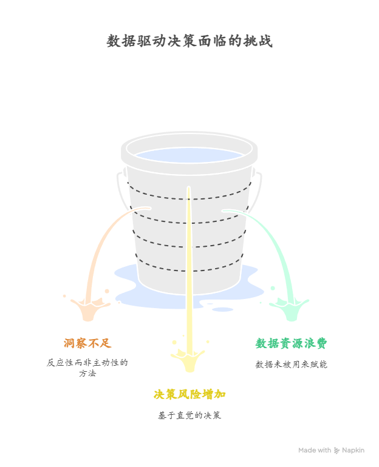

# Minimalist Gomoku (WuziQ)

A command-line Gomoku implementation written in pure Python. The game defaults to a
15x15 board and supports simple two-player matches with coordinate-based input.

## Installation & Requirements

The core game logic depends only on the Python standard library. To use the web
interface install the additional dependency listed in `requirements.txt`:

```bash
pip install -r requirements.txt
```

## Running the Web UI

Launch the lightweight Flask server and open the exposed address (default
`http://127.0.0.1:8000`) in a browser:

```bash
python -m src.webapp
```

The server binds to `0.0.0.0:8000`, making it suitable for Codespaces or other
remote development environments—simply forward port 8000 and open it from your
local browser. The page lets you click cells to place stones, undo moves, reset
the board, or change the AI side.

## Running the Desktop UI

The Tkinter-powered desktop client provides an offline experience with mouse
input, undo/reset controls, and AI side toggling. Launch it with:

```bash
python -m src.ui_tk --size 15 --ai white
```

The window highlights the latest move and displays whose turn it is along the
top bar. Buttons at the bottom let you undo the last turn (rewinding paired AI
and player moves), reset the match, or cycle the AI side between off/black/white.



### Windows portable build

Run the helper script to produce a standalone `WuziQ.exe` using PyInstaller on
Windows 11:

```bat
scripts\build_win.bat
```

The same steps are executed automatically in CI by the
`.github/workflows/build-win.yml` workflow, which uploads the packaged binary as
a build artifact.

## Running the Game (CLI)

You can start a terminal match using either of the following commands:

```bash
python -m src.cli
```

```bash
python src/cli.py
```

Optional flags:

- `--size N` — change the board dimension (minimum 5). For example, to play on a
  10x10 board:

  ```bash
  python -m src.cli --size 10
  ```

- `--ai {off,black,white}` — enable a simple AI opponent. `black` lets the AI
  play first, `white` makes the AI respond to the human's black stones. The
  default is `off` (two human players).

During play you can enter moves such as `H8` (column letter, row number) or
space-separated numeric coordinates like `8 7`. Game commands are prefixed with a
colon:

- `:undo` — undo the previous move (in AI games this rewinds the AI and human
  moves together).
- `:save filename.json` — store the current game state to disk.
- `:load filename.json` — resume a saved game.
- `:quit` — abort the match.

## Example Gameplay

```
Minimalist Gomoku
Board size: 10x10

    A B C D E F G H I J
 1  . . . . . . . . . .
 2  . . . . . . . . . .
 ...
Player B, enter your move: H8

AI (W) plays H9.

Player B, enter your move: :save demo.json
Game saved to demo.json.

Player B, enter your move: :undo
Undid the latest AI and player moves to maintain turn order.
```

## Running Tests

```bash
pytest -q
```

## Design Notes

- **Board Representation:** the board is a `GomokuBoard` data class wrapping a
  2D list of optional player identifiers (`"B"` or `"W"`).
- **Move Parsing:** user input is interpreted by `parse_move`, accepting both
  chess-style (`H8`) and numeric (`8 7`) coordinates.
- **Win Detection:** after each move, `check_victory` counts contiguous stones in
  four directions (horizontal, vertical, and the two diagonals). A run of five or
  more stones signals victory.
- **Command Line Loop:** the CLI alternates between players, printing the board
  after each valid move and exiting when either a player wins or the board fills
  up.

## Four-AI Research Study

The research branch adds four independently selectable opponents while reusing
the existing board and win rules:

- **A:** the original heuristic rule AI (baseline)
- **B:** plain Minimax
- **C:** Minimax with Alpha-Beta pruning
- **D:** UCT Monte Carlo Tree Search without a neural network

The web UI lets a player choose A, B, C, or D. The same selector is available
to automated matches. B and C share candidate generation, move ordering,
evaluation, and configurable depth; only C prunes. The reproducible tournament
configuration is `configs/four_ai_experiment.json`. Each game is appended to a
JSONL file and progress is atomically recorded, so rerunning the command resumes
without counting completed game IDs twice.

Run or resume the configured 9x9 round robin and 15x15 supplement from the
repository root:

```bash
python -m src.research.runner --config configs/four_ai_experiment.json --output research/results
```

Recompute summary tables and confidence intervals from the saved games:

```bash
python scripts/summarize_four_ai.py
```

Replay all saved moves and verify that the six pairings, paired color swaps,
unique IDs, winners, and terminations match the configuration:

```bash
python scripts/validate_four_ai_results.py
```

Re-run the fixed-depth Minimax/Alpha-Beta equivalence and node-count study, plus
the equal-time tournament summary:

```bash
python scripts/run_four_ai_efficiency.py \
  --config configs/four_ai_experiment.json \
  --games research/results/9x9_games.jsonl \
  --output research/results/efficiency.json
```

The raw records, metrics, preflight estimate, recovery drill, and Chinese
research report are saved under `research/`. This project performs algorithm
development and match evaluation; it does not train a neural network or produce
training checkpoints.

V4 measures A/B/C search performance on 12 fixed 9x9 positions at seven time
budgets. Reproduce its preflight, resumable measurements, or validated report
from the repository root with:

```bash
python scripts/run_abc_search_v4.py preflight
python scripts/run_abc_search_v4.py run
python scripts/run_abc_search_v4.py analyze
```

The V4 config, 252 raw measurements, summary, trend figures, recovery metadata,
and Chinese report are under `configs/abc_search_compute_v4.json` and
`research/v4/`.
