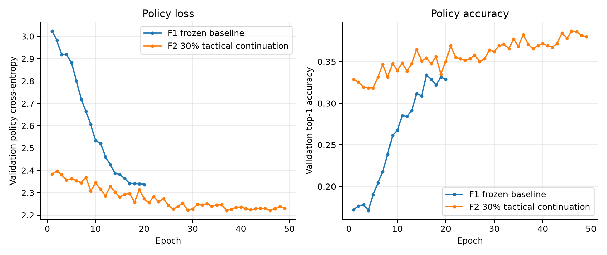
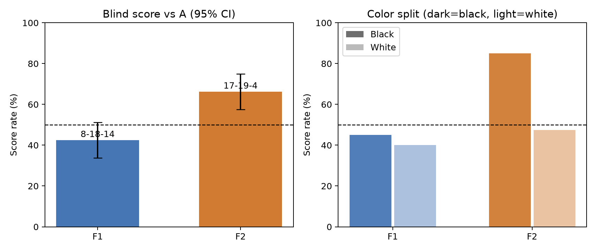
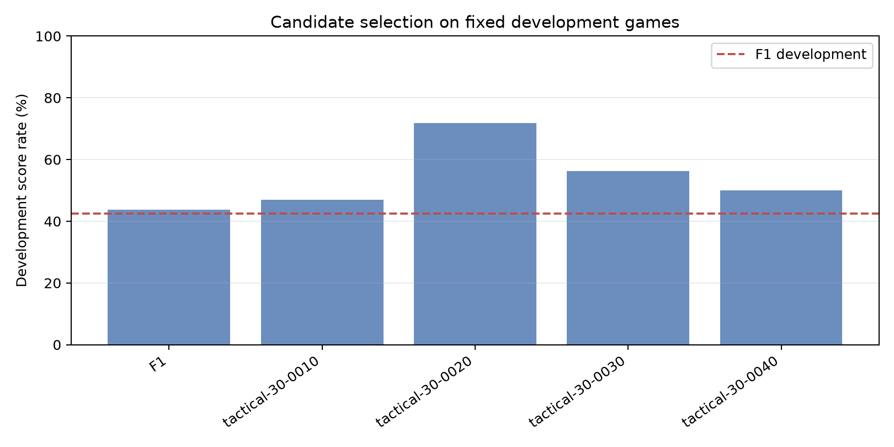

# WuziQ F V2｜模仿学习续训与规则AI盲测

## 结论摘要

F2在20组全新开局、每组黑白各一局的40局最终盲测中取得 **17胜 19平 4负**，得分率 **66.2%**，按配对开局自助法得到95%区间 **57.5%–75.0%**。区间下限高于50%，支持F2在本次已登记配对赛程上的总体得分率超过50%。但只有20组开局，且白棋得分率低于50%，不足以概括成跨颜色、跨开局都稳定胜过A。

冻结对照F1在完全相同的40局中为 **8胜 18平 14负**，得分率 **42.5%**，95%区间 **33.8%–51.2%**。F2较F1提升 **23.8个百分点**；配对差值95%区间 **10.0至36.2个百分点**。在这20组开局的配对自助区间中，F2提升区间高于零；但F2白棋得分仍低于50%，优势主要来自执黑，应继续以换色样本验证泛化。

F2执黑得分率为85.0%（14胜6平0负），执白为47.5%（3胜13平4负）。白棋结果偏弱；不能把总分点估计掩盖的先后手差异解释为稳定棋力优势。

## 实验设置与公平性

- 9×9规则与A沿用仓库既有实现；F1权重冻结为 `research/f_v1/checkpoints/best.pt` 的副本，SHA-256：`8d3cbeefb3b0ec75a4ec769b9852327f7411e8836f87a4add80d9cff2516e51f`。
- F2沿用F1的32通道、2个残差块CNN策略价值双头。仅以F1权重初始化再监督续训，不扩大网络，不做强化学习。
- 全程CPU，PyTorch 2.15.0+cpu，预检观测3个逻辑CPU、约9GiB可用内存、无CUDA。A与F1/F2在相同机器和相同开局下对弈；A采用自然决策时间，上限50ms且没有人为等待。
- 预先固定16个训练开局、8个开发开局、20个最终盲测开局；三组开局互不重叠，盲测开局也不在历史/预检排除集合内。每个开局均交换黑白。
- 预检按CPU实测速率估计主任务耗时：乐观408秒、中性504秒、保守1,470秒；实际见本报告耗时统计。
- 开发赛只用于模型选择；F2选中 `tactical-30-0020`（第20轮候选）。选择规则为开发赛得分最高，平分时比较验证策略交叉熵。F1盲测和F2盲测均使用同一冻结40局赛程。
- 所有F落子都经过回放审计，必须等于合法落点掩码后的策略网络argmax。推理没有即时胜棋、必防或其他手写战术覆盖。

## 数据与训练

| 数据项 | 结果 |
|---|---:|
| F1历史训练局面 | 10,332 |
| F1-A新训练对局 | 32局（16开局×换色） |
| F1实战决策标注 | 911条：C 371，E5 510，精确规则攻防 30 |
| 新标注去重状态 | 909；与F1训练集相同状态跳过 2 个 |
| 训练局面（30%攻防混合） | 14,898行，实际攻防占比 30.0% |
| 独立验证局面 | 1,140；训练状态交集 0 |
| 最终盲测策略局面（仅模型选定后评估） | 1,394；训练状态交集 0 |

对攻防短板的处理只改变训练标签与训练采样：精确五连规则标注直接获胜和唯一必防，其他F1真实决策由C/E5轮换标注。40%攻防版本已生成并保留，但30%模型开发得分达到预注册55%门槛，按计划未启动第二次训练。

### 标注修正与盲测隔离

审计发现DAgger原始精确攻防落点需要随D4规范化变换同步转换。修正前后的文件分开保存；修正后的规则标签均以规范化棋盘坐标表示，并有非对称棋形单元测试验证。重跑C/E5的200ms时限标注后，少量普通局面标签随截止时序发生变化，导致训练文件SHA变化。因此首轮候选及其80局赛果保存在 `results/precorrection/`，仅作探索记录，不纳入本报告的最终胜率，也未用于修正版选模。最终20组开局在此之后确定，并明确排除训练、开发和首轮盲测组；修正版F1/F2各40局只在这套新开局上完成一次。

30%版本在CPU上训练 **49轮 / 11,417次更新**，训练计时 **308.9秒（5.15分钟）**；最优验证策略损失在第37轮。实际入选的是开发赛最佳第20轮候选，而非验证损失最佳轮次。

## 最终换色盲测

挑战者得分按胜1、平0.5、负0计；区间以20个配对开局为抽样单位，避免把同开局换色两局当作完全独立样本。

| 模型 | 胜-平-负 | 积分 | 得分率 | 配对开局95%区间 | 黑棋得分率 | 白棋得分率 |
|---|---:|---:|---:|---:|---:|---:|
| F1（冻结） | 8-18-14 | 17.0/40 | 42.5% | 33.8%–51.2% | 45.0% | 40.0% |
| F2（第20轮） | 17-19-4 | 26.5/40 | 66.2% | 57.5%–75.0% | 85.0% | 47.5% |

F2−F1配对差值：23.8个百分点，95%区间10.0至36.2个百分点。两版共80局、每版40局；原始完整棋谱分别保存在 `results/blind/matches_f1.jsonl` 和 `matches_f2.jsonl`。

## 学习到的能力与失败模式

在V1原有的1,394个未用于F2训练状态的策略标签上，F1 Top-1为41.6%、F2为43.0%；策略损失从1.861降到1.812。价值MAE从0.085变为0.093，略有变差，因此价值头仍未显示明确提升。

精确生成的盲测战术题共103题，其中直接胜棋99题、唯一必防4题：

| 能力 | F1 | F2 |
|---|---:|---:|
| 直接胜棋 | 95/99（96.0%） | 98/99（99.0%） |
| 唯一必防 | 1/4（25.0%） | 3/4（75.0%） |

这些战术结果样本很小，尤其必防只有4题。对最终盲测输局逐手按精确五连检查：F1输14局中漏掉即时胜点4次、漏掉唯一必防11次；F2输6局中未发现漏掉即时胜点，但仍漏掉唯一必防4次。F2主要剩余短板由主动攻胜遗漏转向了复杂局面下的防守选择；这些是输局中的战术失误计数，不等同于全部落子的策略准确率。

## 推理速度和设备

最终实战记录的完整决策耗时（含棋盘编码和策略前向）如下。模型前向评测使用100个单局面的CPU计时样本；均值受少量系统抖动影响，重点参考中位数与P95。

| 模型 | 完整决策中位数 | 完整决策P95 | 网络前向中位数 | 网络前向P95 |
|---|---:|---:|---:|---:|
| F1 | 0.814 ms | 1.283 ms | 0.309 ms | 0.514 ms |
| F2 | 0.797 ms | 1.181 ms | 0.307 ms | 0.461 ms |

F2与F1结构相同，续训未造成明显推理开销增加。对A的实战局中，每版记录了1088和983个网络落子。完整合法性回放和纯网络argmax审计结果见 `results/integrity.json`。

## 开发候选与训练曲线

固定开发集共8组开局、16局/候选。候选比分仅用于选择，不能视为最终能力估计。

| 候选 | 开发赛胜-平-负 | 得分率 | 验证策略损失 |
|---|---:|---:|---:|
| F1 | 4-6-6 | 43.8% | 2.337 |
| tactical-30-0010 | 4-7-5 | 46.9% | 2.345 |
| tactical-30-0020 | 7-9-0 | 71.9% | 2.273 |
| tactical-30-0030 | 7-4-5 | 56.2% | 2.226 |
| tactical-30-0040 | 3-10-3 | 50.0% | 2.235 |








## 能否稳定战胜A、能否进入G

**F2在本次配对盲测总体上超过A，但稳定性结论需要限定。** 得分率为66.2%，配对开局95%区间为57.5%–75.0%，本次区间下限高于50%；相同开局下较F1提高23.8个百分点，差值区间不含零。另一方面，F2执白得分率只有47.5%，20组开局仍是小样本，所以不能称为已证明在任意颜色和开局都稳定战胜A。下一阶段可将F2作为G的初始化基线，但应先保留F1/A对照，并重点改善白棋防守。**本轮没有启动G，也没有强化学习训练。**


## 可复现方式与产物

### 自动化验证

适用测试为 **307项通过、1项跳过**。测试命令及明确排除的后续版本专属测试记录在 `results/test_results.json`；这些V6.2/V6.3分支守卫测试不属于本F1基线分支的实现范围。完整数据、盲测棋谱回放、合法落子及纯网络策略审计：**passed**；F2后续G接口加载：**passed**。

```bash
python scripts/collect_f_v2_data.py
python scripts/prepare_f_v2_dataset.py
python scripts/run_f_v2_training_and_selection.py
python scripts/run_f_v2_final_blind.py
python scripts/report_f_v2.py
pytest -q
```

随机种子、训练/开发/盲测开局、checkpoint哈希、数据清单和逐局唯一ID均记录在 `config/experiment.json`、`data/manifest.json` 和各结果文件中。复现需要使用V1基线提交和保存的CPU依赖环境；最终模型为 `checkpoints/best_f2.pt`，F1冻结对照为 `checkpoints/f1_reference.pt`。

有效修正版的C/E5标注、数据准备、训练/开发选择和最终盲测共约449.4秒（7.49分钟），其中训练本身308.9秒、选择流水线墙钟318.8秒、最终盲测运行11.0秒。首轮预修正探索流程耗时470.5秒；含该轮与修正版的实验计算总耗时约919.8秒（15.33分钟），不含代码开发和最终测试时间。完整数据完整性状态：passed。
