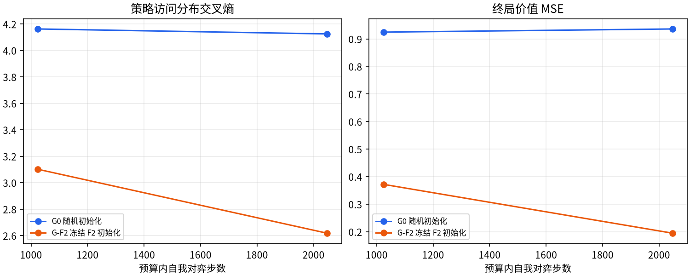
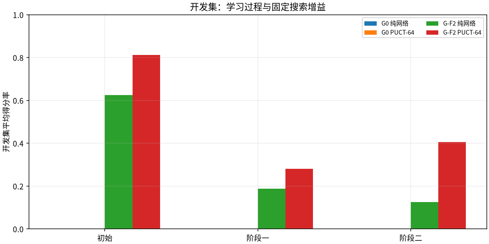
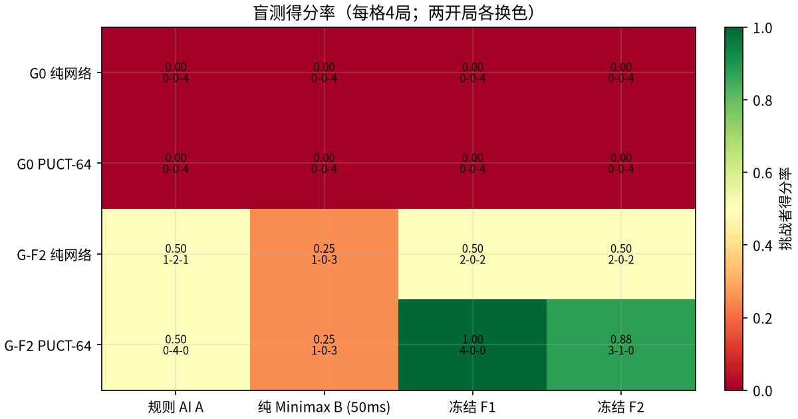

# WuziQ G V1：AlphaZero-Lite 自我对弈强化学习报告

## 摘要

本轮实现策略价值网络引导的 PUCT-MCTS 与终局胜负自我对弈训练，比较随机初始化 G0 和冻结 F2 初始化 G-F2。训练标签只来自各自完整自我对弈中的 MCTS 根访问分布和终局胜负；没有读取 F1/F2 监督样本行、C/E5 教师标签，也没有加战术奖励或推理规则补丁。

- 正式训练棋谱：319 局；开发评估 192 局；盲测 64 局。另有 8 局仅用于预检。
- 两臂各有 2,048 个预算内自我对弈步、128 次优化更新、每步 64 次 PUCT 模拟。
- 正式训练与评估累计记录 CPU 时间 345.1 秒，其中自我对弈/训练 253.3 秒、评估对局 91.7 秒。评估 CPU 时间按已落盘逐局记录求和。
- 按预检、两臂训练和逐局评估的计时器相加，本轮已测阶段 wall time 348.8 秒（预检 3.9、训练 253.4、评估 91.6）；不含启动、报告、测试及 Drive 网络传输。
- 结果为探索性小样本，盲测每个算法/对手仅 4 局、来自 2 个配对开局，不代表稳定棋力等级。

## 主要结论

1. **G0 从随机权重起步，本预算内没有表现出可见棋力提升。** 三个开发节点的 G0 PUCT 得分均为 0；盲测中选出的初始模型纯网络和 PUCT 对 A、B、F1、F2 均为 0/0/4。交叉熵变化很小，价值误差未显示稳定改善。
2. **F2 初始化带来更强的起点表现，但本轮自我对弈训练没有保住这份棋力。** 开发集按预注册规则选择了 G-F2 初始 checkpoint；阶段一、阶段二 PUCT 得分均低于初始模型。F2 初始化的起点优势有实测证据，训练加速或棋力提升则没有。
3. **固定 64 次 PUCT 搜索比同一 G-F2 初始网络有提升，但收益来自搜索。** 最终盲测平均得分率由纯网络 0.438 变为 PUCT 0.656，差 +0.219。这不是神经网络训练增益。
4. **暂不建议扩大同一训练流程的预算。** 应先查明 G-F2 self-play replay 学到的行为为何导致开发棋力下降，并改善候选模型验证/回退机制；G0 则需要有更强探索与自我对弈质量的诊断。

### 最终盲测概览

| 探索排名（PUCT 均分） | 棋手 | 得分率 | 对局数 | 开发选择 checkpoint |
|---:|---|---:|---:|---|
| 1 | G-F2 冻结 F2 初始化 | 0.656 | 16 | `initial` |
| 2 | G0 随机初始化 | 0.000 | 16 | `initial` |

## 算法与数据

- 网络复用 F2 的 9×9、32 通道、2 个残差块结构，输入为当前方、对手、空格三平面；策略头输出 81 个落点，价值头从当前行棋方视角输出 [-1,1]。
- 每个搜索节点用网络策略先验扩展合法空位，PUCT 选择使用 `-Q(child) + c_puct·prior·sqrt(parent visits)/(1+child visits)`；反向传播每跨一手翻转价值符号。根节点训练时混入 Dirichlet 噪声，评估关闭噪声。
- 训练策略目标为根节点访问概率，价值目标为实际终局结果。开局只初始化局面，不计训练状态。温度前 12 个自我对弈步为 1，之后为 0.1。
- 经验池严格按臂隔离，按游戏均匀抽样；D4 旋转/镜像同步变换棋盘与策略目标。每臂使用 AdamW、固定学习率调度、批量 16、128 次更新。
- 每阶段完成整局以获得终局标签；超出环境步配额的尾部状态不进入训练，并单独报告。
- 自我对弈终局有明显黑先偏差：G0 黑胜 42、白胜 27；G-F2 黑胜 191、白胜 59，均无和棋。训练局从空盘固定由黑先，这种结果分布可能影响价值样本；颜色成对的外部评估单独对冲了部分先手偏差。

## 预检与资源预算

- 环境：PyTorch 2.15.0+cpu，3 个可用 CPU 核，单线程训练/搜索，无 CUDA。可用 RAM 9.0 GiB，预检峰值 RSS 219 MiB，预检时磁盘可用 27.6 GiB。
- 实测每步时间（3 种局面、每档重复 2 次）：

| 模拟数 | 平均单步耗时 |
|---:|---:|
| 16 | 23.3 ms |
| 32 | 30.1 ms |
| 64 | 60.2 ms |

- 注册前的正式运行估算：乐观 3.5 分钟，中性 5.3 分钟，保守 10.7 分钟；硬上限 2.0 CPU 小时。估算包括 256 场开发/盲测和两臂 64-simulation 训练。
- 每臂真实完成预检自我对弈 2 局；AdamW 预检吞吐约 120.9 / 127.0 次更新/秒。

## 训练结果

| 臂 | 完成自我对弈局 | 预算内状态 | 实际状态 | 超额终局尾步 | 实际模拟数 | 平均访问熵 | 更新数 | CPU 秒 |
|---|---:|---:|---:|---:|---:|---:|---:|---:|
| G0 随机初始化 | 69 | 2048 | 2066 | 18 | 132,224 | 3.207 | 128 | 132.5 |

**G0 随机初始化 阶段损失**：

| 阶段预算步 | 策略交叉熵 | 价值 MSE | 总损失 | 更新数 |
|---:|---:|---:|---:|---:|
| 1024 | 4.1622 | 0.9245 | 5.0867 | 64 |
| 2048 | 4.1248 | 0.9361 | 5.0608 | 128 |

自我对弈终局颜色：黑胜 42、白胜 27、平局 0。平均完整局自我对弈步数 29.9。

| G-F2 冻结 F2 初始化 | 250 | 2048 | 2055 | 7 | 131,520 | 1.951 | 128 | 120.9 |

**G-F2 冻结 F2 初始化 阶段损失**：

| 阶段预算步 | 策略交叉熵 | 价值 MSE | 总损失 | 更新数 |
|---:|---:|---:|---:|---:|
| 1024 | 3.1011 | 0.3718 | 3.4729 | 64 |
| 2048 | 2.6175 | 0.1944 | 2.8119 | 128 |

自我对弈终局颜色：黑胜 191、白胜 59、平局 0。平均完整局自我对弈步数 8.2。



### 开发集模型选择（只用于选择，不用于最终宣称）

冻结选择规则为：对 A/B/F1/F2 的 PUCT 模式平均得分最高；平分选更早阶段。最终选择 G0=`initial`、G-F2=`initial`。

| 臂 | 模式 | 初始开发得分率 | 被选 checkpoint | 被选开发得分率 |
|---|---|---:|---|---:|
| G0 随机初始化 | 纯网络 | 0.000 | `initial` | 0.000 |
| G0 随机初始化 | PUCT-64 | 0.000 | `initial` | 0.000 |
| G-F2 冻结 F2 初始化 | 纯网络 | 0.625 | `initial` | 0.625 |
| G-F2 冻结 F2 初始化 | PUCT-64 | 0.812 | `initial` | 0.812 |



## 最终盲测：纯网络与固定预算 PUCT

每个棋手/对手/推理模式 4 局：2 个未见配对开局，每个开局各换黑白。得分率为 (胜 + 平/2)/局数；95% 区间按配对开局簇 bootstrap，只有 2 个簇，区间非常粗糙。

| 棋手 | 模式 | 对手 | W–D–L | 得分率 | 配对95%区间 | 黑方得分率 | 白方得分率 | 模拟/局 | 节点/局 | 树深 | 网络/选择熵 | 决策秒/局 |
|---|---|---|---:|---:|---:|---:|---:|---:|---:|---:|---:|---:|
| G-F2 冻结 F2 初始化 | 纯网络 | 规则 AI A | 1–2–1 | 0.500 | [0.25, 0.75] | 0.750 | 0.250 | 0 | 0 | 0.0 | 2.092 | 0.024 |
| G-F2 冻结 F2 初始化 | 纯网络 | 纯 Minimax B (50ms) | 1–0–3 | 0.250 | [0.00, 0.50] | 0.500 | 0.000 | 0 | 0 | 0.0 | 1.501 | 0.004 |
| G-F2 冻结 F2 初始化 | 纯网络 | 冻结 F1 | 2–0–2 | 0.500 | [0.00, 1.00] | 0.500 | 0.500 | 0 | 0 | 0.0 | 1.847 | 0.008 |
| G-F2 冻结 F2 初始化 | 纯网络 | 冻结 F2 | 2–0–2 | 0.500 | [0.50, 0.50] | 0.500 | 0.500 | 0 | 0 | 0.0 | 1.960 | 0.006 |
| G-F2 冻结 F2 初始化 | PUCT-64 | 规则 AI A | 0–4–0 | 0.500 | [0.50, 0.50] | 0.500 | 0.500 | 2464 | 90494 | 9.0 | 0.000 | 2.211 |
| G-F2 冻结 F2 初始化 | PUCT-64 | 纯 Minimax B (50ms) | 1–0–3 | 0.250 | [0.00, 0.50] | 0.500 | 0.000 | 544 | 34563 | 5.2 | 0.000 | 0.523 |
| G-F2 冻结 F2 初始化 | PUCT-64 | 冻结 F1 | 4–0–0 | 1.000 | [1.00, 1.00] | 1.000 | 1.000 | 1056 | 57472 | 7.0 | 0.000 | 0.938 |
| G-F2 冻结 F2 初始化 | PUCT-64 | 冻结 F2 | 3–1–0 | 0.875 | [0.75, 1.00] | 1.000 | 0.750 | 1568 | 70536 | 7.2 | 0.000 | 1.425 |
| G0 随机初始化 | 纯网络 | 规则 AI A | 0–0–4 | 0.000 | [0.00, 0.00] | 0.000 | 0.000 | 0 | 0 | 0.0 | 4.199 | 0.008 |
| G0 随机初始化 | 纯网络 | 纯 Minimax B (50ms) | 0–0–4 | 0.000 | [0.00, 0.00] | 0.000 | 0.000 | 0 | 0 | 0.0 | 4.302 | 0.003 |
| G0 随机初始化 | 纯网络 | 冻结 F1 | 0–0–4 | 0.000 | [0.00, 0.00] | 0.000 | 0.000 | 0 | 0 | 0.0 | 4.289 | 0.003 |
| G0 随机初始化 | 纯网络 | 冻结 F2 | 0–0–4 | 0.000 | [0.00, 0.00] | 0.000 | 0.000 | 0 | 0 | 0.0 | 4.282 | 0.003 |
| G0 随机初始化 | PUCT-64 | 规则 AI A | 0–0–4 | 0.000 | [0.00, 0.00] | 0.000 | 0.000 | 576 | 38445 | 1.5 | 0.000 | 0.562 |
| G0 随机初始化 | PUCT-64 | 纯 Minimax B (50ms) | 0–0–4 | 0.000 | [0.00, 0.00] | 0.000 | 0.000 | 208 | 15460 | 1.0 | 0.000 | 0.208 |
| G0 随机初始化 | PUCT-64 | 冻结 F1 | 0–0–4 | 0.000 | [0.00, 0.00] | 0.000 | 0.000 | 256 | 18842 | 1.0 | 0.000 | 0.253 |
| G0 随机初始化 | PUCT-64 | 冻结 F2 | 0–0–4 | 0.000 | [0.00, 0.00] | 0.000 | 0.000 | 304 | 22012 | 1.0 | 0.000 | 0.301 |



### 逐模型对照

表中纯网络熵是合法落点 softmax 熵；PUCT 评估采用温度 0 的确定性落子，故该熵按定义为 0，并非根节点访问分布的熵。训练期的 MCTS 访问目标熵另见上表；评估棋谱记录所选动作、模拟数、节点与深度，没有保存整条 81 格根访问向量。

- G-F2 同一初始 checkpoint：纯网络平均得分率 0.438；PUCT-64 为 0.656。PUCT-64 共 22,528 次模拟，评测决策 CPU 22.2 秒；纯网络决策 CPU 1.2 秒。
- G0 初始随机网络：纯网络和 PUCT-64 对四个对手在本盲测中均未得分；这是 4 局/对手的小样本结果。
- G-F2 PUCT-64 对 F1 为 4–0–0、对 F2 为 3–0–1；对 A 为 0–4–0；对 B 为 1–0–3。纯网络对 A 为 1–2–1、对 B 为 1–0–3、对 F1/F2 均为 2–0–2。单组对局不能当作稳定胜率。
- 价值头在每步估计与该局终局结果的 MSE（PUCT 用根价值，纯网络用策略网络价值）：

| 推理模式 | 被评估的 agent 落子数 | 终局价值 MSE |
|---|---:|---:|
| 纯网络 | 297 | 0.9345 |
| PUCT-64 | 436 | 0.6581 |

## 搜索收益与学习收益拆分

- **网络学习收益**用同一臂的初始与训练阶段模型、相同开发开局、相同搜索模拟预算比较。G0 未显示提升；G-F2 阶段一/二都不如初始模型，开发选择器回退到了 F2 初始权重。
- **搜索收益**用同一选定 checkpoint、相同盲测开局，比较纯策略网络与固定 64 模拟 PUCT。G-F2 得分率差值见摘要，属于搜索带来的额外计算，不应算作训练提升。G0 两种方式都未取得得分。
- 本轮没有额外关掉 root noise、温度或价值头的独立消融，也未引入传统战术模块；因此不能把结果归因于某个训练组件。

## 失败案例、局限与解释

1. G0 的自我对弈数据来自随机先验的 PUCT，结果没有转化成对冻结对手的可见提升。可能原因包括：预算与更新数较小、从自我生成的弱策略闭环学习、有限 replay 中双方相似导致的策略模式坍塌，以及只有终局结果的延迟价值信号。报告保存每局棋谱，便于后续逐盘检查。
2. G-F2 的策略和值损失都下降，但开发棋力下降，说明对自生成访问分布的拟合不等于对冻结对手的实力提升。监督预训练留下的能力在少量自我对弈更新后发生遗忘/漂移，是本轮最需要进一步诊断的现象。模型选择规则保留了初始权重，没有把更低训练损失误当成更强棋力。
3. G-F2 PUCT 的对手结果显示搜索能显著改变决策，尤其对 F1/F2；但 A 对局主要为平局，B 仍占优势。每个盲测对手仅 4 局，区间由 2 个开局组产生，任何排名都只是探索性。
4. 两臂共有相同的预算内步数、每步模拟数、优化更新数和评测开局。实际完成局数、终局尾部和模拟总量会因终局长度不同；这些差异已单独记录，超额尾部未进入 replay。
5. 每个对手仅有 2 个开局组，黑白交换可以抵消部分先手偏差，却不能覆盖五子棋的开局多样性。A/B/F1/F2 结果均冻结；本轮未评测 C，也未运行 15×15。
6. 盲测中一盘 G0 纯网络对 A 的复核棋谱显示直接漏防：`blind-G0-initial-network-A-g-open-9dd29e3652e6f3a368b6-B` 第 29 手，G0（黑）落在 0 起始坐标 `[1, 4]`；此时 A 只有一个立即成五点 `[4, 5]`，下一手 A 即获胜。该盘展示了随机初始化策略未能处理一步必防威胁，单盘不能代表全部失利。

## G V2 建议

暂缓单纯增加相同配置的训练步数。先进行棋谱诊断和一个小范围开发实验：对比阶段 checkpoint 与 F2 初始网络的策略分布/合法落点熵、回放局面覆盖和终局颜色偏差；加入候选模型晋级门槛与自动回退；监控网络纯落子和同预算 PUCT 的开发对局。如果阶段模型连续不能保留 F2 起点棋力，则保留 F2 为 incumbent，训练不足以晋级。G0 则需要先证明其价值估计和探索产生的策略多样性有效，再扩大算力。

## 复现、完整性与恢复

```bash
source /workspace/.venv-wuziq-f-v1/bin/activate
OMP_NUM_THREADS=1 MKL_NUM_THREADS=1 PYTHONPATH=. python scripts/preflight_g_v1.py --torch-threads 1 --seed 510601
PYTHONPATH=. python scripts/register_g_v1_budget.py --simulations 64 --environment-steps 2048 --updates 128 --batch-size 16 --replay-capacity 4096 --cpu-hour-cap 2
OMP_NUM_THREADS=1 MKL_NUM_THREADS=1 PYTHONPATH=. python scripts/run_g_v1.py
OMP_NUM_THREADS=1 MKL_NUM_THREADS=1 PYTHONPATH=. python scripts/evaluate_g_v1.py --phase all
PYTHONPATH=. python scripts/report_g_v1.py
```

- 注册配置 SHA-256：`6dfa8fa94bc53517810ac2f8b6002f23101e9057b0604b4688a24c671d0dc4b4`；F2 checkpoint SHA-256：`50164ad9b139e0c47c1b1af7497f670c26e9864a81c10c02de0ff4426b2d0257`。G 检查点使用与 F 兼容的文件格式，可通过 `load_g_checkpoint` 加载。
- 自我对弈 JSONL 每局原子追加并 fsync；ID 唯一；训练状态包含模型、优化器、学习率调度、Python/NumPy/Torch RNG、replay 和进度。训练中断测试与不中断运行权重一致。
- 棋谱回放校验了交替落子、占用格、终局、胜者、训练状态前缀和目标值；评测棋谱使用相同规则复核。开发 192 局、盲测 64 局的原始记录与摘要数字在 `results/evaluation/`。
- `results/integrity.json` 保存并复核配置、开局池、原始训练/评测日志、所有 G 检查点、冻结 F1/F2 权重、报告、图表、G 代码及专项测试的 SHA-256 与文件大小。
- Google Drive G V1 专属目录已通过上传、下载、SHA-256 与空目录恢复实测；恢复包只包含最新 G V1 快照，不接触旧实验备份。
- 测试：G 专项 26 项通过；适用于本独立分支的全仓测试 333 项通过、1 项跳过。未过滤全仓测试另有 11 项 V6.2/V6.3 测试因其主动校验当前 Git 分支必须分别为 `research/champion-200s-v6-2` 或 `research/champion-tiebreak-v6-3` 而失败；这 4 个历史分支专属测试文件未修改。
- 本轮无神经网络训练 checkpoint 以外的模型产物；没有神经网络外部数据、强化学习 checkpoint 或 AlphaZero 既成胜率。

## 结论

本轮验证了 AlphaZero 式 PUCT、自我对弈终局价值学习、双臂独立训练和完整恢复链路可以运行，但这份有限预算没有证明随机初始化网络能学出可战胜传统棋手的能力。F2 初始化给出更强起点；当前学习更新却降低了开发表现，因此最终保留了 F2 初始模型。相同网络通过 64 次 PUCT 搜索获得额外棋力，但还不足以稳定战胜 B，面对 A 主要打平。下一阶段应先修复/理解训练后退化，再决定是否扩大算力。
