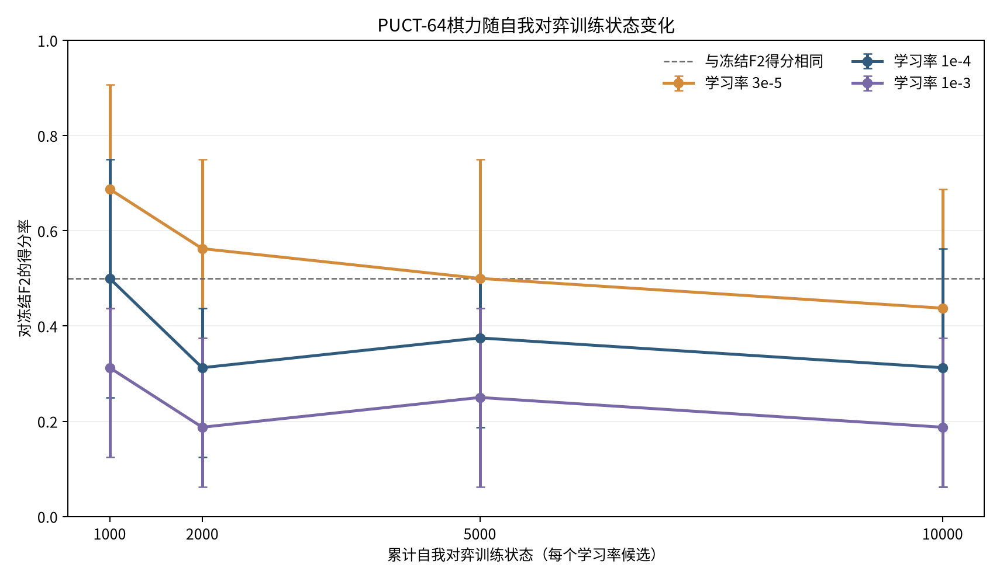
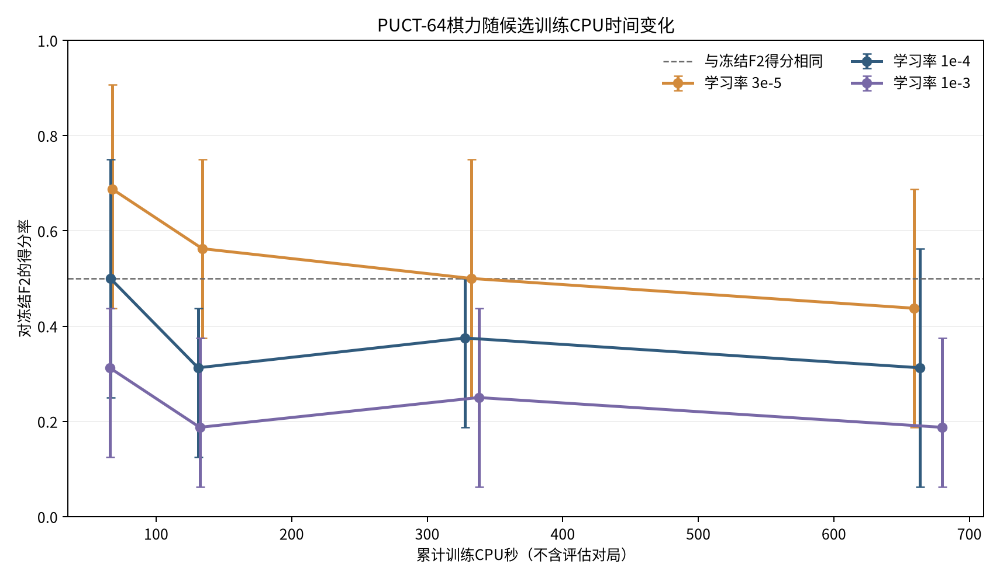
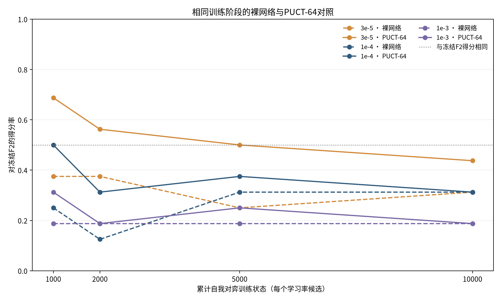

# G-F2自我对弈在本轮预算下是否产生可复核成长

## 结论摘要

- 本轮使用同一个冻结 F2 网络作为三条学习率候选的初始化；固定每步 PUCT-64，不引入教师标签、F 监督样本或人工战术奖励。正式训练完成 30,000 个预算内状态和 1,875 次更新，实际盲测 560 局。
- G-F2 PUCT-64 对冻结 F2 的成对得分率为 **0.200**，差值 -0.600，95% 配对开局区间 [0.100, 0.300]。
- 按相同 64 模拟搜索比较，训练后 G-F2 得分率为 0.200，冻结 F2 为 0.800；差值 -0.600，因此本轮没有证明自我对弈学习带来棋力提升。
- 固定 checkpoint 的搜索收益：F2 从裸网络 0.100 提高到 PUCT-64 0.900；G-F2 从 0.275 提高到 0.725。这是增加搜索带来的收益，不是网络训练增益。
- 开发赛冠军仍为 `F2@0`；供盲测的最佳开发候选为 `lr_1e4@10000`。只有满足预注册冠军门槛的候选才替换 F2。
- 实际总 CPU 时间约 0.87 CPU 小时，活动墙钟约 0.84 小时；2 CPU 小时上限未扩大。20,000 状态节点为**未执行**，本轮每个学习率候选登记上限为 10,000 状态。

## 实验设计与计算预算

- 基线提交：`6e2bf48aa6b630c0fa4f20284ceb3b5aab295080`；冻结 F2 SHA-256：`50164ad9b139e0c47c1b1af7497f670c26e9864a81c10c02de0ff4426b2d0257`；开局表 SHA-256：`047c4a03d32c0066a0114e3f7a4a118991e109f09187ab9d0d0067fc492248ee`。
- 预检实测 12.14 秒墙钟 / 12.13 CPU 秒；正式估算乐观、中位、保守分别为 3544/4725/5907 CPU 秒。资源：3 个可用逻辑 CPU，设备 `cpu`，可用内存 8.9 GiB，PyTorch 2.15.0+cpu。
- 网络复用冻结 F2 的 9×9、32 通道、2 残差块策略价值结构。三个独立候选从相同 F2 权重初始化，学习率为 3e-5、1e-4、1e-3；相同 PUCT-64、每 16 个预算状态更新一次、batch 16、独立经验池和优化器。策略目标是自我对弈访问分布，价值目标是终局胜负。
- 训练里程碑为 1k、2k、5k、10k；20,000 状态节点**未执行**。三个候选分别运行、使用相同训练预算并按同一开发计划比较；不把增加搜索次数当作学习收益。

## 训练规模、过程损失与自我对弈分布

| 候选学习率 | 完整自我对弈局 | 预算状态 | 实际环境步 | 终局尾步 | 更新数 | 训练CPU秒 | 执行状态 |
|---|---:|---:|---:|---:|---:|---:|---|
| 3e-5 | 1234 | 10,000 | 10,018 | 18 | 625 | 659.0 | 完成 |
| 1e-4 | 1309 | 10,000 | 10,017 | 17 | 625 | 663.3 | 完成 |
| 1e-3 | 1296 | 10,000 | 10,008 | 8 | 625 | 679.9 | 完成 |

实际环境步多于预算状态的部分来自完成当前整局以取得终局标签；超额状态未进入训练目标或经验池。三个候选实际完成 30,043 个环境步（登记预算 30,000），多出的 43 步仅为终局尾部。各节点损失、熵、价值误差、胜负颜色、完整局数与模拟数可从 [`growth.csv`](results/growth.csv)、`final_summary.json` 与逐局 JSONL 复算。

## 棋力随训练状态与CPU时间变化

下图中的每个点是该检查点在固定开发开局上的 PUCT-64 对冻结 F2 得分率；误差线为按开局组重采样的 95% 百分位区间。CPU 曲线仅计该候选的训练 CPU，不含模型评估开销。







## 开发赛与冠军晋级

每个阶段的三个候选均挑战同一个冻结 incumbent，换色、成对开局。晋级门槛是得分率至少 0.625、配对开局 bootstrap 下界高于 0.5、黑白得分均不低于 0.5，并且对 A/B 的 PUCT 得分相对 F2 未下降超过 0.125。最终盲测不参与选择。
当前 incumbent：`F2@0`。盲测候选：`lr_1e4@10000`（选择节点 10000）。如果没有候选通过晋级标准，冠军保留 F2，但仍盲测开发集上表现最好的候选。
可加载的盲测候选另存于 [`checkpoints/selected_g_f2.pt`](checkpoints/selected_g_f2.pt)，其元数据和 SHA-256 在 `checkpoints/selected_g_f2.json`；文件沿用 `load_g_checkpoint` 接口。它是供后续复现实验使用的候选，并未取代F2冠军。

开发集阶段得分率均按候选视角统计；每格为16局（8个配对开局、换色）：

| 学习率 | 训练状态 | 裸网络 vs F2 | PUCT-64 vs F2 | PUCT-64 vs A | PUCT-64 vs B |
|---:|---:|---:|---:|---:|---:|
| 3e-5 | 1,000 | 0.375 [0.19,0.59] | 0.688 [0.44,0.91] | 0.562 [0.34,0.78] | 0.688 [0.56,0.88] |
| 3e-5 | 2,000 | 0.375 [0.12,0.69] | 0.562 [0.38,0.75] | 0.312 [0.09,0.56] | 0.500 [0.31,0.69] |
| 3e-5 | 5,000 | 0.250 [0.06,0.44] | 0.500 [0.25,0.75] | 0.438 [0.25,0.62] | 0.375 [0.25,0.50] |
| 3e-5 | 10,000 | 0.312 [0.12,0.50] | 0.438 [0.19,0.69] | 0.531 [0.31,0.75] | 0.312 [0.12,0.44] |
| 1e-4 | 1,000 | 0.250 [0.06,0.44] | 0.500 [0.25,0.75] | 0.188 [0.06,0.38] | 0.375 [0.25,0.50] |
| 1e-4 | 2,000 | 0.125 [0.00,0.25] | 0.312 [0.12,0.44] | 0.125 [0.00,0.38] | 0.312 [0.12,0.44] |
| 1e-4 | 5,000 | 0.312 [0.06,0.56] | 0.375 [0.19,0.50] | 0.062 [0.00,0.19] | 0.438 [0.25,0.62] |
| 1e-4 | 10,000 | 0.312 [0.06,0.56] | 0.312 [0.06,0.56] | 0.312 [0.06,0.56] | 0.188 [0.06,0.38] |
| 1e-3 | 1,000 | 0.188 [0.06,0.38] | 0.312 [0.12,0.44] | 0.250 [0.06,0.44] | 0.062 [0.00,0.19] |
| 1e-3 | 2,000 | 0.188 [0.06,0.38] | 0.188 [0.06,0.38] | 0.188 [0.06,0.38] | 0.188 [0.00,0.38] |
| 1e-3 | 5,000 | 0.188 [0.06,0.38] | 0.250 [0.06,0.44] | 0.062 [0.00,0.19] | 0.125 [0.00,0.31] |
| 1e-3 | 10,000 | 0.188 [0.06,0.38] | 0.188 [0.06,0.38] | 0.000 [0.00,0.00] | 0.125 [0.00,0.31] |

受控学习率结果显示 `1e-3` 退化最明显；`1e-4` 与 `3e-5` 也未随状态数增加而改善，且都没有阶段通过晋级标准。损失下降不是棋力提升的证据。

## 独立盲测：同预算学习收益与固定检查点搜索收益

盲测使用 20 个未参与训练或模型选择的开局，每个比较双方各执黑/白一局。F2 与 G 棋手分别使用裸网络和 PUCT-64；各条件再对 A、B（B 固定 50ms）进行对弈。下表点数按胜 1、平 0.5、负 0 计算；置信区间按开局配对 bootstrap。

| 比较（左侧为统计视角） | W-D-L | 得分率（95%区间） | 黑方得分 | 白方得分 | 平均决策秒/局 | CPU秒 |
|---|---:|---:|---:|---:|---:|---:|
| F2-PUCT64__vs__A | 19-19-2 | 0.713 [0.625, 0.800] | 0.775 | 0.650 | 1.716 | 69.3 |
| F2-PUCT64__vs__B | 18-1-21 | 0.463 [0.325, 0.613] | 0.625 | 0.300 | 0.560 | 37.0 |
| F2-PUCT64__vs__G-F2-PUCT64 | 32-0-8 | 0.800 [0.700, 0.900] | 0.900 | 0.700 | 0.412 | 32.7 |
| F2-PUCT64__vs__G-F2-network | 36-0-4 | 0.900 [0.800, 0.975] | 0.950 | 0.850 | 0.331 | 13.4 |
| F2-network__vs__A | 14-22-4 | 0.625 [0.525, 0.713] | 0.650 | 0.600 | 0.025 | 1.7 |
| F2-network__vs__B | 13-0-27 | 0.325 [0.175, 0.500] | 0.400 | 0.250 | 0.010 | 15.2 |
| F2-network__vs__F2-PUCT64 | 3-2-35 | 0.100 [0.025, 0.200] | 0.175 | 0.025 | 0.015 | 41.9 |
| F2-network__vs__G-F2-PUCT64 | 26-0-14 | 0.650 [0.500, 0.775] | 0.800 | 0.500 | 0.007 | 18.9 |
| F2-network__vs__G-F2-network | 31-0-9 | 0.775 [0.650, 0.900] | 0.700 | 0.850 | 0.005 | 0.4 |
| G-F2-PUCT64__vs__A | 11-1-28 | 0.287 [0.150, 0.438] | 0.250 | 0.325 | 1.006 | 40.7 |
| G-F2-PUCT64__vs__B | 12-0-28 | 0.300 [0.200, 0.400] | 0.450 | 0.150 | 0.267 | 18.2 |
| G-F2-network__vs__A | 11-1-28 | 0.287 [0.150, 0.438] | 0.200 | 0.375 | 0.012 | 0.9 |
| G-F2-network__vs__B | 8-0-32 | 0.200 [0.100, 0.300] | 0.350 | 0.050 | 0.004 | 6.9 |
| G-F2-network__vs__G-F2-PUCT64 | 11-0-29 | 0.275 [0.175, 0.375] | 0.350 | 0.200 | 0.004 | 10.2 |

- 学习收益：比较 `F2-PUCT64` 与 `G-F2-PUCT64`，即同等搜索预算下比较训练前后网络。
- 搜索收益：比较同一 checkpoint 的 network 与 PUCT-64，分别计算 F2 和 G。
- 盲测对 A/B：G-F2 裸网络得分率为 A 0.287、B 0.200；G-F2+PUCT-64 为 A 0.287、B 0.300。对应冻结 F2 裸网络为 A 0.625、B 0.325；F2+PUCT-64 为 A 0.713、B 0.463。
- 裸网络或 PUCT 对 A/B 的胜负和颜色分项见 [`blind_comparisons.csv`](results/blind_comparisons.csv)。两种收益不会相互混算。

## 攻防、价值估计与局限

本轮对 G V1 退化假设的检查：价值回传与终局视角转换有自动化正确性测试；本轮三个臂采用相同每16状态更新一次、相同批量、回放容量及经验采样规则，因此更新频率和 replay 机制没有被混淆成学习率效应。三档学习率的成对开发结果随训练状态均未稳定上升，`1e-3` 末期最低；同时训练交叉熵/价值损失下降而开发棋力变差，符合对自生成目标拟合但出现策略遗忘或自我对弈分布漂移的表现。
每个候选自我对弈均使用完整终局标签。颜色和短局情况如下（短局定义为去除固定开局后不超过8手）：

| 学习率 | 黑胜 | 白胜 | 平局 | 平均后续手数 | 中位后续手数 | ≤8手短局 | 终局超额步 |
|---:|---:|---:|---:|---:|---:|---:|---:|
| 3e-5 | 925 | 308 | 1 | 8.12 | 7 | 894/1234 | 18 |
| 1e-4 | 992 | 316 | 1 | 7.65 | 7 | 1042/1309 | 17 |
| 1e-3 | 1054 | 242 | 0 | 7.72 | 7 | 896/1296 | 8 |

三臂自我对弈都明显偏向执黑，且多数完整局在去除固定开局后8手内结束。V1 同样记录了较强黑胜偏差和短局；这为本轮价值目标分布偏斜、策略自我强化和能力遗忘提供了可观测线索，但单靠本实验不能判定其因果贡献。
攻防诊断仅统计开发棋谱中精确规则可证的即时五连机会与唯一必防点，不修改网络落子。价值误差使用开发集决策值与终局结果计算，不是独立校准集准确率。网络推理仍只采用合法落点掩码。
开发集精确战术计数：`{"network": {"direct_win_accuracy": 0.7277777777777777, "direct_win_opportunities": 180, "direct_wins_taken": 131, "single_block_accuracy": 0.24281150159744408, "single_block_opportunities": 313, "single_blocks_taken": 76}, "puct": {"direct_win_accuracy": 0.8557692307692307, "direct_win_opportunities": 208, "direct_wins_taken": 178, "single_block_accuracy": 0.5097493036211699, "single_block_opportunities": 359, "single_blocks_taken": 183}}`。开发集终局价值误差：`{"network": {"moves": 5448, "outcome_value_mae": 0.8604515809733044, "outcome_value_mse": 1.1809190729261023}, "puct": {"moves": 5847, "outcome_value_mae": 0.8170632937203103, "outcome_value_mse": 1.1366171297348093}}`。
- 本轮只训练 F2 初始化候选，未训练 G0 随机初始化；因此不能回答从随机权重出发是否成长，也不能量化 F2 初始化相对随机初始化的加速。
- 两小时预算下 20k 训练节点未运行；候选只到 10k。开发集仅8组开局，用于晋级，区间不适合作稳定棋力排序。最终盲测每比较20组开局、40局，仍属有限样本。
- 训练中自我对弈对手是同一当前网络，可能出现共同弱点；候选机制和冻结 A/B/F2 评估能暴露部分退化，但不等价于更广泛对手群。
- 若盲测置信区间覆盖零变化，不能把点估计差异宣称为确证的学习提升。一个候选晋级也只表示通过本轮预注册开发门槛。

## 数据、复现和恢复

原始自我对弈、开发赛、冠军挑战赛和盲测棋谱以逐局 JSONL 保存，并由程序完整回放验证；局 ID 去重。`integrity.json` 对配置、模型、原始结果、报告和图表给出 SHA-256。

```bash
python scripts/run_g_v2_growth.py --root .
python scripts/report_g_v2.py --root .
python -m pytest tests/test_alphazero_g_v2_*.py -q
```

## 验收记录

- 分支适用全仓测试：361 项通过、1 项跳过；为遵守历史 V6.2/V6.3 分支身份检查，排除 4 个只允许在原分支运行的历史测试文件。
- 棋谱回放：自我对弈 3839 局、开发 1216 局、冠军挑战 192 局、盲测 560 局；重复ID 0，盲测开局池隔离 `True`。
- G 检查点加载：`research/g_v2/checkpoints/selected_g_f2.pt`，通过 `load_g_checkpoint`，SHA-256 `5ac65c6be2fac6817e4918729a53c2e9518c7aace48a2c7191e4c05892548b0a`。
- CPU 预算：3128.1/7200.0 秒，预算内 `True`。

Drive 恢复快照：final recovery snapshot uploaded, downloaded, SHA-256 verified, and restored into an empty directory; previous V2 snapshot removed only after verification; Drive V2 folder contains one latest valid snapshot。本研究没有神经网络训练之外的模型训练目标；报告只汇总算法开发、监督自对弈优化和实战评估，不包含虚构的 G0、20k 节点或未执行成绩。

## 附件

- `results/growth.csv`：各学习率里程碑数据。
- `results/blind_comparisons.csv`：全部盲测比较统计。
- `results/final_summary.json`：可复算摘要。
- `results/integrity.json`：数据与图表哈希。
- `checkpoints/lr_1e4/node_10000.pt`：盲测用开发集候选（由 `load_g_checkpoint` 兼容加载；未被晋级为 champion）。
