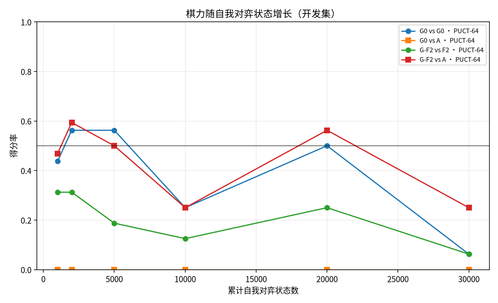
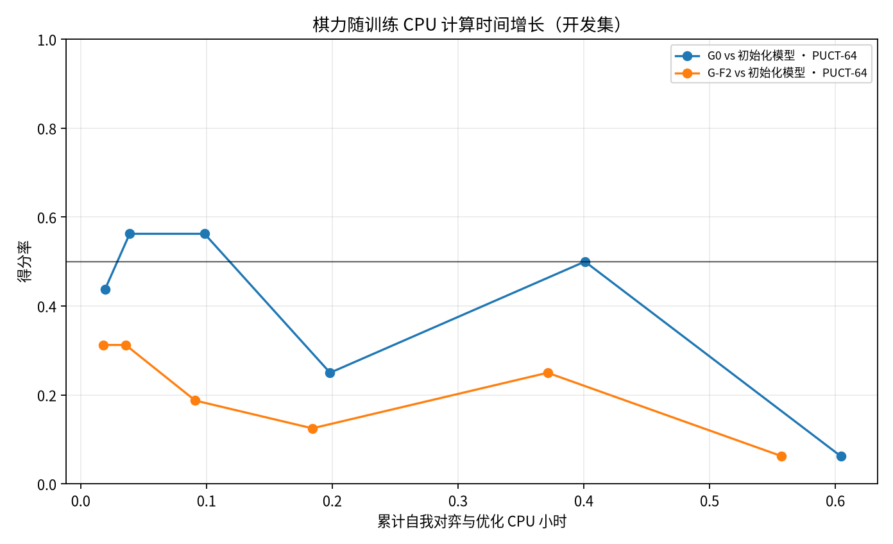
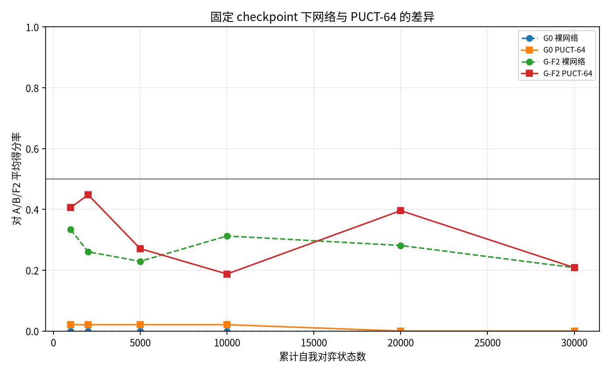
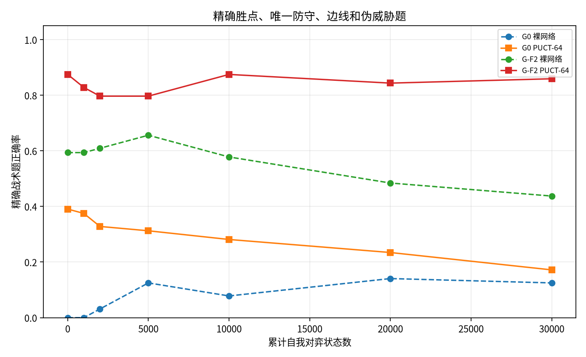

# WuziQ G V3：从零强化学习与模仿预训练强化学习对照

- 分支：research/alphazero-g-v3；基线 G V2 commit：c95eb5aa919c769af11ea6b7fc22df2594ae1c28。
- 注册配置 SHA-256：2f4a48f5fe3ba8b63e498239280e54824b8c9a2f54b0154631616846f11c72ae；冻结 F2 权重 SHA-256：50164ad9b139e0c47c1b1af7497f670c26e9864a81c10c02de0ff4426b2d0257。
- 研究范围：9×9 自由五子棋；两条路线都采用 F2 的 32 通道、2 残差块策略价值 CNN、PUCT-64、自我对弈访问分布与终局胜负监督。
- G0 从两个独立随机种子初始化；G-F2 从同一冻结 F2 权重初始化。两组优化器、经验池和随机状态相互独立。
- 没有 C/E5 教师、F 监督样本、人工战术奖励或推理阶段战术补丁；没有神经网络监督训练教师数据。
- 训练完成：120,000 个预算状态，9102 局完整自我对弈，PUCT 模拟 7,696,320 次；每条路线/种子达到 30,000 状态。
- 评估验收：开发赛 2560 局（含 node0），冠军挑战 576 局，最终盲测 1440 局，战术预测 1792 次。

## 环境、公平性和训练方案

正式训练与逐局评估记录 CPU 时间合计 3.00 小时；逐任务计时器合计 wall time 3.01 小时。预检/BN 探针额外 CPU 时间约 0.06 小时。注册总上限为 6.0 CPU 小时。
预检修正后的估算为乐观 1.81、中心 2.59、保守 4.53 CPU 小时。估算含 4000 组完整评估对局：开发 1984、冠军挑战 576、盲测 1440。
BatchNorm 采用实测短探针中冻结 running statistics 的共同策略。探针每路线 256 状态，不能据此宣称根因已完全确认；采用冻结是预注册 tie-break。完整结果记录于 results/bn_probe/probe.json。
G-F2 的 node0 权重与冻结 F2 完全相同，所以对该初始模型只进行一次实际对阵，并以 F2 同时标记起点基线；G0 则另外与自己的随机 node0 对照。
开局训练 50% 空盘、50% 合法四手随机开局；开发与盲测使用按 D4 对称去重的未见开局，盲测为 20 组并换色。每步 MCTS 固定 64 次模拟；CPU-only 单线程。

## 成长曲线

数值明细见 results/summary/training_stages.csv、match_summaries.csv、blind_summary.csv 和 tactical_accuracy.csv。

## 最终盲测结果

- G-F2:510901 (G-F2-seed-510901@0) network 对自身初始化：15 胜、10 平、15 负；得分率 0.500，按20个配对开局的 95% bootstrap 区间 [0.500, 0.500]。
- G-F2:510901 (G-F2-seed-510901@0) puct 对自身初始化：18 胜、4 平、18 负；得分率 0.500，按20个配对开局的 95% bootstrap 区间 [0.500, 0.500]。
- G-F2:510901 PUCT-64 对另一条路线最终冠军：40-0-0，得分率 1.000，95% CI [1.000, 1.000]。
- G-F2:510901 PUCT-64 对 A：12-21-7，得分率 0.562，95% CI [0.463, 0.662]。
- G-F2:510901 PUCT-64 对 B：22-0-18，得分率 0.550，95% CI [0.375, 0.725]。
- G-F2:510901 PUCT-64 对 F2：18-4-18，得分率 0.500，95% CI [0.500, 0.500]。
- G-F2:510902 (G-F2-seed-510902@0) network 对自身初始化：15 胜、10 平、15 负；得分率 0.500，按20个配对开局的 95% bootstrap 区间 [0.500, 0.500]。
- G-F2:510902 (G-F2-seed-510902@0) puct 对自身初始化：18 胜、4 平、18 负；得分率 0.500，按20个配对开局的 95% bootstrap 区间 [0.500, 0.500]。
- G-F2:510902 PUCT-64 对另一条路线最终冠军：40-0-0，得分率 1.000，95% CI [1.000, 1.000]。
- G-F2:510902 PUCT-64 对 A：13-18-9，得分率 0.550，95% CI [0.425, 0.650]。
- G-F2:510902 PUCT-64 对 B：22-0-18，得分率 0.550，95% CI [0.375, 0.725]。
- G-F2:510902 PUCT-64 对 F2：18-4-18，得分率 0.500，95% CI [0.500, 0.500]。
- G0:510901 (G0-seed-510901@20000) network 对自身初始化：33 胜、0 平、7 负；得分率 0.825，按20个配对开局的 95% bootstrap 区间 [0.725, 0.925]。
- G0:510901 (G0-seed-510901@20000) puct 对自身初始化：35 胜、0 平、5 负；得分率 0.875，按20个配对开局的 95% bootstrap 区间 [0.750, 0.975]。
- G0:510901 PUCT-64 对另一条路线最终冠军：0-0-40，得分率 0.000，95% CI [0.000, 0.000]。
- G0:510901 PUCT-64 对 A：0-0-40，得分率 0.000，95% CI [0.000, 0.000]。
- G0:510901 PUCT-64 对 B：0-0-40，得分率 0.000，95% CI [0.000, 0.000]。
- G0:510901 PUCT-64 对 F2：0-0-40，得分率 0.000，95% CI [0.000, 0.000]。
- G0:510902 (G0-seed-510902@0) network 对自身初始化：20 胜、0 平、20 负；得分率 0.500，按20个配对开局的 95% bootstrap 区间 [0.500, 0.500]。
- G0:510902 (G0-seed-510902@0) puct 对自身初始化：20 胜、0 平、20 负；得分率 0.500，按20个配对开局的 95% bootstrap 区间 [0.500, 0.500]。
- G0:510902 PUCT-64 对另一条路线最终冠军：0-0-40，得分率 0.000，95% CI [0.000, 0.000]。
- G0:510902 PUCT-64 对 A：0-0-40，得分率 0.000，95% CI [0.000, 0.000]。
- G0:510902 PUCT-64 对 B：0-0-40，得分率 0.000，95% CI [0.000, 0.000]。
- G0:510902 PUCT-64 对 F2：0-0-40，得分率 0.000，95% CI [0.000, 0.000]。

## 关键问题与证据边界

- G-F2:510901 训练后相对初始化模型的 PUCT-64 得分率为 0.500，95% CI [0.500, 0.500]；没有得到区间下限高于 50% 的证据。
- G-F2:510902 训练后相对初始化模型的 PUCT-64 得分率为 0.500，95% CI [0.500, 0.500]；没有得到区间下限高于 50% 的证据。
- G0:510901 训练后相对初始化模型的 PUCT-64 得分率为 0.875，95% CI [0.750, 0.975]；区间下限高于 50%。
- G0:510902 训练后相对初始化模型的 PUCT-64 得分率为 0.500，95% CI [0.500, 0.500]；没有得到区间下限高于 50% 的证据。
- G0 与 G-F2 谁更强只按最终盲测同预算 PUCT-64 和配对区间判断；两种初始化各只有两个训练种子，仍无法充分估计种子方差。
- 裸网络与同 checkpoint 的 PUCT-64 差值是搜索收益；训练前后同为 PUCT-64 的差值是网络学习收益。训练损失下降和搜索次数固定不替代棋力证据。
- 晋级测试只用开发集；盲测仅在所有候选模型和晋级决策冻结后执行一次，没有用盲测挑选 checkpoint。
- 战术题由规则枚举直接胜点和唯一防守，覆盖直接胜点、阻挡、边缘、伪威胁；32 个题目来自 4 个母题的 D4 变换，不能视为 32 个独立题型。

## 自我对弈、损失与价值诊断

自我对弈经验平均策略熵 2.827。训练损失、每阶段胜负目标比例、终局长度见 results/summary/training_stages.csv 和 selfplay_diagnostics.json。
价值校准使用开发对局终局结果，以待走方视角比较每步网络 value/root_value；数据不用于训练，但属于 checkpoint 选择用开发集，不把它当作独立盲测误差。结果见 results/summary/value_entropy_diagnostics.json。
冠军—挑战者在每阶段用 12 个固定开发开局组、双方换色。门槛：得分率至少 62.5%、配对 bootstrap 区间下限大于 50%、黑白得分率各至少 50%。未晋级不淘汰后续候选；最终盲测用当前冠军而非自动采用最后训练权重。

## 数据完整性与复现

全部 self-play 棋谱及评估棋谱回放通过。唯一正式评估对局 ID 共 4000 个；每个自我对弈状态来自完成局，所有实际着法都逐步记录，空位/胜负检查通过。完整核验结果见 results/summary/integrity_audit.json。
原始数据：results/selfplay/*.jsonl、results/evaluation/development.jsonl、blind.jsonl、tactics.jsonl；checkpoint 与优化器状态在 checkpoints/。配置、开局、预检和 BatchNorm 探针在 config/ 与 results/preflight、bn_probe/。
复现命令：python scripts/run_g_v3.py --through-node 30000；生成报告与图表：python scripts/report_g_v3.py。最终模型通过 load_g_checkpoint(path, device='cpu') 加载，文件 checkpoints/{G0,G-F2}/seed-{seed}/final.pt 指向晋级筛选后的冠军权重。
恢复入口：先 fetch 分支到研究工作区，再运行 python scripts/restore_g_v3_snapshot.py --archive <zip> --destination <empty-dir>，校验 manifest SHA-256 后将恢复树合并至对应分支工作树；Drive 文件夹只存 V3 最新有效快照，不更改其他实验备份。
本项目没有神经网络教师或 G V4/15×15实验。本轮属于 G-F2 与 G0 的 AlphaZero 式自我对弈训练与棋力评估。
