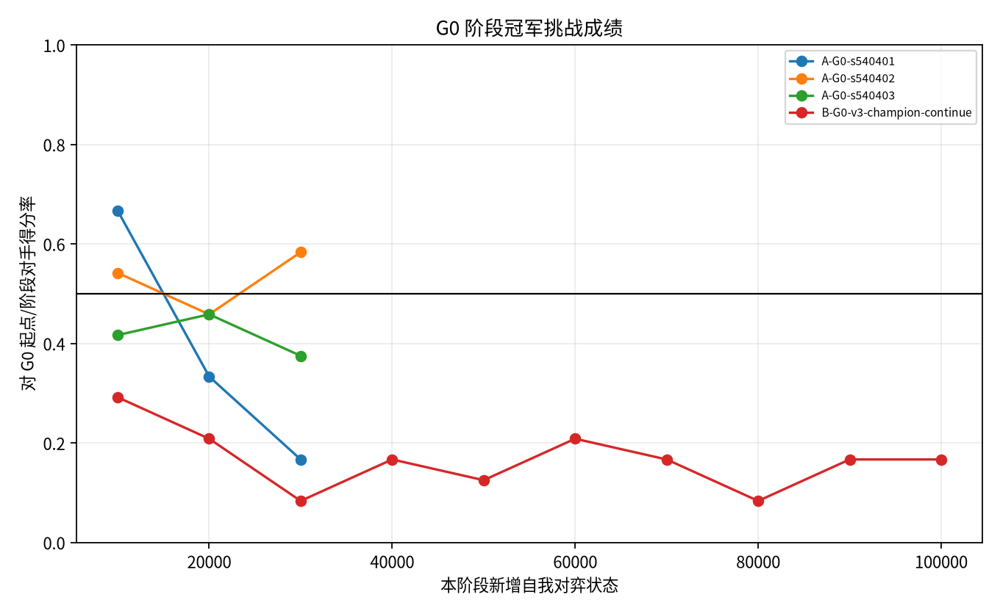
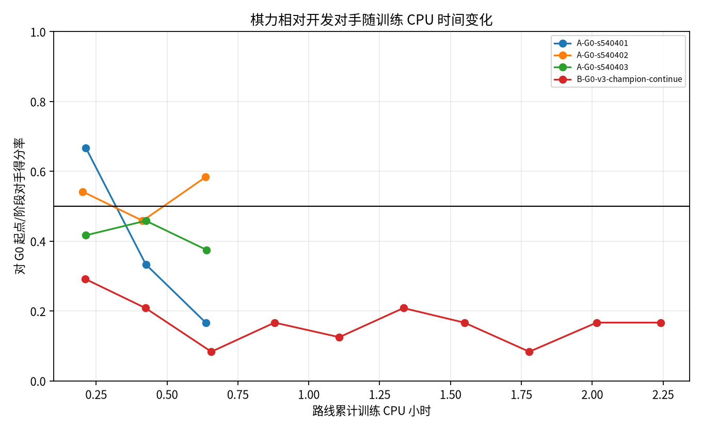
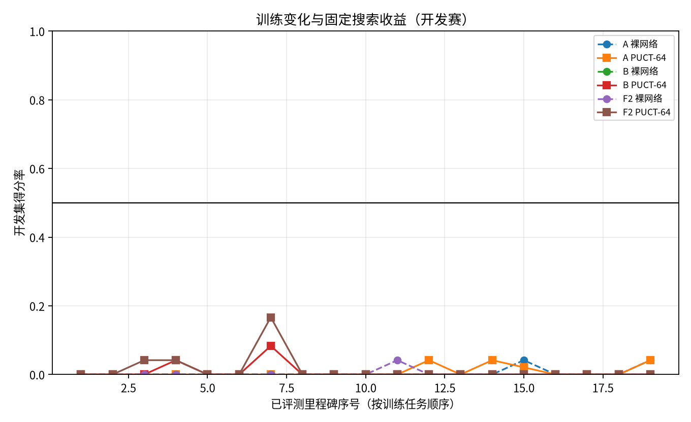

# WuziQ G V4：从零强化学习的稳定成长实验

- 分支：`research/alphazero-g-v4`；基线 G V3 提交：`2401e97b62b887fe66c9137815ac44b440d0fe9e`。
- 注册配置 SHA-256：`25790d7763b3452589a9112872ec2dc81a4d4c6ffdcc4f54ea669e85a1c66a2b`；V3 20K 权重：`research/g_v3/checkpoints/G0/seed-510901/node_20000.pt`（`ed6e2e6b5a25f355db5b31a9c58ba22158af2b345f86b3bcd3add9c3a49da7f9`）。
- 规则/算法：9×9 自由五子棋，32 通道、2 残差块策略价值网络，固定 PUCT-64；只用 MCTS 访问分布与终局结果训练。没有教师标签、模仿样本、人工战术奖励或推理规则补丁。
- 实测新增状态：190,000；自我对弈 7181 局、12,178,368 次 MCTS 模拟。阶段状态：`{"A-G0-s540401": 30000, "A-G0-s540402": 30000, "A-G0-s540403": 30000, "B-G0-v3-champion-continue": 100000}`。
- 正式评估：开发赛 6048 局；盲测 240 局。盲测使用 20 个开发未见开局、双方换色，按 配对开局 bootstrap 95% 区间；每个列出的对阵仅有20组开局，属于探索性样本。

## 资源预检、训练预算和恢复依据

- 环境：3 个可用 CPU 核心，单线程执行，CPU-only；实测峰值 RSS 341,946,368 B；预检可用内存 7,924,662,272 B/10,452,459,520 B；预检磁盘可用 28,508,680,192 B。登记配置中的峰值 RSS 摘要字段为空，数值以原始预检记录为准。
- 预检后登记估算（CPU 时间）：乐观 6.38 小时，中位 7.52 小时，保守 11.87 小时；硬上限 12.0 CPU 小时。
- 正式训练、评估和协调 CPU 6.82 小时；包括首轮预检与线程诊断的总 CPU 6.82 小时。有效工作 wall time 6.83 小时。
- 初始 node-0 评估时发现 PyTorch 默认使用3线程。用相同4局固定种子分别重放3线程和1线程后，A/B/F2/G0 对阵的完整落子序列均与正式记录逐步一致；之后的正式训练/评估固定1线程。逐局耗时仍使用实际值，探针另计入 CPU 账本，详细数据见 `results/runtime/thread_probe.json`。
- V3 没有 20K 对应的优化器/经验池/随机态快照（当时最新状态为 30,000 状态、1,875 次更新）。因此 B 阶段采用权重继承、AdamW/余弦调度器重置，并从完整 V3 对局记录重建 20K 经验状态；不称为精确续训。
- A 三个随机种子：[540401, 540402, 540403]；B 权重继承 V3 G0@20K，最多新增 100K；C 启动状态为 `False`，原因：A阶段没有种子冠军通过预注册的 V3 G0@20K 门槛。总预算上限 300K。

## 成长曲线

图只绘制有真实配对开发数据的里程碑。每个点来自固定开发开局换色比赛；训练状态本身不会被当作棋力提升。

## 随机种子与续训成长

`results/summary/development_summary.csv` 给出每个候选 checkpoint 对阶段起点/当前冠军、V3 G0@20K、A、B、F2 的网络及 PUCT-64 对局汇总。置信区间按配对开局 bootstrap 计算。晋级需要得分率≥62.5%、95%区间下限>50%、执黑/执白均≥50%，只由开发赛决定。
相关验证：V4 专项测试 12 项通过、0 项失败；全仓测试 408 项通过、24 项失败（共 432 项）。
全仓失败集中于旧版测试的分支身份保护，要求分别在 research/alphazero-g-v2, research/alphazero-g-v3, research/champion-200s-v6-2, research/champion-tiebreak-v6-3 分支运行；当前 V4 分支上这些旧分支测试拒绝启动。完整统计见 `results/summary/test_results.json`。
- `A-G0-s540401@10000` 对 `A-G0-s540401@0`：16胜/0平/8负（24局）；得分率 0.667，配对95% CI [0.5, 0.8333333333333334]，晋级=False。
- `A-G0-s540401@20000` 对 `A-G0-s540401@0`：23胜/0平/1负（24局）；得分率 0.958，配对95% CI [0.875, 1.0]，晋级=True。
- `A-G0-s540401@30000` 对 `A-G0-s540401@20000`：12胜/0平/12负（24局）；得分率 0.500，配对95% CI [0.3333333333333333, 0.6666666666666666]，晋级=False。
- `A-G0-s540402@10000` 对 `A-G0-s540402@0`：15胜/0平/9负（24局）；得分率 0.625，配对95% CI [0.4166666666666667, 0.8333333333333334]，晋级=False。
- `A-G0-s540402@20000` 对 `A-G0-s540402@0`：21胜/0平/3负（24局）；得分率 0.875，配对95% CI [0.6666666666666666, 1.0]，晋级=True。
- `A-G0-s540402@30000` 对 `A-G0-s540402@20000`：13胜/0平/11负（24局）；得分率 0.542，配对95% CI [0.4166666666666667, 0.6666666666666666]，晋级=False。
- `A-G0-s540403@10000` 对 `A-G0-s540403@0`：20胜/0平/4负（24局）；得分率 0.833，配对95% CI [0.625, 1.0]，晋级=True。
- `A-G0-s540403@20000` 对 `A-G0-s540403@10000`：18胜/0平/6负（24局）；得分率 0.750，配对95% CI [0.5416666666666666, 0.9166666666666666]，晋级=True。
- `A-G0-s540403@30000` 对 `A-G0-s540403@20000`：13胜/0平/11负（24局）；得分率 0.542，配对95% CI [0.4166666666666667, 0.6666666666666666]，晋级=False。
- `B-G0-v3-champion-continue@10000` 对 `G0-seed-510901@20000`：7胜/0平/17负（24局）；得分率 0.292，配对95% CI [0.16666666666666666, 0.4166666666666667]，晋级=False。
- `B-G0-v3-champion-continue@20000` 对 `G0-seed-510901@20000`：5胜/0平/19负（24局）；得分率 0.208，配对95% CI [0.08333333333333333, 0.3333333333333333]，晋级=False。
- `B-G0-v3-champion-continue@30000` 对 `G0-seed-510901@20000`：2胜/0平/22负（24局）；得分率 0.083，配对95% CI [0.0, 0.20833333333333334]，晋级=False。
- `B-G0-v3-champion-continue@40000` 对 `G0-seed-510901@20000`：4胜/0平/20负（24局）；得分率 0.167，配对95% CI [0.041666666666666664, 0.2916666666666667]，晋级=False。
- `B-G0-v3-champion-continue@50000` 对 `G0-seed-510901@20000`：3胜/0平/21负（24局）；得分率 0.125，配对95% CI [0.0, 0.25]，晋级=False。
- `B-G0-v3-champion-continue@60000` 对 `G0-seed-510901@20000`：5胜/0平/19负（24局）；得分率 0.208，配对95% CI [0.08333333333333333, 0.3333333333333333]，晋级=False。
- `B-G0-v3-champion-continue@70000` 对 `G0-seed-510901@20000`：4胜/0平/20负（24局）；得分率 0.167，配对95% CI [0.041666666666666664, 0.2916666666666667]，晋级=False。
- `B-G0-v3-champion-continue@80000` 对 `G0-seed-510901@20000`：2胜/0平/22负（24局）；得分率 0.083，配对95% CI [0.0, 0.20833333333333334]，晋级=False。
- `B-G0-v3-champion-continue@90000` 对 `G0-seed-510901@20000`：4胜/0平/20负（24局）；得分率 0.167，配对95% CI [0.041666666666666664, 0.2916666666666667]，晋级=False。
- `B-G0-v3-champion-continue@100000` 对 `G0-seed-510901@20000`：4胜/0平/20负（24局）；得分率 0.167，配对95% CI [0.041666666666666664, 0.2916666666666667]，晋级=False。

### A 阶段种子冠军对 V3 G0@20K 全局门槛

- seed 540401，`A-G0-s540401@20000`：8胜/0平/16负（24局），得分率 0.333，95% CI [0.125, 0.5416666666666666]；执黑 0.417、执白 0.250；晋级=False。
- seed 540402，`A-G0-s540402@20000`：11胜/0平/13负（24局），得分率 0.458，95% CI [0.20833333333333334, 0.7083333333333334]；执黑 0.333、执白 0.583；晋级=False。
- seed 540403，`A-G0-s540403@20000`：11胜/0平/13负（24局），得分率 0.458，95% CI [0.2916666666666667, 0.625]；执黑 0.417、执白 0.500；晋级=False。

## 最终盲测

盲测未用于选择 checkpoint。开发集选出的冻结模型为：
- `G0-seed-510901@20000`，SHA-256 `ed6e2e6b5a25f355db5b31a9c58ba22158af2b345f86b3bcd3add9c3a49da7f9`。
- `G0-seed-510901@20000` 对 `A@frozen`（A），network：0胜/0平/40负，得分率 0.000，95% CI [0.0, 0.0]；黑 `0.0`，白 `0.0`。
- `G0-seed-510901@20000` 对 `A@frozen`（A），puct：0胜/0平/40负，得分率 0.000，95% CI [0.0, 0.0]；黑 `0.0`，白 `0.0`。
- `G0-seed-510901@20000` 对 `B@frozen`（B），network：0胜/0平/40负，得分率 0.000，95% CI [0.0, 0.0]；黑 `0.0`，白 `0.0`。
- `G0-seed-510901@20000` 对 `B@frozen`（B），puct：0胜/0平/40负，得分率 0.000，95% CI [0.0, 0.0]；黑 `0.0`，白 `0.0`。
- `G0-seed-510901@20000` 对 `F2@frozen`（F2），network：0胜/0平/40负，得分率 0.000，95% CI [0.0, 0.0]；黑 `0.0`，白 `0.0`。
- `G0-seed-510901@20000` 对 `F2@frozen`（F2），puct：1胜/0平/39负，得分率 0.025，95% CI [0.0, 0.075]；黑 `0.0`，白 `0.05`。

## 战术题、训练统计与解释边界

- `A-G0-s540401@0` network 精确规则战术题 0/32（0.000），类别 `{"direct_win": {"accuracy": 0.0, "correct": 0, "puzzles": 8}, "edge": {"accuracy": 0.0, "correct": 0, "puzzles": 8}, "false_threat": {"accuracy": 0.0, "correct": 0, "puzzles": 8}, "unique_block": {"accuracy": 0.0, "correct": 0, "puzzles": 8}}`。题集由少量母题做对称变换，不能当作大量独立战术样本。
- `A-G0-s540401@0` puct 精确规则战术题 9/32（0.281），类别 `{"direct_win": {"accuracy": 0.625, "correct": 5, "puzzles": 8}, "edge": {"accuracy": 0.5, "correct": 4, "puzzles": 8}, "false_threat": {"accuracy": 0.0, "correct": 0, "puzzles": 8}, "unique_block": {"accuracy": 0.0, "correct": 0, "puzzles": 8}}`。题集由少量母题做对称变换，不能当作大量独立战术样本。
- `A-G0-s540401@10000` network 精确规则战术题 8/32（0.250），类别 `{"direct_win": {"accuracy": 0.0, "correct": 0, "puzzles": 8}, "edge": {"accuracy": 0.0, "correct": 0, "puzzles": 8}, "false_threat": {"accuracy": 0.0, "correct": 0, "puzzles": 8}, "unique_block": {"accuracy": 1.0, "correct": 8, "puzzles": 8}}`。题集由少量母题做对称变换，不能当作大量独立战术样本。
- `A-G0-s540401@10000` puct 精确规则战术题 12/32（0.375），类别 `{"direct_win": {"accuracy": 0.75, "correct": 6, "puzzles": 8}, "edge": {"accuracy": 0.0, "correct": 0, "puzzles": 8}, "false_threat": {"accuracy": 0.0, "correct": 0, "puzzles": 8}, "unique_block": {"accuracy": 0.75, "correct": 6, "puzzles": 8}}`。题集由少量母题做对称变换，不能当作大量独立战术样本。
- `A-G0-s540401@20000` network 精确规则战术题 8/32（0.250），类别 `{"direct_win": {"accuracy": 0.0, "correct": 0, "puzzles": 8}, "edge": {"accuracy": 0.0, "correct": 0, "puzzles": 8}, "false_threat": {"accuracy": 0.0, "correct": 0, "puzzles": 8}, "unique_block": {"accuracy": 1.0, "correct": 8, "puzzles": 8}}`。题集由少量母题做对称变换，不能当作大量独立战术样本。
- `A-G0-s540401@20000` puct 精确规则战术题 8/32（0.250），类别 `{"direct_win": {"accuracy": 0.0, "correct": 0, "puzzles": 8}, "edge": {"accuracy": 0.0, "correct": 0, "puzzles": 8}, "false_threat": {"accuracy": 0.0, "correct": 0, "puzzles": 8}, "unique_block": {"accuracy": 1.0, "correct": 8, "puzzles": 8}}`。题集由少量母题做对称变换，不能当作大量独立战术样本。
- `A-G0-s540401@30000` network 精确规则战术题 8/32（0.250），类别 `{"direct_win": {"accuracy": 0.0, "correct": 0, "puzzles": 8}, "edge": {"accuracy": 0.0, "correct": 0, "puzzles": 8}, "false_threat": {"accuracy": 0.0, "correct": 0, "puzzles": 8}, "unique_block": {"accuracy": 1.0, "correct": 8, "puzzles": 8}}`。题集由少量母题做对称变换，不能当作大量独立战术样本。
- `A-G0-s540401@30000` puct 精确规则战术题 8/32（0.250），类别 `{"direct_win": {"accuracy": 0.0, "correct": 0, "puzzles": 8}, "edge": {"accuracy": 0.0, "correct": 0, "puzzles": 8}, "false_threat": {"accuracy": 0.0, "correct": 0, "puzzles": 8}, "unique_block": {"accuracy": 1.0, "correct": 8, "puzzles": 8}}`。题集由少量母题做对称变换，不能当作大量独立战术样本。
- `A-G0-s540402@0` network 精确规则战术题 0/32（0.000），类别 `{"direct_win": {"accuracy": 0.0, "correct": 0, "puzzles": 8}, "edge": {"accuracy": 0.0, "correct": 0, "puzzles": 8}, "false_threat": {"accuracy": 0.0, "correct": 0, "puzzles": 8}, "unique_block": {"accuracy": 0.0, "correct": 0, "puzzles": 8}}`。题集由少量母题做对称变换，不能当作大量独立战术样本。
- `A-G0-s540402@0` puct 精确规则战术题 17/32（0.531），类别 `{"direct_win": {"accuracy": 1.0, "correct": 8, "puzzles": 8}, "edge": {"accuracy": 1.0, "correct": 8, "puzzles": 8}, "false_threat": {"accuracy": 0.125, "correct": 1, "puzzles": 8}, "unique_block": {"accuracy": 0.0, "correct": 0, "puzzles": 8}}`。题集由少量母题做对称变换，不能当作大量独立战术样本。
- `A-G0-s540402@10000` network 精确规则战术题 10/32（0.312），类别 `{"direct_win": {"accuracy": 0.25, "correct": 2, "puzzles": 8}, "edge": {"accuracy": 0.0, "correct": 0, "puzzles": 8}, "false_threat": {"accuracy": 0.0, "correct": 0, "puzzles": 8}, "unique_block": {"accuracy": 1.0, "correct": 8, "puzzles": 8}}`。题集由少量母题做对称变换，不能当作大量独立战术样本。
- `A-G0-s540402@10000` puct 精确规则战术题 20/32（0.625），类别 `{"direct_win": {"accuracy": 1.0, "correct": 8, "puzzles": 8}, "edge": {"accuracy": 1.0, "correct": 8, "puzzles": 8}, "false_threat": {"accuracy": 0.125, "correct": 1, "puzzles": 8}, "unique_block": {"accuracy": 0.375, "correct": 3, "puzzles": 8}}`。题集由少量母题做对称变换，不能当作大量独立战术样本。
- `A-G0-s540402@20000` network 精确规则战术题 6/32（0.188），类别 `{"direct_win": {"accuracy": 0.0, "correct": 0, "puzzles": 8}, "edge": {"accuracy": 0.0, "correct": 0, "puzzles": 8}, "false_threat": {"accuracy": 0.0, "correct": 0, "puzzles": 8}, "unique_block": {"accuracy": 0.75, "correct": 6, "puzzles": 8}}`。题集由少量母题做对称变换，不能当作大量独立战术样本。
- `A-G0-s540402@20000` puct 精确规则战术题 17/32（0.531），类别 `{"direct_win": {"accuracy": 1.0, "correct": 8, "puzzles": 8}, "edge": {"accuracy": 1.0, "correct": 8, "puzzles": 8}, "false_threat": {"accuracy": 0.125, "correct": 1, "puzzles": 8}, "unique_block": {"accuracy": 0.0, "correct": 0, "puzzles": 8}}`。题集由少量母题做对称变换，不能当作大量独立战术样本。
- `A-G0-s540402@30000` network 精确规则战术题 9/32（0.281），类别 `{"direct_win": {"accuracy": 0.125, "correct": 1, "puzzles": 8}, "edge": {"accuracy": 0.0, "correct": 0, "puzzles": 8}, "false_threat": {"accuracy": 0.0, "correct": 0, "puzzles": 8}, "unique_block": {"accuracy": 1.0, "correct": 8, "puzzles": 8}}`。题集由少量母题做对称变换，不能当作大量独立战术样本。
- `A-G0-s540402@30000` puct 精确规则战术题 24/32（0.750），类别 `{"direct_win": {"accuracy": 1.0, "correct": 8, "puzzles": 8}, "edge": {"accuracy": 1.0, "correct": 8, "puzzles": 8}, "false_threat": {"accuracy": 0.0, "correct": 0, "puzzles": 8}, "unique_block": {"accuracy": 1.0, "correct": 8, "puzzles": 8}}`。题集由少量母题做对称变换，不能当作大量独立战术样本。
- `A-G0-s540403@0` network 精确规则战术题 0/32（0.000），类别 `{"direct_win": {"accuracy": 0.0, "correct": 0, "puzzles": 8}, "edge": {"accuracy": 0.0, "correct": 0, "puzzles": 8}, "false_threat": {"accuracy": 0.0, "correct": 0, "puzzles": 8}, "unique_block": {"accuracy": 0.0, "correct": 0, "puzzles": 8}}`。题集由少量母题做对称变换，不能当作大量独立战术样本。
- `A-G0-s540403@0` puct 精确规则战术题 12/32（0.375），类别 `{"direct_win": {"accuracy": 0.75, "correct": 6, "puzzles": 8}, "edge": {"accuracy": 0.75, "correct": 6, "puzzles": 8}, "false_threat": {"accuracy": 0.0, "correct": 0, "puzzles": 8}, "unique_block": {"accuracy": 0.0, "correct": 0, "puzzles": 8}}`。题集由少量母题做对称变换，不能当作大量独立战术样本。
- `A-G0-s540403@10000` network 精确规则战术题 6/32（0.188），类别 `{"direct_win": {"accuracy": 0.0, "correct": 0, "puzzles": 8}, "edge": {"accuracy": 0.0, "correct": 0, "puzzles": 8}, "false_threat": {"accuracy": 0.0, "correct": 0, "puzzles": 8}, "unique_block": {"accuracy": 0.75, "correct": 6, "puzzles": 8}}`。题集由少量母题做对称变换，不能当作大量独立战术样本。
- `A-G0-s540403@10000` puct 精确规则战术题 11/32（0.344），类别 `{"direct_win": {"accuracy": 0.25, "correct": 2, "puzzles": 8}, "edge": {"accuracy": 1.0, "correct": 8, "puzzles": 8}, "false_threat": {"accuracy": 0.125, "correct": 1, "puzzles": 8}, "unique_block": {"accuracy": 0.0, "correct": 0, "puzzles": 8}}`。题集由少量母题做对称变换，不能当作大量独立战术样本。
- `A-G0-s540403@20000` network 精确规则战术题 3/32（0.094），类别 `{"direct_win": {"accuracy": 0.0, "correct": 0, "puzzles": 8}, "edge": {"accuracy": 0.0, "correct": 0, "puzzles": 8}, "false_threat": {"accuracy": 0.0, "correct": 0, "puzzles": 8}, "unique_block": {"accuracy": 0.375, "correct": 3, "puzzles": 8}}`。题集由少量母题做对称变换，不能当作大量独立战术样本。
- `A-G0-s540403@20000` puct 精确规则战术题 9/32（0.281），类别 `{"direct_win": {"accuracy": 0.0, "correct": 0, "puzzles": 8}, "edge": {"accuracy": 1.0, "correct": 8, "puzzles": 8}, "false_threat": {"accuracy": 0.0, "correct": 0, "puzzles": 8}, "unique_block": {"accuracy": 0.125, "correct": 1, "puzzles": 8}}`。题集由少量母题做对称变换，不能当作大量独立战术样本。
- `A-G0-s540403@30000` network 精确规则战术题 0/32（0.000），类别 `{"direct_win": {"accuracy": 0.0, "correct": 0, "puzzles": 8}, "edge": {"accuracy": 0.0, "correct": 0, "puzzles": 8}, "false_threat": {"accuracy": 0.0, "correct": 0, "puzzles": 8}, "unique_block": {"accuracy": 0.0, "correct": 0, "puzzles": 8}}`。题集由少量母题做对称变换，不能当作大量独立战术样本。
- `A-G0-s540403@30000` puct 精确规则战术题 8/32（0.250），类别 `{"direct_win": {"accuracy": 0.0, "correct": 0, "puzzles": 8}, "edge": {"accuracy": 1.0, "correct": 8, "puzzles": 8}, "false_threat": {"accuracy": 0.0, "correct": 0, "puzzles": 8}, "unique_block": {"accuracy": 0.0, "correct": 0, "puzzles": 8}}`。题集由少量母题做对称变换，不能当作大量独立战术样本。
- `B-G0-v3-champion-continue@0` network 精确规则战术题 9/32（0.281），类别 `{"direct_win": {"accuracy": 0.0, "correct": 0, "puzzles": 8}, "edge": {"accuracy": 0.0, "correct": 0, "puzzles": 8}, "false_threat": {"accuracy": 0.125, "correct": 1, "puzzles": 8}, "unique_block": {"accuracy": 1.0, "correct": 8, "puzzles": 8}}`。题集由少量母题做对称变换，不能当作大量独立战术样本。
- `B-G0-v3-champion-continue@0` puct 精确规则战术题 15/32（0.469），类别 `{"direct_win": {"accuracy": 0.0, "correct": 0, "puzzles": 8}, "edge": {"accuracy": 1.0, "correct": 8, "puzzles": 8}, "false_threat": {"accuracy": 0.25, "correct": 2, "puzzles": 8}, "unique_block": {"accuracy": 0.625, "correct": 5, "puzzles": 8}}`。题集由少量母题做对称变换，不能当作大量独立战术样本。
- `B-G0-v3-champion-continue@10000` network 精确规则战术题 8/32（0.250），类别 `{"direct_win": {"accuracy": 0.0, "correct": 0, "puzzles": 8}, "edge": {"accuracy": 0.0, "correct": 0, "puzzles": 8}, "false_threat": {"accuracy": 0.0, "correct": 0, "puzzles": 8}, "unique_block": {"accuracy": 1.0, "correct": 8, "puzzles": 8}}`。题集由少量母题做对称变换，不能当作大量独立战术样本。
- `B-G0-v3-champion-continue@10000` puct 精确规则战术题 12/32（0.375），类别 `{"direct_win": {"accuracy": 0.0, "correct": 0, "puzzles": 8}, "edge": {"accuracy": 0.5, "correct": 4, "puzzles": 8}, "false_threat": {"accuracy": 0.0, "correct": 0, "puzzles": 8}, "unique_block": {"accuracy": 1.0, "correct": 8, "puzzles": 8}}`。题集由少量母题做对称变换，不能当作大量独立战术样本。
- `B-G0-v3-champion-continue@100000` network 精确规则战术题 8/32（0.250），类别 `{"direct_win": {"accuracy": 0.0, "correct": 0, "puzzles": 8}, "edge": {"accuracy": 0.0, "correct": 0, "puzzles": 8}, "false_threat": {"accuracy": 0.0, "correct": 0, "puzzles": 8}, "unique_block": {"accuracy": 1.0, "correct": 8, "puzzles": 8}}`。题集由少量母题做对称变换，不能当作大量独立战术样本。
- `B-G0-v3-champion-continue@100000` puct 精确规则战术题 8/32（0.250），类别 `{"direct_win": {"accuracy": 0.0, "correct": 0, "puzzles": 8}, "edge": {"accuracy": 0.0, "correct": 0, "puzzles": 8}, "false_threat": {"accuracy": 0.0, "correct": 0, "puzzles": 8}, "unique_block": {"accuracy": 1.0, "correct": 8, "puzzles": 8}}`。题集由少量母题做对称变换，不能当作大量独立战术样本。
- `B-G0-v3-champion-continue@20000` network 精确规则战术题 8/32（0.250），类别 `{"direct_win": {"accuracy": 0.0, "correct": 0, "puzzles": 8}, "edge": {"accuracy": 0.0, "correct": 0, "puzzles": 8}, "false_threat": {"accuracy": 0.0, "correct": 0, "puzzles": 8}, "unique_block": {"accuracy": 1.0, "correct": 8, "puzzles": 8}}`。题集由少量母题做对称变换，不能当作大量独立战术样本。
- `B-G0-v3-champion-continue@20000` puct 精确规则战术题 9/32（0.281），类别 `{"direct_win": {"accuracy": 0.0, "correct": 0, "puzzles": 8}, "edge": {"accuracy": 0.125, "correct": 1, "puzzles": 8}, "false_threat": {"accuracy": 0.0, "correct": 0, "puzzles": 8}, "unique_block": {"accuracy": 1.0, "correct": 8, "puzzles": 8}}`。题集由少量母题做对称变换，不能当作大量独立战术样本。
- `B-G0-v3-champion-continue@30000` network 精确规则战术题 8/32（0.250），类别 `{"direct_win": {"accuracy": 0.0, "correct": 0, "puzzles": 8}, "edge": {"accuracy": 0.0, "correct": 0, "puzzles": 8}, "false_threat": {"accuracy": 0.0, "correct": 0, "puzzles": 8}, "unique_block": {"accuracy": 1.0, "correct": 8, "puzzles": 8}}`。题集由少量母题做对称变换，不能当作大量独立战术样本。
- `B-G0-v3-champion-continue@30000` puct 精确规则战术题 8/32（0.250），类别 `{"direct_win": {"accuracy": 0.0, "correct": 0, "puzzles": 8}, "edge": {"accuracy": 0.0, "correct": 0, "puzzles": 8}, "false_threat": {"accuracy": 0.0, "correct": 0, "puzzles": 8}, "unique_block": {"accuracy": 1.0, "correct": 8, "puzzles": 8}}`。题集由少量母题做对称变换，不能当作大量独立战术样本。
- `B-G0-v3-champion-continue@40000` network 精确规则战术题 8/32（0.250），类别 `{"direct_win": {"accuracy": 0.0, "correct": 0, "puzzles": 8}, "edge": {"accuracy": 0.0, "correct": 0, "puzzles": 8}, "false_threat": {"accuracy": 0.0, "correct": 0, "puzzles": 8}, "unique_block": {"accuracy": 1.0, "correct": 8, "puzzles": 8}}`。题集由少量母题做对称变换，不能当作大量独立战术样本。
- `B-G0-v3-champion-continue@40000` puct 精确规则战术题 8/32（0.250），类别 `{"direct_win": {"accuracy": 0.0, "correct": 0, "puzzles": 8}, "edge": {"accuracy": 0.0, "correct": 0, "puzzles": 8}, "false_threat": {"accuracy": 0.0, "correct": 0, "puzzles": 8}, "unique_block": {"accuracy": 1.0, "correct": 8, "puzzles": 8}}`。题集由少量母题做对称变换，不能当作大量独立战术样本。
- `B-G0-v3-champion-continue@50000` network 精确规则战术题 8/32（0.250），类别 `{"direct_win": {"accuracy": 0.0, "correct": 0, "puzzles": 8}, "edge": {"accuracy": 0.0, "correct": 0, "puzzles": 8}, "false_threat": {"accuracy": 0.0, "correct": 0, "puzzles": 8}, "unique_block": {"accuracy": 1.0, "correct": 8, "puzzles": 8}}`。题集由少量母题做对称变换，不能当作大量独立战术样本。
- `B-G0-v3-champion-continue@50000` puct 精确规则战术题 8/32（0.250），类别 `{"direct_win": {"accuracy": 0.0, "correct": 0, "puzzles": 8}, "edge": {"accuracy": 0.0, "correct": 0, "puzzles": 8}, "false_threat": {"accuracy": 0.0, "correct": 0, "puzzles": 8}, "unique_block": {"accuracy": 1.0, "correct": 8, "puzzles": 8}}`。题集由少量母题做对称变换，不能当作大量独立战术样本。
- `B-G0-v3-champion-continue@60000` network 精确规则战术题 8/32（0.250），类别 `{"direct_win": {"accuracy": 0.0, "correct": 0, "puzzles": 8}, "edge": {"accuracy": 0.0, "correct": 0, "puzzles": 8}, "false_threat": {"accuracy": 0.0, "correct": 0, "puzzles": 8}, "unique_block": {"accuracy": 1.0, "correct": 8, "puzzles": 8}}`。题集由少量母题做对称变换，不能当作大量独立战术样本。
- `B-G0-v3-champion-continue@60000` puct 精确规则战术题 8/32（0.250），类别 `{"direct_win": {"accuracy": 0.0, "correct": 0, "puzzles": 8}, "edge": {"accuracy": 0.0, "correct": 0, "puzzles": 8}, "false_threat": {"accuracy": 0.0, "correct": 0, "puzzles": 8}, "unique_block": {"accuracy": 1.0, "correct": 8, "puzzles": 8}}`。题集由少量母题做对称变换，不能当作大量独立战术样本。
- `B-G0-v3-champion-continue@70000` network 精确规则战术题 8/32（0.250），类别 `{"direct_win": {"accuracy": 0.0, "correct": 0, "puzzles": 8}, "edge": {"accuracy": 0.0, "correct": 0, "puzzles": 8}, "false_threat": {"accuracy": 0.0, "correct": 0, "puzzles": 8}, "unique_block": {"accuracy": 1.0, "correct": 8, "puzzles": 8}}`。题集由少量母题做对称变换，不能当作大量独立战术样本。
- `B-G0-v3-champion-continue@70000` puct 精确规则战术题 8/32（0.250），类别 `{"direct_win": {"accuracy": 0.0, "correct": 0, "puzzles": 8}, "edge": {"accuracy": 0.0, "correct": 0, "puzzles": 8}, "false_threat": {"accuracy": 0.0, "correct": 0, "puzzles": 8}, "unique_block": {"accuracy": 1.0, "correct": 8, "puzzles": 8}}`。题集由少量母题做对称变换，不能当作大量独立战术样本。
- `B-G0-v3-champion-continue@80000` network 精确规则战术题 8/32（0.250），类别 `{"direct_win": {"accuracy": 0.0, "correct": 0, "puzzles": 8}, "edge": {"accuracy": 0.0, "correct": 0, "puzzles": 8}, "false_threat": {"accuracy": 0.0, "correct": 0, "puzzles": 8}, "unique_block": {"accuracy": 1.0, "correct": 8, "puzzles": 8}}`。题集由少量母题做对称变换，不能当作大量独立战术样本。
- `B-G0-v3-champion-continue@80000` puct 精确规则战术题 8/32（0.250），类别 `{"direct_win": {"accuracy": 0.0, "correct": 0, "puzzles": 8}, "edge": {"accuracy": 0.0, "correct": 0, "puzzles": 8}, "false_threat": {"accuracy": 0.0, "correct": 0, "puzzles": 8}, "unique_block": {"accuracy": 1.0, "correct": 8, "puzzles": 8}}`。题集由少量母题做对称变换，不能当作大量独立战术样本。
- `B-G0-v3-champion-continue@90000` network 精确规则战术题 8/32（0.250），类别 `{"direct_win": {"accuracy": 0.0, "correct": 0, "puzzles": 8}, "edge": {"accuracy": 0.0, "correct": 0, "puzzles": 8}, "false_threat": {"accuracy": 0.0, "correct": 0, "puzzles": 8}, "unique_block": {"accuracy": 1.0, "correct": 8, "puzzles": 8}}`。题集由少量母题做对称变换，不能当作大量独立战术样本。
- `B-G0-v3-champion-continue@90000` puct 精确规则战术题 8/32（0.250），类别 `{"direct_win": {"accuracy": 0.0, "correct": 0, "puzzles": 8}, "edge": {"accuracy": 0.0, "correct": 0, "puzzles": 8}, "false_threat": {"accuracy": 0.0, "correct": 0, "puzzles": 8}, "unique_block": {"accuracy": 1.0, "correct": 8, "puzzles": 8}}`。题集由少量母题做对称变换，不能当作大量独立战术样本。
- `G0-seed-510901@20000` network 精确规则战术题 9/32（0.281），类别 `{"direct_win": {"accuracy": 0.0, "correct": 0, "puzzles": 8}, "edge": {"accuracy": 0.0, "correct": 0, "puzzles": 8}, "false_threat": {"accuracy": 0.125, "correct": 1, "puzzles": 8}, "unique_block": {"accuracy": 1.0, "correct": 8, "puzzles": 8}}`。题集由少量母题做对称变换，不能当作大量独立战术样本。
- `G0-seed-510901@20000` puct 精确规则战术题 15/32（0.469），类别 `{"direct_win": {"accuracy": 0.0, "correct": 0, "puzzles": 8}, "edge": {"accuracy": 1.0, "correct": 8, "puzzles": 8}, "false_threat": {"accuracy": 0.25, "correct": 2, "puzzles": 8}, "unique_block": {"accuracy": 0.625, "correct": 5, "puzzles": 8}}`。题集由少量母题做对称变换，不能当作大量独立战术样本。

自我对弈胜负分布按路线见 `{"A-G0-s540401": {"B_win": 545, "W_win": 452}, "A-G0-s540402": {"W_win": 472, "B_win": 559}, "A-G0-s540403": {"B_win": 465, "W_win": 480}, "B-G0-v3-champion-continue": {"W_win": 974, "B_win": 3234}}`。策略熵、状态数、迭代更新、模拟数和逐局耗时见 `results/summary/selfplay_games.csv`、`training_stages.csv`。
- 学习收益：相同 PUCT-64 对手/预算下，训练 checkpoint 与同路线起点的差异。搜索收益：同一 checkpoint 下裸网络与 PUCT-64 的差异。二者分列，不能用训练损失下降代替棋力证据。
- G0 是否跨随机种子稳定成长，需要多个随机路线在配对开发赛中重复晋级；A 阶段仅三个新种子且每种子30K。即使都未晋级，也只说明此预算/门槛下没有稳定提升证据。B 是一个旧冠军权重续训路线，单路线不能估计种子方差。
- 盲测每个对局通常只有20组配对开局，CI 可能很宽；对 A/B/F2 的成绩只说明当前协议下的探索性结果，不宣称统计显著。A、B 的实力受其固定规则/50ms配置限制。
- 若 C 未运行，是因为没有 A 阶段新随机种子 champion 通过注册的 V3 G0@20K 挑战门槛；未执行的 110K 预算不计作负例。若任务受 12 CPU 小时硬上限停止，报告中的部分状态会小于规划值。

## 完整性、复现与结论

完整性审计通过：7181 局自我对弈及 6288 场评估棋谱已逐手回放；唯一评估 ID、开局计划和配置 hash 校验均通过。结果见 `results/summary/integrity_audit.json`。
保存内容：`results/selfplay/` 原始棋谱、`results/evaluation/` 逐局对局、`checkpoints/` 模型和可精确恢复训练状态、`config/` 预注册参数及开局池、`figures/` 趋势图。
复现：`python scripts/run_g_v4.py --initialize`，随后重复 `python scripts/run_g_v4.py --advance` 直到输出 `completed=true`；生成报告：`python scripts/report_g_v4.py`。空目录快照恢复：`python scripts/restore_g_v4_snapshot.py --archive <zip> --destination <empty-dir>`。
结果判断仅由实测配对棋局、路线晋级记录和盲测组成。V4没有神经网络外部教师，也没有执行 G-F2 新训练、15×15或 G V5。

### 研究结论

- **G0 是否跨种子成长？** 三个独立随机种子各自至少有一个开发阶段冠军超过本种子的随机起点；三条路线在 30K 节点均未超过各自 20K 阶段冠军。因此能观察到种子内阶段性成长，但没有持续单调提升的证据。
- **长期续训是否有效？** 从 V3 G0@20K 权重继承的单一路线新增 100K 状态，十个 10K 检查点对冻结 V3 冠军的 PUCT-64 得分率全部低于 50%（8.3%–29.2%）。当前训练方案下，继续堆叠状态没有带来可验证收益，候选出现能力回退；本实验不能把回退归因到单一训练组件。
- **是否超过历史冠军？** 没有。最终保留 V3 `G0-seed-510901@20000`，A 阶段三种子都未通过其全局晋级门槛，故 C 阶段 110K 按注册规则跳过。盲测中该冠军对 A、B 的裸网络和 PUCT-64 各为 0胜/40负；对 F2 裸网络 0胜/40负、PUCT-64 1胜/39负。每项只有20组换色开局，结果属探索性证据。
- **下一步建议：** 先修改并验证训练稳定性与经验分布等算法因素，再决定是否扩量。当前证据不支持直接把预算从 300K 上限继续扩大；本轮也没有证明 G0 能稳定战胜 A、B 或历史冠军。
