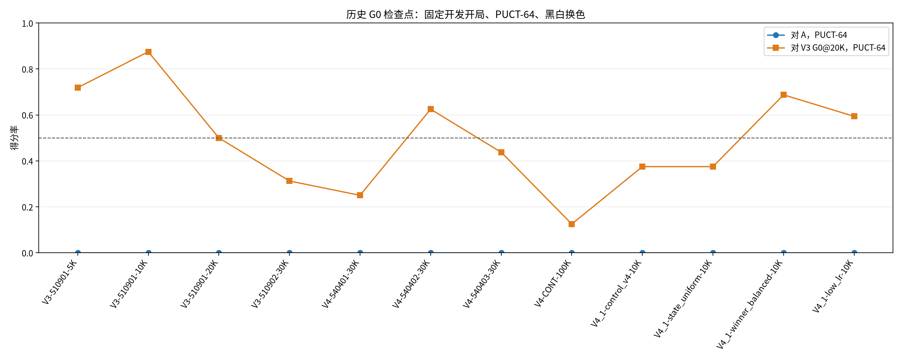
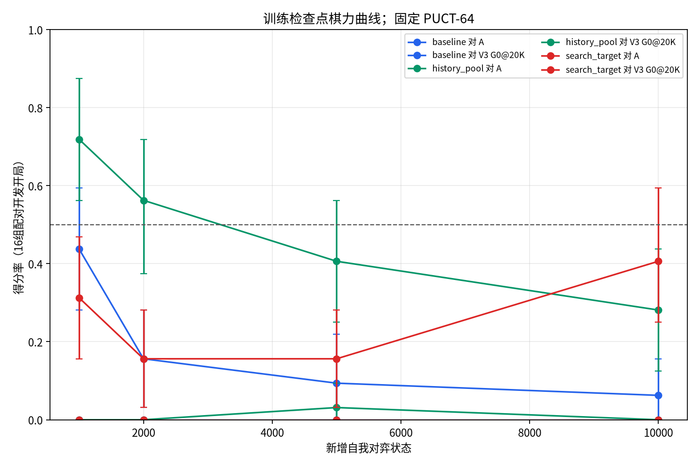
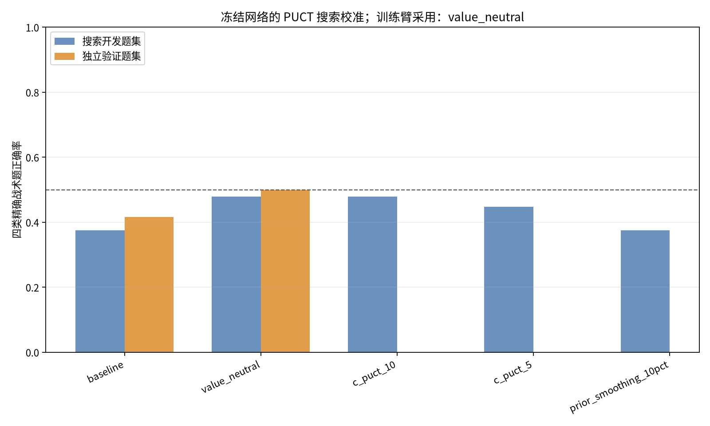
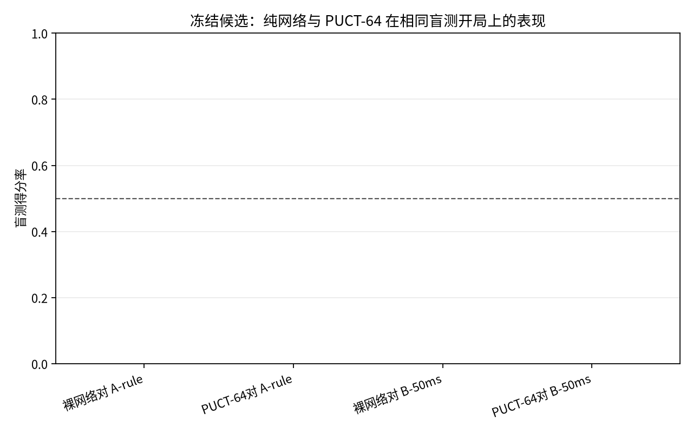

# WuziQ G V4.2：AlphaZero 搜索与训练协同优化

> 本报告记录规则/搜索算法诊断与AlphaZero式纯自我对弈实验；未使用A/B/C/E/F棋谱、标签或权重作为G0训练输入。A/B只在评估时出现。

## 摘要

- 基线：`4dd0c449c7a4afe1a4f68b3e2a234cdd70e186df`；实验分支：`research/alphazero-g-v4-2`。配置SHA-256：`ffa4c84a5a13ee78da5bb4d91ff91dd4af7bbce9fd9c418c78a56116803ce987`。
- 9×9，原G0 32通道、2残差块；统一训练/正式评估搜索为每步64次PUCT模拟。最多3臂各10,000个新增状态，总登记上限30,000。
- 训练臂：`baseline, search_target, history_pool`；实际新增状态：30,000。优化器从V3@20K权重初始化时重置，BatchNorm统计冻结。
- 开发集选出的最终候选：`history_pool@1000`；盲测后冠军判断：`G0-V3-510901-20K`。
- 实测CPU耗时约1.73小时；盲测20组新开局、换色对弈。

## 预检、环境与预注册

云端机器实测：CPU亲和3核、cgroup CPU配额2.0核，内存上限8.0GiB，可用磁盘21.4GiB；GPU不可用，使用CPU及1个Torch线程。
短预检实测：64次搜索每步约0.074 CPU秒；自我对弈约13.36状态/CPU秒；优化器约102.5更新/CPU秒；评测局约0.915 CPU秒。
总CPU预估（含2440场正式/开发对局，不含战术题搜索调用）：乐观1.28小时、中位1.62小时、保守2.55小时；硬上限5小时。
开局表SHA-256：`7df8d9e1d3e86839987f617be34f03fa2bc7441973369d24cdb03d53919b0181`。注册时排除了V3/V4/V4.1中2,444个唯一D4对称等价的4手开局；新开局池含训练800组、开发16组、盲测20组。
开发集只用于历史筛选和训练候选选择。盲测开局在冻结候选后才执行；没有依据盲测结果回调训练或参数。

## 搜索机制诊断

历史12个G0检查点先在相同16组开发开局上与A、V3 G0@20K对弈，各组交换黑白；其中胜率最高的三个用于冻结权重搜索对照。战术题64道，四类各16道，母局面之间做D4去重，标签由精确五连规则计算。

| 搜索配置 | 开发题正确率 | 独立验证正确率 | 开发战术增益 | 阻挡相对保留 | 决定 |
|---|---:|---:|---:|---:|---|
| value_neutral | 47.9% | 50.0% | +0.104 | 100.0% | 采用 |
| c_puct_10 | 47.9% | — | +0.104 | 100.0% | 未采用 |
| c_puct_5 | 44.8% | — | +0.073 | 100.0% | 未采用 |
| prior_smoothing_10pct | 37.5% | — | +0.000 | 100.0% | 未采用 |
| baseline | 37.5% | 41.7% | 0.000 | 100.0% | 对照 |

冻结权重的自动选型最终为`value_neutral`。选型门槛是开发题宏平均至少提升5个百分点、阻挡类保持基线90%以上，并在未参与选择的验证题上不退步且满足同样的阻挡保留条件。未达门槛时，不启用搜索改进训练臂。

### 冻结权重的直接搜索对局

以下是在相同冻结检查点、相同8组开发开局及换色条件下，所列搜索配置对阵该检查点的基线PUCT-64。每个检查点/配置只有16局，属探索性对照；结果可检查战术题收益是否延伸到实际决策，不能单独证明稳定棋力提升。

| 冻结检查点 | 搜索配置对基线 PUCT-64 | 场次 | 胜-平-负 | 得分率（配对95%区间） | CPU秒/局 | 平均树深 | 节点/局 |
|---|---|---:|---:|---:|---:|---:|---:|
| G0-V3-510901-10K | c_puct_10 | 16 | 5-0-11 | 31.2% [12.5%, 56.2%] | 0.933 | 1.94 | 53999 |
| G0-V3-510901-10K | c_puct_5 | 16 | 7-0-9 | 43.8% [18.8%, 68.8%] | 0.943 | 1.94 | 54249 |
| G0-V3-510901-10K | prior_smoothing_10pct | 16 | 9-0-7 | 56.2% [31.2%, 81.2%] | 0.980 | 1.94 | 54428 |
| G0-V3-510901-10K | value_neutral | 16 | 11-0-5 | 68.8% [43.8%, 87.5%] | 1.004 | 1.94 | 56881 |
| G0-V3-510901-5K | c_puct_10 | 16 | 14-0-2 | 87.5% [68.8%, 100.0%] | 1.001 | 2.00 | 56318 |
| G0-V3-510901-5K | c_puct_5 | 16 | 13-0-3 | 81.2% [62.5%, 100.0%] | 0.927 | 2.00 | 53824 |
| G0-V3-510901-5K | prior_smoothing_10pct | 16 | 9-0-7 | 56.2% [31.2%, 81.2%] | 1.133 | 2.00 | 62390 |
| G0-V3-510901-5K | value_neutral | 16 | 14-0-2 | 87.5% [68.8%, 100.0%] | 0.927 | 2.00 | 53618 |
| G0-V4_1-winner_balanced-10K | c_puct_10 | 16 | 12-0-4 | 75.0% [50.0%, 93.8%] | 0.614 | 2.00 | 36407 |
| G0-V4_1-winner_balanced-10K | c_puct_5 | 16 | 8-0-8 | 50.0% [25.0%, 75.0%] | 0.576 | 2.00 | 33950 |
| G0-V4_1-winner_balanced-10K | prior_smoothing_10pct | 16 | 8-0-8 | 50.0% [25.0%, 75.0%] | 0.396 | 1.62 | 23634 |
| G0-V4_1-winner_balanced-10K | value_neutral | 16 | 6-0-10 | 37.5% [12.5%, 62.5%] | 0.607 | 2.00 | 36526 |

搜索对局收益会随检查点变化，因此`value_neutral`是按预登记战术开发/验证门槛选择，不表示对所有网络都统一最强。历史模型的策略头直接胜点准确率为0/48，最优动作平均先验质量约1.7%，而基线PUCT根访问能找到约70.8%；训练后策略头直接胜点准确率仍为0。history_pool@10K对直接胜点的网络价值MAE为1.826。一个与数据相符的解释是：自我对弈若错过潜在胜点，最终输棋标签会把该状态教成负价值；这说明可能的标签/搜索反馈回路，但本实验没有证明它是唯一根因。

| 类别 | 题数 | 基线正确 | 基线最优策略先验质量 | 基线根访问质量 |
|---|---:|---:|---:|---:|
| direct_win | 48（3模型×16） | 34/48（70.8%） | 1.7% | 70.8% |
| unique_block | 48（3模型×16） | 2/48（4.2%） | 1.4% | 4.2% |
| false_threat | 48（3模型×16） | 2/48（4.2%） | 1.4% | 4.2% |
| edge_win | 48（3模型×16） | 38/48（79.2%） | 2.5% | 79.2% |

策略头与价值头另行记录，不将单题即时获胜标签外推到阻挡题：

| 历史候选 | 立即获胜题网络策略准确率 | 最优动作平均先验质量 | 网络价值MAE（立即胜点对+1） |
|---|---:|---:|---:|
| G0-V3-510901-10K | 0.0% | 2.1% | 0.979 |
| G0-V3-510901-5K | 0.0% | 2.1% | 0.956 |
| G0-V4_1-winner_balanced-10K | 0.0% | 2.0% | 0.903 |
对直接获胜类题，策略先验质量与根访问质量的差异可显示PUCT是否补救了网络先验；两者都低时属于策略头漏报，访问质量低而先验质量尚可时更像搜索预算/探索分配问题。非终局阻挡题没有被错误地赋予`+1`价值标签。128/256模拟只用于同一题集的搜索诊断，没有计入正式64次棋力。

### 128/256模拟诊断（仅搜索预算对照）

| 模拟数 | 题数 | 精确战术正确率 | 平均树深 | 平均节点 |
|---:|---:|---:|---:|---:|
| 64 | 96 | 47.9% | 1.32 | 3590.8 |
| 128 | 96 | 51.0% | 1.66 | 5835.0 |
| 256 | 96 | 53.1% | 1.74 | 10283.2 |

## 历史G0阶段复核

| G0检查点 | 对A得分率（配对95%区间） | 对V3@20K得分率 | 64题战术正确率 |
|---|---:|---:|---:|
| G0-V3-510901-5K | 0.0% [0.0%, 0.0%] | 71.9% [56.2%, 87.5%] | 32/64（50.0%） |
| G0-V3-510901-10K | 0.0% [0.0%, 0.0%] | 87.5% [75.0%, 96.9%] | 32/64（50.0%） |
| G0-V3-510901-20K | 0.0% [0.0%, 0.0%] | 50.0% [31.2%, 68.8%] | 23/64（35.9%） |
| G0-V3-510902-30K | 0.0% [0.0%, 0.0%] | 31.2% [15.6%, 46.9%] | 25/64（39.1%） |
| G0-V4-540401-30K | 0.0% [0.0%, 0.0%] | 25.0% [9.4%, 40.6%] | 14/64（21.9%） |
| G0-V4-540402-30K | 0.0% [0.0%, 0.0%] | 62.5% [46.9%, 78.1%] | 26/64（40.6%） |
| G0-V4-540403-30K | 0.0% [0.0%, 0.0%] | 43.8% [28.1%, 62.5%] | 29/64（45.3%） |
| G0-V4-CONT-100K | 0.0% [0.0%, 0.0%] | 12.5% [3.1%, 25.0%] | 4/64（6.2%） |
| G0-V4_1-control_v4-10K | 0.0% [0.0%, 0.0%] | 37.5% [21.9%, 53.1%] | 14/64（21.9%） |
| G0-V4_1-state_uniform-10K | 0.0% [0.0%, 0.0%] | 37.5% [21.9%, 53.1%] | 13/64（20.3%） |
| G0-V4_1-winner_balanced-10K | 0.0% [0.0%, 0.0%] | 68.8% [53.1%, 84.4%] | 12/64（18.8%） |
| G0-V4_1-low_lr-10K | 0.0% [0.0%, 0.0%] | 59.4% [43.8%, 75.0%] | 19/64（29.7%） |

## 受控训练曲线

三个预注册组从相同的V3 G0@20K冻结权重起步，使用相同PUCT-64、温度、根噪声、1e-4学习率、AdamW、批大小16、BatchNorm冻结及256状态检查点间隔。唯一变化为：原始当前网络自我对弈、通过门槛的搜索配置、或仅与历史G0模型池对弈。历史池臂只把当前G0棋手自己的状态写入训练集；冻结G0模型只提供自我对弈对手，不反向采样或训练。优化器按登记从零重置。

### baseline

| 新增状态 | 更新数 | 策略损失 | 价值损失 | 自我对弈CPU秒 | 评测CPU秒 | A对局平均树深/节点 | 对A | 对B | 对V3@20K | 挑战门槛 | 战术题 |
|---:|---:|---:|---:|---:|---:|---:|---:|---:|---:|---|---:|
| 1,000 | 62 | 4.0926 | 0.9199 | 74.1 | 79.5 | 2.94/53613 | 0.0% [0.0%, 0.0%] | 0.0% [0.0%, 0.0%] | 43.8% [28.1%, 59.4%] | 未通过 | 6/32 |
| 2,000 | 125 | 4.0551 | 0.8782 | 82.3 | 82.0 | 3.62/52821 | 0.0% [0.0%, 0.0%] | 0.0% [0.0%, 0.0%] | 15.6% [3.1%, 28.1%] | 未通过 | 3/32 |
| 5,000 | 312 | 3.9783 | 0.8638 | 290.1 | 88.3 | 3.72/49884 | 0.0% [0.0%, 0.0%] | 0.0% [0.0%, 0.0%] | 9.4% [0.0%, 21.9%] | 未通过 | 2/32 |
| 10,000 | 625 | 3.8836 | 0.8903 | 406.0 | 90.2 | 3.97/52304 | 0.0% [0.0%, 0.0%] | 0.0% [0.0%, 0.0%] | 6.2% [0.0%, 15.6%] | 未通过 | 3/32 |

### search_target

| 新增状态 | 更新数 | 策略损失 | 价值损失 | 自我对弈CPU秒 | 评测CPU秒 | A对局平均树深/节点 | 对A | 对B | 对V3@20K | 挑战门槛 | 战术题 |
|---:|---:|---:|---:|---:|---:|---:|---:|---:|---:|---|---:|
| 1,000 | 62 | 4.0743 | 0.9867 | 86.2 | 90.1 | 2.03/47906 | 0.0% [0.0%, 0.0%] | 0.0% [0.0%, 0.0%] | 31.2% [15.6%, 46.9%] | 未通过 | 8/32 |
| 2,000 | 125 | 4.0585 | 0.9866 | 88.0 | 83.6 | 2.00/47177 | 0.0% [0.0%, 0.0%] | 0.0% [0.0%, 0.0%] | 15.6% [3.1%, 28.1%] | 未通过 | 8/32 |
| 5,000 | 312 | 4.0402 | 0.9757 | 273.1 | 92.6 | 2.03/46829 | 0.0% [0.0%, 0.0%] | 0.0% [0.0%, 0.0%] | 15.6% [3.1%, 28.1%] | 未通过 | 6/32 |
| 10,000 | 625 | 4.0207 | 0.9726 | 452.4 | 96.5 | 2.09/42044 | 0.0% [0.0%, 0.0%] | 0.0% [0.0%, 0.0%] | 40.6% [25.0%, 59.4%] | 未通过 | 6/32 |

### history_pool

| 新增状态 | 更新数 | 策略损失 | 价值损失 | 自我对弈CPU秒 | 评测CPU秒 | A对局平均树深/节点 | 对A | 对B | 对V3@20K | 挑战门槛 | 战术题 |
|---:|---:|---:|---:|---:|---:|---:|---:|---:|---:|---|---:|
| 1,000 | 62 | 4.1445 | 0.4408 | 171.0 | 104.2 | 3.00/47528 | 0.0% [0.0%, 0.0%] | 0.0% [0.0%, 0.0%] | 71.9% [56.2%, 87.5%] | 通过 | 7/32 |
| 2,000 | 125 | 4.0229 | 0.2668 | 168.0 | 95.0 | 3.00/45034 | 0.0% [0.0%, 0.0%] | 0.0% [0.0%, 0.0%] | 56.2% [37.5%, 71.9%] | 未通过 | 6/32 |
| 5,000 | 312 | 3.9525 | 0.3294 | 518.9 | 87.3 | 3.00/43297 | 3.1% [0.0%, 9.4%] | 0.0% [0.0%, 0.0%] | 40.6% [25.0%, 56.2%] | 未通过 | 7/32 |
| 10,000 | 625 | 3.9011 | 0.3206 | 855.1 | 84.1 | 3.09/41838 | 0.0% [0.0%, 0.0%] | 0.0% [0.0%, 0.0%] | 28.1% [12.5%, 43.8%] | 未通过 | 6/32 |

### 各阶段的战术类别与网络头

每类使用8道开发诊断题。裸策略头准确率只看网络先验最高落点；PUCT列看64次搜索后的落点。直接胜点价值MAE以精确胜点的+1为参照。

| 训练臂 | 新增状态 | 裸策略头直接胜点准确率 | PUCT直接胜点 | PUCT唯一必防 | PUCT虚假威胁 | PUCT边线胜点 | 直接胜点价值MAE |
|---|---:|---:|---:|---:|---:|---:|---:|
| baseline | 1,000 | 0.0% | 37.5% | 12.5% | 0.0% | 25.0% | 0.978 |
| baseline | 2,000 | 0.0% | 25.0% | 12.5% | 0.0% | 0.0% | 0.970 |
| baseline | 5,000 | 0.0% | 12.5% | 12.5% | 0.0% | 0.0% | 0.818 |
| baseline | 10,000 | 0.0% | 12.5% | 12.5% | 0.0% | 12.5% | 0.925 |
| search_target | 1,000 | 0.0% | 37.5% | 12.5% | 0.0% | 50.0% | 0.948 |
| search_target | 2,000 | 0.0% | 37.5% | 12.5% | 0.0% | 50.0% | 0.928 |
| search_target | 5,000 | 0.0% | 25.0% | 12.5% | 0.0% | 37.5% | 0.900 |
| search_target | 10,000 | 0.0% | 25.0% | 12.5% | 0.0% | 37.5% | 0.877 |
| history_pool | 1,000 | 0.0% | 37.5% | 12.5% | 0.0% | 37.5% | 1.908 |
| history_pool | 2,000 | 0.0% | 37.5% | 12.5% | 0.0% | 25.0% | 1.855 |
| history_pool | 5,000 | 0.0% | 37.5% | 12.5% | 0.0% | 37.5% | 1.823 |
| history_pool | 10,000 | 0.0% | 37.5% | 12.5% | 0.0% | 25.0% | 1.826 |

### 训练臂最终节点直接交手（开发集，非盲测）

| 对局 | 场次 | 胜-平-负 | 得分率（配对95%区间） |
|---|---:|---:|---:|
| baseline_vs_history_pool | 16 | 12-0-4 | 75.0% [50.0%, 93.8%] |
| baseline_vs_search_target | 16 | 7-0-9 | 43.8% [18.8%, 68.8%] |
| search_target_vs_history_pool | 16 | 8-0-8 | 50.0% [25.0%, 75.0%] |

## 冻结候选与独立盲测

开发集冻结候选为`history_pool@1000`（训练状态1,000）。盲测使用预注册20组新开局，每组黑白交换；候选与旧V3@20K分别对A/B，候选另以纯网络与PUCT-64对A/B。所有组合使用同样棋盘、规则、开局和颜色分配。

| 评测模式/对手 | 场次 | 胜-平-负 | 得分率（配对95%区间） | 黑方候选得分率 | 白方候选得分率 |
|---|---:|---:|---:|---:|---:|
| 候选 PUCT-64 对A | 40 | 0-0-40 | 0.0% [0.0%, 0.0%] | 0.0% | 0.0% |
| 候选 PUCT-64 对B | 40 | 0-0-40 | 0.0% [0.0%, 0.0%] | 0.0% | 0.0% |
| 候选 PUCT-64 对V3 G0@20K | 40 | 21-0-19 | 52.5% [37.5%, 67.5%] | 50.0% | 55.0% |
| 候选裸网络对A | 40 | 0-0-40 | 0.0% [0.0%, 0.0%] | 0.0% | 0.0% |
| 候选裸网络对B | 40 | 0-0-40 | 0.0% [0.0%, 0.0%] | 0.0% | 0.0% |
| V3 G0@20K PUCT-64 对A | 40 | 0-0-40 | 0.0% [0.0%, 0.0%] | 0.0% | 0.0% |
| V3 G0@20K PUCT-64 对B | 40 | 0-0-40 | 0.0% [0.0%, 0.0%] | 0.0% | 0.0% |

| 配对差值 | 均值 | 95%开局配对区间 |
|---|---:|---:|
| 训练候选相对初始V3@20K，对A | +0.0% | [0.0%, 0.0%] |
| 训练候选相对初始V3@20K，对B | +0.0% | [0.0%, 0.0%] |
| 同一候选：PUCT-64减裸网络，对A | +0.0% | [0.0%, 0.0%] |
| 同一候选：PUCT-64减裸网络，对B | +0.0% | [0.0%, 0.0%] |

最终判定：盲测中候选相对V3 G0@20K的得分率为52.5% [37.5%, 67.5%]；只有开发挑战门槛通过且该直接盲测的配对区间下限超过50%才替换冠军。本次冠军记录为`G0-V3-510901-20K`。20组开局样本仍有限，区间反映配对开局波动，不应视作对所有开局的稳定等级。

## 主要结论

### 搜索缺陷与训练退化证据

- 历史前三检查点的直接胜点题上，裸策略头只选中0/48，PUCT-64根落点达到70.8%；唯一必防题仅4.2%正确。主要短板是策略先验对战术落点赋权不足且防守更弱，而不只是候选集缺点。
- 对冻结权重，`value_neutral`把战术开发正确率从37.5%提高至47.9%，独立验证从41.7%提高至50.0%；各检查点与基线PUCT的直接对局见上表，结果并不一致。因此价值中性化有战术题证据，但不能称为普遍更强。
- 搜索诊断为64次：正确率47.9%、平均深度1.32, 128次：正确率51.0%、平均深度1.66, 256次：正确率53.1%、平均深度1.74。树深随模拟数增加而提高，但提升幅度有限；这支持64次搜索容易停留在浅层的观察。128/256结果只描述搜索预算收益，不作为训练收益。
- 同一PUCT-64开发赛中，baseline对旧冠军得分率从1K的43.8%到10K的6.2%；history_pool从71.9%到28.1%。历史池短期取得优势，但10K时已回落。证据显示本轮训练未能稳定保留既有攻防能力，不能用损失下降当作棋力成长。

- **G0是否接近A：** 盲测点估计没有超过50%，本轮没有证明G0已经稳定战胜A。
- **是否出现新冠军：** 没有；保留V3 G0@20K旧冠军。
- **训练与搜索分别贡献什么：** 同一冻结候选的PUCT-64与裸网络差值见盲测表，表示搜索增益；训练候选与V3 G0@20K同预算差值表示学习增益。不得把更高模拟量或PUCT搜索收益算作网络训练成长。
- **搜索问题与有效方法：** 本轮只认同一冻结权重64次搜索下通过开发/验证门槛的配置；最终采用`value_neutral`。先验质量、根访问质量、节点和深度数据见战术结果及原始JSON。
- 搜索配置通过独立验证后作为第三训练臂；其结果仍以固定PUCT-64开发/盲测比较，不将更宽搜索本身认作学习收益。
- **单种子与预算限制：** 每臂仅一个随机流、最多10K状态，适合检验方向而非给出跨种子复现结论；只有满足挑战门槛的候选才可替换旧冠军。
- **恢复与完整性：** 每个对局以稳定ID原子写入；训练状态每256个状态原子checkpoint。完整棋谱、训练标签、固定模拟数及开局唯一性审计见 `results/integrity_audit.json`。
- **自动审计：** 共2440个唯一评测局，训练状态30,000；棋谱合法回放、PUCT-64及训练数据ID检查均为通过。
- **模型配置声明：** 本报告只记录当前仓库代码的算法与实验配置；运行环境不能独立验证Codex模型名称或推理强度。

## 图表









## 复现与交付文件

```bash
python scripts/register_g_v4_2.py --states-per-arm 10000
python scripts/preflight_g_v4_2.py
python scripts/run_g_v4_2.py
pytest -q tests/test_alphazero_g_v4_2_*.py
```

主要文件：`config/experiment.json`、`config/openings.json`、`config/tactical_puzzles.json`、`results/games/`、`checkpoints/`、`figures/`。这是一项传统策略价值网络与自我对弈算法研究，不含训练checkpoint指标之外的监督教师结果。
