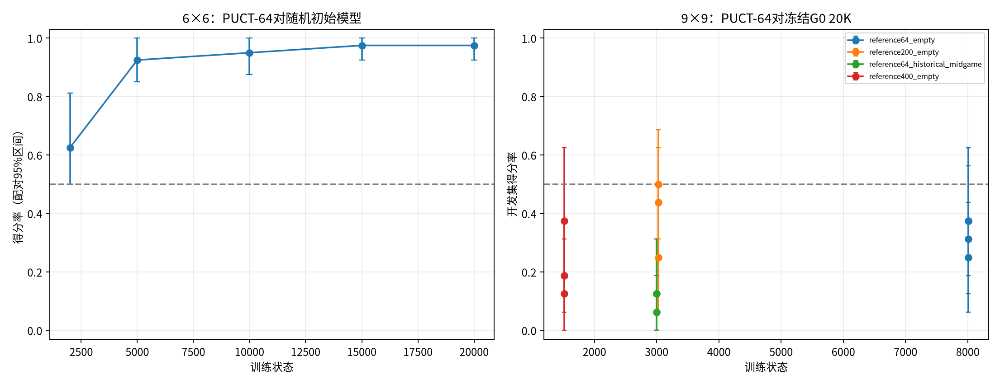
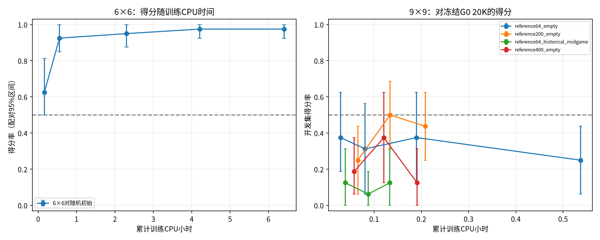
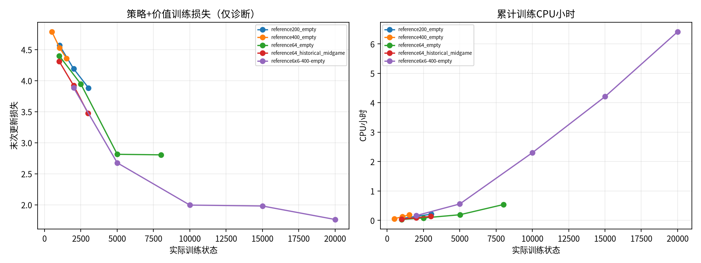
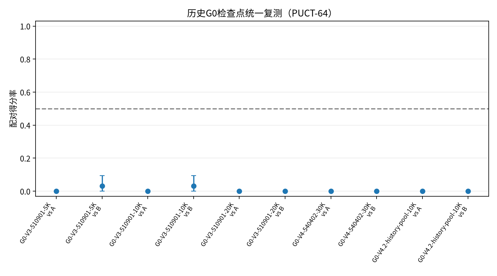
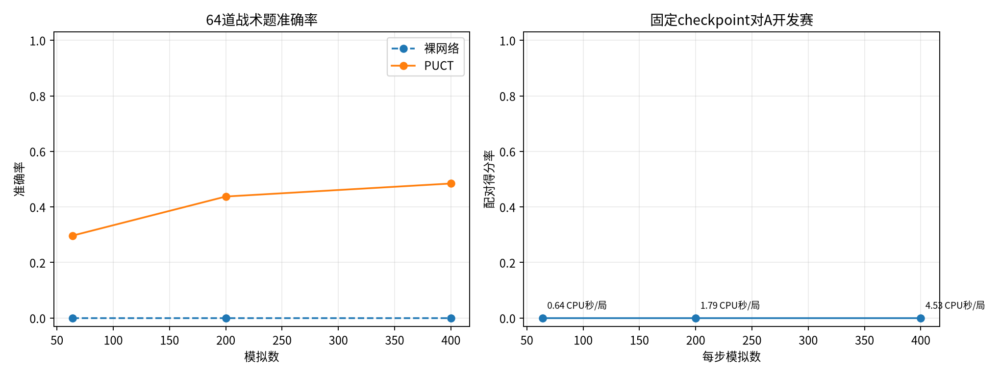

# WuziQ G V5：标准AlphaZero复现与G0学习闭环验证

- 分支：research/alphazero-g-v5；基线：37ec1423a2d971e52fea5e9bd708b0fe2fd54e5e。
- 状态：完成；配置SHA-256：ed39282807bc1d6a681ffa3afdeb4452587d117b29b18d372e06cb98c079d660。
- 计算上限10 CPU小时；实际 **7.956 CPU小时**（28640.1秒）。Runner没有可靠记录端到端wall时间，不用CPU值代替。
- 完成局数：2,429局自我对弈 + 1,968局评测 = 4,397局。逐局回放训练样本共35,552个；没有将重复checkpoint阶段数相加。
- 完整性：全部棋谱合法且完整；唯一ID通过；固定配置/checkpoint与7个上游源文件SHA校验通过。

## 结论摘要

- 标准AlphaZero从随机权重在6×6连四单种子上学到了更强的策略。15K模型对随机初始模型在20组新开局换色盲测为38-0-2，95.0%，配对95%区间87.5%–100%。这是该任务的真实正向结果，但不证明跨随机种子稳定，也不代表9×9。
- 9×9没有学到能击败A的棋力。最终候选PUCT-64盲测对A和B各0胜0平40负。
- 本轮没有证据证明G0存在唯一算法错误。历史G0对A均0胜0平，10K对20K只有13-19。9×9候选策略头的战术top-1为0/64，PUCT-64为19/64，唯一必防仅1/16；问题可能涉及先验、浅层搜索和防守覆盖，但不足以确认为G0退化根因。
- 建议先多种子复核6×6，再对9×9小预算验证策略先验、唯一防守探索和价值校准；当前不宜大幅扩展9×9训练。

## 参考实现与公平性边界

采用https://github.com/junxiaosong/AlphaZero_Gomoku，上游提交0b4917ccd84ea2771706701015eb26182c1159f4，MIT许可。源文件保存在third_party/AlphaZero_Gomoku并由SHA清单校验。保留上游4平面、32/64/128 CNN、MCTS/PUCT、Adam、8重几何增强和策略交叉熵+价值MSE；原生训练参数包括batch=512、replay=10,000、learning rate=0.002、每次更新5轮、根Dirichlet alpha=0.3/混入比例0.25、temperature=1、c_puct=5。兼容改动仅为loss标量读取和inference_mode推理。没有改搜索/训练目标。上游README的棋力宣称没有作为复现结果。
原G0是3平面、32通道、2残差块且有BatchNorm；参考网络无BatchNorm。因此是独立实现端到端对照，不是同构搜索消融。参考模型全部随机初始化，自我对弈目标只来自MCTS访问分布与终局胜负，不含A/B/C/E/F训练数据、教师标签、人工奖励或落子补丁。中盘路线只用历史G0自博弈前缀作起始局面，不作训练标签。

上游README建议用6×6连四作学习冒烟测试，并提到约500–1,000局；8×8连五建议约2,000–3,000局。这些是上游经验建议，不是本研究复现结果。本轮6×6共1,770局，9×9自由五子棋与上游README的示例规则不同。
固定种子与开局表保存在config/registration.json和opening_schedule.json：6×6训练/网络种子560602/560601，开发/盲测种子560603/560604；9×9训练/网络种子590502/590501，开发/盲测/历史开局种子590503/590504/590505。盲测每个对手20组新开局换色，checkpoint仅由开发集选择。

## 环境、预估和计算成本

CPU配额2.0核，内存上限8.0GiB，GPU=不可用，PyTorch2.15.0+cpu。预估乐观/正常/保守CPU时长：2.81/4.03/5.54小时。
实际预检35.7秒；训练7.483小时；评测0.440小时；runner收尾79.9秒；总计7.956小时。

## 6×6连四闭环

随机权重起步、400模拟/步；训练20,002状态、1,770局、1,767次更新，训练CPU6.413小时。晋级门槛[15000, 20000]通过=True；开发选中节点15000。

| 状态节点 | 对随机初始W-D-L | 得分率 | 配对95%区间 | 裸网胜点 | PUCT胜点 | 裸网必防 | PUCT必防 |
|---:|---:|---:|---:|---:|---:|---:|---:|
| 2000 | 10-0-6 | 62.5% | 50.0%–81.2% | 31.2% | 96.9% | 15.6% | 46.9% |
| 5000 | 37-0-3 | 92.5% | 85.0%–100.0% | 68.8% | 93.8% | 18.8% | 46.9% |
| 10000 | 38-0-2 | 95.0% | 87.5%–100.0% | 87.5% | 93.8% | 40.6% | 56.2% |
| 15000 | 39-0-1 | 97.5% | 92.5%–100.0% | 81.2% | 96.9% | 56.2% | 59.4% |
| 20000 | 39-0-1 | 97.5% | 92.5%–100.0% | 84.4% | 93.8% | 53.1% | 59.4% |

开发得分率按节点为62.5%, 92.5%, 95.0%, 97.5%, 97.5%；15K至20K持平。冻结15K模型在新20组盲测对初始模型38-0-2，得分95.0%，配对95%区间87.5%–100.0%，黑/白得分率100.0%/90.0%。早期已揭示的10K盲测另列为探索数据，不与新盲测合并。战术题按32个立即胜点与32个唯一防守局面分别计算，仅用于评估，不进入训练。

## 历史G0统一复测

统一9×9、PUCT-64、16组开发开局换色。

| 冻结G0 | 对手 | W-D-L | 得分率 | 配对95%区间 | 平均步数 |
|---|---|---:|---:|---:|---:|
| G0-V3-510901-5K | A | 0-0-32 | 0.0% | 0.0%–0.0% | 24.2 |
| G0-V3-510901-5K | B | 1-0-31 | 3.1% | 0.0%–9.4% | 12.8 |
| G0-V3-510901-10K | A | 0-0-32 | 0.0% | 0.0%–0.0% | 24.8 |
| G0-V3-510901-10K | B | 1-0-31 | 3.1% | 0.0%–9.4% | 12.8 |
| G0-V3-510901-20K | A | 0-0-32 | 0.0% | 0.0%–0.0% | 27.6 |
| G0-V3-510901-20K | B | 0-0-32 | 0.0% | 0.0%–0.0% | 12.7 |
| G0-V4-540402-30K | A | 0-0-32 | 0.0% | 0.0%–0.0% | 32.4 |
| G0-V4-540402-30K | B | 0-0-32 | 0.0% | 0.0%–0.0% | 12.8 |
| G0-V4.2-history-pool-10K | A | 0-0-32 | 0.0% | 0.0%–0.0% | 25.3 |
| G0-V4.2-history-pool-10K | B | 0-0-32 | 0.0% | 0.0%–0.0% | 12.8 |
| G0-V3-510901-10K | G0-V3-510901-20K | 13-0-19 | 40.6% | 28.1%–53.1% | 24.0 |

这些历史检查点对A均0胜0平；5K/10K对B各仅1胜。10K对20K为13-0-19（40.6%，区间28.1%–53.1%），说明更长训练不保证棋力单调增加，但样本不足以做普遍判断。
历史诊断仅作为跨版本背景：G V3的256状态BatchNorm探针选择冻结running statistics，但旧报告明确称该短探针不足以确认根因；G V4.1的回传符号/终局测试未复现符号错误，并报告网络与PUCT表现错位及浅层搜索对先验敏感；G V4.2记录历史策略头直接胜点0/48、目标平均先验质量约1.7%、原PUCT搜索约70.8%找到目标。这与本轮观察方向一致，但跨实验不是单变量因果验证。

## 9×9参考训练路线

| 路线 | 模拟/步 | 状态分布 | 状态数 | 自博弈局 | 更新数 | CPU小时 |
|---|---:|---|---:|---:|---:|---:|
| reference64_empty | 64 | empty board | 8,008 | 355 | 354 | 0.537 |
| reference200_empty | 200 | empty board | 3,028 | 97 | 96 | 0.209 |
| reference64_historical_midgame | 64 | random legal middle-game prefix from historical G0 self-play; prefixes only, no G0 actions/labels used as targets | 3,000 | 160 | 158 | 0.133 |
| reference400_empty | 400 | empty board | 1,514 | 47 | 46 | 0.191 |

四条路线合计15,550状态；各阶段均用PUCT-64评估。提高训练模拟数的成本单独记录。中盘起始路线改变状态分布，目标仍全部来自该网络搜索与终局。

| 路线最终节点 | 对随机初始W-D-L/得分 | 对G0 20K | 对A | 对B |
|---|---:|---:|---:|---:|
| reference64_empty@8000 | 12-0-4 / 75.0% | 4-0-12 / 25.0% | 0-0-16 / 0.0% | 0-0-16 / 0.0% |
| reference200_empty@3000 | 14-0-2 / 87.5% | 7-0-9 / 43.8% | 0-0-16 / 0.0% | 0-0-16 / 0.0% |
| reference64_historical_midgame@3000 | 10-0-6 / 62.5% | 2-0-14 / 12.5% | 0-0-16 / 0.0% | 0-0-16 / 0.0% |
| reference400_empty@1500 | 10-0-6 / 62.5% | 2-0-14 / 12.5% | 0-1-15 / 3.1% | 0-0-16 / 0.0% |

各参考模型能超过本路线随机初始网络，但对A/B几乎全负；只有400模拟路线一个开发局面与A平局。未找到可挑战A的新模型。

## 9×9最终盲测

开发规则选择reference200_empty@2000，实际状态2,001，200次模拟训练。冻结后使用20组新开局各换色，对每个对手40局。

| 对手 | W-D-L | 得分率 | 配对95%区间 | 黑/白得分率 | 候选CPU秒/局 |
|---|---:|---:|---:|---:|---:|
| A | 0-0-40 | 0.0% | 0.0%–0.0% | 0.0%/0.0% | 0.631 |
| B | 0-0-40 | 0.0% | 0.0%–0.0% | 0.0%/0.0% | 0.213 |
| G0-V3-510901-5K | 18-0-22 | 45.0% | 27.5%–62.5% | 55.0%/35.0% | 0.554 |
| G0-V3-510901-10K | 20-0-20 | 50.0% | 35.0%–65.0% | 65.0%/35.0% | 0.520 |
| G0-V3-510901-20K | 14-0-26 | 35.0% | 22.5%–47.5% | 40.0%/30.0% | 0.668 |
| G0-V4.2-history-pool-10K | 7-0-33 | 17.5% | 7.5%–27.5% | 20.0%/15.0% | 0.582 |

对A和B都0-0-40。对历史G0得分为：5K 45%（18-22）、10K 50%（20-20）、20K 35%（14-26）、V4.2 history-pool 10K 17.5%（7-33）；区间宽，不能作稳定实力顺序。全部配对局均落败时bootstrap区间会退化为0%–0%，不表示母体胜率没有不确定性；0/40二项Wilson 95%区间上限约8.8%，可作为补充参考。

## 同一checkpoint的搜索预算与战术对照

| 模拟/步 | 对A开发W-D-L | 得分率 | 候选CPU秒/局 |
|---:|---:|---:|---:|
| 64 | 0-0-16 | 0.0% | 0.639 |
| 200 | 0-0-16 | 0.0% | 1.790 |
| 400 | 0-0-16 | 0.0% | 4.533 |

64/200/400模拟在8组开发开局均未对A取得胜分；CPU成本约0.64/1.79/4.53秒每局。

| 模拟/题 | 裸网 | PUCT总计 | 立即胜点 | 边缘胜点 | 伪威胁 | 唯一必防 |
|---:|---:|---:|---:|---:|---:|---:|
| 64 | 0/64 | 19/64 (29.7%) | 9/16 | 8/16 | 1/16 | 1/16 |
| 200 | 0/64 | 28/64 (43.8%) | 12/16 | 13/16 | 1/16 | 2/16 |
| 400 | 0/64 | 31/64 (48.4%) | 12/16 | 15/16 | 1/16 | 3/16 |

64到400模拟时战术总准确率从19/64升到31/64；立即胜点9/16到12/16，边缘胜点8/16到15/16，唯一必防仅1/16到3/16，伪威胁始终1/16。属于搜索带来的题目收益，不是网络学习收益。

## 代码审计与限制

- 完整回放核验2,429局自博弈/35,552状态及1,968局评测；落子合法，终局和颜色得分与独立规则判定一致；访问分布归一化、非法点无权重，终局价值视角一致。
- 运行时修复两处实验编排/数据格式集成错误：6×6晋级节点序列化把整数当对象；旧V4.2战术题字段position/optimal_actions未转换。都经最小复现测试后修复，再从已有结果幂等续跑；这不是G0算法错误证据。
- 没有可复现证据证明G0的符号/终局回传有错，也不能声称已证明所有工程路径无缺陷。先前V4.1报告的网络与PUCT棋力错位现象与本轮诊断一致，但不足以定位唯一根因。
- 训练loss、增加搜索量均不作为棋力结论。6×6仅一个种子；9×9未打败A。

## 测试结果

- V5专项：14通过、0失败；命令：OMP_NUM_THREADS=1 MKL_NUM_THREADS=1 PYTHONPATH=. pytest -q tests/test_alphazero_g_v5_*.py。
- 仓库全量：465通过、29失败；29个失败均由历史V2/V3/V4/V6测试要求在各自隔离分支运行引起，当前V5工作树保留在其独立分支。失败均在branch guard提前退出，没有V5专项失败；全量测试警告：5。

## 对任务问题的回答

1. 标准AlphaZero在本环境从零学习了6×6连四；本轮没证明能学会9×9。
2. 原G0未成长的唯一根因未知。先验分布、浅层搜索与漏防是有数据支持的研究方向，不是已证实根因。
3. 新路线在6×6有效；9×9没有对A/B奏效的新路线。增加搜索改善战术题但不等于训练成长。
4. 先多种子复制6×6，再对9×9做小预算机制诊断，不建议扩大长训练。

## 复现与文件

- 配置：research/g_v5/config/；原始自我对弈棋谱/样本：research/g_v5/raw/；评测逐局棋谱：research/g_v5/results/matches/。
- 权重/训练状态：research/g_v5/checkpoints/；汇总CSV：research/g_v5/results/match_games.csv；逐局审计：research/g_v5/results/integrity_audit.json；源哈希：research/g_v5/reference/source_manifest.json。
- 复现命令（在仓库根目录运行）：
    OMP_NUM_THREADS=1 MKL_NUM_THREADS=1 PYTHONPATH=. python scripts/preflight_g_v5.py
    PYTHONPATH=. python -m src.research.alphazero_g.v5_registration
    OMP_NUM_THREADS=1 MKL_NUM_THREADS=1 PYTHONPATH=. python scripts/run_g_v5.py --session-cpu-seconds 3600
    PYTHONPATH=. python scripts/audit_g_v5.py
    PYTHONPATH=. python scripts/report_g_v5.py
