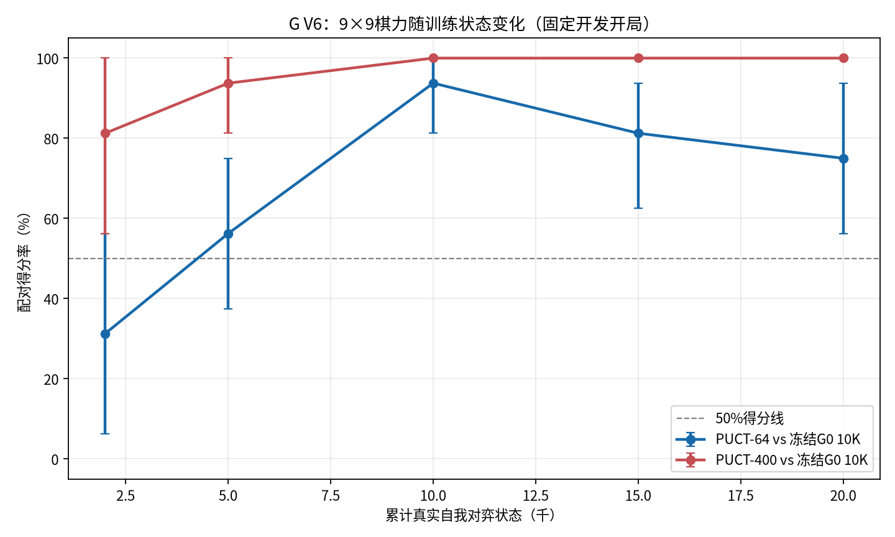
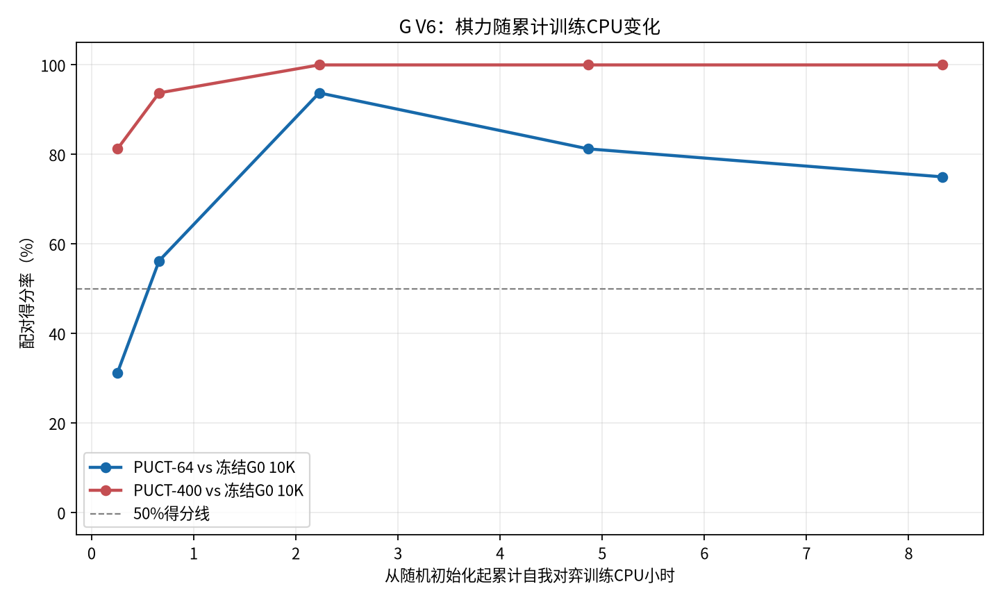
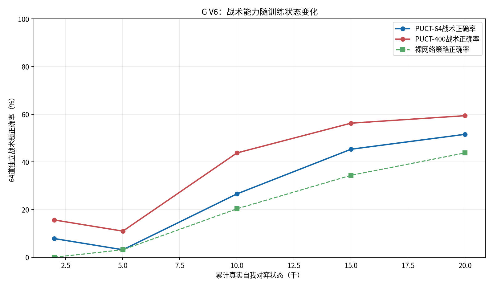

# WuziQ G V6：9×9等预算AlphaZero训练验证

- 状态：**完成**。分支：`research/alphazero-g-v6`。
- V5基线：`73aff7b2adb6d91b5890d6fef12ee7b0a43acc11`；注册代码：`c00bc12313a46bc1abf29adbc998218eb2875dd7`。
- 规则与训练：9×9自由五子棋，连五获胜；V5标准参考实现，Adam、8重旋转/反射数据增强、原策略交叉熵+价值MSE、原PUCT和Replay Buffer；每步400次配置搜索。
- V5检查点续训：从累计1,514状态、47局继续，训练目标是累计20,000个未增强真实局面状态；完整局边界会产生少量超出，报告实际值。棋谱增强后样本与状态数分开统计。
- 训练预算：10 CPU小时硬上限。已消耗V6实验CPU约 **9.61小时**，其中续训CPU约 **8.14小时**。当前累计训练状态 **20,001**（V6新增18,487）。全任务wall-clock未由runner可靠汇总，不将CPU小时当作墙钟时间。
- CPU/内存：2.0核配额，内存上限8.0GiB；设备CPU，PyTorch 2.15.0+cpu。

## 主要发现

完整盲测已完成。

20,001状态模型在开发集用PUCT-64和PUCT-400分别对冻结随机初始网络取得16/16胜；对历史G0 10K的得分率从2K节点的31.3%升到10K节点的93.8%，之后在15K和20K节点回落到81.3%和75.0%。这显示9×9的自博弈确实学到超过自身初始策略的能力，但训练增长并非随状态数单调提升。

对A的开发成绩随节点起伏：PUCT-64分别为0%、3.1%、18.8%、12.5%、15.6%；PUCT-400为3.1%、6.3%、12.5%、21.9%、28.1%。开发样本每条件仅16局，不能据此声称稳定超过A。冻结的10K候选在新盲测中对A取得PUCT-64的0胜1平39负（得分1.25%），PUCT-400的2胜7平31负（13.75%）；对B-50ms分别为2胜0平38负（5%）。因此训练让网络学会了部分策略和攻防，但尚未接近A到可竞争水平。

PUCT-400对A的得分比同一冻结候选PUCT-64高12.5个百分点；这是固定网络增加搜索的收益，不能算训练进步。各节点的同预算对照、独立战术集和最终新开局盲测分开列示，不能把搜索提升、训练损失下降或有限开发集优势混为一谈。盲测开局是在候选冻结后使用的。

跨棋盘参考：V5的6×6连四、15K模型在20组全新换色开局上以PUCT-64对随机初始网络取得38胜2负（95.0%，配对95%区间87.5%–100%）。V6的9×9规则、对手和训练起点不同，不能作严格因果比较；但本轮开发集对随机初始网络的16/16胜与最终仍难以对抗A，说明相同搜索次数/状态量不能把6×6成绩直接外推到9×9。

## V5与V6预算对照

| 检查点/实验 | 评测预算 | 对手 | 局数 | 胜平负 | 得分率 | 配对95%区间 |
|---|---:|---|---:|---|---:|---|
| V5 reference400@1500 | PUCT-64 | ref9x9@0 | 16 | 10胜 0平 6负 | 62.5% | 37.5%–81.2% |
| V5 reference400@1500 | PUCT-64 | G0-V3-510901-20K | 16 | 2胜 0平 14负 | 12.5% | 0.0%–31.2% |
| V5 reference400@1500 | PUCT-64 | A | 16 | 0胜 1平 15负 | 3.1% | 0.0%–9.4% |
| V5 reference400@1500 | PUCT-64 | B | 16 | 0胜 0平 16负 | 0.0% | 0.0%–0.0% |
| V5 reference200_empty@2000 | PUCT-64 | A | 40 | 0胜 0平 40负 | 0.0% | 0.0%–0.0% |
| V5 reference200_empty@2000 | PUCT-64 | B | 40 | 0胜 0平 40负 | 0.0% | 0.0%–0.0% |
| V5 reference200_empty@2000 | PUCT-64 | G0-V3-510901-5K | 40 | 18胜 0平 22负 | 45.0% | 27.5%–62.5% |
| V5 reference200_empty@2000 | PUCT-64 | G0-V3-510901-10K | 40 | 20胜 0平 20负 | 50.0% | 35.0%–65.0% |
| V5 reference200_empty@2000 | PUCT-64 | G0-V3-510901-20K | 40 | 14胜 0平 26负 | 35.0% | 22.5%–47.5% |
| V5 reference200_empty@2000 | PUCT-64 | G0-V4.2-history-pool-10K | 40 | 7胜 0平 33负 | 17.5% | 7.5%–27.5% |

V5的9×9 reference400路线在V5中只训练至约1.5K状态；V6延续其完整训练状态至20K累计目标，算法、网络、学习目标及训练参数保持冻结。V6开发集为8组开局换色；最终盲测为20组全新开局换色，每个对手在每档预算各40局。

## 训练节点与训练损失

| 注册节点 | 实际累计状态 | 累计自博弈局数（括号为V6新增） | 优化更新 | 节点loss | 策略熵 | 从随机初始化累计训练CPU小时 |
|---:|---:|---:|---:|---:|---:|---:|
| 2,000 | 2,003 | 63 (V6新增 16) | 62 | 3.8634 | 3.5214 | 0.25 |
| 5,000 | 5,006 | 196 (V6新增 149) | 195 | 3.2052 | 2.6370 | 0.66 |
| 10,000 | 10,004 | 482 (V6新增 435) | 481 | 2.6302 | 2.0867 | 2.23 |
| 15,000 | 15,006 | 744 (V6新增 697) | 743 | 2.6697 | 2.2544 | 4.86 |
| 20,000 | 20,001 | 1,012 (V6新增 965) | 1,011 | 2.7284 | 2.2881 | 8.33 |

loss下降不作为棋力提升证据。策略熵和价值/策略损失在阶段结果中保存；不同阶段训练状态增加并不等同于相同更新数。

## 开发集：阶段棋力变化

每个节点以同一组已注册开发开局、黑白换色，对随机初始参考网络、冻结历史G0 5K/10K/20K、A及B-50ms评测。每个节点均用PUCT-64与PUCT-400；计分为胜1、平0.5、负0，区间按配对开局bootstrap计算。

| 实际状态 | 候选预算 | 对手 | 完成局数 | 胜平负 | 得分率 | 配对95%区间 | 黑/白得分率 | 候选平均CPU秒/局 |
|---:|---:|---|---:|---|---:|---|---|---:|
| 2,003 | 64 | ref-v6-initial | 16 | 12胜 0平 4负 | 75.0% | 56.2%–93.8% | 100.0%/50.0% | 0.74 |
| 2,003 | 64 | G0-V3-510901-5K | 16 | 5胜 0平 11负 | 31.2% | 6.2%–56.2% | 25.0%/37.5% | 0.33 |
| 2,003 | 64 | G0-V3-510901-10K | 16 | 5胜 0平 11负 | 31.2% | 6.2%–56.2% | 12.5%/50.0% | 0.34 |
| 2,003 | 64 | G0-V3-510901-20K | 16 | 4胜 0平 12负 | 25.0% | 6.2%–50.0% | 12.5%/37.5% | 0.55 |
| 2,003 | 64 | A | 16 | 0胜 0平 16负 | 0.0% | 0.0%–0.0% | 0.0%/0.0% | 0.64 |
| 2,003 | 64 | B-50ms | 16 | 0胜 0平 16负 | 0.0% | 0.0%–0.0% | 0.0%/0.0% | 0.20 |
| 2,003 | 400 | ref-v6-initial | 16 | 14胜 0平 2负 | 87.5% | 68.8%–100.0% | 100.0%/75.0% | 4.63 |
| 2,003 | 400 | G0-V3-510901-5K | 16 | 10胜 0平 6负 | 62.5% | 31.2%–87.5% | 62.5%/62.5% | 3.57 |
| 2,003 | 400 | G0-V3-510901-10K | 16 | 13胜 0平 3负 | 81.2% | 56.2%–100.0% | 87.5%/75.0% | 3.57 |
| 2,003 | 400 | G0-V3-510901-20K | 16 | 6胜 0平 10负 | 37.5% | 12.5%–62.5% | 50.0%/25.0% | 3.72 |
| 2,003 | 400 | A | 16 | 0胜 1平 15负 | 3.1% | 0.0%–9.4% | 6.2%/0.0% | 4.39 |
| 2,003 | 400 | B-50ms | 16 | 1胜 0平 15负 | 6.2% | 0.0%–18.8% | 12.5%/0.0% | 1.35 |
| 5,006 | 64 | ref-v6-initial | 16 | 15胜 0平 1负 | 93.8% | 81.2%–100.0% | 100.0%/87.5% | 0.41 |
| 5,006 | 64 | G0-V3-510901-5K | 16 | 9胜 0平 7负 | 56.2% | 37.5%–75.0% | 87.5%/25.0% | 0.30 |
| 5,006 | 64 | G0-V3-510901-10K | 16 | 9胜 0平 7负 | 56.2% | 37.5%–75.0% | 87.5%/25.0% | 0.31 |
| 5,006 | 64 | G0-V3-510901-20K | 16 | 13胜 0平 3负 | 81.2% | 62.5%–93.8% | 100.0%/62.5% | 0.38 |
| 5,006 | 64 | A | 16 | 0胜 1平 15负 | 3.1% | 0.0%–9.4% | 6.2%/0.0% | 0.71 |
| 5,006 | 64 | B-50ms | 16 | 0胜 0平 16负 | 0.0% | 0.0%–0.0% | 0.0%/0.0% | 0.23 |
| 5,006 | 400 | ref-v6-initial | 16 | 16胜 0平 0负 | 100.0% | 100.0%–100.0% | 100.0%/100.0% | 2.92 |
| 5,006 | 400 | G0-V3-510901-5K | 16 | 15胜 0平 1负 | 93.8% | 81.2%–100.0% | 100.0%/87.5% | 2.40 |
| 5,006 | 400 | G0-V3-510901-10K | 16 | 15胜 0平 1负 | 93.8% | 81.2%–100.0% | 100.0%/87.5% | 2.13 |
| 5,006 | 400 | G0-V3-510901-20K | 16 | 15胜 0平 1负 | 93.8% | 81.2%–100.0% | 100.0%/87.5% | 2.73 |
| 5,006 | 400 | A | 16 | 0胜 2平 14负 | 6.2% | 0.0%–12.5% | 0.0%/12.5% | 5.73 |
| 5,006 | 400 | B-50ms | 16 | 0胜 0平 16负 | 0.0% | 0.0%–0.0% | 0.0%/0.0% | 1.36 |
| 10,004 | 64 | ref-v6-initial | 16 | 16胜 0平 0负 | 100.0% | 100.0%–100.0% | 100.0%/100.0% | 0.58 |
| 10,004 | 64 | G0-V3-510901-5K | 16 | 15胜 0平 1负 | 93.8% | 81.2%–100.0% | 100.0%/87.5% | 0.58 |
| 10,004 | 64 | G0-V3-510901-10K | 16 | 15胜 0平 1负 | 93.8% | 81.2%–100.0% | 100.0%/87.5% | 0.55 |
| 10,004 | 64 | G0-V3-510901-20K | 16 | 14胜 0平 2负 | 87.5% | 68.8%–100.0% | 87.5%/87.5% | 0.58 |
| 10,004 | 64 | A | 16 | 3胜 0平 13负 | 18.8% | 6.2%–37.5% | 25.0%/12.5% | 1.78 |
| 10,004 | 64 | B-50ms | 16 | 1胜 0平 15负 | 6.2% | 0.0%–18.8% | 12.5%/0.0% | 0.51 |
| 10,004 | 400 | ref-v6-initial | 16 | 16胜 0平 0负 | 100.0% | 100.0%–100.0% | 100.0%/100.0% | 4.04 |
| 10,004 | 400 | G0-V3-510901-5K | 16 | 16胜 0平 0负 | 100.0% | 100.0%–100.0% | 100.0%/100.0% | 3.81 |
| 10,004 | 400 | G0-V3-510901-10K | 16 | 16胜 0平 0负 | 100.0% | 100.0%–100.0% | 100.0%/100.0% | 3.97 |
| 10,004 | 400 | G0-V3-510901-20K | 16 | 15胜 0平 1负 | 93.8% | 81.2%–100.0% | 100.0%/87.5% | 4.00 |
| 10,004 | 400 | A | 16 | 2胜 0平 14负 | 12.5% | 0.0%–31.2% | 25.0%/0.0% | 13.25 |
| 10,004 | 400 | B-50ms | 16 | 1胜 0平 15负 | 6.2% | 0.0%–18.8% | 12.5%/0.0% | 3.25 |
| 15,006 | 64 | ref-v6-initial | 16 | 16胜 0平 0负 | 100.0% | 100.0%–100.0% | 100.0%/100.0% | 0.77 |
| 15,006 | 64 | G0-V3-510901-5K | 16 | 13胜 0平 3负 | 81.2% | 56.2%–100.0% | 75.0%/87.5% | 0.75 |
| 15,006 | 64 | G0-V3-510901-10K | 16 | 13胜 0平 3负 | 81.2% | 62.5%–93.8% | 75.0%/87.5% | 0.72 |
| 15,006 | 64 | G0-V3-510901-20K | 16 | 15胜 0平 1负 | 93.8% | 81.2%–100.0% | 87.5%/100.0% | 0.81 |
| 15,006 | 64 | A | 16 | 1胜 2平 13负 | 12.5% | 0.0%–25.0% | 6.2%/18.8% | 2.81 |
| 15,006 | 64 | B-50ms | 16 | 0胜 0平 16负 | 0.0% | 0.0%–0.0% | 0.0%/0.0% | 0.66 |
| 15,006 | 400 | ref-v6-initial | 16 | 16胜 0平 0负 | 100.0% | 100.0%–100.0% | 100.0%/100.0% | 4.91 |
| 15,006 | 400 | G0-V3-510901-5K | 16 | 16胜 0平 0负 | 100.0% | 100.0%–100.0% | 100.0%/100.0% | 4.68 |
| 15,006 | 400 | G0-V3-510901-10K | 16 | 16胜 0平 0负 | 100.0% | 100.0%–100.0% | 100.0%/100.0% | 4.73 |
| 15,006 | 400 | G0-V3-510901-20K | 16 | 13胜 0平 3负 | 81.2% | 62.5%–93.8% | 87.5%/75.0% | 5.45 |
| 15,006 | 400 | A | 16 | 1胜 5平 10负 | 21.9% | 12.5%–31.2% | 31.2%/12.5% | 23.57 |
| 15,006 | 400 | B-50ms | 16 | 2胜 0平 14负 | 12.5% | 0.0%–31.2% | 12.5%/12.5% | 4.00 |
| 20,001 | 64 | ref-v6-initial | 16 | 16胜 0平 0负 | 100.0% | 100.0%–100.0% | 100.0%/100.0% | 0.91 |
| 20,001 | 64 | G0-V3-510901-5K | 16 | 12胜 0平 4负 | 75.0% | 56.2%–93.8% | 75.0%/75.0% | 0.81 |
| 20,001 | 64 | G0-V3-510901-10K | 16 | 12胜 0平 4负 | 75.0% | 56.2%–93.8% | 75.0%/75.0% | 0.79 |
| 20,001 | 64 | G0-V3-510901-20K | 16 | 14胜 0平 2负 | 87.5% | 68.8%–100.0% | 87.5%/87.5% | 0.95 |
| 20,001 | 64 | A | 16 | 1胜 3平 12负 | 15.6% | 3.1%–28.1% | 25.0%/6.2% | 3.80 |
| 20,001 | 64 | B-50ms | 16 | 2胜 0平 14负 | 12.5% | 0.0%–37.5% | 12.5%/12.5% | 0.89 |
| 20,001 | 400 | ref-v6-initial | 16 | 16胜 0平 0负 | 100.0% | 100.0%–100.0% | 100.0%/100.0% | 6.11 |
| 20,001 | 400 | G0-V3-510901-5K | 16 | 16胜 0平 0负 | 100.0% | 100.0%–100.0% | 100.0%/100.0% | 6.05 |
| 20,001 | 400 | G0-V3-510901-10K | 16 | 16胜 0平 0负 | 100.0% | 100.0%–100.0% | 100.0%/100.0% | 5.48 |
| 20,001 | 400 | G0-V3-510901-20K | 16 | 13胜 0平 3负 | 81.2% | 62.5%–100.0% | 100.0%/62.5% | 7.55 |
| 20,001 | 400 | A | 16 | 2胜 5平 9负 | 28.1% | 12.5%–43.8% | 43.8%/12.5% | 26.09 |
| 20,001 | 400 | B-50ms | 16 | 2胜 0平 14负 | 12.5% | 0.0%–31.2% | 0.0%/25.0% | 5.20 |





## 战术题变化

| 实际状态 | 搜索预算 | 题型 | 题数 | 裸网络准确率 | 搜索后准确率 |
|---:|---:|---|---:|---:|---:|
| 2,003 | 64 | direct_win | 16 | 0.0% | 18.8% |
| 2,003 | 64 | edge_win | 16 | 0.0% | 6.2% |
| 2,003 | 64 | false_threat | 16 | 0.0% | 0.0% |
| 2,003 | 64 | unique_block | 16 | 0.0% | 6.2% |
| 2,003 | 400 | direct_win | 16 | 0.0% | 37.5% |
| 2,003 | 400 | edge_win | 16 | 0.0% | 6.2% |
| 2,003 | 400 | false_threat | 16 | 0.0% | 0.0% |
| 2,003 | 400 | unique_block | 16 | 0.0% | 18.8% |
| 5,006 | 64 | direct_win | 16 | 0.0% | 0.0% |
| 5,006 | 64 | edge_win | 16 | 0.0% | 0.0% |
| 5,006 | 64 | false_threat | 16 | 0.0% | 0.0% |
| 5,006 | 64 | unique_block | 16 | 12.5% | 12.5% |
| 5,006 | 400 | direct_win | 16 | 0.0% | 18.8% |
| 5,006 | 400 | edge_win | 16 | 0.0% | 12.5% |
| 5,006 | 400 | false_threat | 16 | 0.0% | 0.0% |
| 5,006 | 400 | unique_block | 16 | 12.5% | 12.5% |
| 10,004 | 64 | direct_win | 16 | 18.8% | 31.2% |
| 10,004 | 64 | edge_win | 16 | 25.0% | 31.2% |
| 10,004 | 64 | false_threat | 16 | 12.5% | 12.5% |
| 10,004 | 64 | unique_block | 16 | 25.0% | 31.2% |
| 10,004 | 400 | direct_win | 16 | 18.8% | 56.2% |
| 10,004 | 400 | edge_win | 16 | 25.0% | 50.0% |
| 10,004 | 400 | false_threat | 16 | 12.5% | 25.0% |
| 10,004 | 400 | unique_block | 16 | 25.0% | 43.8% |
| 15,006 | 64 | direct_win | 16 | 37.5% | 62.5% |
| 15,006 | 64 | edge_win | 16 | 31.2% | 43.8% |
| 15,006 | 64 | false_threat | 16 | 18.8% | 25.0% |
| 15,006 | 64 | unique_block | 16 | 50.0% | 50.0% |
| 15,006 | 400 | direct_win | 16 | 37.5% | 81.2% |
| 15,006 | 400 | edge_win | 16 | 31.2% | 50.0% |
| 15,006 | 400 | false_threat | 16 | 18.8% | 37.5% |
| 15,006 | 400 | unique_block | 16 | 50.0% | 56.2% |
| 20,001 | 64 | direct_win | 16 | 56.2% | 68.8% |
| 20,001 | 64 | edge_win | 16 | 31.2% | 31.2% |
| 20,001 | 64 | false_threat | 16 | 25.0% | 43.8% |
| 20,001 | 64 | unique_block | 16 | 62.5% | 62.5% |
| 20,001 | 400 | direct_win | 16 | 56.2% | 68.8% |
| 20,001 | 400 | edge_win | 16 | 31.2% | 50.0% |
| 20,001 | 400 | false_threat | 16 | 25.0% | 56.2% |
| 20,001 | 400 | unique_block | 16 | 62.5% | 62.5% |



题集来自冻结的V4.2独立战术评估，仅用于评测；它没有进入训练回放或奖励。64与400搜索差值是计算搜索收益，不是学习收益。

## 最终盲测

| 冻结候选 / 对手 | 局数 | 胜平负 | 得分率 | 配对95%区间 | 黑/白得分率 | 候选平均CPU秒/局 |
|---|---:|---|---:|---|---|---:|
| A / puct64 | 40 | 0胜 1平 39负 | 1.2% | 0.0%–3.8% | 0.0%/2.5% | 1.89 |
| A / puct400 | 40 | 2胜 7平 31负 | 13.8% | 6.2%–22.5% | 17.5%/10.0% | 13.57 |
| B-50ms / puct64 | 40 | 2胜 0平 38负 | 5.0% | 0.0%–12.5% | 10.0%/0.0% | 0.39 |
| B-50ms / puct400 | 40 | 2胜 0平 38负 | 5.0% | 0.0%–12.5% | 10.0%/0.0% | 2.78 |

候选选择只使用PUCT-64开发集上对冻结G0-V3-510901-10K的配对得分；并列时选较早节点。`frozen_candidate.json`必须先于最终盲测生成，盲测结果不用于模型选择。40局/条件是探索性样本，区间可能较宽。

## 检查点恢复与完整性

- V5来源验证：模型权重与node_1500完全一致；Adam槽、10,000行Replay Buffer和Python/NumPy/PyTorch RNG逐项加载校验。V5原始状态SHA-256保持不变。
- 最终可续训状态：{"board_size": 9, "environment_states": 20001, "games_completed": 1012, "model_restored": true, "numpy_rng_restored": true, "optimizer_restored": true, "optimizer_slots": 16, "optimizer_updates": 1011, "path": "research/g_v6/checkpoints/reference400_empty/training_state.pt", "python_rng_restored": true, "replay_rows": 10000, "sha256": "b14d36916c545da78149a7ef70e6c2285c6ccabbfd2c9e36e77cbdf825758e0d", "simulations_per_move": 400, "torch_rng_restored": true, "v5_origin_states": 1514, "v6_added_games": 965, "v6_added_states": 18487}
- V6自博弈棋谱：965局；回放训练状态18,487。评测棋谱：1120局；完整配对开局560组；未完成配对0组。
- 所有已完成棋谱经V5独立网格规则器回放：落子合法、终局一致、唯一ID无重复；训练策略目标概率归一且非法点权重为零。
- Drive最新V6恢复快照信息由`results/snapshot_status.json`登记，最终哈希与空目录恢复结果在此保存。

## 资源估算与实耗

预检实测400模拟完整局CPU 5.33秒、13个决策状态；单次真实optimizer update 1.754秒。20K目标总CPU估算：乐观2.80小时、正常3.50小时、保守5.60小时；实耗9.61小时。

实耗高于预检保守估计：新增965局自博弈，平均每局19.16个训练状态（预检参考历史均值32.21）；预检估为剩余574局，实际因训练局更短而完成目标需更多局。CPU实测每新增训练局的批次更新约15.26秒，高于预检单次update 1.75秒。保守估计5.60小时，实耗9.61小时；总量仍低于10小时上限，余量约0.39小时。

## 结论

最终盲测：PUCT-64对A: 0胜 1平 39负，得分率1.2%，配对95%区间0.0%–3.8%；PUCT-64对B-50ms: 2胜 0平 38负，得分率5.0%，配对95%区间0.0%–12.5%；PUCT-400对A: 2胜 7平 31负，得分率13.8%，配对95%区间6.2%–22.5%；PUCT-400对B-50ms: 2胜 0平 38负，得分率5.0%，配对95%区间0.0%–12.5%。应结合各阶段同预算开发曲线判断是持续学习、只优于随机初始，还是仍无稳定增长。

### 三个研究问题

1. **9×9在相近搜索预算与20K状态规模下能否学习？**能看到真实的自博弈学习：全部节点都在开发集击败随机初始化参考网络；相对冻结G0-10K的PUCT-64表现先从31.3%升至93.8%，但随后降至75.0%。这是有限开发集上的明显提升证据，不是持续单调成长，也不是对强棋手的胜利证明。
2. **提升体现在哪里？**20K节点独立战术题上，裸网络总体正确率43.8%，PUCT-64为51.6%，PUCT-400为59.4%；直接取胜题分别为56.3%/68.8%/68.8%，唯一必防题为62.5%/62.5%/62.5%。这些结果说明学到一些基础攻防，但仍有大量战术题未解。对A的最终新开局盲测仅1.25%（PUCT-64）和13.75%（PUCT-400），仍显著弱于A的实战表现。
3. **若还没明显成长，下一步查什么？**本轮证明训练目标能带来基础成长，但没有跨到A/B棋力层级。下一步应优先扩大独立对局与战术题覆盖，诊断策略先验、价值估值和搜索访问分布如何造成实战差距；不应把简单增加训练状态或搜索预算当成已验证方案。

## 复现

```bash
OMP_NUM_THREADS=1 MKL_NUM_THREADS=1 PYTHONPATH=. python scripts/register_g_v6.py
OMP_NUM_THREADS=1 MKL_NUM_THREADS=1 PYTHONPATH=. python scripts/preflight_g_v6.py
OMP_NUM_THREADS=1 MKL_NUM_THREADS=1 PYTHONPATH=. python scripts/run_g_v6.py --through-stage 2000
OMP_NUM_THREADS=1 MKL_NUM_THREADS=1 PYTHONPATH=. python scripts/run_g_v6.py --through-stage 5000
OMP_NUM_THREADS=1 MKL_NUM_THREADS=1 PYTHONPATH=. python scripts/run_g_v6.py --through-stage 10000
OMP_NUM_THREADS=1 MKL_NUM_THREADS=1 PYTHONPATH=. python scripts/run_g_v6.py --through-stage 15000
OMP_NUM_THREADS=1 MKL_NUM_THREADS=1 PYTHONPATH=. python scripts/run_g_v6.py --through-stage 20000
OMP_NUM_THREADS=1 MKL_NUM_THREADS=1 PYTHONPATH=. python scripts/run_g_v6.py --finalize-blind
OMP_NUM_THREADS=1 MKL_NUM_THREADS=1 PYTHONPATH=. python scripts/audit_g_v6.py
OMP_NUM_THREADS=1 MKL_NUM_THREADS=1 PYTHONPATH=. python scripts/report_g_v6.py
```

结果、开局池、完整checkpoint、自博弈棋谱、训练样本及逐局评测保存在`research/g_v6/`。本轮不涉及神经网络训练以外的教师监督或规则补丁。
