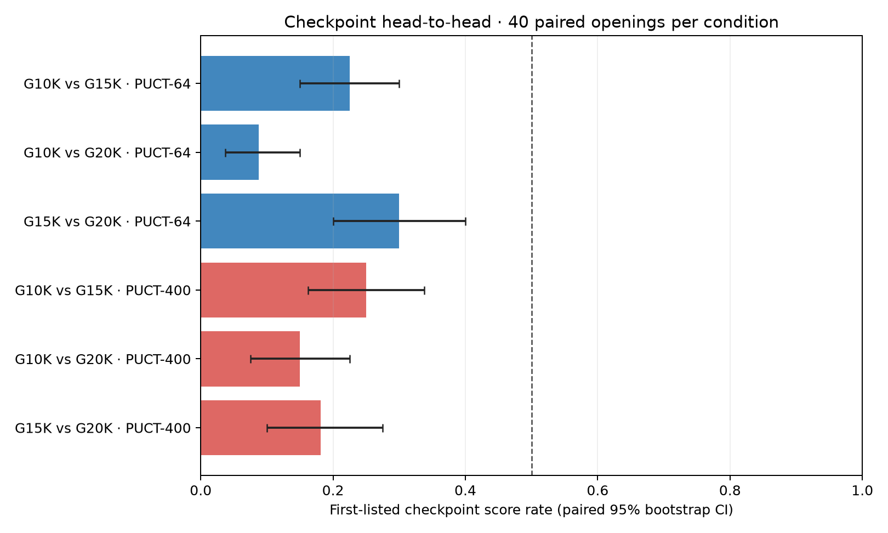
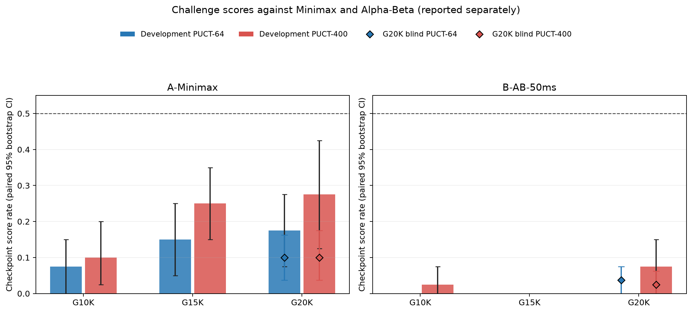
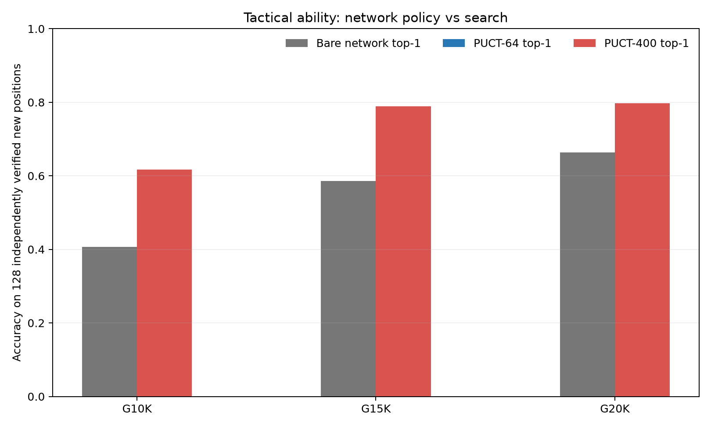

# WuziQ AlphaZero G V6.1 检查点横向验证报告

## 结论摘要

统一对局下，**G20K 在 PUCT-64 与 PUCT-400 都是三个冻结检查点中最强候选**。在开发赛的等权直接交锋平均得分率，G20K分别为 80.6%、83.4%；G15K为 53.8%、46.6%；G10K为 15.6%、20.0%。配对开局bootstrap区间和逐组直接对局均支持20K领先；这否定了“10K是绝对最强”的早期判断，但**不代表20K已经战胜强传统搜索棋手**。

对Minimax A的开发得分率随检查点从10K到20K上升；对Alpha-Beta B也出现少量20K得分，但幅度小、区间宽，仍远低于50%。PUCT-400相对PUCT-64对A有帮助，尤其15K/20K；对B的收益有限。新战术集上20K裸策略和搜索总体最好，但题型间不均衡，且单点题分数不能替代完整对局。

本轮没有训练、改权重或调参。正式赛 **1,280局、640组配对换色**；另外预检6局不计成绩。全量棋谱通过合法性、终局、模型身份和换色完整性审计，唯一ID 1,280，未完成配对 0。

## 1. 模型与冻结检查

基线提交为 `0405b288d44e0cc35cfefb08a17f0714a1b3683e`。三份检查点启动前逐一核对SHA-256、结构和可加载性；所有条件采用同一9×9自由五子规则、同一个V6参考网络及搜索实现。

| 检查点 | 环境状态 | 相同结构/规则 | SHA-256 |
|---|---:|---|---|
| G10K | 10,004 | `research/g_v6/checkpoints/reference400_empty/node_10000.pt` | `5aece10655c0ae4f606888163fe96f7b3b8a48e9bfbc29a8919a5ad45ed72137` |
| G15K | 15,006 | `research/g_v6/checkpoints/reference400_empty/node_15000.pt` | `b32d3292efdc96366cb630d4df920cd60bfdbe3bcd16fdb64fdc4619cc9ec862` |
| G20K | 20,001 | `research/g_v6/checkpoints/reference400_empty/node_20000.pt` | `b6e14e947fd176794ca050faab3b7f6331ec881ffd01d8584b1e8943b48cbc05` |

网络架构：4-plane CNN 32/64/128 with policy/value heads; no BatchNorm。规则为freestyle Gomoku; five in a row wins; same V6 reference engine, independent grid oracle。没有发生训练或搜索参数改变。PUCT c_puct=5、根噪声关闭、温度0.001；根边实际访问数为N，参考实现因根节点初次展开配置playout=N+1。模型间不复用搜索树。

**引擎标签映射说明：**项目原生A是规则选择器、原生B是纯Minimax、原生C是Alpha-Beta；本任务的对手A要求Minimax、B要求Alpha-Beta 50ms。因此记录采用语义别名 `A-Minimax`→原生B、`B-AB-50ms`→原生C。逐局JSON保存映射，避免名称混淆。两者均为50ms/步。

## 2. 赛程与统计方法

三个直接交手配对在每个搜索档各使用40个独立开局、每个开局黑白各一局，共480局。与A/B的开发赛每个模型、对手、预算各20组换色，共480局。按开发集选择出的赢家在全新盲测开局挑战A/B；两个预算均选择G20K，每个条件40组换色，共320局。历史V6盲测未复用。

开发/盲测开局固定并在注册时哈希：`ad73ae1d3924f25df4f6c1613b9e422d9460c930300b009a3692dbe4c09abf71`。同组交换颜色，胜1、平0.5、负0；置信区间按开局组重采样。开发选择规则已在解盲前登记：每预算先看相对另两个检查点的等权平均配对得分，完全同分时依次看A、B、再看战术准确率；A/B不合并。冻结结果为 `{"400": "G20K", "64": "G20K"}`。选择结果不声称统计显著排序。

预检测得环境：3个可见CPU、cgroup限额`200000 100000`、内存上限8GiB，PyTorch `2.15.0+cpu` CPU版，线程数1。预检累计10.3 CPU秒。运行前按30/50/70着子情景估算总CPU时间分别约5.08/8.32/11.56小时；保守估计高于10小时，所以预注册规则是优先做完P0、P1，剩余预算再做盲测。实际全量任务在10小时CPU上限内完成。

## 3. 三检查点直接对局

表格按“左侧模型作为候选者”列出W-D-L与得分率；矩阵为行棋手相对于列棋手的得分率，区间为配对95% bootstrap CI。

| 左侧模型 | 对手 | 搜索 | 左侧模型W-D-L | 得分率（配对95%区间） | 黑方 / 白方得分率 | 平均步数 | 平均CPU秒/局 |
|---|---|---:|---:|---:|---:|---:|---:|
| G10K | G15K | 64 | 18-0-62 | 22.5% [15.0%, 30.0%] | 30.0% / 15.0% | 19.93 | 0.893 |
| G10K | G20K | 64 | 7-0-73 | 8.8% [3.8%, 15.0%] | 17.5% / 0.0% | 20.24 | 1.020 |
| G15K | G20K | 64 | 24-0-56 | 30.0% [20.0%, 40.0%] | 35.0% / 25.0% | 23.12 | 1.429 |
| G10K | G15K | 400 | 20-0-60 | 25.0% [16.2%, 33.8%] | 27.5% / 22.5% | 21.43 | 6.048 |
| G10K | G20K | 400 | 12-0-68 | 15.0% [7.5%, 22.5%] | 20.0% / 10.0% | 22.95 | 6.845 |
| G15K | G20K | 400 | 14-1-65 | 18.1% [10.0%, 27.5%] | 21.2% / 15.0% | 24.89 | 9.457 |

### PUCT-64相对得分矩阵

| 棋手 | G10K | G15K | G20K |
|---|---:|---:|---:|
| G10K | — | 22.5% [15.0%, 30.0%] | 8.8% [3.8%, 15.0%] |
| G15K | 77.5% [70.0%, 85.0%] | — | 30.0% [20.0%, 40.0%] |
| G20K | 91.2% [85.0%, 96.2%] | 70.0% [60.0%, 80.0%] | — |

### PUCT-400相对得分矩阵

| 棋手 | G10K | G15K | G20K |
|---|---:|---:|---:|
| G10K | — | 25.0% [16.2%, 33.8%] | 15.0% [7.5%, 22.5%] |
| G15K | 75.0% [66.2%, 83.8%] | — | 18.1% [10.0%, 27.5%] |
| G20K | 85.0% [77.5%, 92.5%] | 81.9% [72.5%, 90.0%] | — |

*图1：三个检查点直接交手。*

直接对局只出现一平（G15K对G20K的PUCT-400）；其余为胜负。两个搜索档下G20K都赢了G10K与G15K的多数配对，且优势不是由训练状态数标签推断得出。G10K对G15K的比较接近得多；其点估计在64/400下分别是22.5%/25%，不宜解读为早期模型稳定胜过15K。

## 4. 对Minimax A与Alpha-Beta B的统一挑战

### 开发集（20组换色开局，每条件40局）

| 赛道 | 棋手 | 对手 | 搜索 | W-D-L | 得分率（配对95%区间） | 黑方 / 白方得分率 | 平均步数 | 棋手平均CPU秒/局 |
|---|---|---|---:|---:|---:|---:|---:|---:|
| development | G10K | A-Minimax | 64 | 3-0-37 | 7.5% [0.0%, 15.0%] | 5.0% / 10.0% | 13.18 | 0.414 |
| development | G10K | A-Minimax | 400 | 4-0-36 | 10.0% [2.5%, 20.0%] | 10.0% / 10.0% | 13.80 | 2.913 |
| development | G10K | B-AB-50ms | 64 | 0-0-40 | 0.0% [0.0%, 0.0%] | 0.0% / 0.0% | 14.30 | 0.479 |
| development | G10K | B-AB-50ms | 400 | 1-0-39 | 2.5% [0.0%, 7.5%] | 5.0% / 0.0% | 14.72 | 3.230 |
| development | G15K | A-Minimax | 64 | 6-0-34 | 15.0% [5.0%, 25.0%] | 25.0% / 5.0% | 13.70 | 0.556 |
| development | G15K | A-Minimax | 400 | 10-0-30 | 25.0% [15.0%, 35.0%] | 30.0% / 20.0% | 14.05 | 3.701 |
| development | G15K | B-AB-50ms | 64 | 0-0-40 | 0.0% [0.0%, 0.0%] | 0.0% / 0.0% | 15.45 | 0.684 |
| development | G15K | B-AB-50ms | 400 | 0-0-40 | 0.0% [0.0%, 0.0%] | 0.0% / 0.0% | 16.45 | 4.917 |
| development | G20K | A-Minimax | 64 | 7-0-33 | 17.5% [7.5%, 27.5%] | 30.0% / 5.0% | 14.88 | 0.781 |
| development | G20K | A-Minimax | 400 | 11-0-29 | 27.5% [12.5%, 42.5%] | 35.0% / 20.0% | 15.38 | 5.809 |
| development | G20K | B-AB-50ms | 64 | 0-0-40 | 0.0% [0.0%, 0.0%] | 0.0% / 0.0% | 16.40 | 0.902 |
| development | G20K | B-AB-50ms | 400 | 3-0-37 | 7.5% [0.0%, 15.0%] | 10.0% / 5.0% | 17.02 | 6.683 |

### 冻结候选后的独立盲测（40组换色开局，每条件80局）

| 赛道 | 棋手 | 对手 | 搜索 | W-D-L | 得分率（配对95%区间） | 黑方 / 白方得分率 | 平均步数 | 棋手平均CPU秒/局 |
|---|---|---|---:|---:|---:|---:|---:|---:|
| final_blind | G20K | A-Minimax | 64 | 8-0-72 | 10.0% [3.8%, 16.2%] | 20.0% / 0.0% | 13.97 | 0.786 |
| final_blind | G20K | A-Minimax | 400 | 8-0-72 | 10.0% [3.8%, 17.5%] | 17.5% / 2.5% | 14.62 | 5.315 |
| final_blind | G20K | B-AB-50ms | 64 | 3-0-77 | 3.8% [0.0%, 7.5%] | 7.5% / 0.0% | 14.79 | 0.994 |
| final_blind | G20K | B-AB-50ms | 400 | 2-0-78 | 2.5% [0.0%, 6.2%] | 5.0% / 0.0% | 15.80 | 6.055 |

*图2：A/B分开统计。柱为开发赛；菱形为冻结G20K的独立盲测。*

G20K在开发集PUCT-400对A得分率为27.5%，PUCT-64为17.5%；独立盲测两个档均为10%。这说明20K具备一定开发赛收益但样本/开局敏感，盲测没有重现较高点估计。对B，开发赛PUCT-400为7.5%，PUCT-64为0%；盲测分别为2.5%和3.8%。样本不能支持G20K接近或超过A/B，尤其B仍几乎完全压制各检查点。

**搜索预算带来的收益：**相同检查点、相同开局协议下，PUCT-400相对PUCT-64使G15K/G20K开发集对A得分率分别提升10/10个百分点；G10K提升2.5个百分点。对B，只有G10K/G20K在开发点估计提升2.5/7.5个百分点，G15K仍为0；盲测G20K对B两个预算都很低。PUCT-400单步实际CPU代价约为PUCT-64的数倍，见下节。这属于搜索预算效果，不是训练进步。

## 5. 战术题能力

新题集共128个可靠验证、互不重复且排除历史训练/评测位置的局面，四类各32题：立即获胜、唯一必防、三步强制威胁、伪威胁；包含85个边/角局面、33个多解局面，32道强制威胁题逐一验证全部对手防守。旧V6 64题作为独立历史基准，不与新题合并。

| 模型 | 新题裸网络Top-1 | 新题正确动作概率质量 | 新题PUCT-64准确率 | 新题PUCT-400准确率 | 新题目标访问质量（64 / 400） | 历史64题PUCT准确率（64 / 400） | 可证明局面 / 价值MAE |
|---|---:|---:|---:|---:|---:|---:|---:|
| G10K | 40.6% | 27.0% | 46.9% | 61.7% | 29.8% / 42.5% | 25.0% / 43.8% | 64 / 0.446 |
| G15K | 58.6% | 43.9% | 66.4% | 78.9% | 45.0% / 60.7% | 46.9% / 56.2% | 64 / 0.539 |
| G20K | 66.4% | 51.8% | 69.5% | 79.7% | 54.1% / 63.3% | 51.6% / 59.4% | 64 / 0.271 |

*图3：新128题上裸网络Top-1与PUCT-64/400准确率。*

PUCT-400的新题分类结果（32题/类）：

| 题型（每类32题） | 模型 | 裸网络Top-1 | 裸网络目标概率质量 | PUCT-400准确率 | PUCT-400目标访问质量 |
|---|---|---:|---:|---:|---:|
| direct_win | G10K | 37.5% | 32.0% | 78.1% | 65.0% |
| false_threat | G10K | 28.1% | 9.8% | 37.5% | 18.4% |
| forced_threat_3ply | G10K | 46.9% | 41.8% | 62.5% | 55.7% |
| unique_block | G10K | 50.0% | 24.6% | 68.8% | 31.1% |
| direct_win | G15K | 46.9% | 42.5% | 81.2% | 75.2% |
| false_threat | G15K | 40.6% | 23.4% | 65.6% | 39.8% |
| forced_threat_3ply | G15K | 62.5% | 56.8% | 78.1% | 69.0% |
| unique_block | G15K | 84.4% | 52.7% | 90.6% | 58.9% |
| direct_win | G20K | 59.4% | 52.4% | 65.6% | 58.2% |
| false_threat | G20K | 37.5% | 26.8% | 75.0% | 49.8% |
| forced_threat_3ply | G20K | 75.0% | 67.8% | 78.1% | 72.9% |
| unique_block | G20K | 93.8% | 60.3% | 100.0% | 72.3% |

20K整体上确实比10K有更好的新题裸网络Top-1（66.4% vs 40.6%）和PUCT-400准确率（79.7% vs 61.7%），但直接取胜题的PUCT-400准确率为65.6%，低于15K的81.3%；伪威胁题也仍只有75.0%。这说明提升不均匀。新题上搜索将20K top-1从66.4%提到PUCT-400的79.7%，表明一部分正确动作在网络候选/先验中可用、搜索能够重新排序；剩余错误同时包括策略先验未把正确手放在前列和有限搜索未访问到最优分支。PUCT访问质量列用于区分这两类问题，原始逐题数据保存在`tactics/`目录。

可证明胜负局面中（每模型64题）价值头MAE：G10K 0.446，G15K 0.539，G20K 0.271。20K较好，但这只是筛选后的可证明战术子集，不能据此推断全局价值校准。历史64题上的PUCT准确率也列在表中，因旧题来源和难度构成不同，不与新题准确率直接混算。

## 6. 搜索效率与计算成本

### 直接检查点对局中MCTS实际搜索

统计只取三模型相同数量级的直接交锋，不混入G20K额外盲测局。节点和树深为每次实际决策的均值；超时均为0。

| 模型 | 预算 | 决策数 | 实际平均模拟/步 | 平均树深 | 平均节点 | CPU秒/决策 | 超时数 |
|---|---:|---:|---:|---:|---:|---:|---:|
| G10K | 64 | 1,099 | 64 | 5.59 | 3824 | 0.139 | 0 |
| G10K | 400 | 1,271 | 400 | 7.48 | 21332 | 0.811 | 0 |
| G15K | 64 | 1,245 | 64 | 5.55 | 3644 | 0.164 | 0 |
| G15K | 400 | 1,370 | 400 | 7.62 | 20663 | 0.997 | 0 |
| G20K | 64 | 1,279 | 64 | 5.67 | 3551 | 0.209 | 0 |
| G20K | 400 | 1,460 | 400 | 7.61 | 19959 | 1.214 | 0 |

### 两个传统搜索对手

| 对手引擎 | 条件 | 决策数 | 完成深度 | 节点 | 剪枝数/决策 | CPU秒/决策 | 达到50ms截止数 |
|---|---|---:|---:|---:|---:|---:|---:|
| A-Minimax | 对局中PUCT-64 | 497 | 1.00 | 680 | 0 | 0.045 | 497 |
| A-Minimax | 对局中PUCT-400 | 522 | 1.00 | 670 | 0 | 0.045 | 522 |
| B-AB-50ms | 对局中PUCT-64 | 593 | 1.74 | 331 | 58 | 0.045 | 593 |
| B-AB-50ms | 对局中PUCT-400 | 632 | 1.70 | 322 | 56 | 0.045 | 632 |

MCTS直接对局中的每次模型决策平均耗时：PUCT-64为0.139–0.209 CPU秒，PUCT-400为0.811–1.214秒；400次搜索约为64次的5.8倍CPU成本。直接交手平均19.9–24.9手；对传统对手平均13.2–17.0手（均含6手开局）。Minimax/Alpha-Beta在每步50ms上限附近触发截止后，均安全返回上一完整迭代结果；表中的“达到50ms截止数”表示搜索主动结束次数，不代表非法落子或超预算。传统搜索的实际深度、节点、剪枝、决策耗时按条件导出至`baseline_search_efficiency.csv`。

正式任务总CPU时间2.20小时（包括预检10.3秒）；从首局棋谱落盘到最后一局落盘约2.28小时。最终恢复后的runner本段执行墙钟18.8分钟；中途有一次进程中断以及一次P2开始前的缺失常量错误，二者均在幂等恢复下修正，已存完整对局没有重复计分。自动去重、固定ID和复跑审计保证最终只统计一次。

## 7. 代表性棋谱和错误类型

* **G20K战胜G15K（PUCT-400）**：`v61m-4974acaaae926e4e`，开局组`v61-development-610634-024`。G20K黑棋于第3行从第4列起连续推进到第8列；G15K未能中断已形成的四连，G20K完成五连。逐步棋谱和搜索统计见原始JSON。
* **G20K战胜Alpha-Beta（盲测，PUCT-400）**：`v61m-b24635745f39404a`，开局组`v61-blind-610611-000`；G20K沿第5列第3–7行连五，是本次很少数对B的胜局。
* **G20K负于Alpha-Beta（盲测，PUCT-400）**：`v61m-6646f0b569d807d3`，开局组`v61-blind-610623-012`。G20K白棋没有堵住黑棋(2,4)、(3,3)、(4,2)、(6,0)所形成斜线上的空点(5,1)，Alpha-Beta于(5,1)完成五连。这是可直接从棋谱确认的漏防局面；不把单局扩大解释成所有失利的统一根因。

原始棋谱记录完整落点、实际每步时间、模拟数、搜索树深、节点及终局。完整局面复盘由独立9×9五连规则审计器通过。

## 8. 对V6早期判断的重新回答

1. **10K、15K、20K谁更强？** 在这轮统一对局的探索性排序中，20K明确领先；15K第二；10K第三。直接交手每组40个配对开局，尤其20K对10K/15K的点差及区间支持该结论。10K过去对历史G0-10K的93.8%是特定对手、PUCT-64开发指标，不能代表三候选总排序。
2. **20K是否继续成长或真实退化？** 本轮证据显示，在这些冻结检查点及统一直接交锋中，20K比10K/15K强，不支持“继续训练必然退化”。V6原开发集所示PUCT-64对历史G0指标下降可能是对手与预算特异的，不等同广义棋力下降。此次没有进行20K以后新训练，不能证明训练到40K仍有提升。
3. **预算改变赢家吗？** 未改变冠军，64与400两档均为20K；但G10K/G15K相对表现随预算有波动，尤其G15K对G20K的差距在400下更大。预算改变胜率和排序置信程度，不改变本轮的头名。
4. **为何战术进步没有明显转为A/B胜率？** 战术集刻意含直接必胜/必防/三步强制和伪威胁，并且给定已进入攻防的局面；实战还要求从新开局持续产生正确布局、理解多步策略、避免搜索误判。G20K在对B盲测仍只有2.5%/3.8%，显示高战术题分数不等于稳健完整对弈；PUCT-400对A的开发提高也未在盲测维持。
5. **下一步做什么？** 优先做搜索/策略价值的失误归因和更稳健的训练/选模验证，不建议只因20K战术提升就直接扩大到40K。先重现20K优势、分析盲测中对A得分回落和对B漏防；如果扩训，继续保留20K冠军并设置独立开局配对晋级门槛，禁止用搜索模拟增加伪装训练收益。

## 9. 完整性、复现和交付

* 匹配结果审计：1,280局，唯一ID 1,280，配对换色640组，不完整组0；全部对局合法、到达终局且引擎和结果一致：`True`。
* 三个冻结checkpoint哈希在注册、开跑、收尾一致；模型权重未写入。
* Google Drive独立目录：[WuziQ G V6.1 Recovery](https://drive.google.com/drive/folders/1e15OmoFNXiKyUWbiiFxjjYfdW42Rn5CM)。最终快照在完成上传、回下载SHA-256比对及空目录恢复后才替换旧版；只保留最新V6.1快照，不触及其他实验。
* 研究分支：`research/alphazero-g-v6-1-tournament`。当前结果生成器：`python scripts/report_g_v6_1.py`；复跑需使用`OMP_NUM_THREADS=1 MKL_NUM_THREADS=1 PYTHONPATH=. python scripts/run_g_v6_1.py`。逐局结果是幂等的，完成局会校验ID和开局，不会重计。
* 结果表：`results/match_summary.csv`、`results/tactics_summary.csv`、`results/tactics_by_category.csv`、`results/search_efficiency_direct_h2h.csv`、`results/baseline_search_efficiency.csv`；完整逐局JSON在`results/matches/`，逐题JSON在`results/tactics/`。
* 本轮定向V6.1测试7项通过；全仓库测试486项通过、29项失败。失败项是历史V2–V6.3测试的分支名称硬约束（例如要求当前分支必须是`research/alphazero-g-v2`），与V6.1结果无关；完整列表见执行日志，未修改历史分支代码来绕过这些约束。

## 局限

每个直接模型配对只有40个开局对，虽足以揭示本轮的大幅候选差别，但小差距不应被当成稳定的跨开局能力排名。对A/B开发样本各20个配对，盲测每条件40个配对；区间宽、且20K盲测得分偏低。战术集虽独立且标签经规则验证，仍是人工构造的四类测试分布，不是棋局自然分布。全部结论限定为本轮冻结检查点、9×9、PUCT-64/400和已登记开局。
