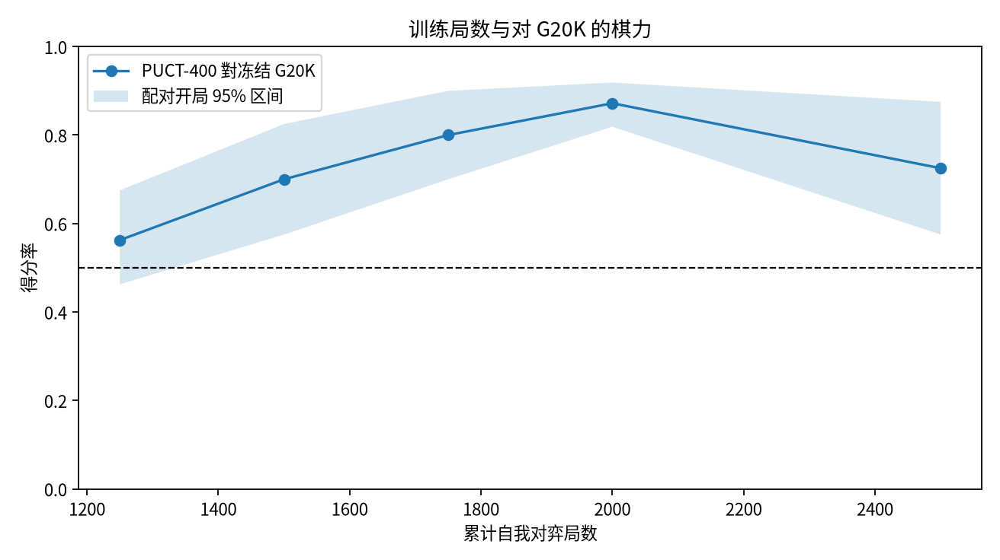
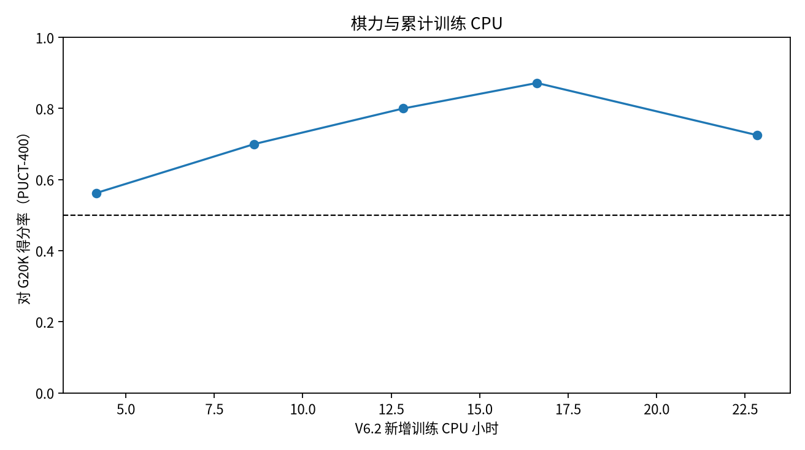
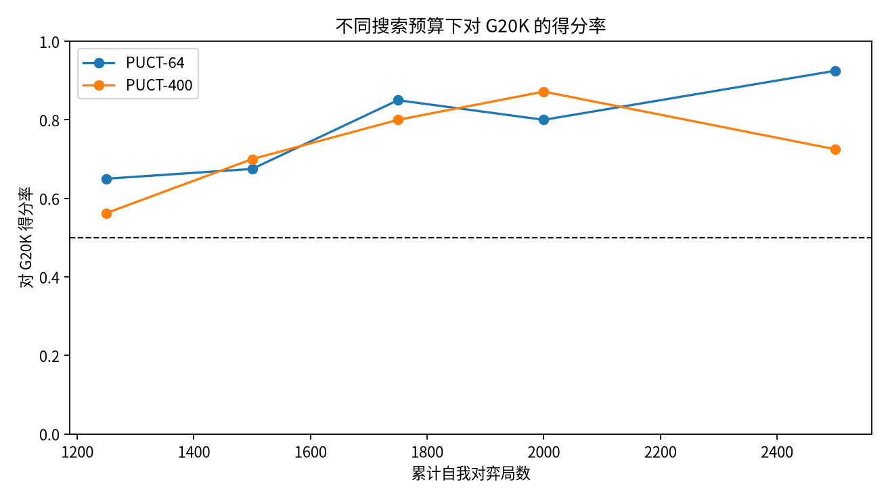
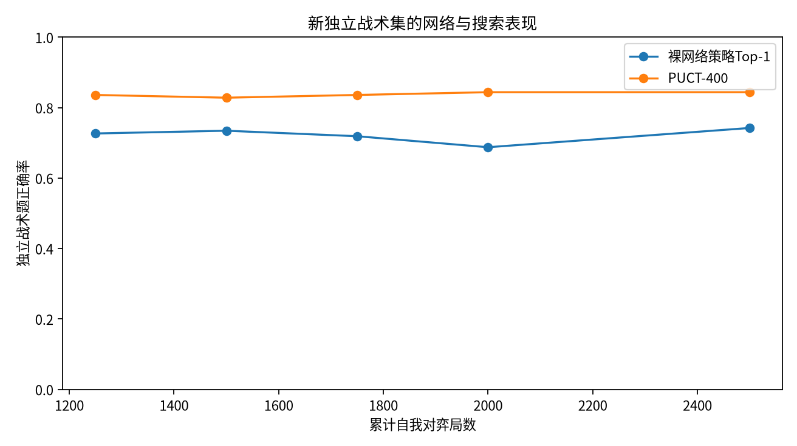

# WuziQ AlphaZero G V6.2：9×9 长期自我对弈训练

## 研究范围与冻结条件

本轮从冻结的 G20K 完整训练状态继续自我对弈。保持V6的9×9自由五子棋、参考实现4-plane CNN 32/64/128、400次PUCT模拟、`c_puct=5.0`、batch 512、10,000 replay buffer、Adam与其余训练参数不变。训练没有使用A/B或教师棋谱、外部对局、人工奖励、战术题或推理规则补丁。A、B、历史G0和战术题仅用于独立评测。

基线来自 V6 commit `0405b288d44e0cc35cfefb08a17f0714a1b3683e`：1,012局、20,001状态、1,011次优化更新。完整恢复验证见 [`results/resume_validation.json`](results/resume_validation.json)。模型、Adam、replay及Python/NumPy/PyTorch随机状态均逐项校验。

## 资源预检与实际成本

- CPU：3逻辑CPU，cgroup限额2核；内存限额8 GiB；CUDA不可用；PyTorch线程数1。
- V6实测新增965局训练消耗8.14 CPU小时，30.36 CPU秒/局。V6.1的1,280局比赛实测6.19 CPU秒/局。
- 实测完整续训预检局（含优化器更新）进程CPU耗时50.33秒；该局已作为V6.2第1,013局保留，没有丢弃或重复计入。
- 预检估算到2,000局为乐观/中性/保守11.9/14.3/20.0 CPU小时；若通过晋级条件并完成3,000局，分别为22.0/26.2/36.5小时。
- 当前累计训练 CPU 为22.84小时；从训练、比赛及战术搜索明细累计记账28.04 CPU小时（总上限30小时）。

预检文件：[`results/preflight.json`](results/preflight.json)。

训练阶段的区间CPU小时按相邻检查点的累计训练CPU差值计算。审计发现旧记录后续区间曾混用V6绝对CPU与V6.2增量CPU起点；现已统一口径并更新完整性审计，累计CPU总量未变，区间CPU计算测试已通过。

## 训练阶段

完成至累计2,500局、45,284状态、2,499次更新。实际训练检查点：

| 累计局数 | 累计状态 | 更新次数 | 本区间训练CPU小时 | 对G20K PUCT-64 | 对G20K PUCT-400 | 对A PUCT-400 | 对B-50ms PUCT-400 |
|---:|---:|---:|---:|---:|---:|---:|---:|
| 1250 | 24778 | 1249 | 4.17 | 65.0% | 56.2% | 23.8% | 30.0% |
| 1500 | 29127 | 1499 | 4.46 | 67.5% | 70.0% | 26.2% | 32.5% |
| 1750 | 32890 | 1749 | 4.20 | 85.0% | 80.0% | 20.0% | 25.0% |
| 2000 | 36623 | 1999 | 3.78 | 80.0% | 87.2% | 25.0% | 42.5% |
| 2500 | 45284 | 2499 | 6.23 | 92.5% | 72.5% | 37.5% | 45.0% |

损失、策略损失、价值损失、策略熵、局长、累计状态、优化器更新和CPU记录在 [`results/milestones.json`](results/milestones.json) 与每局日志中。损失变化只描述训练目标拟合，不单独作为棋力增长证据。

## 开发集对局结果

同一模型和对手分别用PUCT-64与PUCT-400。每组使用合法新开局，并交换黑白。配对区间以开局为单位bootstrap。未运行的项目明确保留为未运行。

### 累计 1250 局

| 对手 | 预算 | 胜-平-负 | 得分率 | 配对95%区间 | 黑方得分率 | 白方得分率 | 平均CPU秒/局 |
|---|---:|---:|---:|---:|---:|---:|---:|
| G20K | 64 | 26-0-14 | 65.0% | 52.5%–77.5% | 80.0% | 50.0% | 1.557 |
| A | 64 | 6-3-31 | 18.8% | 10.0%–28.7% | 20.0% | 17.5% | 3.509 |
| B-50ms | 64 | 5-0-35 | 12.5% | 2.5%–25.0% | 5.0% | 20.0% | 0.936 |
| G20K | 400 | 22-1-17 | 56.2% | 46.2%–67.5% | 80.0% | 32.5% | 12.248 |
| A | 400 | 5-9-26 | 23.8% | 11.2%–38.8% | 30.0% | 17.5% | 29.516 |
| B-50ms | 400 | 12-0-28 | 30.0% | 15.0%–45.0% | 25.0% | 35.0% | 7.064 |

### 累计 1500 局

| 对手 | 预算 | 胜-平-负 | 得分率 | 配对95%区间 | 黑方得分率 | 白方得分率 | 平均CPU秒/局 |
|---|---:|---:|---:|---:|---:|---:|---:|
| G20K | 64 | 27-0-13 | 67.5% | 55.0%–80.0% | 80.0% | 55.0% | 1.962 |
| A | 64 | 6-7-27 | 23.8% | 13.8%–33.8% | 17.5% | 30.0% | 5.030 |
| B-50ms | 64 | 10-0-30 | 25.0% | 12.5%–40.0% | 30.0% | 20.0% | 1.214 |
| G20K | 400 | 28-0-12 | 70.0% | 57.5%–82.5% | 90.0% | 50.0% | 13.920 |
| A | 400 | 7-7-26 | 26.2% | 16.2%–36.2% | 20.0% | 32.5% | 28.458 |
| B-50ms | 400 | 13-0-27 | 32.5% | 17.5%–47.5% | 35.0% | 30.0% | 7.912 |

### 累计 1750 局

| 对手 | 预算 | 胜-平-负 | 得分率 | 配对95%区间 | 黑方得分率 | 白方得分率 | 平均CPU秒/局 |
|---|---:|---:|---:|---:|---:|---:|---:|
| G20K | 64 | 34-0-6 | 85.0% | 75.0%–95.0% | 90.0% | 80.0% | 1.418 |
| A | 64 | 5-4-31 | 17.5% | 8.8%–26.2% | 15.0% | 20.0% | 3.467 |
| B-50ms | 64 | 13-0-27 | 32.5% | 17.5%–50.0% | 40.0% | 25.0% | 0.985 |
| G20K | 400 | 32-0-8 | 80.0% | 70.0%–90.0% | 90.0% | 70.0% | 10.469 |
| A | 400 | 3-10-27 | 20.0% | 10.0%–30.0% | 15.0% | 25.0% | 27.665 |
| B-50ms | 400 | 10-0-30 | 25.0% | 12.5%–40.0% | 30.0% | 20.0% | 6.679 |

### 累计 2000 局

| 对手 | 预算 | 胜-平-负 | 得分率 | 配对95%区间 | 黑方得分率 | 白方得分率 | 平均CPU秒/局 |
|---|---:|---:|---:|---:|---:|---:|---:|
| G20K | 64 | 32-0-8 | 80.0% | 70.0%–90.0% | 95.0% | 65.0% | 0.998 |
| A | 64 | 3-2-35 | 10.0% | 2.5%–18.8% | 12.5% | 7.5% | 3.021 |
| B-50ms | 64 | 14-0-26 | 35.0% | 20.0%–50.0% | 45.0% | 25.0% | 0.911 |
| G20K | 400 | 139-1-20 | 87.2% | 81.9%–91.9% | 96.2% | 78.1% | 7.889 |
| A | 400 | 6-8-26 | 25.0% | 13.8%–37.5% | 37.5% | 12.5% | 21.797 |
| B-50ms | 400 | 17-0-23 | 42.5% | 27.5%–57.5% | 50.0% | 35.0% | 5.699 |

### 累计 2500 局

| 对手 | 预算 | 胜-平-负 | 得分率 | 配对95%区间 | 黑方得分率 | 白方得分率 | 平均CPU秒/局 |
|---|---:|---:|---:|---:|---:|---:|---:|
| G20K | 64 | 37-0-3 | 92.5% | 85.0%–100.0% | 100.0% | 85.0% | 0.639 |
| A | 64 | 10-7-23 | 33.8% | 23.8%–45.0% | 47.5% | 20.0% | 2.275 |
| B-50ms | 64 | 15-0-25 | 37.5% | 25.0%–50.0% | 45.0% | 30.0% | 0.504 |
| G20K | 400 | 29-0-11 | 72.5% | 57.5%–87.5% | 85.0% | 60.0% | 4.128 |
| A | 400 | 9-12-19 | 37.5% | 28.7%–46.2% | 27.5% | 47.5% | 14.472 |
| B-50ms | 400 | 18-0-22 | 45.0% | 27.5%–62.5% | 50.0% | 40.0% | 3.445 |







## 2,000局晋级门槛、训练停止点与模型选择

预注册主指标是累计2,000局模型在PUCT-400下对冻结G20K的80组配对开局得分率。该节点结果为139胜-1平-20负，得分率87.2%，配对95%区间81.9%–91.9%。只有得分率严格高于55%，且配对95%区间下限严格高于50%，才允许扩训。本轮门槛：**通过**。门槛记录：[`results/gate_2000.json`](results/gate_2000.json)。

门槛通过后完成了2,500局检查点及其开发评测。 本轮没有到达3,000局。 在盲测和2,500局阶段评测完成后，账面剩余CPU预算为1.96小时；最近500局训练区间实际消耗6.23 CPU小时。单是同规模训练已高于剩余预算，因此按30 CPU小时硬上限停止，没有削减搜索次数或盲测样本，也没有声称完成3,000局。

开发集模型选择只使用对G20K的PUCT-400配对得分率；精确并列时选择训练局数较少的模型。选择冻结：2000局模型。最终盲测不得回流模型选择。

## 独立盲测

最终候选使用预先冻结的新开局，分别挑战冻结G20K、A-Minimax与B-AB-50ms；每个条件40组换色开局，单独报告PUCT-64与PUCT-400。

| 对手 | 预算 | 胜-平-负 | 得分率 | 配对95%区间 | 黑方得分率 | 白方得分率 | 配对开局数 |
|---|---:|---:|---:|---:|---:|---:|---:|
| A | 400 | 12-14-54 | 23.8% | 16.2%–31.9% | 33.8% | 13.8% | 40 |
| B-50ms | 400 | 24-0-56 | 30.0% | 20.0%–40.0% | 32.5% | 27.5% | 40 |
| G20K | 400 | 68-1-11 | 85.6% | 78.8%–92.5% | 100.0% | 71.2% | 40 |
| A | 64 | 15-5-60 | 21.9% | 13.1%–31.2% | 25.0% | 18.8% | 40 |
| B-50ms | 64 | 12-0-68 | 15.0% | 7.5%–22.5% | 20.0% | 10.0% | 40 |
| G20K | 64 | 70-0-10 | 87.5% | 78.8%–95.0% | 97.5% | 77.5% | 40 |

## 战术能力

沿用V6旧64题，并加入V6.1构建的128题独立集；两者没有加入训练。裸网络策略Top-1和正确动作概率质量与PUCT访问分布、正确落点率分开记录。价值误差只在提供已求解局面价值的题目上计算。



逐题结果：[`results/tactics/`](results/tactics/)；题目及SHA见[`config/registration.json`](config/registration.json)。

| 累计局数 | 新128题裸网络Top-1 | 新128题PUCT-64 | 新128题PUCT-400 | 价值MAE | 历史64题裸网络Top-1 | 历史64题PUCT-400 |
|---:|---:|---:|---:|---:|---:|---:|
| 1250 | 72.7% | 76.6% | 83.6% | 19.1% | 40.6% | 57.8% |
| 1500 | 73.4% | 76.6% | 82.8% | 22.0% | 51.6% | 60.9% |
| 1750 | 71.9% | 78.1% | 83.6% | 19.4% | 50.0% | 67.2% |
| 2000 | 68.8% | 78.1% | 84.4% | 71.0% | 59.4% | 71.9% |
| 2500 | 74.2% | 78.1% | 84.4% | 50.3% | 59.4% | 71.9% |

## 完整性与测试验收

- 规则回放：通过；新增自我对弈1488局、评估1800局，配对开局完整900组，不完整0组。
- 最终完整训练状态：2500局、45284状态、2499次更新；恢复校验通过，包含Adam、回放池和随机状态。
- 定向测试：20项通过，0项失败。
- 扩展的同名V6.2测试另有2项失败：`test_v6_2_snapshot.py`中的两个快照测试在创建前要求分支名`research/champion-200s-v6-2`，而本任务分支为`research/alphazero-g-v6-2-selfplay-scale`。该分支身份检查属于另一套Champion V6.2实验，不是本轮G恢复包测试；其余该批测试通过。详细命令和结果见[`results/verification.json`](results/verification.json)。

## 结果解读

V6.1确认20K优于10K/15K，但此前并未证明把训练从约1,000局继续增加会提升实战。累计2,000局检查点在PUCT-400下以87.2%得分率、配对95%区间81.9%–91.9%击败G20K，明确通过晋级门槛。2,500局检查点的开发点估计在PUCT-64下为92.5%，PUCT-400下为72.5%；其PUCT-400样本只有20组开局，2,000局使用80组，区间明显重叠，因此不能认定真实回落。开发集选模仍按预注册PUCT-400指标选择2,000局模型。

独立128题上，裸网络Top-1由2,000局的68.8%到2,500局的74.2%，PUCT-400保持84.4%，价值MAE从0.710降到0.503；这说明战术策略和价值校准有改善，但并不能代替实战胜率。最终盲测的2,000局候选以PUCT-400对G20K得分85.6%，但对A和B-50ms分别仅23.8%和30.0%，没有转化成能挑战传统搜索棋手的竞争力。较高PUCT预算提升了对B的盲测点估计（15.0%→30.0%），对A则只小幅变化（21.9%→23.8%）；这些是搜索预算收益，不是额外训练收益。

本轮模型选择依据冻结在盲测之前，选择只使用开发集对G20K的PUCT-400成绩。训练超过旧基线的证据来自配对直接交锋；对A/B的表现是独立指标，不能混成一个总分。对传统算法的胜率也不能等同于相同计算成本下的比较，因为双方预算不同。若训练未达到3,000局，原因与已完成开发集表现分开陈述，不能把CPU上限造成的截断当作训练失败或成功。

阶段检查点及其完整状态保存在[`checkpoints/reference400_empty/`](checkpoints/reference400_empty/)，逐局自我对弈和逐局比赛保存在[`raw/`](raw/)及[`results/matches/`](results/matches/)。所有原始对局经规则回放核验；完整性报告为[`results/integrity_audit.json`](results/integrity_audit.json)。

## 复现

```bash
OMP_NUM_THREADS=1 MKL_NUM_THREADS=1 PYTHONPATH=. python scripts/audit_g_v6_2.py
OMP_NUM_THREADS=1 MKL_NUM_THREADS=1 PYTHONPATH=. python scripts/report_g_v6_2.py
OMP_NUM_THREADS=1 MKL_NUM_THREADS=1 PYTHONPATH=. python scripts/run_g_v6_2.py --train-through-games 1250
OMP_NUM_THREADS=1 MKL_NUM_THREADS=1 PYTHONPATH=. python scripts/run_g_v6_2.py --evaluate-games 1250
```

如需继续训练，先遵守2,000局门槛和单次/累计CPU上限。具体已完成阶段见 [`results/progress.json`](results/progress.json)。

## Git与Drive

- 分支：`research/alphazero-g-v6-2-selfplay-scale`
- 基线：`0405b288d44e0cc35cfefb08a17f0714a1b3683e`
- Drive恢复状态：见[`results/snapshot_status.json`](results/snapshot_status.json)。每个新快照需完成回下载、SHA-256和空目录恢复验证后才可替换旧版。

## 研究边界

本轮是AlphaZero自我对弈训练与实战评测，没有神经网络教师训练，也没有把增加搜索预算解释为网络学习收益。阶段比赛和小样本区间仍有不确定性，训练成功与否需依赖预注册配对检验。
