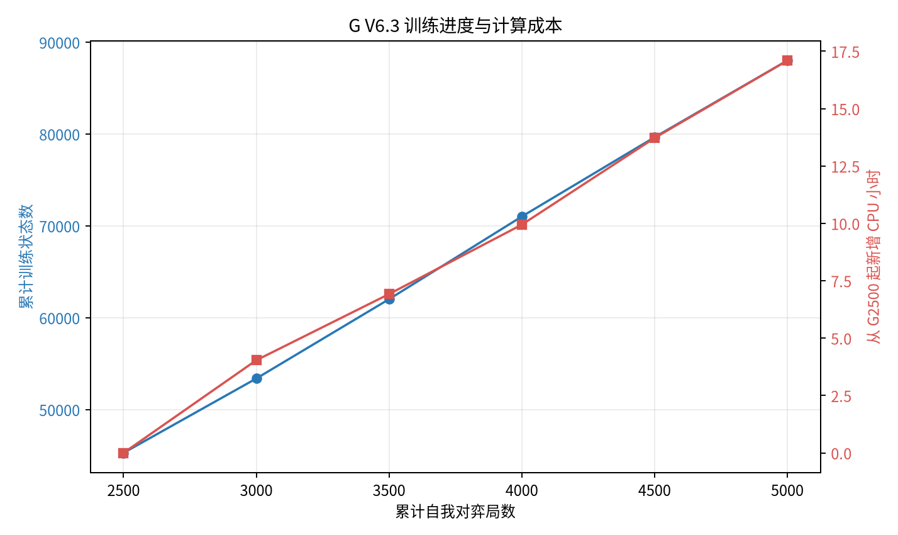
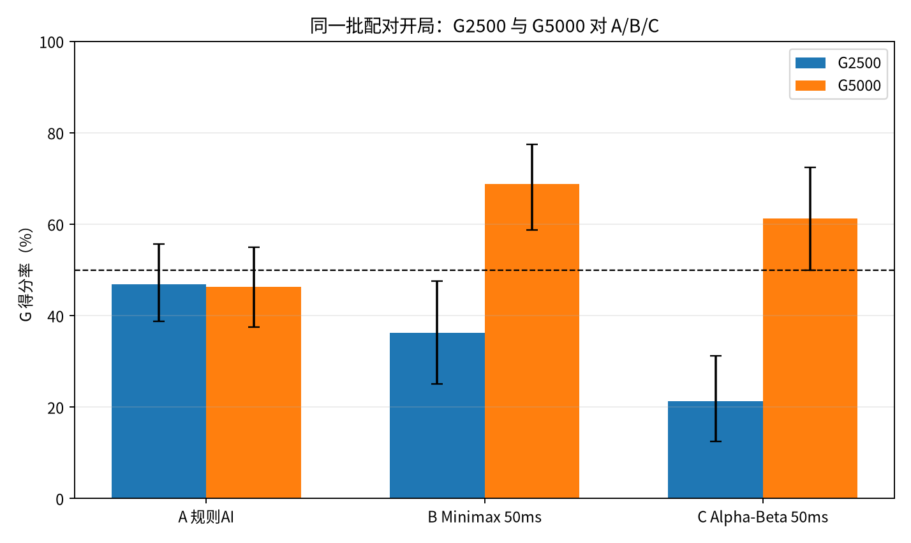

# WuziQ AlphaZero G V6.3：从 G2500 续训至 G5000

## 实验状态

- 目标：从冻结 G2500 恢复完整 AlphaZero 训练状态，保持 V6.2 算法、网络、400 次 PUCT、优化器、回放池、随机数和自我对弈规则不变。
- 当前累计：**G5,000**，累计训练状态 **87,999**，新增训练 CPU **17.10 小时**。
- 训练到 G5000：**完成**；最终挑战赛：**完成**。
- 实验新增 CPU（训练与已完成挑战）：**18.35 小时**；注册硬上限 50 CPU 小时。
- 另计恢复包压缩 CPU 29.2秒、最终棋谱审计 CPU 15.8秒；云端传输等待不计为本机CPU。
- 棋力结论只按同一批 40 个新开局、双方换色的直接对局判断。训练 loss 仅作为训练状态，不解释为棋力提升。

## 训练参数与起点

9×9自由五子棋，连五获胜；AlphaZero_Gomoku 冻结参考实现的4-plane CNN、PUCT c=5、400次模拟、Adam、batch 512、Replay 10,000、学习率与训练目标均沿用 V6.2/V5 注册配置。每局从空盘开始，当前网络执黑和执白自我对弈。没有加入教师数据、人工战术奖励或规则落子补丁。

G2500 起始恢复校验：权重 SHA-256 `70c1ca4b7e1db3a7f19be49aec5387b8b8596a1b6b83a7b0527ba38d869b9463`；完整状态 SHA-256 `72f3f989472c4656b292d6d28bcc05ea0f01dae14541cdc132a2a28301ded5ed`；2,500局、45,284状态、2,499次更新、10,000回放样本、16个Adam状态槽。权重、Adam、Replay Buffer、Python/NumPy/PyTorch RNG 的实际加载检查均通过。

## 资源预估和实耗

预检在当前机器实测：3 个逻辑CPU，容器CPU配额 2.0 核，内存限制 8 GiB。开盘位置的PUCT-400单步实际耗时 1.01 CPU秒。估算依据是V6.2最近500局实测训练CPU 22,416.0秒（44.8秒/局）；新2,500局加480场比赛的乐观/正常/保守总估算分别为 **26.0 / 32.7 / 42.8 CPU小时**。

## 训练进度

| 累计对局 | 累计训练状态 | 优化更新 | G2500后训练CPU小时 | 区间平均loss | 策略熵 |
|---:|---:|---:|---:|---:|---:|
| 2500 | 45,284 | 2,499 | 0.00 | — | — |
| 3000 | 53,380 | 2,999 | 4.04 | 2.434 | 2.052 |
| 3500 | 62,018 | 3,499 | 6.92 | 2.348 | 1.962 |
| 4000 | 71,017 | 3,999 | 9.94 | 2.351 | 1.960 |
| 4500 | 79,649 | 4,499 | 13.72 | 2.323 | 1.924 |
| 5000 | 87,999 | 4,999 | 17.10 | 2.283 | 1.889 |

模型棋力并不从loss推断。该曲线展示训练规模和成本；棋力结论来自下方固定开局挑战赛。

## G2500 与最终模型挑战赛

开局表在训练开始前固定，40组各6手的合法非终局局面；相对于V5、V6、V6.2已登记开局的D4等价重叠为0。同一批开局分别供G2500/G5000对A/B/C使用，每个条件开局双方各执黑白，共80局。G棋手双方均为PUCT-400；A为原规则AI自然耗时，B为纯Minimax 50ms，C为Alpha-Beta 50ms。

积分为胜1、平0.5、负0。表中95%区间按40个开局配对进行bootstrap；不同对手分别汇总，不合并其预算或胜率。

| 对手 | G模型 | 胜-平-负 | 得分率 | 执黑得分率 | 执白得分率 | 配对95%区间 | 每局平均双方CPU秒 |
|---|---|---:|---:|---:|---:|---:|---:|
| A 原规则 AI | G2500 | 22-31-27 (80局) | 46.9% | 40.0% | 53.8% | [38.8%, 55.6%] | 17.3 |
| A 原规则 AI | G5000 | 20-34-26 (80局) | 46.2% | 58.8% | 33.8% | [37.5%, 55.0%] | 17.5 |
| B 纯 Minimax 50ms | G2500 | 29-0-51 (80局) | 36.2% | 42.5% | 30.0% | [25.0%, 47.5%] | 4.7 |
| B 纯 Minimax 50ms | G5000 | 55-0-25 (80局) | 68.8% | 87.5% | 50.0% | [58.8%, 77.5%] | 5.0 |
| C Alpha-Beta 50ms | G2500 | 17-0-63 (80局) | 21.2% | 25.0% | 17.5% | [12.5%, 31.2%] | 5.4 |
| C Alpha-Beta 50ms | G5000 | 49-0-31 (80局) | 61.3% | 75.0% | 47.5% | [50.0%, 72.5%] | 5.9 |

### 逐组结论

- **A**：G2500 46.9%；G5000 46.2%；同开局G5000−G2500得分率差 -0.6%，配对95%区间 [-13.1%, +11.9%]（40组）。
- **B@50ms**：G2500 36.2%；G5000 68.8%；同开局G5000−G2500得分率差 +32.5%，配对95%区间 [+18.8%, +46.2%]（40组）。
- **C@50ms**：G2500 21.2%；G5000 61.3%；同开局G5000−G2500得分率差 +40.0%，配对95%区间 [+25.0%, +55.0%]（40组）。

## 训练状态与完整性

- 本阶段新增训练局：2500；逐局棋谱和策略/价值训练数组保存在 `raw/selfplay/reference400_empty/`。
- 检查点：G2500基线及G3000/G3500/G4000/G4500/G5000（未完成节点在审计中标明）；每500局保存完整权重、Adam、回放池和随机状态。
- V6.2历史G2500检查点计数为2,500局；已保存并逐局回放验证的历史自我对弈棋谱为2453局。V6/V6.2历史记录中另有47局没有可供本轮复核的逐局棋谱；这不影响已恢复G2500完整训练状态的权重、Adam、回放池及随机数状态校验，但不将缺失的历史棋谱称为已审计。
- 棋谱/ID/样本一致性审计：**通过**；训练完整状态校验：**通过**。
- Drive专用目录：[WuziQ G V6.3 Recovery](https://drive.google.com/drive/folders/1u3556ink-VFf9a7AbS701flr0V0spSzQ); 保留最近两份通过下载、SHA-256和空目录恢复检查的快照：
- 第11份，G5000：[分卷1/2](https://drive.google.com/file/d/1knw1_Wp65ov-tEoo9YPqcCUAdLDJiB8E/view?usp=drivesdk)、[分卷2/2](https://drive.google.com/file/d/1B2mt6IOEKMHgc78zscIWgBr8Ts01bQ1k/view?usp=drivesdk)；合并包 SHA-256 `60819bf0246cef3e8f7362c41011f491d41bee07e53cc82e5aff40070c4b80c0`（分卷已回读并完成空目录恢复）。
- 第12份，G5000：[分卷1/2](https://drive.google.com/file/d/1ASBLF3rtif3JsMpdtOatnbg1f2xPRmML/view?usp=drivesdk)、[分卷2/2](https://drive.google.com/file/d/10sufN5wddmFJup2BRPZElsekhCBPHw37/view?usp=drivesdk)；合并包 SHA-256 `c7a615c112324d955e32122f66f6930254510d111ff23606f7805e58f61af592`（分卷已回读并完成空目录恢复）。

## 结论

G5000已完成且三组挑战数据齐全。从G2500续训到G5000后，G对A得分率由46.9%到46.2%，同开局差值-0.6个百分点，配对95%区间[-13.1,+11.9]个百分点；本轮没有发现对A真实提升的证据，A对局仍接近五五开且存在明显黑白差异。对B@50ms，得分率由36.2%升至68.8%，配对差值+32.5个百分点，95%区间[+18.8,+46.2]；对C@50ms，由21.2%升至61.2%，差值+40.0个百分点，95%区间[+25.0,+55.0]。这些对B/C的配对结果支持续训后的实战改善；G5000对C的绝对得分率区间下界为50.0%，因此不作严格高于50%的统计宣称。每项比较只有40组配对开局，结论仍受样本与执黑执白差异限制。下一步应先扩大对A的独立配对评测并分析白棋失分，再决定继续增加训练量还是改进搜索；本轮没有证明继续加量就能稳定战胜A。
