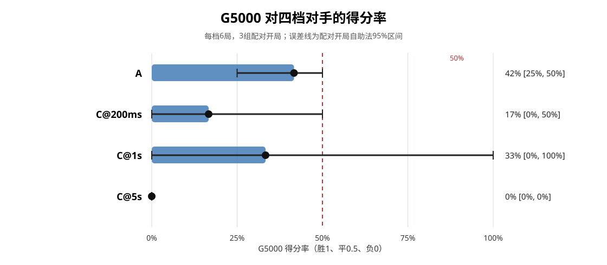

# WuziQ G5000 天梯挑战 V6.4

## 结论摘要

G5000 使用冻结的 PUCT-400 参加了 24 局、4 个对手条件各 6 局。G5000 在 A 上取得 **1胜3平2负，得分率 41.7%**；C@200ms 为 **1胜0平5负，16.7%**；C@1s 为 **2胜0平4负，33.3%**；C@5s 为 **0胜0平6负，0%**。这只是每档3组开局的探索结果，不能当作稳定棋力排名。

按本轮观察，G5000 能在 A、C@200ms、C@1s 的个别对局中取胜或得分，但没有稳定击败任何一档；C@5s 六局全部失利。最高的实测预算中没有得分。尤其 C@1s 的两胜都来自同一开局组 seed 640616（黑白各一局），而其余两组均失利，显示开局影响很大。

## 赛制与冻结条件

- 规则：9×9自由五子棋，五连获胜；使用 V6.3 的规则、棋盘及搜索引擎接口。
- G5000：节点权重 SHA-256 `cc383f0667cfe02b8e8ccbaecf51eccc2c4f088d56c836a4e91e016cfae3ee97`；完整训练状态 SHA-256 `0fb9886068a014d000227ae7b275ff9043322a678d7f259e9730d44ac95398d2`；5000 局、87,999 状态、4,999 次更新。仅评测，没有训练或修改权重。
- G 每步 PUCT-400、`c_puct=5.0`，原实现配置 401 playout，实际根边访问数经逐步审计均为400。
- A 使用原规则 AI 的自然运行时间；C@200ms、C@1s、C@5s 使用同一 Alpha-Beta 引擎、最大深度69、候选半径2，只有单步 deadline 不同。
- 每个对手均使用相同的3个预注册开局；每个开局 G 执黑、执白各一局。随机种子和唯一 game ID 固定。
- 赛前扫描仓库 research 数据及 Drive 恢复的完整 V6.3 文件树，发现 37,262 个 D4 规范化六手开局；本轮三个开局与历史集合重叠为0。历史开局扫描哈希：`6e59a011ba438b30193d3fdc13a374f0202cd11a4805744b2151888026e4700f`；赛程哈希：`fb196631f19499f55e49ad89b73c2dbc604ee29ca0372dbe1abd5e00e338694d`。

### 冻结开局

- `v6-4-640614-000` (seed 640614): B(0,4) W(7,6) B(0,0) W(7,5) B(8,5) W(5,7)
- `v6-4-640614-001` (seed 640615): B(7,3) W(7,0) B(0,2) W(3,1) B(2,1) W(5,3)
- `v6-4-640614-002` (seed 640616): B(2,3) W(7,2) B(8,0) W(3,5) B(8,2) W(0,5)

## 四档战绩

| 对手 | W-D-L | 得分 | 得分率 | 配对95%区间 | G执黑 | G执白 | 平均手数 | G CPU/局 | 对手 CPU/局 |
|---|---:|---:|---:|---:|---:|---:|---:|---:|---:|
| A | 1-3-2 | 2.5/6 | 41.7% | [25.0%, 50.0%] | 33.3% | 50.0% | 63.0 | 56.3秒 | 0.03秒 |
| C@200ms | 1-0-5 | 1.0/6 | 16.7% | [0.0%, 50.0%] | 0.0% | 33.3% | 23.0 | 20.3秒 | 1.66秒 |
| C@1s | 2-0-4 | 2.0/6 | 33.3% | [0.0%, 100.0%] | 33.3% | 33.3% | 25.5 | 26.1秒 | 9.74秒 |
| C@5s | 0-0-6 | 0.0/6 | 0.0% | [0.0%, 0.0%] | 0.0% | 0.0% | 29.2 | 29.0秒 | 58.15秒 |

得分按胜1、平0.5、负0计算。区间以3个开局组的配对平均分作自助法95%区间；只有3个配对组，区间极不稳定，C@5s的 `[0%,0%]` 只表示这三组的实测结果。

### 先后手

| 对手 | G执黑得分率 | G执白得分率 |
|---|---:|---:|
| A | 33.3% | 50.0% |
| C@200ms | 0.0% | 33.3% |
| C@1s | 33.3% | 33.3% |
| C@5s | 0.0% | 0.0% |

A 组 G 执白为50%、执黑为33.3%；C@200ms 执白为33.3%、执黑为0%；C@1s 两色均为33.3%；C@5s 两色均为0%。每格仅3局，不能据此量化先手优势。

## 每步实际计算量

| 对手 | 每步时间 | 决策数 | 平均完成深度 | 平均节点 | 平均剪枝 | 到时返回完整层 |
|---|---:|---:|---:|---:|---:|---:|
| A | 自然耗时 | 171 | — | — | — | 0/171 |
| C@200ms | 0.2秒 | 52 | 2.21 | 1324 | 173 | 52/52 |
| C@1s | 1秒 | 59 | 3.15 | 7519 | 585 | 59/59 |
| C@5s | 5秒 | 71 | 5.80 | 27178 | 4682 | 69/71 |

G5000 合计作出 347 次决策，真实完成 **138,800 次 MCTS 模拟**，每步严格400次；平均每步 CPU 2.28 秒、树深 9.30，节点 16951。各档 C 的超时数指预算截止后返回上一个完整迭代深度，是迭代加深的预期行为；未发生预算超额。C@5s 平均完成深度约5.80层、27,178节点，CPU均耗约58.15秒/局；C@1s 平均3.15层、7,519节点、CPU均耗约9.74秒/局。更高预算带来更多搜索，但在本次小样本中没有转成更高 G 得分。

## 算力预检与实际成本

- 环境：3个 CPU 核，PyTorch CPU-only，3线程；可用内存约8.6 GiB、可用磁盘约16.5 GiB。
- 代表局面实测：G 的400次模拟/步 CPU 2.406秒；A 自然决策0.0012秒；C@200ms 0.195秒、完成深度2；C@1s 0.994秒、深度3；C@5s 4.994秒、深度4。
- 预检按每方12/20/30次开局后决策并加20%余量，估计约 19.0 / 37.9 / 56.9 CPU分钟。实际24局棋手决策 CPU 合计 **0.336小时**（1207.9秒）；逐局实际 wall 时间相加为 13.6分钟。预检比实际多估的主要原因是中位手数低于预设20次/方，尤其 C@200ms、C@1s 对局较短。
- 执行期间没有环境重启或中断。预检和快照过程不计入上述比赛 CPU 总量。

## 棋谱样例

以下片段列出终局前的坐标，完整逐手数据在 `results/matches/*.json`。片段用于定位棋谱，不据此对未审查的战术原因作断言。

- `v64-44325ab80345b41f`：A，开局 seed `640614`，G执W，G胜，18手；终局前 8 手：B(7,3)；W(5,4)；B(5,6)；W(6,5)；B(4,5)；W(4,3)；B(8,7)；W(3,2)。
- `v64-e8f4b4c07d31a81c`：A，开局 seed `640614`，G执B，G负，58手；终局前 8 手：B(3,7)；W(6,7)；B(1,7)；W(8,6)；B(3,0)；W(8,4)；B(7,1)；W(4,8)。
- `v64-433826c2f2863154`：C@200ms，开局 seed `640615`，G执W，G胜，20手；终局前 8 手：B(7,4)；W(8,4)；B(5,2)；W(3,3)；B(6,3)；W(3,2)；B(3,5)；W(3,0)。
- `v64-170a06ce6edbecb2`：C@1s，开局 seed `640616`，G执B，G胜，19手；终局前 8 手：W(5,2)；B(1,6)；W(0,7)；B(2,4)；W(5,4)；B(2,6)；W(2,7)；B(2,2)。
- `v64-f4417eb25fd094c9`：C@5s，开局 seed `640614`，G执B，G负，18手；终局前 8 手：B(3,3)；W(3,6)；B(2,4)；W(7,7)；B(7,8)；W(8,4)；B(4,4)；W(4,8)。

本轮最明显的非单调结果是 C@1s 的两胜集中在同一个开局 seed，而 C@5s 三组配对均告负。增加搜索预算也改变了整局后续局面，不能把跨条件胜负差当成单独搜索节点的因果比较；6局不足以判定 C@5s 实力低于 C@1s。

## 验收、原始数据与复现

- 棋谱审计：计划24局、实际24局、唯一 ID 24个、全部独立规则回放合法、终局与胜负一致、开局组均完成黑白配对、无多余或缺失对局。
- 自动化测试：V6.4赛程、对局回放、配对、快照恢复与图表测试共15项；原五子棋规则/搜索测试29项，共44项通过。
- 历史 G5000 恢复包 #12 的 SHA-256 和空目录恢复校验已通过；模型、Adam、回放池与随机状态均可从 V6.3 Drive 原包恢复。V6.4 未训练，因此恢复快照只引用冻结模型身份和原 V6.3 恢复源，不覆盖该原包。
- V6.4 Drive 恢复目录：[WuziQ G5000 V6.4 Recovery](https://drive.google.com/drive/folders/1cvdyNM-M8RgYwnS7Y4moCRBAbXB_pXIB)。已上传、回下载、SHA-256 比对并在空目录恢复验证的快照数量：7；目录保留初始、分阶段和最终恢复点。
- 原始棋谱：`results/matches/`；完整比分：`results/game_results.csv`、`results/condition_summary.csv`；逐棋谱 SHA-256：`results/game_sha256.json`；审计：`results/audit.json`；开局与环境：`config/`；图表：`charts/ladder_score_rate.svg`。
- 复现：`python scripts/prepare_g_v6_4.py --historical-root <V6.3恢复树>`；`python scripts/preflight_g_v6_4.py --checkpoint-dir <已校验检查点目录>`；`python scripts/run_g_v6_4.py --checkpoint-dir <已校验检查点目录>`；`python scripts/audit_g_v6_4.py`；`python scripts/report_g_v6_4.py`。
- 适用恢复包后，执行器以固定 game ID 自动跳过已校验对局；单局中断会从同一预注册开局重赛，不会重复计入统计。

## 结论边界

本轮的简短阶梯只能给出探索性能力边界：G5000 曾对 A、C@200ms 和 C@1s 取分，但在每档仅3组开局的条件下没有足够证据宣称稳定战胜它们；C@5s 本轮0/6。C@1s的两胜集中在一组开局，也说明把最高单档胜利解释为稳定能力会过度推断。若继续研究，应扩大开局数并维持配对换色；本结果不能替代正式棋力评测。
