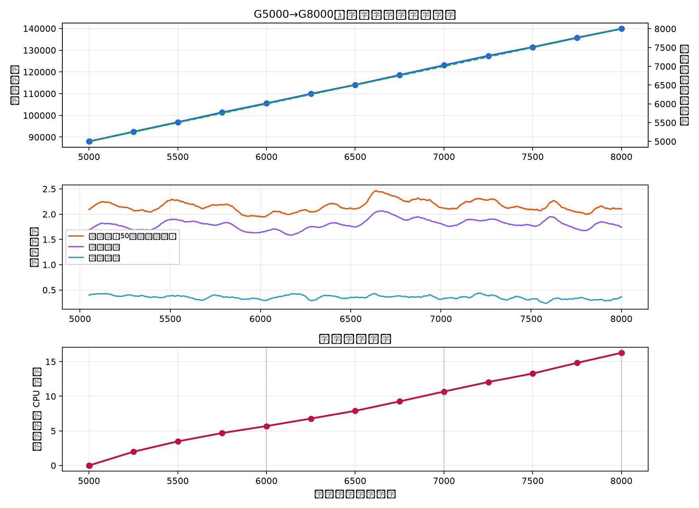

# WuziQ AlphaZero G V6.5：G5000 续训至 G8000

## 结果摘要

V6.5 从 V6.3 的 G5000 **完整训练状态**继续训练，完成新增 **3,000 局**纯自我对弈，最终到达 G8000。本轮未进行正式挑战赛，因此不把训练 loss 或训练局数解释成棋力提升。

- 训练状态：139,884（G5000 为 87,999，新增 51,885）
- 优化器更新：7,999（G5000 为 4,999；每局一次更新）
- 新增训练 CPU：**16.28 小时**；恢复状态中累计训练 CPU 为 64.55 小时
- 新增3,000局平均总损失：2.1555；首100局平均 2.1538；末100局平均 2.1129
- G8000 完整状态 SHA-256：`6b56dee19e66365fd3623a80817e397eb71875861e1f28be8809447daef88a82`
- G8000 模型 SHA-256：`490b70eabb75de1b076e1eb9d13a9d82d2ccc213f3b769bfe6c98eddcb679272`

## 冻结条件与恢复来源

- 本实验分支基线提交：`66b88d2270c799870aa81651fe3c07be18479cf0`；V6.3源恢复包 SHA-256：`c7a615c112324d955e32122f66f6930254510d111ff23606f7805e58f61af592`。该恢复包清单记录其生成代码提交为 `b31f24acffee423b33beca19ccb9389964bd7a36`；恢复得到的G5000状态及权重哈希与指定基线一致。
- G5000 权重 SHA-256：`cc383f0667cfe02b8e8ccbaecf51eccc2c4f088d56c836a4e91e016cfae3ee97`；完整状态 SHA-256：`0fb9886068a014d000227ae7b275ff9043322a678d7f259e9730d44ac95398d2`。
- 启动前从 V6.3 Google Drive 下载两个分卷，合并后的恢复包大小 37,000,229 字节；SHA-256 与登记值一致，ZIP CRC 检查通过，并在空目录完整解包。
- 实际加载校验通过：G5000、87,999状态、4,999更新、10,000条回放；模型、Adam、Replay Buffer、Python/NumPy/PyTorch 随机状态均逐项恢复一致。
- 固定 9×9连五、V6.3 CNN、PUCT-400、Adam、Replay Buffer、学习率、数据增强与目标不变。V6.5 只改变累计对局目标和恢复编排；没有教师数据、战术补丁或额外奖励。

## 资源预估与实耗

- 当前机器：3 个逻辑 CPU，CPU 配额 2.0 核，内存限制 8.0 GiB；PyTorch CPU-only、1线程；启动时可用磁盘 15.0 GiB。
- G5000 开盘位置 PUCT-400 预检：0.80 CPU秒，完成 399 个根动作访问（参考实现每步配置400次playout）。
- 估算依据：V6.3 G2500→G5000实测 24.62 CPU秒/局。乐观/正常/保守新增训练估时：16.4/20.5/26.7 CPU小时；含备份成本估算为 16.7/21.3/28.2 小时。40小时新增CPU硬上限未触发。
- 实际运行开始：2026-11-14T01:23:37Z；完成：2026-11-14T18:27:05Z。新增CPU 16.28 小时。

## 阶段检查点

| 累计对局 | 累计训练状态 | 累计更新 | G5000后CPU小时 | 阶段平均loss |
|---:|---:|---:|---:|---:|
| 5000 | 87,999 | 4,999 | 0.00 | — |
| 6000 | 105,533 | 5,999 | 5.70 | 2.0463 |
| 7000 | 123,088 | 6,999 | 10.68 | 2.2442 |
| 8000 | 139,884 | 7,999 | 16.28 | 2.0923 |

## 对局与状态审计

- 新增棋谱：3,000 局，ID 从 `reference400_empty-game-005000` 至 `reference400_empty-game-007999`，全部唯一。
- 独立规则回放：3,000/3,000 局合法且终局、胜负一致；每局 NPZ 状态、策略和值样本数与决策步数一致。
- 新增状态总数 51,885 与检查点状态差值 51,885 一致；更新数与对局数满足每局一次更新。
- 自我对弈结果分布（仅训练诊断）：黑胜 2,017、白胜 983、和棋 0；平均 17.3 个决策状态/局。该分布不是独立棋力评估。
- G6000/G7000/G8000均保存了完整 Adam、回放池、随机数和模型状态，并逐项执行恢复检查。
- V6.5 Drive 目录保留 13 个已验证恢复点；其中 G6000/G7000/G8000里程碑均须保留，最近两份滚动快照也保留。每份上传后回下载核对SHA-256并在空目录恢复。

## 结论与下一步

训练已从G5000续接至G8000，状态、更新、随机数及新增3,000局棋谱通过一致性审计。loss变化只说明训练目标拟合变化；本轮没有对A或C系列进行挑战，因而**不能据此声称G8000棋力强于G5000**。下一轮应在预注册的新开局上用冻结PUCT预算与G5000/G8000直接对战，再判断续训是否带来实战收益。

恢复目录：[WuziQ G V6.5 Recovery](https://drive.google.com/drive/folders/1b3bTfx8Eqczy0D8sQAgDdDhKbuVgWfNR)。G5000来源目录：[WuziQ G V6.3 Recovery](https://drive.google.com/drive/folders/1u3556ink-VFf9a7AbS701flr0V0spSzQ)。

可复现命令：`python scripts/run_g_v6_5.py prepare --source-state <G5000-training-state> --source-node <G5000-model> --drive-folder-id 1b3bTfx8Eqczy0D8sQAgDdDhKbuVgWfNR`，随后执行 `python scripts/run_g_v6_5.py preflight`；每次运行 `python scripts/run_g_v6_5.py train-batch` 后创建并上传经过校验的恢复快照。审计：`python scripts/audit_g_v6_5.py`；报告：`python scripts/report_g_v6_5.py`。
