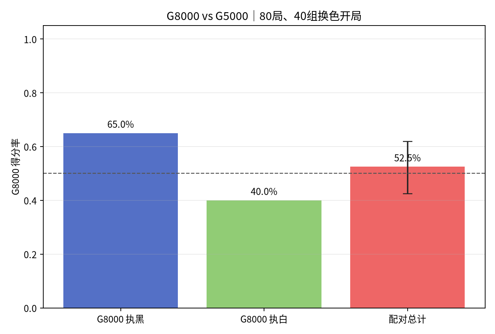
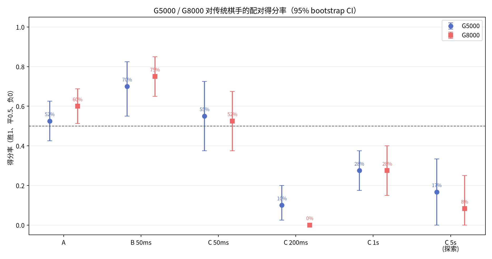

# WuziQ AlphaZero G V6.6｜实力验收与天梯挑战

## 实验结论与范围

- 有效完成并回放验收 **504 / 504 局**；对局累计 CPU 4.12 小时，首局到末局完成的实际墙钟区间约 2.77 小时（含局间快照/审计，不含正式开赛前模型恢复与预检）。这是规则/搜索推理评测，不含训练。
- 冻结模型 G5000 SHA-256：`cc383f0667cfe02b8e8ccbaecf51eccc2c4f088d56c836a4e91e016cfae3ee97`。G8000：`490b70eabb75de1b076e1eb9d13a9d82d2ccc213f3b769bfe6c98eddcb679272`。
- 主要指标是配对换色后的得分率及按开局组 bootstrap 的 95% 区间。区间不含开局池以外的不确定性；C@5s 每模型仅 6 组，属于探索结果。
- G 权重、PUCT-400 配置、A/B/C 决策引擎均未训练或修改。V6.5 进度文件仅将已完成 G8000 的元数据从 `completed:false` 修正为 `true`，未改任何 checkpoint。

## 开局、赛程与公平性

- 棋盘 9×9，自由连五；固定 6 手合法非终局开局，种子 `660606`，D4 旋转/镜像去重，扫描 8131 个历史开局签名，重叠数为 0。
- G8000 对 G5000 使用 40 组×换色=80 局。每个 G 对 A、B@50ms、C@50ms、C@200ms、C@1s 各 20 组×换色=40 局；C@5s 各 6 组×换色=12 局。总计 504 局。
- 两个 G 模型的基线挑战严格共享同一开局组、颜色和随机种子。传统棋手不交换开局内的固定开局序列。
- A 立即执行规则策略；B 为 50ms 纯 Minimax；C 为 Alpha-Beta 并按条件限时。搜索超时使用算法返回的最后完整迭代结果，合法落子照常计局；非法着按负方判负。实际未见非法落子。

## G8000 对 G5000

| 对阵（G8000视角） | 局数 | 胜-和-负 | 得分率 | 配对95%区间 | 黑得分率 | 白得分率 | 平均步数 | G8000/G5000 CPU秒/局 | G8000/G5000深度、节点、模拟/步 |
|---|---:|---:|---:|---:|---:|---:|---:|---:|---:|
| PUCT-400 | 80 | 41-2-37 | 52.5% | [42.5%, 61.9%] | 65.0% | 40.0% | 28.8 | 21.97 / 23.37 | 8.37/18281/400 / 8.71/18491/400 |

## 传统对手天梯

| 棋手 | G模型 | 局数 | 胜-和-负 | 得分率 | 配对95%区间 | 执黑 | 执白 | 平均步数 | G CPU秒/局 | 对手CPU秒/局 | G深度/节点/模拟 | 对手深度/节点/剪枝 | 对手超时数 |
|---|---|---:|---:|---:|---:|---:|---:|---:|---:|---:|---:|---:|---:|
| A | G5000 | 40 | 13-16-11 | 52.5% | [42.5%, 62.5%] | 60.0% | 45.0% | 53.6 | 45.08 | 0.03 | 9.32/14368/400 | 0.00/45/0 | 0 |
| A | G8000 | 40 | 15-18-7 | 60.0% | [51.2%, 68.8%] | 57.5% | 62.5% | 54.7 | 45.39 | 0.03 | 9.15/14147/400 | 0.00/45/0 | 0 |
| B@50ms | G5000 | 40 | 28-0-12 | 70.0% | [55.0%, 82.5%] | 90.0% | 50.0% | 19.6 | 14.58 | 0.28 | 8.41/19364/400 | 1.00/527/0 | 269 |
| B@50ms | G8000 | 40 | 30-0-10 | 75.0% | [65.0%, 85.0%] | 90.0% | 60.0% | 19.9 | 15.35 | 0.28 | 8.31/19198/400 | 1.00/482/0 | 273 |
| C@50ms | G5000 | 40 | 22-0-18 | 55.0% | [37.5%, 72.5%] | 70.0% | 40.0% | 22.1 | 16.48 | 0.34 | 8.56/19320/400 | 1.24/280/39 | 322 |
| C@50ms | G8000 | 40 | 21-0-19 | 52.5% | [37.5%, 67.5%] | 60.0% | 45.0% | 21.2 | 14.95 | 0.32 | 8.34/19540/400 | 1.24/276/38 | 303 |
| C@200ms | G5000 | 40 | 4-0-36 | 10.0% | [2.5%, 20.0%] | 15.0% | 5.0% | 29.3 | 24.69 | 2.24 | 8.77/19652/400 | 2.18/1260/166 | 460 |
| C@200ms | G8000 | 40 | 0-0-40 | 0.0% | [0.0%, 0.0%] | 0.0% | 0.0% | 30.4 | 21.80 | 2.36 | 8.54/19215/400 | 2.14/1320/162 | 480 |
| C@1s | G5000 | 40 | 11-0-29 | 27.5% | [17.5%, 37.5%] | 50.0% | 5.0% | 21.8 | 16.07 | 6.91 | 8.64/19826/400 | 3.19/7053/584 | 252 |
| C@1s | G8000 | 40 | 11-0-29 | 27.5% | [15.0%, 40.0%] | 50.0% | 5.0% | 22.4 | 16.25 | 7.21 | 8.37/18992/400 | 3.19/7156/561 | 260 |
| C@5s | G5000 | 12 | 2-0-10 | 16.7% | [0.0%, 33.3%] | 33.3% | 0.0% | 23.7 | 16.81 | 30.76 | 8.36/20453/400 | 3.76/19933/3695 | 26 |
| C@5s | G8000 | 12 | 1-0-11 | 8.3% | [0.0%, 25.0%] | 16.7% | 0.0% | 23.8 | 17.95 | 31.14 | 8.49/20289/400 | 3.75/18891/3556 | 27 |

### G8000相对G5000的配对变化

| 对手 | G8000−G5000 配对得分差 | 95%区间 | 开局组 |
|---|---:|---:|---:|
| A | +0.075 | [-0.037, +0.188] | 20 |
| B@50ms | +0.050 | [-0.075, +0.175] | 20 |
| C@50ms | -0.025 | [-0.200, +0.150] | 20 |
| C@200ms | -0.100 | [-0.200, -0.025] | 20 |
| C@1s | +0.000 | [-0.175, +0.175] | 20 |
| C@5s | -0.083 | [-0.250, +0.000] | 6 |

## 计算成本与深度观察

- 全部对局合计 4.12 CPU 小时；逐局思考墙钟时间加总 2.27 小时；从第一局开始至最后一局结束约 2.77 小时。统计边界见 `results/runtime.json`。
- G8000 对 A 的局长均值 54.7 手，最长 81 手；其 G 侧平均 CPU 45.39 秒/局。
- 固定开局25手代表局面的预检中，G5000/G8000各完成400次根访问，测得约 2.01/1.83 CPU 秒、树深9/5、树节点8729/4533。该预检用于成本估算，不计入赛果。
- C@5s在预检位置只完成深度4并于约2.65秒自然结束（没有触发5秒超时）。本轮保持历史 `SearchConfig` 深度上限4未改；因此 C@5s 条件可能受深度上限约束，报告的对手身份应理解为“历史C实现、5秒上限”，不是保证每步消耗满5秒。
- G每步记录400次根访问、树深和节点；C/B记录实际完成深度、节点、剪枝及超时；每步详情和完整棋谱均保存在原始JSON。

## 统计解读与限制

- 直接对弈的配对95%区间完全高于/低于50%时，可作为本开局池上方向性证据；若跨越50%，结论是本轮不能区分。即便不跨越，40组仍是有限开局的探索性评估。
- C@5s只有6组，区间很宽，不能据此确认稳定强弱。A/B/C对手来自不同算法和时间预算，成绩分开呈现、不合并成总分。
- 训练局数、训练Loss没有作为棋力证据；本轮是冻结模型实战对照。先后手成绩仅描述本次配对开局，不解释为一般性先手效应。

## 结论

- G8000对G5000直接对战得分率 52.5%，配对95%区间 [42.5%, 61.9%] 跨过50%；本轮不能确认8K模型总体强于5K。G8000执黑 65.0%、执白 40.0%，颜色差异提示开局先后可能影响本次成绩。
- 对A，G8000得分率 60.0%、配对区间 [51.2%, 68.8%]；G5000为 52.5%。在这20组固定新开局上，G8000已经有超过A的方向性结果，但G8000−G5000配对提升区间仍跨0，因此不能归因于训练带来的可靠强度提升。
- 对B@50ms，G8000得分率 75.0%；对C@50ms为 52.5%，区间跨50%，结果未能区分强弱。
- G8000对C@200ms为 0-0-40，得分率 0.0%；G5000为 10.0%。本轮没有显示G8000能突破C@200ms，配对变化反而为负。对C@1s得分率 27.5%；对C@5s为 8.3%（6组探索样本）。
- 当前证据支持“G8000可以挑战A和B@50ms、与C@50ms尚不能区分，但无法挑战更高时间档的C”。这些结论限于本轮开局池与冻结引擎，不是跨开局稳定排名。

## 原始数据和复现

- 每局原始 JSON：`results/matches/<series>/<game_id>.json`；单局原子落盘，`results/progress.json`按局更新。
- 统计：`results/summary.json`、`results/games.csv`、`results/condition_summary.csv`、`results/audit.json`。
- 固定计划：`config/registration.json`、`config/opening_schedule.json`、`config/match_plan.json`。
- V6.6 Google Drive 恢复目录：[WuziQ G V6.6 Recovery](https://drive.google.com/drive/folders/1uOc9NRe8-GKHeHyoqdesNfyVUZYqj5_R)；已验证快照文件 ID、SHA-256 与保留策略记录在 `results/drive_backup_status.json`。
- 复现检查：`PYTHONPATH=. pytest -q tests/test_alphazero_g_v6_6.py`；运行/审计：`PYTHONPATH=. python scripts/run_g_v6_6.py run-batch --batch-games 10`、`PYTHONPATH=. python scripts/run_g_v6_6.py audit`。
- 与本轮直接相关的V6.6/V6.5/V6.3测试通过 29/29。全仓库测试结果为 514 passed、29 failed；失败项属于旧V2/V3/V4/V6.3分支身份绑定的历史测试，它们要求当前Git分支分别等于各自旧分支名，在独立V6.6分支上触发保护性拒绝；本轮未修改那些历史分支守卫。
- SHA-256、文件数、规则回放、配对开局数及重复ID检查见 `results/audit.json`。
