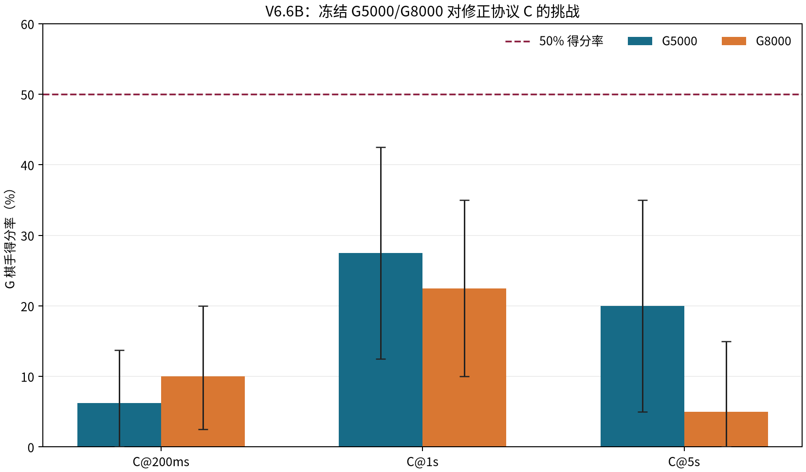
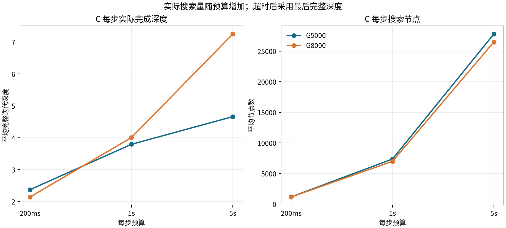
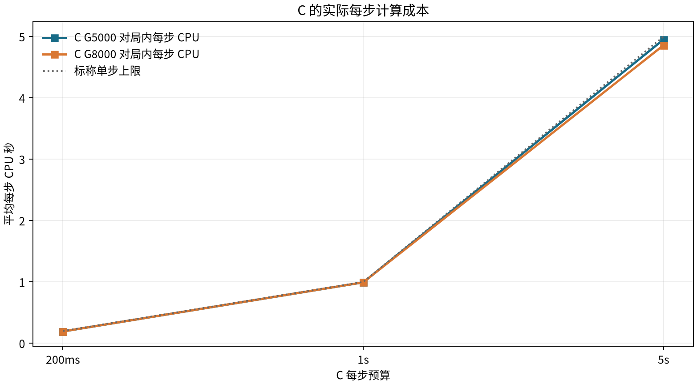

# WuziQ V6.6B｜C 系列评测修正与复赛

## 结论摘要

- 200/200 局完成，全部棋谱通过逐步合法落子、终局、胜者及发动方独立规则回放；没有重复 ID、缺局或未完成局。
- 按 V6.4 的 C 配置（Alpha-Beta、`max_depth=69`、`candidate_radius=2`）重赛后，G5000/G8000 对 C@200ms、C@1s、C@5s 的得分分别为 **6.25%/10.0%**、**27.5%/22.5%**、**20.0%/5.0%**。六个配对95%区间上限均低于50%。
- G8000 对 G5000 的同开局配对差：C@200ms **+3.75个百分点**（95% CI −6.25 至 +13.75），C@1s **−5个百分点**（−25 至 +15），C@5s **−15个百分点**（−35 至 +5）。差异都跨过0，不能确认 G8000 更强；点估计混合，C@1s/C@5s 更偏向 G5000。
- V6.6 的偏差来自调用点只传入时间参数，`SearchConfig` 的默认 `max_depth=4` 生效；C 引擎本身和评估函数未改。V6.6B 显式恢复 `max_depth=69`、半径2，和 V6.4 协议一致。
- 结果支持：按 G 得分率衡量，G8000 没有显示出比 G5000 更强；两者都未能突破 C@200ms/1s/5s。这个小样本只能说明本赛程上的表现，不能断言两个 checkpoint 的总体棋力完全相同。

## 冻结条件与评测协议

- 基线：`ec8eb2dcee6db6b359556b448ecc489ada708222`；分支：`research/alphazero-g-v6-6b-replay`；棋盘9×9、连五获胜。
- G5000 权重 SHA-256：`cc383f0667cfe02b8e8ccbaecf51eccc2c4f088d56c836a4e91e016cfae3ee97`；G8000：`490b70eabb75de1b076e1eb9d13a9d82d2ccc213f3b769bfe6c98eddcb679272`。两份权重与完整训练状态中的模型一致；分别冻结为5000局/87999状态/4999更新和8000局/139884状态/7999更新。
- 两模型固定 PUCT-400；C 每步预算200ms、1秒、5秒。C 使用同一 Alpha-Beta 搜索、评价函数、`max_depth=69`、`candidate_radius=2`，到时返回最后一层完整迭代结果。算法代码未更改。
- 预注册开局池：20个六手合法非终局开局，固定种子 `660701`；D4规范化后与扫描的历史开局池无重叠。开局表 SHA-256：`ceff32a0f5242bc34288245eb86734e422c695e95f7ea72e73736fb375e2b180`；完整200局计划 SHA-256：`654d68344d808b968a487e1272dd0c42dd90f72debdbf136bb3bb2a9a5626459`。G5000/G8000使用完全相同的开局、颜色和随机种子。
- C@200ms 与 C@1s 各为20组开局、黑白换色40局/模型；C@5s为10组开局、黑白换色20局/模型。胜1分、平0.5分、负0分。区间使用开局组为单位的配对 bootstrap 95%区间；同一组的两种颜色先平均，避免把两局当独立样本。

## 正式战绩

得分率以 G 棋手视角计算。CI 是开局配对 bootstrap 95% 区间。

| G 棋手 | 对手 | 局数 | 胜-平-负 | 得分率 | 配对95% CI | G执黑 | G执白 | 平均手数 | G CPU/局 | G CPU/步 | G深度 | G节点/步 | G模拟/步 | C CPU/局 | C深度 | C节点/步 | 超时步数 |
|---|---:|---:|---:|---:|---:|---:|---:|---:|---:|---:|---:|---:|---:|---:|---:|---:|---:|
| G5000 | C@200ms | 40 | 2-1-37 | 6.2% | [0.0%, 13.8%] | 12.5% | 0.0% | 30.5 | 25.6s | 2.13s | 8.91 | 19195 | 400 | 2.4s | 2.37 | 1179 | 498/499 |
| G5000 | C@1s | 40 | 11-0-29 | 27.5% | [12.5%, 42.5%] | 45.0% | 10.0% | 24.9 | 20.0s | 2.14s | 8.81 | 19347 | 400 | 9.5s | 3.79 | 7362 | 382/382 |
| G5000 | C@5s | 20 | 4-0-16 | 20.0% | [5.0%, 35.0%] | 40.0% | 0.0% | 25.7 | 22.6s | 2.33s | 8.98 | 19600 | 400 | 49.5s | 4.66 | 27786 | 197/200 |
| G8000 | C@200ms | 40 | 4-0-36 | 10.0% | [2.5%, 20.0%] | 10.0% | 10.0% | 29.1 | 21.7s | 1.92s | 8.63 | 19563 | 400 | 2.3s | 2.14 | 1165 | 469/469 |
| G8000 | C@1s | 40 | 9-0-31 | 22.5% | [10.0%, 35.0%] | 30.0% | 15.0% | 23.8 | 22.7s | 2.59s | 8.45 | 19160 | 400 | 9.0s | 4.01 | 6985 | 362/362 |
| G8000 | C@5s | 20 | 1-0-19 | 5.0% | [0.0%, 15.0%] | 0.0% | 10.0% | 23.9 | 18.0s | 2.05s | 9.03 | 19270 | 400 | 44.7s | 7.25 | 26482 | 174/184 |

### G5000 与 G8000 的同条件差值

| C对手 | 配对开局组 | G8000−G5000得分率 | 配对95% CI | 解释 |
|---|---:|---:|---:|---|
| C@200ms | 20 | +3.75个百分点 | [-6.25, +13.75] | 区间包含0，不能确认差异 |
| C@1s | 20 | -5.00个百分点 | [-25.00, +15.00] | 区间包含0，不能确认差异 |
| C@5s | 10 | -15.00个百分点 | [-35.00, +5.00] | 区间包含0，不能确认差异 |

20组开局的 C@200ms/C@1s 中，G8000 的点估计略高于 G5000，但区间宽且跨0；C@1s的差值更偏向 G5000。C@5s只有10组，证据更弱。不能用胜局数或训练局数替代直接交锋。

### 固定相同10组开局观察预算趋势

C@5s使用前10组，故可在这10组开局上作预算匹配的探索性对照（每条件20局）。

| G棋手 | C预算 | 局数 | 匹配开局得分率 | 配对95% CI |
|---|---:|---:|---:|---:|
| G5000 | C@200ms | 20 | 10.0% | [0.0%, 25.0%] |
| G5000 | C@1s | 20 | 25.0% | [5.0%, 45.0%] |
| G5000 | C@5s | 20 | 20.0% | [5.0%, 35.0%] |
| G8000 | C@200ms | 20 | 15.0% | [0.0%, 30.0%] |
| G8000 | C@1s | 20 | 20.0% | [0.0%, 40.0%] |
| G8000 | C@5s | 20 | 5.0% | [0.0%, 15.0%] |

这组匹配子样本每档只有10个开局对，区间仍很宽。得分率不随预算呈单调变化，不能据此认为较长预算降低了 C 棋力；预算改变后整局分支也随之改变。更可核验的是实际每步深度、节点和耗时随预算增加。

## C 搜索量与计算成本

| G棋手面对的C | C每步时间上限 | 完整深度（平均） | 节点（平均/步） | 剪枝（平均/步） | 实际耗时（CPU/步） | 超时步数 |
|---|---:|---:|---:|---:|---:|---:|
| G5000 / C@200ms | 0.2s | 2.37 | 1179 | 161 | 0.192s / 0.195s | 498/499 |
| G5000 / C@1s | 1s | 3.79 | 7362 | 626 | 0.992s / 0.995s | 382/382 |
| G5000 / C@5s | 5s | 4.66 | 27786 | 4415 | 4.952s / 4.959s | 197/200 |
| G8000 / C@200ms | 0.2s | 2.14 | 1165 | 158 | 0.192s / 0.195s | 469/469 |
| G8000 / C@1s | 1s | 4.01 | 6985 | 598 | 0.993s / 0.996s | 362/362 |
| G8000 / C@5s | 5s | 7.25 | 26482 | 4454 | 4.858s / 4.865s | 174/184 |

C@200ms 实际平均完成约2.1–2.4层，约1.2K节点/步；C@1s约3.8–4.0层、约7.0–7.4K节点/步；C@5s约4.7层（G5000局面）至7.3层（G8000局面）、约26–28K节点/步。深度随棋局局面复杂度变化，不应只看预算标签。超时表示迭代加深到时后停止；最终着法仍来自最后完整层。

G 每局平均耗时约17.95–25.63 CPU秒；C 每局约2.25–49.52 CPU秒，随预算增长。正式200局总棋手 CPU 时间 `7222.3` 秒（2.006 CPU小时）；逐局wall时长合计 `5001.5` 秒。执行器累计 CPU `7253.8` 秒（含运行调度开销）；对局文件时间跨度 `5460` 秒。
- 赛前实测资源：逻辑CPU 3、容器CPU配额 2.0核、内存 9.73 GiB（可用 8.83 GiB）、磁盘空闲 12.88 GiB。预估乐观/中性/保守为 1.72/2.46/4.18 CPU小时；实测对局约2.01 CPU小时，低于12小时上限。

## 历史配置核查与可比性

- V6.4 的 `v6_4_ladder.py` 明确创建 `SearchConfig(max_depth=69, candidate_radius=2)`；本轮检查到其 Alpha-Beta 算法和评估函数未变。
- V6.6 的 `v6_6_evaluation.py` 仅用 `SearchConfig(time_limit_seconds=...)` 创建 C 配置；`src/ai.py` 的默认 `max_depth=4` 因而生效，默认 `candidate_radius=2`。V6.6出现深度差异是调用点未显式传最大深度，不是 Alpha-Beta 算法变化。
- V6.6B显式传入69层、半径2及三档时间上限。C算法和评估函数保持原样，只有评测配置恢复为V6.4协议。

| G模型 | 对手 | V6.4 (6局/档) | V6.6 (C max_depth=4) | V6.6B (C max_depth=69) |
|---|---|---:|---:|---:|
| G5000 | C@200ms | 16.7% (n=6) | 10.0% (n=40) | 6.2% (n=40) |
| G5000 | C@1s | 33.3% (n=6) | 27.5% (n=40) | 27.5% (n=40) |
| G5000 | C@5s | 0.0% (n=6) | 16.7% (n=12) | 20.0% (n=20) |
| G8000 | C@200ms | 16.7% (n=6) | 0.0% (n=40) | 10.0% (n=40) |
| G8000 | C@1s | 33.3% (n=6) | 27.5% (n=40) | 22.5% (n=40) |
| G8000 | C@5s | 0.0% (n=6) | 8.3% (n=12) | 5.0% (n=20) |

V6.4只有G5000、每条件6局且使用不同开局；V6.6为G5000/G8000混合条件、C深度上限错误为4、每条件40局（C@5s为12局）；V6.6B使用新开局并修正深度，C@5s为20局。以上跨轮次得分率不可当作同局面因果比较。V6.6与V6.6B的用途是指出协议变化和描述结果，不能把胜率升降全部归因于深度上限。

从搜索遥测看，V6.6 的 C@5s 平均只完成3.75–3.76层，受4层上限约束；V6.6B 在 G5000/G8000的局面上分别完成4.66/7.25层。C@1s 约从V6.6的3.19层变为3.79/4.01层，C@200ms则为2.18/2.14层变为2.37/2.14层。V6.6B确实让部分局面搜索超过4层；实际胜率与历史小样本有升有降，不能据此给出单方向的跨轮次强弱因果结论。

## 回放审计、恢复与自动化测试

- 审计：200/200局；缺失 `0`；唯一ID `200`；`all_games_valid=true`。独立规则 oracle、Alpha-Beta配置、开局配对、两个模型共用种子与胜者校验均通过。
- 冻结模型SHA、完整训练状态、优化器槽位、回放池大小、计数及可加载性均在开赛前核验。没有训练或修改模型。
- V6.6B Drive 目录：`https://drive.google.com/drive/folders/1V_-xNxwIkjd8lIbJU2JkkW38KQGxGXMW`。快照上传后回下载 SHA-256、空目录恢复与棋谱回放验证通过；保留最近两份进度快照，最后另存最终报告快照。
- 相关测试：`pytest tests/test_alphazero_g_v6_6b.py tests/test_alphazero_g_v6_6.py tests/test_alphazero_g_v6_5.py`。
- 复现摘要：冻结 `registration.json`、`opening_schedule.json` 与 `match_plan.json`；运行 `python scripts/run_g_v6_6b.py`，审计 `python scripts/run_g_v6_6b.py audit`，汇总 `python scripts/run_g_v6_6b.py summarize`，生成本报告 `python scripts/build_g_v6_6b_report.py`。重新运行比赛需已有匹配的冻结权重与Python依赖。

## 局限与结论

本轮每档只有10–20组配对开局，置信区间不足以区分 G5000 与 G8000；两模型都没有任何一档得分接近50%，但这不等于算法总体实力可由这些开局完全确定。修正协议后的C在200ms、1s和5s下均能持续击败G，且预算越大，实际节点和完整深度总体越高。G8000并未显示对G5000的可靠提升，也未能挑战更高算力的C。

下一步应优先扩大相同开局、相同颜色配对的直接复赛，并检查 AlphaZero 网络在长预算搜索中的战术识别与防守，而不是根据本轮小样本对checkpoint重新排序。
