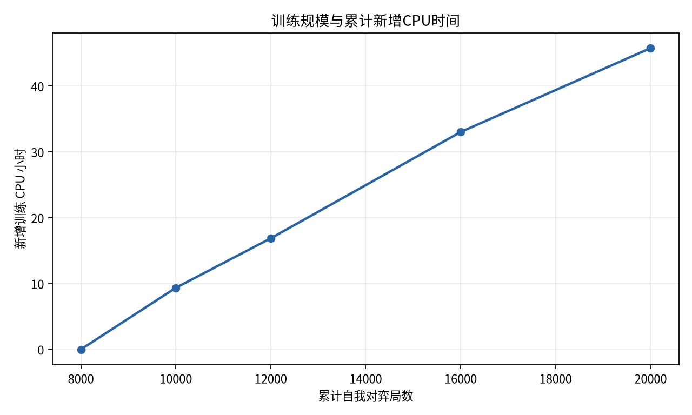
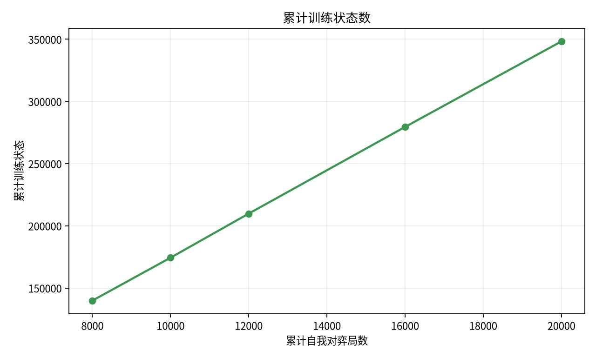
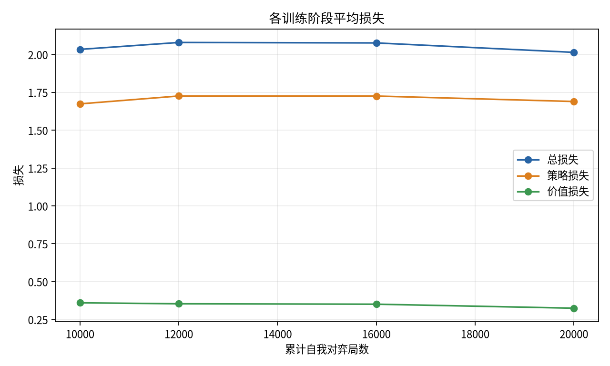
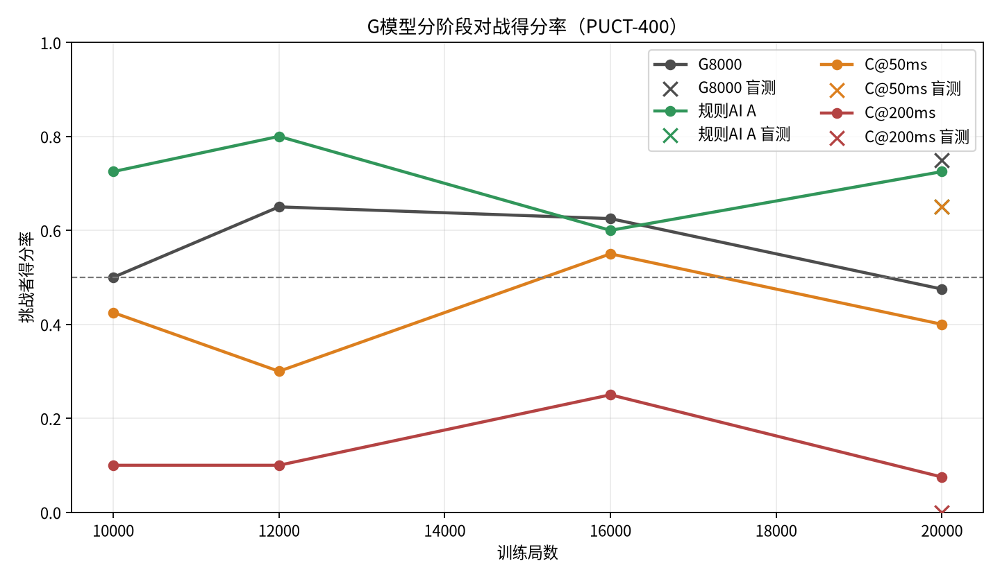

# WuziQ AlphaZero G V6.7：持续训练至20K

## 状态

- 训练基线：冻结 G8000；模型 SHA-256 `490b70eabb75de1b076e1eb9d13a9d82d2ccc213f3b769bfe6c98eddcb679272`，完整训练状态 SHA-256 `6b56dee19e66365fd3623a80817e397eb71875861e1f28be8809447daef88a82`。
- 当前：G20000，累计 348,216 个训练状态、19,999 次更新；新增训练 45.75 CPU小时。
- 完成状态：完成G20000。本轮未修改网络、PUCT-400、Adam、Replay Buffer、学习率或训练目标。
- 从 G8000 恢复登记至本次报告生成的墙钟时长约 52.91 小时；其中包含训练、评测、备份及等待时间。
- 新增数据来源为同一G网络的纯自我对弈；未使用教师模型、人工棋谱、战术奖励或规则补丁。
- Codex 运行时的具体模型档位无法从实验容器独立核实。

## 预检与预算

- 资源：3 个可见 CPU，配额 `200000 100000`；内存上限 `8589934592` 字节；磁盘可用 12.6 GiB。
- G5000→G8000历史实测：3000 局耗费 16.28 CPU小时，即 19.53 CPU秒/局；剩余12,000局训练预估 52.1/65.1/84.7 CPU小时（乐观/中性/保守）。
- 对局预检外推400局评测成本 0.2/0.3/0.5 CPU小时；连同打包/审计总预估 58.3/71.4/91.2 CPU小时。

任务新增CPU硬上限为110小时，其中训练阶段最多100小时，为评测与验收保留余量。实际新增CPU约 46.94 小时（训练状态内累计CPU、正式评测、审计与本地快照打包之和；Drive传输墙钟时间单列）。

## 检查点与训练指标

以下loss/entropy为相邻里程碑间的均值；它们描述优化过程，不单独证明棋力提升。

| 检查点 | 累计状态 | 累计更新 | 阶段总损失 | 策略损失 | 价值损失 | 策略熵 | 新增训练CPU小时 |
|---:|---:|---:|---:|---:|---:|---:|---:|
| G8000 | 139884 | 7999 | — | — | — | — | 0.00 |
| G10000 | 174367 | 9999 | 2.0336 | 1.6737 | 0.3600 | 1.6843 | 9.36 |
| G12000 | 209807 | 11999 | 2.0792 | 1.7257 | 0.3535 | 1.7360 | 16.87 |
| G16000 | 279472 | 15999 | 2.0762 | 1.7254 | 0.3508 | 1.7370 | 33.02 |
| G20000 | 348216 | 19999 | 2.0139 | 1.6894 | 0.3245 | 1.7019 | 45.75 |







## 配对对局

开发赛每个阶段、每个对手使用同一组10个固定六手开局并交换执黑/执白。G20000冻结后额外使用10个从未参与开发选模的开局做盲测。表中区间是按开局配对的自助法95%描述区间；每条件仅20局，属于探索性结果。

对手：G8000、规则AI A、Alpha-Beta C@50ms、C@200ms。C严格为 `max_depth=69`、`candidate_radius=2`，超时返回最后完整搜索层。

| 阶段 | 对手 | 胜-平-负 | 得分率与配对95%区间 | 执黑得分率 | 执白得分率 | 平均步数 | G CPU秒/局 | 对手CPU秒/局 |
|---:|---|---:|---:|---:|---:|---:|---:|---:|
| G10000 开发 | G8000 | 10-0-10 | 10-0-10；50.0% [30.0%, 70.0%] | 70.0% | 30.0% | 30.8 | 6.31 | 6.20 |
| G10000 开发 | A | 11-7-2 | 11-7-2；72.5% [62.5%, 82.5%] | 70.0% | 75.0% | 49.1 | 10.27 | 0.02 |
| G10000 开发 | C@50ms | 8-1-11 | 8-1-11；42.5% [17.5%, 70.0%] | 40.0% | 45.0% | 28.9 | 5.65 | 0.52 |
| G10000 开发 | C@200ms | 2-0-18 | 2-0-18；10.0% [0.0%, 25.0%] | 20.0% | 0.0% | 29.3 | 5.91 | 2.31 |
| G12000 开发 | G8000 | 11-4-5 | 11-4-5；65.0% [55.0%, 75.0%] | 90.0% | 40.0% | 35.6 | 6.80 | 7.25 |
| G12000 开发 | A | 13-6-1 | 13-6-1；80.0% [65.0%, 92.6%] | 75.0% | 85.0% | 46.3 | 8.95 | 0.01 |
| G12000 开发 | C@50ms | 5-2-13 | 5-2-13；30.0% [10.0%, 52.5%] | 20.0% | 40.0% | 33.5 | 6.34 | 0.62 |
| G12000 开发 | C@200ms | 0-4-16 | 0-4-16；10.0% [2.5%, 17.5%] | 10.0% | 10.0% | 41.3 | 7.83 | 3.45 |
| G16000 开发 | G8000 | 12-1-7 | 12-1-7；62.5% [45.0%, 80.0%] | 90.0% | 35.0% | 29.0 | 5.35 | 5.91 |
| G16000 开发 | A | 7-10-3 | 7-10-3；60.0% [50.0%, 70.0%] | 65.0% | 55.0% | 57.1 | 11.01 | 0.02 |
| G16000 开发 | C@50ms | 11-0-9 | 11-0-9；55.0% [40.0%, 70.0%] | 90.0% | 20.0% | 24.4 | 4.03 | 0.41 |
| G16000 开发 | C@200ms | 5-0-15 | 5-0-15；25.0% [5.0%, 45.0%] | 40.0% | 10.0% | 32.4 | 5.69 | 2.60 |
| G20000 开发 | G8000 | 8-3-9 | 8-3-9；47.5% [27.5%, 67.5%] | 70.0% | 25.0% | 33.9 | 5.49 | 6.49 |
| G20000 开发 | A | 10-9-1 | 10-9-1；72.5% [62.5%, 82.5%] | 70.0% | 75.0% | 54.0 | 9.39 | 0.02 |
| G20000 开发 | C@50ms | 8-0-12 | 8-0-12；40.0% [20.0%, 60.0%] | 50.0% | 30.0% | 24.7 | 4.11 | 0.42 |
| G20000 开发 | C@200ms | 1-1-18 | 1-1-18；7.5% [0.0%, 17.5%] | 15.0% | 0.0% | 32.9 | 5.90 | 2.66 |
| G20000 盲测 | G8000 | 15-0-5 | 15-0-5；75.0% [60.0%, 90.0%] | 70.0% | 80.0% | 30.4 | 5.69 | 6.39 |
| G20000 盲测 | A | 6-14-0 | 6-14-0；65.0% [55.0%, 75.0%] | 60.0% | 70.0% | 64.6 | 12.11 | 0.02 |
| G20000 盲测 | C@50ms | 13-0-7 | 13-0-7；65.0% [45.0%, 85.0%] | 60.0% | 70.0% | 22.1 | 3.80 | 0.36 |
| G20000 盲测 | C@200ms | 0-0-20 | 0-0-20；0.0% [0.0%, 0.0%] | 0.0% | 0.0% | 31.8 | 5.77 | 2.57 |



### C实际搜索成本

| C预算 | 实际落子数 | 平均完成深度 | 平均节点 | 平均CPU秒/步 | 超时比例 |
|---|---:|---:|---:|---:|---:|
| C@50ms | 1038 | 1.79 | 318 | 0.0450 | 99.7% |
| C@200ms | 1396 | 2.59 | 1509 | 0.1946 | 99.6% |

正式评测总计 400 局。盲测仅在G20000后执行，且不用于修改权重或训练方案。

## 数据完整性

- 训练棋谱独立按9×9连五规则回放，核对唯一ID、确定性种子、状态数、终局、NPZ形状与胜负视角。
- 训练状态检查模型、Adam、10,000行Replay及Python/NumPy/PyTorch RNG；各里程碑检查点单独恢复校验。
- 评测棋谱逐手回放；验证换色成对、胜负、计分及C的搜索参数。
- 当前完整性审计：`通过`；训练回放 12000 局；评测回放 400 局；评测条件完整：True。
- 最新Drive文件夹：[WuziQ G V6.7 Recovery](https://drive.google.com/drive/folders/1bkakjo5fdhgELAzyuOohDE8wynVBY1fh)；源G8000包 SHA 与本轮恢复包均记录在 `results/drive_backup_status.json`。快照中仅保留恢复必需代码、状态、进度、棋谱和评测记录。

## 结论

由于本轮固定了网络、PUCT预算和训练算法，G8000到各里程碑的同预算配对成绩才可作为训练规模对照。10对开局的阶段评测以及最终盲测样本均有限；若配对区间覆盖50%，应报告“证据不足以区分”，不能视为胜率变化已稳定。对A或C的结果用于描述目前能力边界，不能将跨阶段小样本的偶然起伏解释为确定成长或退化。

## 复现

```bash
python scripts/prepare_g_v6_7.py --source-state <G8000-training-state.pt> --source-node <G8000-node.pt>
python scripts/preflight_g_v6_7.py
python scripts/run_g_v6_7_batch.py
python scripts/evaluate_g_v6_7.py --games 10000 --pool development
python scripts/audit_g_v6_7.py
python scripts/report_g_v6_7.py
```

Drive恢复使用 `scripts/restore_g_v6_7_snapshot.py <verified-snapshot.zip> <empty-directory>`；多段文件先按清单顺序拼接，再运行恢复和SHA校验。
