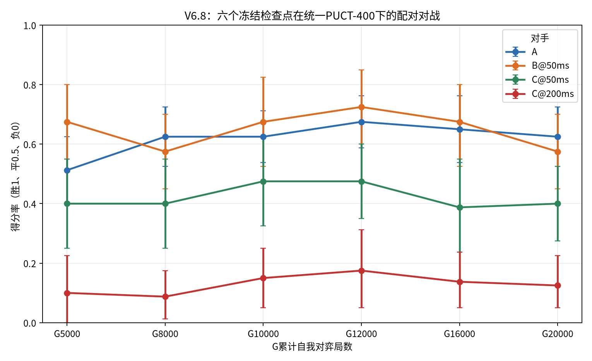

# WuziQ AlphaZero G V6.8：六阶段棋力成长对比

## 实验登记与环境

- 基线：V6.7 提交 `911242c10c8a374740db072f71a6b5f450a837e6`；新分支：`research/alphazero-g-v6-8-stage-comparison`。
- 本轮仅评测，不训练、不更新权重。6个模型全部冻结，使用相同AlphaZero参考实现、PUCT配置和9×9连五规则。
- 6个阶段：G5000, G8000, G10000, G12000, G16000, G20000；每阶段 4 个对手，每条件20组开局、换色40局；总计960局。
- 所有条件共用20个合法六手开局；按D4对称归一化，与本机可检索历史实验开局重叠数为0。开局表SHA-256：`e7650c70c087b1ed6e1a3ece41d5e84b85e8a9f0b4c422bb6c13f57a014a313a`。
- G模型每步配置400次PUCT模拟（V6参考实现根扩展方式下记录399次根边访问）。温度、根噪声、候选网络均固定，未作训练或调参。
- 资源预检：3个可见逻辑CPU、cgroup最多2核时间、内存上限8GiB；GPU不可用（PyTorch为CPU构建）；960局棋手进程累计CPU约5.83小时，按逐局CPU实测求和。
- 从预检记录到最后一局持久化约3小时22分钟47秒；CPU时间为逐局进程CPU时间求和，与墙钟时间口径不同。

## 检查点身份

| 模型 | 局数 | 累计训练状态 | 更新数 | PUCT/步 | 权重SHA-256 |
|---|---:|---:|---:|---:|---|
| G5000 | 5000 | 87,999 | 4,999 | 400 | `cc383f0667cfe02b8e8ccbaecf51eccc2c4f088d56c836a4e91e016cfae3ee97` |
| G8000 | 8000 | 139,884 | 7,999 | 400 | `490b70eabb75de1b076e1eb9d13a9d82d2ccc213f3b769bfe6c98eddcb679272` |
| G10000 | 10000 | 174,367 | 9,999 | 400 | `6c5ed1c27a4b59ff4aeffcc9a89fa5ad92a600e2d8ce7358c1ad38430f2a2a24` |
| G12000 | 12000 | 209,807 | 11,999 | 400 | `19a12ca8a860275cd3253e10d68cacf445965acd75dc1587ad614c2515e03bd2` |
| G16000 | 16000 | 279,472 | 15,999 | 400 | `e63504351f2e4c5e51414fe88596f5068d5cd1cd31ac68be1ed835865c38f633` |
| G20000 | 20000 | 348,216 | 19,999 | 400 | `aa8b69920675c9cd43a9b8a960abf3a43b88ebf6ad92dff2d2fb0ed2f4fcecbc` |

## 对手设定与结果

- A：原始规则AI，自然计算完成即落子，没有人为等待。
- B@50ms：原纯Minimax，无Alpha-Beta剪枝，50ms/步；沿用历史`SearchConfig`默认深度4、候选半径2。
- C@50ms、C@200ms：Alpha-Beta，`max_depth=69`、`candidate_radius=2`，超时返回最后完整层。
- 区间以20个开局组为配对单位做10,000次bootstrap，描述性95%区间；不是独立样本的普通二项区间。每条件仅40局，作为探索性评测。

### 核心成绩表

| G累计训练局数 | A | B@50ms | C@50ms | C@200ms |
|---:|---:|---:|---:|---:|
| 5000 | 51.2% | 67.5% | 40.0% | 10.0% |
| 8000 | 62.5% | 57.5% | 40.0% | 8.8% |
| 10000 | 62.5% | 67.5% | 47.5% | 15.0% |
| 12000 | 67.5% | 72.5% | 47.5% | 17.5% |
| 16000 | 65.0% | 67.5% | 38.8% | 13.8% |
| 20000 | 62.5% | 57.5% | 40.0% | 12.5% |

### 逐项成绩与成本

| 模型 | 对手 | 胜-平-负 | 得分率 | 配对95%区间 | 执黑 | 执白 | G CPU秒/局 | 对手CPU秒/局 |
|---:|---|---:|---:|---:|---:|---:|---:|---:|
| G5000 | A | 15-11-14 | 51.2% | [40.0%, 62.5%] | 72.5% | 30.0% | 37.11 | 0.02 |
| G5000 | B@50ms | 27-0-13 | 67.5% | [55.0%, 80.0%] | 80.0% | 55.0% | 11.39 | 0.27 |
| G5000 | C@50ms | 16-0-24 | 40.0% | [25.0%, 55.0%] | 50.0% | 30.0% | 14.90 | 0.37 |
| G5000 | C@200ms | 4-0-36 | 10.0% | [0.0%, 22.5%] | 15.0% | 5.0% | 18.39 | 2.31 |
| G8000 | A | 15-20-5 | 62.5% | [52.5%, 72.5%] | 65.0% | 60.0% | 43.30 | 0.03 |
| G8000 | B@50ms | 23-0-17 | 57.5% | [45.0%, 70.0%] | 75.0% | 40.0% | 13.11 | 0.31 |
| G8000 | C@50ms | 16-0-24 | 40.0% | [25.0%, 55.0%] | 55.0% | 25.0% | 15.78 | 0.36 |
| G8000 | C@200ms | 3-1-36 | 8.8% | [1.2%, 17.5%] | 15.0% | 2.5% | 20.87 | 2.38 |
| G10000 | A | 13-24-3 | 62.5% | [53.8%, 71.2%] | 65.0% | 60.0% | 45.89 | 0.03 |
| G10000 | B@50ms | 27-0-13 | 67.5% | [52.5%, 82.5%] | 70.0% | 65.0% | 14.65 | 0.30 |
| G10000 | C@50ms | 19-0-21 | 47.5% | [32.5%, 62.5%] | 55.0% | 40.0% | 13.73 | 0.35 |
| G10000 | C@200ms | 6-0-34 | 15.0% | [5.0%, 25.0%] | 25.0% | 5.0% | 18.36 | 2.14 |
| G12000 | A | 19-16-5 | 67.5% | [58.8%, 76.2%] | 85.0% | 50.0% | 33.08 | 0.02 |
| G12000 | B@50ms | 29-0-11 | 72.5% | [60.0%, 85.0%] | 75.0% | 70.0% | 12.78 | 0.30 |
| G12000 | C@50ms | 19-0-21 | 47.5% | [35.0%, 60.0%] | 55.0% | 40.0% | 16.39 | 0.40 |
| G12000 | C@200ms | 6-2-32 | 17.5% | [5.0%, 31.2%] | 22.5% | 12.5% | 21.01 | 2.85 |
| G16000 | A | 16-20-4 | 65.0% | [53.8%, 76.2%] | 65.0% | 65.0% | 36.20 | 0.03 |
| G16000 | B@50ms | 27-0-13 | 67.5% | [52.5%, 80.0%] | 70.0% | 65.0% | 11.54 | 0.28 |
| G16000 | C@50ms | 15-1-24 | 38.8% | [23.8%, 55.0%] | 32.5% | 45.0% | 15.25 | 0.43 |
| G16000 | C@200ms | 5-1-34 | 13.8% | [5.0%, 23.8%] | 22.5% | 5.0% | 20.67 | 2.77 |
| G20000 | A | 16-18-6 | 62.5% | [52.5%, 72.5%] | 70.0% | 55.0% | 32.65 | 0.02 |
| G20000 | B@50ms | 23-0-17 | 57.5% | [45.0%, 70.0%] | 80.0% | 35.0% | 10.19 | 0.28 |
| G20000 | C@50ms | 16-0-24 | 40.0% | [27.5%, 52.5%] | 50.0% | 30.0% | 12.06 | 0.36 |
| G20000 | C@200ms | 5-0-35 | 12.5% | [5.0%, 22.5%] | 15.0% | 10.0% | 16.81 | 2.24 |

### G5000到G20000同开局差异

- **A**：G5000 51.2% → G20000 62.5%；同开局差 +11.2%，配对95%自助区间 [-5.0%, +27.5%]。
- **B@50ms**：G5000 67.5% → G20000 57.5%；同开局差 -10.0%，配对95%自助区间 [-22.5%, +0.0%]。
- **C@50ms**：G5000 40.0% → G20000 40.0%；同开局差 +0.0%，配对95%自助区间 [-12.5%, +15.0%]。
- **C@200ms**：G5000 10.0% → G20000 12.5%；同开局差 +2.5%，配对95%自助区间 [-12.5%, +15.0%]。

## 成长趋势解释

四个不同强度对手的得分率等权平均仅作为描述性摘要，不代替分对手结论：{'5000': 0.421875, '8000': 0.421875, '10000': 0.48125, '12000': 0.5125, '16000': 0.4625, '20000': 0.43125}。平均值最高的阶段为 G12000（51.2%）。四对手等权均值最大阶段性上升为G8000→G10000（+5.9%），最大阶段性下降为G12000→G16000（-5.0%）。四条曲线若有起伏，应优先结合配对区间和执黑执白差异解释；本次20组开局不足以把小幅波动认定为稳定成长或退步。

- 每个对手的G5000→G20000同开局差和95%区间列在上表。区间跨0表示当前样本不足以确认差异方向。
- C@200ms是否仍是瓶颈，按独立得分率曲线和对局记录判断；不能用低预算C或A的成绩代替。
- B@50ms维持V6历史配置（深度4）；因此不能与采用69层截止迭代加深的C对手混为相同搜索深度。
- 每步耗时、搜索深度、节点、剪枝/超时以及PUCT根访问数记录在960份逐局JSON的逐手数据中。

## 完整性验收与复现

- 审计结果：960局逐手合法回放，独立规则oracle核对终局；唯一ID 960；24个条件各40局并按同开局换色；审计状态 `通过`。
- 原始记录：`results/games/`；开局和模型清单：`config/`；汇总：`results/summaries/`；完整审计：`results/audit.json`。
- 可分析的汇总表：`results/scores.csv`；包含24个条件的胜平负、得分率、配对区间、颜色成绩、同开局G5000差值及CPU成本。
- 复现：`PYTHONPATH=. python scripts/run_g_v6_8.py --max-new-games 40` 重复运行会跳过已完成且配置一致的棋局；完成后 `PYTHONPATH=. python scripts/run_g_v6_8.py --audit` 与 `--report`。
- Drive恢复目录：https://drive.google.com/drive/folders/1G2H0BDZ6uiZjEZreDyFuFKVEyxXLLhlS。快照经下载SHA-256核验并在空目录恢复后登记；本地与远端提交信息记在`results/drive_backup_status.json`。
- 最终完整恢复包：[final-G00960](https://drive.google.com/file/d/1Q_I8nLSUpzFQj04gUMxRultdkwS_eIcO/view?usp=drivesdk)；SHA-256 `02432bff783ec8dcbff279504a51835d555a6812b00bb6dc3226c0b6b093408e`；空目录恢复核验 1004 个文件。
