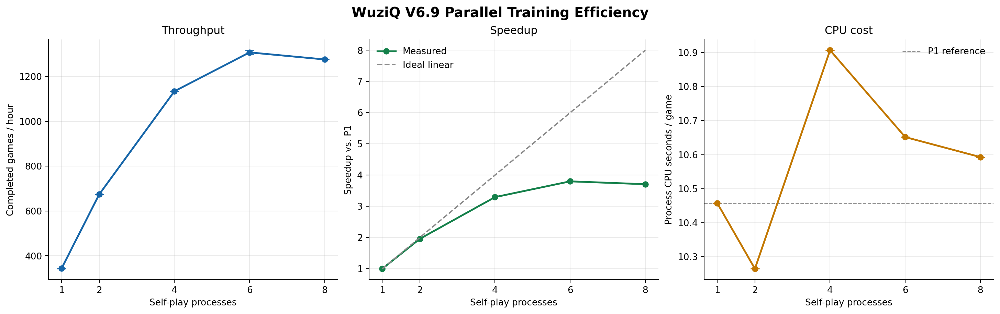

# WuziQ V6.9｜AlphaZero 并行训练效率实验

## 结论

- **本 Work 环境建议 6 个自我对弈进程。** P6 两次各 100 局的合并吞吐为 **1307.5 局/小时**，比 P1 两次基线均值 **344.1 局/小时**快 **3.80 倍**。两次 P6 分别为 1297.8 和 1317.2 局/小时，重复结果相差约 1.5%。
- **CPU 总消耗小幅增加。** P6 平均 10.65 CPU 秒/局，比 P1 的 10.46 高 **1.9%**；并行把墙钟时间大幅压缩，但 CPU 总工作量没有按 3.8 倍增加。
- **8 个进程不如 6 个。** P8 为 P1 的 3.71 倍，低于 P6 的 3.80 倍，同时占用更多内存且权重滞后更大。
- 按 P6 实测均值线性估算，G20K 到 G50K 的 30,000 局约需 **22.9 小时墙钟、88.8 CPU 小时**；P1 约需 87.2 小时墙钟、87.1 CPU 小时。
- 本轮只验证效率，**没有启动正式 G50K 训练，也没有用这 100 局证明并行与串行棋力等价**。P6 会形成一条新的训练时序轨迹，正式继续时应保存为独立实验。

## 环境与基线

- 基线 Git commit：`911242c10c8a374740db072f71a6b5f450a837e6`；G20000 checkpoint SHA-256：`f932ec34eaf4da6ac63bc77b6636e0517235a8986bbcf981139afa4cae7b7719`。
- 基线完整状态为 20,000 局、348,216 个训练状态、19,999 次优化更新、10,000 条 Replay Buffer。Adam（16 个 optimizer slots）、模型、Replay Buffer、Python/NumPy/PyTorch 随机状态均通过恢复校验。
- 预检可见 9 个逻辑 CPU（affinity 0–8）；Work 未暴露 CPU quota 或内存 cgroup 上限路径，因而**无法读取硬性配额值**。实测 P6 平均约 3.87 个有效核，P8 约 3.75，本任务的有效算力平台约在 4 核附近。
- 内存总量约 10.45 GB，预检可用约 3.31 GB；工作盘 20.96 GB、预检可用 13.18 GB。没有 GPU，PyTorch 为 CPU 版 2.15.0。进程树 RSS 是所有进程 RSS 求和；fork 共享页会重复计入，因此它不是物理唯一内存的精确值。
- GitHub 克隆、G20000 Drive 分片下载、空目录恢复和完整状态校验均成功。

## 测试设计与结果

各条件都从同一 G20000 checkpoint 独立恢复，使用相同的 100 个种子序号：`590502 + game_index × 10007`。每组先跑预热对局并丢弃预热更新，再正式计时 100 局。每局保持 9×9、PUCT-400、batch 512、5 epochs、学习率 0.002、原 KL 目标与 10,000 条 Replay Buffer；每新增一局调用一次原有完整优化更新流程。Torch intra/inter-op 和 BLAS/OpenMP 线程均限制为 1。

| 方案 | 复测数 | 启动方式 | 局/小时 | 相对 P1 | 墙钟秒/100局 | CPU秒/100局 | CPU秒/局 | 状态/秒 | 有效核数 | RSS峰值 GiB | 平均滞后/更新 | P95 | 最大 |
|---:|---:|---|---:|---:|---:|---:|---:|---:|---:|---:|---:|---:|---:|
| P1 | 2 | spawn | 344.1 | 1.00× | 1046.1 | 1045.7 | 10.46 | 1.75 | 1.00 | 0.87 | 0.00 | 0.0 | 0 |
| P2 | 1 | spawn | 674.0 | 1.96× | 534.1 | 1026.5 | 10.26 | 3.17 | 1.92 | 1.20 | 0.99 | 2.0 | 2 |
| P4 | 1 | spawn | 1133.8 | 3.29× | 317.5 | 1090.7 | 10.91 | 5.75 | 3.43 | 1.86 | 2.94 | 4.0 | 7 |
| P6 | 2 | fork | 1307.5 | 3.80× | 275.3 | 1065.2 | 10.65 | 6.37 | 3.87 | 2.66 | 4.85 | 6.0 | 8 |
| P8 | 1 | fork | 1276.1 | 3.71× | 282.1 | 1059.3 | 10.59 | 5.94 | 3.75 | 3.37 | 6.72 | 8.0 | 9 |

图中误差线仅显示有两次重复的 P1、P6 各自观测范围；P2、P4、P8 各只有一组 100 局。

## 并行调度造成的差异

P1 按“完整自我对弈 → 使用最新权重做一次优化更新 → 下一局”的串行顺序运行，权重滞后为 0。并行方案由多个 worker 使用各自拿到的冻结权重完成整局；中央训练进程按对局完成顺序统一写 Replay Buffer、调用 Adam 更新一次，并在 worker 开始下一局时发送最新权重。棋局生成与更新没有被删除，但完成顺序和训练时序改变了。

| 进程数 | 平均权重滞后 | P95 滞后 | 最大滞后 |
|---:|---:|---:|---:|
| 1 | 0.00 | 0.0 | 0 |
| 2 | 0.99 | 2.0 | 2 |
| 4 | 2.94 | 4.0 | 7 |
| 6 | 4.85 | 6.0 | 8 |
| 8 | 6.72 | 8.0 | 9 |

所有 700 局正式测量都通过棋谱合法性与终局回放、PUCT-400、唯一 ID/种子、每局一次更新，以及最终模型、Adam、Replay Buffer 和随机状态检查。并行时相同随机种子不保证落子轨迹相同，因为每局拿到的模型版本和中央更新完成顺序不同。100 局只说明吞吐与完整性，不说明棋力等价。

## 资源限制与过程记录

- 6-worker 的 `spawn` 预热尝试以退出码 137 被系统终止，未产生正式测量；环境没有暴露 cgroup 限制值，原因只能判为资源保护终止，不能精确归因。之后 P6 与 P8 使用 `fork`，完成正式测量和全部校验。P1/P2/P4 使用 `spawn`。所有实验协议及启动方式均记录在各 run summary 中。
- 第一次 P2 的中断恢复尝试因局号续接错误形成重复对局记录和多余更新，审计判为无效并排除。修复续跑逻辑后以全新 run `P2-CLEAN-1` 从 G20000 重跑并通过审计。
- 修复后的续跑冒烟校验在提交 ordinal 1、ordinal 0 仍未完成时中断；恢复后按 `1, 2, 0, 3` 完成 4 局，唯一 ID、更新次数和完整 checkpoint 审计均通过，不计入性能样本。
- 每组成功 run 的完整权重 checkpoint、100 局棋谱与样本、原始逐局计时和审计文件均已打包到 Drive；下载副本与上传包 SHA-256 一致，并在空目录恢复成功。汇总清单见 `drive_backup_status.json`。

## G20K 到 G50K 的线性估算

| 方案 | 墙钟小时（30,000 局） | CPU 小时（30,000 局） |
|---:|---:|---:|
| P1 | 87.2 | 87.1 |
| P2 | 44.5 | 85.5 |
| P4 | 26.5 | 90.9 |
| P6 | 22.9 | 88.8 |
| P8 | 23.5 | 88.3 |

这是基于 G20K 附近每组 100 局表现的线性外推，模型、棋局长度、机器负载和权重滞后在后续 30K 局中可能变化。可以把 P6 用于一个**独立的 50K 后续实验**，预计把墙钟从约 87.2 小时降到约 22.9 小时，代价是约 1.9% 的 CPU 增量以及更大的异步权重滞后。若目标还包括与原串行轨迹比较棋力，应保留 P1/旧轨迹作为对照，并用固定对手、交换先后手的盲测判断效果。

## 交付文件

- `per_game_metrics.jsonl.gz`：700 行原始逐局性能数据的 gzip 压缩件，解压后为 JSONL。
- `runs_summary.csv`、`runs_summary.json`：方案汇总。
- `throughput_scaling.png`：吞吐量、加速比和 CPU 成本曲线。
- `drive_backup_status.json`：Drive 文件 ID、压缩包和状态 checkpoint SHA-256、恢复结果。
- 源码：`src/research/alphazero_g/v6_9_parallel.py`、`src/research/alphazero_g/v6_9_snapshot.py`、`scripts/run_g_v6_9_efficiency.py`、`scripts/package_g_v6_9_run.py`、`scripts/summarize_g_v6_9.py`。
