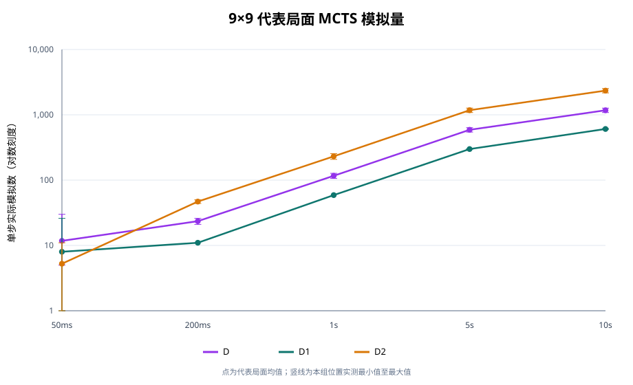
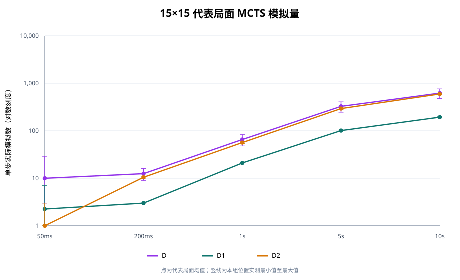

# MCTS 极限潜力验证 V2：算法开发与对弈评估

## 摘要

本轮从 V1 的 A/B/C/D 基线出发，保留 D 为原版 UCT 参考，新增 D1（预算放宽的原策略 UCT）与 D2（带战术处理和工程优化的纯 MCTS）。正式分析采用缩减后的 10 局/对阵条件：9×9 公平赛四个时间预算、15×15 两个补充预算，以及四档 D2 对 C 的非对等挑战，共 400 局。全部模型使用同一棋规和公开局面；没有神经网络、强化学习或离线训练。

主要结论：在相同时间上限下，D1、D2 都未能击败 9×9 的 C；D2 在 5 秒对 50 毫秒 C 的挑战里赢 1/10，尚不足以证明能稳定挑战 Alpha-Beta。该局用了约 100 倍的单步预算，D2 对 C 的其余 9 局仍告负。D2 增加时间确实显著增加模拟量，但 5 秒公平赛未把模拟量优势转化为对 C 的胜场。

## 1. 规模、资源与耗时

V2 原始计划为 2,960 局；用户将每个条件压缩至 10 局后，正式计划为 400 局。由于 15×15 补充项目原先是 20 局/条件，缩减后总计划是原计划的 7.4 分之一（9×9 的所有正式条件正好缩减 10 倍）。

正式预检在 3 vCPU Intel Xeon Platinum 8573C、9.7 GiB 内存和约 30 GiB 可用磁盘上进行。按原 2,960 局试跑数据估算，约需 7.81 小时串行计算时间，含 1.5 倍波动余量约 11.72 小时，原始棋谱预计约 13.2 MiB。按最终正式棋谱逐步累计的模型思考时间，400 局合计 5,323.5 秒（1.48 小时）；这是从零重跑的近似计算量。V1 上一轮对局阶段约 19 分钟，因此 400 局从零执行约为 V1 的 4.7 倍，约多 1 小时 10 分钟。

缩减前已经实际完成 2,010 局，其中选定的 210 局满足缩减后的正式开局索引，直接纳入 400 局主样本；其余 1,800 局原样保存在补充归档，未混入正式统计。缩减后新跑完剩余 190 局，基于进度快照 14:20:05Z 至完成进度写入 14:56:54Z，约 37 分钟。故从缩减决策时点起实际增加的对局计算明显少于从零执行 400 局的估算。端到端 07:12 首个恢复快照至完成约 7 小时 45 分，其中包含缩减前的 2,010 局工作；不能将这段总时长说成 400 局所需时间。

主分析有 400 个唯一局 ID、200 个配对开局组、7,753 次合法落子回放；384 局五连终局、16 局满盘和棋；0 非法着法、0 未配对开局组。共有 35 种 9×9、15 种 15×15 唯一开局位置。早先的 2,010 局归档已单独校验，非法着法和未配对组也均为 0。

## 2. 算法定义与 V1 的关系

- **D（V1 原版）**：保持旧版 UCT 搜索作为历史基线；受 V1 的 50 ms 限制，rollout 最多 24 手。旧结果和代码未覆盖。
- **D1**：使用原 UCT 选择、随机扩展、回传和 rollout 走法策略；提高模拟/时间上限，并将 rollout 上限放宽到本局剩余空位数，让模拟尽量走到真实胜负或满盘。D1 同时移除了 rollout 24 手截断并放宽算力，因此 D 对 D1 的差异是这两者合并效果，不能单独归因于纯算力。
- **D2**：独立的传统 UCT，不调用 Minimax 或 Alpha-Beta。增加即时胜棋与必防点识别、根节点候选公平覆盖和渐进扩展、战术感知 rollout、候选生成开销优化、跨步节点复用与完整终局判断。每步使用确定性种子派生。被截止时间中断的 rollout 不回传、不计作完成模拟。

A/B/C 的代码和评估规则沿用 V1。所有算法只访问同一棋盘公开状态。非法落子按负局处理；预算超时会记录，如果能返回合法着法则继续该局，不自动判负。主样本没有非法着法。

## 3. 实验设计与可复现性

公平赛中双方使用相同单步时间上限：

- 9×9：50 ms、200 ms、1 秒、5 秒；每预算各测 A/B/C 对 D1 和 D2。
- 15×15：50 ms 和 1 秒补充验证；每预算各测 A/B/C 对 D1 和 D2。
- 非对等挑战：C 固定为 V1 的 50 ms，D2 分别使用 200 ms、1 秒、5 秒（9×9），以及 1 秒（15×15）。

每组 10 局由 5 个预先派生的配对开局组成，每个开局各交换一次黑白。种子从配置、阶段、开局索引、唯一对局 ID 派生；不按结果挑选种子。对缩减前数据只取预先排序的开局索引 0–4 进入主样本，其他棋谱留在补充归档。

主赛配置固定基种子 20261018、开局 4 手、UCT 探索常数 √2、候选半径 2、D1/D2 模拟上限 1,000,000。逐局 JSONL 及时 fsync，进度文件按唯一 ID 去重并可恢复。置信区间使用配对开局块 Wilson 95% 区间；每个单独对阵只有 5 个有效配对块，因此区间较宽。报告不把小样本排名当作稳定能力证明。汇总 JSON 也保留了 5,000 次配对开局 bootstrap 的区间。

正式运行前实测了 CPU、内存、磁盘；Google Drive 读写、哈希核验和恢复演练均成功。运行中上传了缩减后正式进度快照，下载回读哈希一致，恢复出 210 个局 ID 后才删除前一版 V2 快照。Drive 文件 ID：1qVJRe_FAwi7r_jGaQPSXU94BU0dpUCHU；SHA-256：5b9a9f6950a54e024f4abdbb207db3f5e507c872a0083c648b864268a18fceb3。运行未跨越 24 小时快照周期。

## 4. 公平赛完整胜负矩阵

下列胜负按每个对阵的首模型、次模型计为“首模型胜–次模型胜–平”，每格同时列出两方得分率和配对开局 95% CI。每个对阵 10 局。结果只覆盖 D1/D2 对 A/B/C；本赛程没有 A/B/C 彼此交手，也没有 D1 对 D2 直接交手。因而表中“排名”是共同对手成绩榜，不代表缺失的直接对局结果。

### fair-9x9-50ms（9×9，fair）

| 对阵 | 首模型胜–次模型胜–平 | 首模型得分率（95% CI） | 次模型得分率（95% CI） | 平均秒/步（首/次） | 模拟/步（首/次） | 树深（首/次） |
|---|---:|---:|---:|---:|---:|---:|
| A–D1 | 10–0–0 | 100.0% [56.6, 100.0] | 0.0% [0.0, 43.4] | 0.001/0.049 | 0.0/7.8 | 0.00/1.05 |
| A–D2 | 7–0–3 | 85.0% [41.8, 97.8] | 15.0% [2.2, 58.2] | 0.001/0.044 | 0.0/254.4 | 0.00/1.81 |
| B–D1 | 10–0–0 | 100.0% [56.6, 100.0] | 0.0% [0.0, 43.4] | 0.049/0.049 | 0.0/21.8 | 1.00/1.26 |
| B–D2 | 10–0–0 | 100.0% [56.6, 100.0] | 0.0% [0.0, 43.4] | 0.049/0.044 | 0.0/28.1 | 1.00/1.80 |
| C–D1 | 10–0–0 | 100.0% [56.6, 100.0] | 0.0% [0.0, 43.4] | 0.049/0.049 | 0.0/16.6 | 1.77/1.13 |
| C–D2 | 10–0–0 | 100.0% [56.6, 100.0] | 0.0% [0.0, 43.4] | 0.049/0.049 | 0.0/31.3 | 1.98/2.00 |

每个对阵均为 10 局、5 个固定开局各交换一次黑白。CI 按配对开局块计算；A/B/C 的模拟数为 0，表示不适用。

### fair-9x9-200ms（9×9，fair）

| 对阵 | 首模型胜–次模型胜–平 | 首模型得分率（95% CI） | 次模型得分率（95% CI） | 平均秒/步（首/次） | 模拟/步（首/次） | 树深（首/次） |
|---|---:|---:|---:|---:|---:|---:|
| A–D1 | 10–0–0 | 100.0% [56.6, 100.0] | 0.0% [0.0, 43.4] | 0.001/0.199 | 0.0/30.1 | 0.00/1.16 |
| A–D2 | 8–0–2 | 90.0% [46.3, 98.9] | 10.0% [1.1, 53.7] | 0.001/0.179 | 0.0/806.7 | 0.00/1.90 |
| B–D1 | 10–0–0 | 100.0% [56.6, 100.0] | 0.0% [0.0, 43.4] | 0.199/0.199 | 0.0/42.6 | 1.69/1.29 |
| B–D2 | 10–0–0 | 100.0% [56.6, 100.0] | 0.0% [0.0, 43.4] | 0.199/0.200 | 0.0/99.6 | 1.45/2.00 |
| C–D1 | 10–0–0 | 100.0% [56.6, 100.0] | 0.0% [0.0, 43.4] | 0.200/0.200 | 0.0/43.0 | 2.14/1.24 |
| C–D2 | 10–0–0 | 100.0% [56.6, 100.0] | 0.0% [0.0, 43.4] | 0.196/0.199 | 0.0/109.9 | 2.10/2.00 |

每个对阵均为 10 局、5 个固定开局各交换一次黑白。CI 按配对开局块计算；A/B/C 的模拟数为 0，表示不适用。

### fair-9x9-1s（9×9，fair）

| 对阵 | 首模型胜–次模型胜–平 | 首模型得分率（95% CI） | 次模型得分率（95% CI） | 平均秒/步（首/次） | 模拟/步（首/次） | 树深（首/次） |
|---|---:|---:|---:|---:|---:|---:|
| A–D1 | 10–0–0 | 100.0% [56.6, 100.0] | 0.0% [0.0, 43.4] | 0.001/0.999 | 0.0/93.8 | 0.00/1.92 |
| A–D2 | 6–0–4 | 80.0% [37.6, 96.4] | 20.0% [3.6, 62.4] | 0.001/0.853 | 0.0/3381.9 | 0.00/2.05 |
| B–D1 | 10–0–0 | 100.0% [56.6, 100.0] | 0.0% [0.0, 43.4] | 0.999/0.999 | 0.0/165.0 | 2.00/1.85 |
| B–D2 | 10–0–0 | 100.0% [56.6, 100.0] | 0.0% [0.0, 43.4] | 0.999/0.930 | 0.0/472.6 | 2.00/2.07 |
| C–D1 | 10–0–0 | 100.0% [56.6, 100.0] | 0.0% [0.0, 43.4] | 0.958/0.999 | 0.0/173.5 | 3.05/1.87 |
| C–D2 | 10–0–0 | 100.0% [56.6, 100.0] | 0.0% [0.0, 43.4] | 0.967/0.999 | 0.0/503.0 | 3.04/2.24 |

每个对阵均为 10 局、5 个固定开局各交换一次黑白。CI 按配对开局块计算；A/B/C 的模拟数为 0，表示不适用。

### fair-9x9-5s（9×9，fair）

| 对阵 | 首模型胜–次模型胜–平 | 首模型得分率（95% CI） | 次模型得分率（95% CI） | 平均秒/步（首/次） | 模拟/步（首/次） | 树深（首/次） |
|---|---:|---:|---:|---:|---:|---:|
| A–D1 | 10–0–0 | 100.0% [56.6, 100.0] | 0.0% [0.0, 43.4] | 0.001/4.999 | 0.0/472.5 | 0.00/2.05 |
| A–D2 | 3–0–7 | 65.0% [26.4, 90.6] | 35.0% [9.4, 73.6] | 0.000/4.570 | 0.0/29769.9 | 0.00/2.78 |
| B–D1 | 10–0–0 | 100.0% [56.6, 100.0] | 0.0% [0.0, 43.4] | 4.999/4.999 | 0.0/789.4 | 2.08/2.17 |
| B–D2 | 10–0–0 | 100.0% [56.6, 100.0] | 0.0% [0.0, 43.4] | 4.999/4.402 | 0.0/2665.1 | 2.00/2.16 |
| C–D1 | 10–0–0 | 100.0% [56.6, 100.0] | 0.0% [0.0, 43.4] | 2.375/4.999 | 0.0/1081.0 | 4.00/2.23 |
| C–D2 | 10–0–0 | 100.0% [56.6, 100.0] | 0.0% [0.0, 43.4] | 2.145/4.310 | 0.0/3164.6 | 4.00/2.16 |

每个对阵均为 10 局、5 个固定开局各交换一次黑白。CI 按配对开局块计算；A/B/C 的模拟数为 0，表示不适用。

### extreme-9x9-d2-200ms-vs-c-50ms（9×9，extreme）

| 对阵 | 首模型胜–次模型胜–平 | 首模型得分率（95% CI） | 次模型得分率（95% CI） | 平均秒/步（首/次） | 模拟/步（首/次） | 树深（首/次） |
|---|---:|---:|---:|---:|---:|---:|
| C–D2 | 10–0–0 | 100.0% [56.6, 100.0] | 0.0% [0.0, 43.4] | 0.049/0.189 | 0.0/115.7 | 1.93/1.92 |

每个对阵均为 10 局、5 个固定开局各交换一次黑白。CI 按配对开局块计算；A/B/C 的模拟数为 0，表示不适用。

### extreme-9x9-d2-1s-vs-c-50ms（9×9，extreme）

| 对阵 | 首模型胜–次模型胜–平 | 首模型得分率（95% CI） | 次模型得分率（95% CI） | 平均秒/步（首/次） | 模拟/步（首/次） | 树深（首/次） |
|---|---:|---:|---:|---:|---:|---:|
| C–D2 | 10–0–0 | 100.0% [56.6, 100.0] | 0.0% [0.0, 43.4] | 0.049/0.976 | 0.0/532.2 | 1.98/2.19 |

每个对阵均为 10 局、5 个固定开局各交换一次黑白。CI 按配对开局块计算；A/B/C 的模拟数为 0，表示不适用。

### extreme-9x9-d2-5s-vs-c-50ms（9×9，extreme）

| 对阵 | 首模型胜–次模型胜–平 | 首模型得分率（95% CI） | 次模型得分率（95% CI） | 平均秒/步（首/次） | 模拟/步（首/次） | 树深（首/次） |
|---|---:|---:|---:|---:|---:|---:|
| C–D2 | 9–1–0 | 90.0% [46.3, 98.9] | 10.0% [1.1, 53.7] | 0.049/4.510 | 0.0/2654.9 | 1.82/2.11 |

每个对阵均为 10 局、5 个固定开局各交换一次黑白。CI 按配对开局块计算；A/B/C 的模拟数为 0，表示不适用。

### fair-15x15-50ms-supplement（15×15，fair）

| 对阵 | 首模型胜–次模型胜–平 | 首模型得分率（95% CI） | 次模型得分率（95% CI） | 平均秒/步（首/次） | 模拟/步（首/次） | 树深（首/次） |
|---|---:|---:|---:|---:|---:|---:|
| A–D1 | 10–0–0 | 100.0% [56.6, 100.0] | 0.0% [0.0, 43.4] | 0.002/0.050 | 0.0/3.0 | 0.00/0.58 |
| A–D2 | 10–0–0 | 100.0% [56.6, 100.0] | 0.0% [0.0, 43.4] | 0.002/0.044 | 0.0/4.0 | 0.00/1.74 |
| B–D1 | 9–1–0 | 90.0% [46.3, 98.9] | 10.0% [1.1, 53.7] | 0.049/0.050 | 0.0/12.9 | 1.00/0.71 |
| B–D2 | 10–0–0 | 100.0% [56.6, 100.0] | 0.0% [0.0, 43.4] | 0.049/0.047 | 0.0/10.1 | 1.00/1.77 |
| C–D1 | 9–1–0 | 90.0% [46.3, 98.9] | 10.0% [1.1, 53.7] | 0.049/0.053 | 0.0/13.0 | 1.00/0.76 |
| C–D2 | 10–0–0 | 100.0% [56.6, 100.0] | 0.0% [0.0, 43.4] | 0.049/0.047 | 0.0/12.3 | 1.00/1.83 |

每个对阵均为 10 局、5 个固定开局各交换一次黑白。CI 按配对开局块计算；A/B/C 的模拟数为 0，表示不适用。

### fair-15x15-1s-supplement（15×15，fair）

| 对阵 | 首模型胜–次模型胜–平 | 首模型得分率（95% CI） | 次模型得分率（95% CI） | 平均秒/步（首/次） | 模拟/步（首/次） | 树深（首/次） |
|---|---:|---:|---:|---:|---:|---:|
| A–D1 | 10–0–0 | 100.0% [56.6, 100.0] | 0.0% [0.0, 43.4] | 0.002/1.000 | 0.0/50.7 | 0.00/1.10 |
| A–D2 | 10–0–0 | 100.0% [56.6, 100.0] | 0.0% [0.0, 43.4] | 0.002/0.951 | 0.0/115.4 | 0.00/1.91 |
| B–D1 | 10–0–0 | 100.0% [56.6, 100.0] | 0.0% [0.0, 43.4] | 0.999/0.999 | 0.0/108.9 | 1.32/1.34 |
| B–D2 | 10–0–0 | 100.0% [56.6, 100.0] | 0.0% [0.0, 43.4] | 0.999/0.942 | 0.0/217.8 | 1.25/1.91 |
| C–D1 | 10–0–0 | 100.0% [56.6, 100.0] | 0.0% [0.0, 43.4] | 0.976/1.000 | 0.0/106.0 | 2.16/1.30 |
| C–D2 | 10–0–0 | 100.0% [56.6, 100.0] | 0.0% [0.0, 43.4] | 0.984/0.972 | 0.0/218.0 | 2.15/1.94 |

每个对阵均为 10 局、5 个固定开局各交换一次黑白。CI 按配对开局块计算；A/B/C 的模拟数为 0，表示不适用。

### extreme-15x15-d2-1s-vs-c-50ms-supplement（15×15，extreme）

| 对阵 | 首模型胜–次模型胜–平 | 首模型得分率（95% CI） | 次模型得分率（95% CI） | 平均秒/步（首/次） | 模拟/步（首/次） | 树深（首/次） |
|---|---:|---:|---:|---:|---:|---:|
| C–D2 | 10–0–0 | 100.0% [56.6, 100.0] | 0.0% [0.0, 43.4] | 0.049/0.914 | 0.0/231.9 | 1.02/1.86 |

每个对阵均为 10 局、5 个固定开局各交换一次黑白。CI 按配对开局块计算；A/B/C 的模拟数为 0，表示不适用。
## 5. 相同预算赛道排名

得分率 =（胜局 + 0.5 × 和局）/ 局数。排名只在同棋盘、同预算阶段内按成绩排列。A/B/C 在该赛程里都面对同一组 D1、D2 对手；D1、D2 都面对 A、B、C。相同得分时视为并列。以下区间为按配对开局块计算的 95% Wilson 区间。

### fair-9x9-50ms

| 排名 | 模型 | 局数 | 胜–平–负 | 纯胜率 | 得分率（配对 95% CI） | 平均秒/步 | 模拟/步 | 搜索树深 | 超时步/模型步 |
|---:|---|---:|---:|---:|---:|---:|---:|---:|---:|
| 1 | B | 20 | 20–0–0 | 100.0% | 100.0% [72.2, 100.0] | 0.049 | 0.0 | 1.00 | 84/84 |
| 2 | C | 20 | 20–0–0 | 100.0% | 100.0% [72.2, 100.0] | 0.049 | 0.0 | 1.87 | 85/85 |
| 3 | A | 20 | 17–3–0 | 85.0% | 92.5% [62.5, 98.9] | 0.001 | 0.0 | 0.00 | 0/326 |
| 4 | D2 | 30 | 0–3–27 | 0.0% | 5.0% [0.7, 27.6] | 0.045 | 190.0 | 1.83 | 240/265 |
| 5 | D1 | 30 | 0–0–30 | 0.0% | 0.0% [0.0, 20.4] | 0.049 | 11.8 | 1.10 | 203/203 |

### fair-9x9-200ms

| 排名 | 模型 | 局数 | 胜–平–负 | 纯胜率 | 得分率（配对 95% CI） | 平均秒/步 | 模拟/步 | 搜索树深 | 超时步/模型步 |
|---:|---|---:|---:|---:|---:|---:|---:|---:|---:|
| 1 | B | 20 | 20–0–0 | 100.0% | 100.0% [72.2, 100.0] | 0.199 | 0.0 | 1.57 | 77/77 |
| 2 | C | 20 | 20–0–0 | 100.0% | 100.0% [72.2, 100.0] | 0.198 | 0.0 | 2.12 | 81/82 |
| 3 | A | 20 | 18–2–0 | 90.0% | 95.0% [65.5, 99.5] | 0.001 | 0.0 | 0.00 | 0/234 |
| 4 | D2 | 30 | 0–2–28 | 0.0% | 3.3% [0.3, 25.3] | 0.185 | 597.7 | 1.93 | 209/225 |
| 5 | D1 | 30 | 0–0–30 | 0.0% | 0.0% [0.0, 20.4] | 0.199 | 36.7 | 1.21 | 140/140 |

### fair-9x9-1s

| 排名 | 模型 | 局数 | 胜–平–负 | 纯胜率 | 得分率（配对 95% CI） | 平均秒/步 | 模拟/步 | 搜索树深 | 超时步/模型步 |
|---:|---|---:|---:|---:|---:|---:|---:|---:|---:|
| 1 | B | 20 | 20–0–0 | 100.0% | 100.0% [72.2, 100.0] | 0.999 | 0.0 | 2.00 | 93/93 |
| 2 | C | 20 | 20–0–0 | 100.0% | 100.0% [72.2, 100.0] | 0.963 | 0.0 | 3.04 | 85/89 |
| 3 | A | 20 | 16–4–0 | 80.0% | 90.0% [59.6, 98.2] | 0.001 | 0.0 | 0.00 | 0/323 |
| 4 | D2 | 30 | 0–4–26 | 0.0% | 6.7% [1.2, 29.8] | 0.884 | 2576.8 | 2.08 | 267/302 |
| 5 | D1 | 30 | 0–0–30 | 0.0% | 0.0% [0.0, 20.4] | 0.999 | 127.6 | 1.89 | 174/174 |

### fair-9x9-5s

| 排名 | 模型 | 局数 | 胜–平–负 | 纯胜率 | 得分率（配对 95% CI） | 平均秒/步 | 模拟/步 | 搜索树深 | 超时步/模型步 |
|---:|---|---:|---:|---:|---:|---:|---:|---:|---:|
| 1 | B | 20 | 20–0–0 | 100.0% | 100.0% [72.2, 100.0] | 4.999 | 0.0 | 2.03 | 124/124 |
| 2 | C | 20 | 20–0–0 | 100.0% | 100.0% [72.2, 100.0] | 2.241 | 0.0 | 4.00 | 0/108 |
| 3 | A | 20 | 13–7–0 | 65.0% | 82.5% [51.5, 95.4] | 0.001 | 0.0 | 0.00 | 0/394 |
| 4 | D2 | 30 | 0–7–23 | 0.0% | 11.7% [3.0, 36.0] | 4.507 | 21733.7 | 2.60 | 375/418 |
| 5 | D1 | 30 | 0–0–30 | 0.0% | 0.0% [0.0, 20.4] | 4.999 | 690.5 | 2.12 | 180/180 |

### fair-15x15-50ms-supplement

| 排名 | 模型 | 局数 | 胜–平–负 | 纯胜率 | 得分率（配对 95% CI） | 平均秒/步 | 模拟/步 | 搜索树深 | 超时步/模型步 |
|---:|---|---:|---:|---:|---:|---:|---:|---:|---:|
| 1 | A | 20 | 20–0–0 | 100.0% | 100.0% [72.2, 100.0] | 0.002 | 0.0 | 0.00 | 0/389 |
| 2 | B | 20 | 19–0–1 | 95.0% | 95.0% [65.5, 99.5] | 0.049 | 0.0 | 1.00 | 78/78 |
| 3 | C | 20 | 19–0–1 | 95.0% | 95.0% [65.5, 99.5] | 0.049 | 0.0 | 1.00 | 78/78 |
| 4 | D1 | 30 | 2–0–28 | 6.7% | 6.7% [1.2, 29.8] | 0.050 | 6.1 | 0.63 | 217/217 |
| 5 | D2 | 30 | 0–0–30 | 0.0% | 0.0% [0.0, 20.4] | 0.044 | 5.7 | 1.75 | 269/300 |

### fair-15x15-1s-supplement

| 排名 | 模型 | 局数 | 胜–平–负 | 纯胜率 | 得分率（配对 95% CI） | 平均秒/步 | 模拟/步 | 搜索树深 | 超时步/模型步 |
|---:|---|---:|---:|---:|---:|---:|---:|---:|---:|
| 1 | A | 20 | 20–0–0 | 100.0% | 100.0% [72.2, 100.0] | 0.002 | 0.0 | 0.00 | 0/252 |
| 2 | B | 20 | 20–0–0 | 100.0% | 100.0% [72.2, 100.0] | 0.999 | 0.0 | 1.29 | 80/80 |
| 3 | C | 20 | 20–0–0 | 100.0% | 100.0% [72.2, 100.0] | 0.980 | 0.0 | 2.15 | 77/79 |
| 4 | D1 | 30 | 0–0–30 | 0.0% | 0.0% [0.0, 20.4] | 1.000 | 74.1 | 1.19 | 165/165 |
| 5 | D2 | 30 | 0–0–30 | 0.0% | 0.0% [0.0, 20.4] | 0.953 | 149.1 | 1.92 | 206/216 |
### 公平赛阶段观察

9×9 各预算下 B、C 均以 20/20 胜场击败 D1、D2；A 的得分率从 50 ms 的 92.5% 到 5 秒的 82.5%，损失变化主要表现为面对 D2 时平局增加。D1 对 C、B、A 均未获胜。D2 对 B、C 也没有胜场；对 A 在 50 ms、200 ms、1 秒、5 秒下分别得到 3、2、4、7 和局，没有胜局。D2 增加预算的可见收益主要是对 A 的和局增加，不是打赢 C。

15×15 只有 10 局/对阵。50 ms 下 D1 对 B、C 各赢 1 局，D2 对三家均未胜；1 秒下六个对阵都是 A/B/C 全胜。小样本下，15×15 的一两局差距不应外推为稳定算法强弱。

## 6. 非对等算力挑战

C 每步固定 50 ms，D2 使用较长预算。该赛道不与公平排名合并。

| 棋盘 | D2 预算 | C 预算 | C 胜–D2 胜–平 | C 得分率（配对 95% CI） | D2 平均模拟/步 | D2 平均树深 | D2 平均秒/步 |
|---|---:|---:|---:|---:|---:|---:|---:|
| 9×9 | 0.2 s | 50 ms | 10–0–0 | 100.0% [56.6, 100.0] | 115.7 | 1.92 | 0.189 |
| 9×9 | 1 s | 50 ms | 10–0–0 | 100.0% [56.6, 100.0] | 532.2 | 2.19 | 0.976 |
| 9×9 | 5 s | 50 ms | 9–1–0 | 90.0% [46.3, 98.9] | 2654.9 | 2.11 | 4.510 |
| 15×15 | 1 s | 50 ms | 10–0–0 | 100.0% [56.6, 100.0] | 231.9 | 1.86 | 0.914 |

D2 的 5 秒挑战结果为 1 胜 9 负，D2 单独得分率的配对 95% 区间约 1.1%–53.7%，C 的区间约 46.3%–98.9%，二者有重叠。此样本显示 5 秒 D2 能偶尔赢 50 ms C，但不能支持“已经稳定打赢 Alpha-Beta”。5 秒相对于 C 的单步预算是 100 倍；同时公平 5 秒组中 C 对 D2 是 10 胜 0 负。非对等单局胜利是探索信号，不是稳健结论。

## 7. 模拟数、树深和耗时

D1/D2 在公平比赛中的平均每步实际搜索计数如下；超时只表示该步搜索到预算边界，合法返回的最后一个已完成搜索着法仍会继续使用。

### 9×9 公平对局中的实测

| 预算 | D1 模拟/步 | D1 树深 / 秒/步 | D1 超时率 | D2 模拟/步 | D2 树深 / 秒/步 | D2 超时率 |
|---:|---:|---:|---:|---:|---:|---:|
| 0.05 s | 11.8 | 1.10 / 0.049 | 100.0% | 190.0 | 1.83 / 0.045 | 90.6% |
| 0.2 s | 36.7 | 1.21 / 0.199 | 100.0% | 597.7 | 1.93 / 0.185 | 92.9% |
| 1 s | 127.6 | 1.89 / 0.999 | 100.0% | 2576.8 | 2.08 / 0.884 | 88.4% |
| 5 s | 690.5 | 2.12 / 4.999 | 100.0% | 21733.7 | 2.60 / 4.507 | 89.7% |
### 15×15 公平对局中的实测

| 预算 | D1 模拟/步 | D1 树深 / 秒/步 | D1 超时率 | D2 模拟/步 | D2 树深 / 秒/步 | D2 超时率 |
|---:|---:|---:|---:|---:|---:|---:|
| 0.05 s | 6.1 | 0.63 / 0.050 | 100.0% | 5.7 | 1.75 / 0.044 | 89.7% |
| 1 s | 74.1 | 1.19 / 1.000 | 100.0% | 149.1 | 1.92 / 0.953 | 95.4% |
### 每阶段节点、模拟、超时与每计算秒得分

| 阶段 | 模型 | 平均记录节点/步 | 平均模拟/步 | 平均秒/步 | 平均完成深度 | 超时步/总步 | 得分点/模型思考秒 |
|---|---|---:|---:|---:|---:|---:|---:|
| fair-9x9-50ms | B | 728.8 | 0.0 | 0.049 | 1.00 | 84/84 | 4.855 |
| fair-9x9-50ms | C | 346.7 | 0.0 | 0.049 | 1.87 | 85/85 | 4.793 |
| fair-9x9-50ms | A | 53.8 | 0.0 | 0.001 | 0.00 | 0/326 | 102.897 |
| fair-9x9-50ms | D2 | 727.7 | 190.0 | 0.045 | 1.83 | 240/265 | 0.127 |
| fair-9x9-50ms | D1 | 106.2 | 11.8 | 0.049 | 1.10 | 203/203 | 0.000 |
| fair-9x9-200ms | B | 2543.2 | 0.0 | 0.199 | 1.57 | 77/77 | 1.303 |
| fair-9x9-200ms | C | 1896.6 | 0.0 | 0.198 | 2.12 | 81/82 | 1.231 |
| fair-9x9-200ms | A | 57.6 | 0.0 | 0.001 | 0.00 | 0/234 | 137.501 |
| fair-9x9-200ms | D2 | 2778.8 | 597.7 | 0.185 | 1.93 | 209/225 | 0.024 |
| fair-9x9-200ms | D1 | 510.7 | 36.7 | 0.199 | 1.21 | 140/140 | 0.000 |
| fair-9x9-1s | B | 13329.3 | 0.0 | 0.999 | 2.00 | 93/93 | 0.215 |
| fair-9x9-1s | C | 7608.5 | 0.0 | 0.963 | 3.04 | 85/89 | 0.233 |
| fair-9x9-1s | A | 53.2 | 0.0 | 0.001 | 0.00 | 0/323 | 95.327 |
| fair-9x9-1s | D2 | 14289.0 | 2576.8 | 0.884 | 2.08 | 267/302 | 0.007 |
| fair-9x9-1s | D1 | 2624.6 | 127.6 | 0.999 | 1.89 | 174/174 | 0.000 |
| fair-9x9-5s | B | 68265.8 | 0.0 | 4.999 | 2.03 | 124/124 | 0.032 |
| fair-9x9-5s | C | 14043.8 | 0.0 | 2.241 | 4.00 | 0/108 | 0.083 |
| fair-9x9-5s | A | 47.6 | 0.0 | 0.001 | 0.00 | 0/394 | 77.837 |
| fair-9x9-5s | D2 | 105084.0 | 21733.7 | 4.507 | 2.60 | 375/418 | 0.002 |
| fair-9x9-5s | D1 | 13376.7 | 690.5 | 4.999 | 2.12 | 180/180 | 0.000 |
| fair-15x15-50ms-supplement | A | 181.9 | 0.0 | 0.002 | 0.00 | 0/389 | 24.928 |
| fair-15x15-50ms-supplement | B | 156.6 | 0.0 | 0.049 | 1.00 | 78/78 | 4.933 |
| fair-15x15-50ms-supplement | C | 150.8 | 0.0 | 0.049 | 1.00 | 78/78 | 4.944 |
| fair-15x15-50ms-supplement | D1 | 31.6 | 6.1 | 0.050 | 0.63 | 217/217 | 0.184 |
| fair-15x15-50ms-supplement | D2 | 132.0 | 5.7 | 0.044 | 1.75 | 269/300 | 0.000 |
| fair-15x15-1s-supplement | A | 203.8 | 0.0 | 0.002 | 0.00 | 0/252 | 36.532 |
| fair-15x15-1s-supplement | B | 4153.6 | 0.0 | 0.999 | 1.29 | 80/80 | 0.250 |
| fair-15x15-1s-supplement | C | 3677.8 | 0.0 | 0.980 | 2.15 | 77/79 | 0.258 |
| fair-15x15-1s-supplement | D1 | 1242.6 | 74.1 | 1.000 | 1.19 | 165/165 | 0.000 |
| fair-15x15-1s-supplement | D2 | 3576.3 | 149.1 | 0.953 | 1.92 | 206/216 | 0.000 |

节点字段由各模型自身上报，A 记录候选数；不同算法的节点定义不完全同口径，适合用于同模型跨预算对照。得分点为胜局 1、和局 0.5，除以该模型实际累计思考秒。
### 代表局面的预算扩展基准

每个预算使用 2 个代表局面（50 ms 使用 4 个），所以这是吞吐基准而非棋力结论。下面是不同位置上的完成模拟均值；D2 战术检查有时降低模拟总数，但能直接处理根节点战术。

### 固定代表局面性能点（9×9）

| 单步预算 | D 模拟/次（截断/次） | D1 模拟/次（树深） | D2 模拟/次（树深） |
|---:|---:|---:|---:|
| 0.05 s | 11.8 (4.8) | 8.0 (1.00) | 5.2 (1.00) |
| 0.2 s | 23.5 (19.5) | 11.0 (1.00) | 47.0 (2.00) |
| 1 s | 116.5 (102.5) | 59.0 (1.50) | 231.5 (2.00) |
| 5 s | 590.0 (480.5) | 299.0 (2.00) | 1175.5 (2.00) |
| 10 s | 1174.5 (963.0) | 607.5 (2.00) | 2344.5 (3.00) |

每个预算为 2 个局面（50 ms 为 4 个）的平均。D 的 rollout 会在 24 手处截断；D1/D2 的截断均为 0。
### 固定代表局面性能点（15×15）

| 单步预算 | D 模拟/次（截断/次） | D1 模拟/次（树深） | D2 模拟/次（树深） |
|---:|---:|---:|---:|
| 0.05 s | 10.0 (2.5) | 2.2 (0.75) | 1.0 (1.00) |
| 0.2 s | 12.5 (12.0) | 3.0 (1.00) | 10.5 (2.00) |
| 1 s | 65.5 (58.5) | 21.0 (1.00) | 56.5 (2.00) |
| 5 s | 326.0 (289.0) | 101.0 (1.50) | 293.0 (2.00) |
| 10 s | 621.0 (550.0) | 193.5 (2.00) | 596.0 (2.00) |

每个预算为 2 个局面（50 ms 为 4 个）的平均。D 的 rollout 会在 24 手处截断；D1/D2 的截断均为 0。
### 指定模拟量实测

| 模型 | 请求模拟 | 实际完成 | 耗时 | 树深 | rollout 截断 |
|---|---:|---:|---:|---:|---:|
| D1 | 1,000 | 1,000 | 17.79 s | 2 | 0 |
| D2 | 10,000 | 10,000 | 50.55 s | 3 | 0 |
| D2 | 100,000 | 100,000 | 476.31 s | 5 | 0 |

100,000 次 D2 模拟在代表局面上耗时 476.31 秒（约 7.94 分钟），树深 5；没有把配置上限当作实际完成数。不同预算下实测曲线见图：

## 8. D2 工程优化与消融

D2 保留 UCT 的选择、扩展、模拟、回传流程，没有以确定性搜索替代 MCTS。优化主要减少每个迭代的开销并强化战术：

1. 统一根候选集合并保证未访问根子节点先探索，降低随机扩展导致的候选漏看。
2. 在根节点直接检查成五和对手必胜点，先解决最紧急的一步战术。
3. rollout 优先选择即时胜点或阻断点；否则继续局部随机模拟，直到真实终局或棋盘满。
4. 对对手上一步后的局面复用已有子树；用便宜的邻域候选生成和内联胜负线检查减少热点开销。

固定局面的消融数据显示，在 200 ms 条件下，完整 D2 平均约 21.8 次模拟、1,086 个树/rollout 访问、树深 1；关闭战术 rollout 后平均约 118.3 次模拟、6,096 个访问，树深仍约 1。每次模拟更快不等于战术决策更好，完整 D2 做了更多战术检查而减少了每单位预算的随机样本。加入根节点战术检查的 12 个必胜/必防案例中完整 D2 均选到战术着法；关闭根战术检查的变体只命中 1/12。该单元组验证战术识别，不代表全局胜率提升幅度。

在 12 个可复用节点的对手回复探针中，D2 成功重用节点；关闭复用时重用数为 0。公平根扩展、战术 rollout 和复用会改变单步可完成模拟数，因此消融分别报告模拟与节点数，不能只拿原始模拟数比较棋力。完整 D2 的 50 ms 行为也受根节点战术快捷路径影响。详细逐位置数据见 research/v2/pilot/ablation_final.json。

## 9. 战术、典型棋局与失败原因

战术测试覆盖即时胜棋、唯一必防点、完整 rollout 直到终局、被超时中断的 rollout 不回传、不把中断次数算作已完成模拟、根候选未访问时的 UCT 选择、固定种子复现和节点复用。全套测试结果见交付说明。

典型棋谱保存在逐局 JSONL 的 moves 字段中；每步记录坐标、模型、耗时、节点、模拟数、树深、rollout 长度和超时标记。

- D2 的唯一极限赛胜局：9×9、D2 5 秒对 C 50 ms，局 ID 为 wuziq-mcts-potential-v2-paired-seat-swap-9x9-extreme-extreme-9x9-d2-5s-vs-c-50ms-C-D2-c-00050ms-d2-05000ms-o0000-s1。完整棋步为 B:E5 W:G3 B:C5 W:I2 B:E6 W:G5 B:E3 W:G4 B:E4 W:E7 B:E2。D2 以 E2–E6 纵向五连获胜；到末段时，白方只能堵住 E2 或 E7 一端，D2 选择另一端完成五连。
- 公平 5 秒赛中 C 击败 D2 的一局：局 ID 为 wuziq-mcts-potential-v2-paired-seat-swap-9x9-fair-fair-9x9-5s-C-D2-c-05000ms-d2-05000ms-o0000-s0。完整棋步为 B:E5 W:E3 B:E2 W:D3 B:F3 W:D5 B:D4 W:H2 B:C3 W:B2 B:F4 W:H4 B:F6 W:G7 B:F5 W:F7 B:F2。C 以 F2–F6 五连取胜。D2 在白方 F7 封住一端后，C 从另一端 F2 成五；关键威胁在此之前已形成，说明 MCTS 对连续多步威胁的应对有限。
极限赛中 D2 曾在 9×9、5 秒对 C 50 ms 取得唯一一胜；其余 9 局因 C 在可用步数内完成成五而落败。公平 5 秒 D2 对 C 十局皆败，说明提高 rollout 样本量仍未稳定阻止确定性搜索构造的连续威胁。D1 的主要失败原因是原始 UCT 随机 rollout 缺少根级必胜/必防处理；D2 的主要限制则是 rollout 的战术视野仍短于 Alpha-Beta 的显式对抗搜索，面对多步威胁时胜负估计方差高，且单步 5 秒的平均搜索树仍只有约 2 层。

原始对局中的典型局面可以直接由脚本按 game_id 载入并复现；报告不从棋谱臆测未记录的内部思考过程。

## 10. 先后手、15×15 与统计解释

公平赛按配对开局严格交换模型黑白。9×9 的 240 局公平赛合计黑方 112 胜、白方 112 胜、16 和，黑方得分正好 50%；15×15 的 120 局公平赛黑白各 60 胜。观测数据没有显示统一方向的先手优势。9×9 各预算单独的波动范围在胜负矩阵和 summary.json 中；样本每对仅 5 个开局块，不宜据此精确估计黑先优势。极限赛各对阵 10 局也严格交换颜色。

15×15 在公平赛 C–D1/C–D2 对局中，50 ms 下 D1、D2 平均约 13、12 次模拟/步；1 秒下约 106、218 次。汇总所有对手时，短局和模型思考时间差异会改变加权均值，因此应同时看对阵级和阶段级计数。相同时间在更大棋盘上的 rollout 更昂贵，D1/D2 的位置依赖也更明显。15×15 结果方向上与 9×9 一致：MCTS 没有稳定胜过 A/B/C；但是 10 局/对阵的区间很宽，不能据此推算大型棋盘的普遍排名。

## 11. 收益、限制与结论

- **纯算力收益**：只看公平赛的 C–D2 对阵，D2 平均实际模拟数从 50 ms 的约 31/步增至 5 秒的约 3,165/步，树深约从 2.0 增至 2.2；模拟数继续增长，但棋力指标没有随之稳定超过 C。
- **工程优化收益**：公平 1–5 秒下，D2 完成模拟量通常是 D1 的约 2–3 倍，并通过根战术检查稳定处理设计的即时战术案例。但 D2 仍未胜过 C，不能将吞吐提升等同于决策能力提升。
- **是否饱和**：截至 5 秒/步、约 2,665 次模拟/步，未观察到模拟量饱和；固定目标 100,000 次也实际完成。但棋力收益未出现相称的提升，样本只够支持“截至目前没有稳定击败 C”，不能断言更高算力永远无收益。
- **能否打赢 Alpha-Beta**：有限样本中 D2 在 5 秒对 50 ms C 赢过 1 局，但其余 9 局告负；同预算 5 秒则 C 赢 10/10。结论是“偶尔能赢，尚未证明可稳定打赢”。样本量只有 10 局，极限挑战得分区间明显重叠。
- **计算成本**：在代表局面上 100,000 次模拟耗时约 7.94 分钟，远高于当前 C 的 50 ms 单步基线。若只追求胜率，当前纯 MCTS 的算力性价比较低；下一步优先改善对抗式战术推演、渐进根候选和多步威胁识别，再以配对开局扩样验证，而非单纯继续堆模拟次数。

研究没有任何神经网络训练过程或训练 checkpoint，交付内容是算法开发与对弈评估。

## 12. 文件与复现

- 当前正式配置：configs/mcts_potential_v2.json
- 原 100 局/条件配置：configs/mcts_potential_v2_100games_original.json
- 逐局结果：research/v2/results/*_games.jsonl
- 正式汇总、排名、胜负矩阵：research/v2/results/summary.json、model_summary.csv、pairwise_summary.csv
- 结果完整性和合法回放：research/v2/results/validation.json
- 修改前额外 2,010 局归档：research/v2/archive/full100-partial-2010/
- 额外归档的探索性汇总：research/v2/supplementary_100game/
- 预检、性能基准、消融、Drive 恢复演练：research/v2/pilot/
- 可复现运行：python scripts/run_mcts_v2.py --config configs/mcts_potential_v2.json --output research/v2/results
- 重算统计：python scripts/summarize_mcts_v2.py --results-dir research/v2/results --config research/v2/results/config.json
- 校验棋谱：python scripts/validate_mcts_v2_results.py
- MCTS 实现：src/research/mcts_d2.py、src/research/mcts_v2.py
- 原 V1 四模型结果保留在 research/results/，没有改写 main 或 V1 分支。
