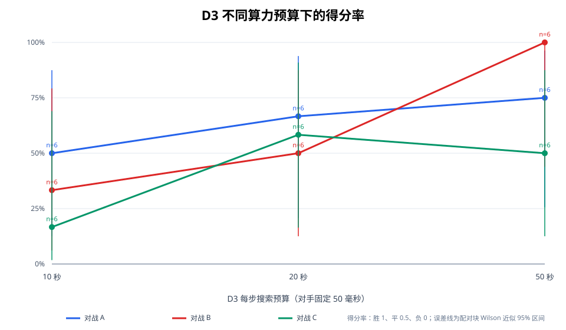

# V3：MCTS 高算力挑战

## 摘要

本轮在 9×9 棋盘上，用 V2 的纯 UCT `MCTSAgent` 作为 D3，分别给 D3 每步 10、20、50 秒，对手 A（规则 AI）、B（Minimax）和 C（Minimax + Alpha-Beta）固定为每步 50 ms。每个预算和对手组合 6 局，由 3 个开局各交换黑白一次，共 9 个条件、54 局。

D3 没有引入新搜索策略或更换评价策略；它是 V2 D2 同一实现，只放宽时间预算。没有神经网络、强化学习、离线训练，也没有通过 Minimax 或 Alpha-Beta 代替 MCTS。因而本轮观察到的变化只能归于增加思考时间和由此得到的更多搜索，不是 D3 算法本身优于 D2 的证据。

主要观察：50 秒档对 A 为 3 胜、0 负、3 平；对 B 为 6 胜、0 负；对 C 为 2 胜、2 负、2 平。对 C 的得分率为 50%，与 20 秒档的 58.3% 接近，且区间很宽。六局样本、每档只有 3 个配对开局，不能证明稳定领先；本轮没有得到 D3 已突破 Alpha-Beta 的结论。V2 的 D2 在 5 秒对 C（50 ms）为 1 胜 9 负；V3 的 50 秒档出现 2 胜 2 负 2 平，是值得继续复测的信号，但开局、局数和预算均不同，不能据此认定稳定棋力提升。

## 1. 实验配置与可复现性

- 棋盘为 9×9。每组 6 局，黑白双方各 3 局；3 个冻结的四手开局对 `731091`、`731092`、`731093`，在 10/20/50 秒及 A/B/C 九种条件中复用，并交换颜色。
- 基础随机种子为 `20261018`。对局 ID 和搜索种子由已登记配置确定，恢复时跳过已完成 ID。配置见 [`config.json`](results/config.json)，完整单步数据见 [`*_games.jsonl`](results/)；每个对局包含落子、逐步耗时、节点、实际模拟次数、树深、超时标记、颜色、种子和胜负。
- A/B/C 每步固定 0.05 秒，D3 分别为 10/20/50 秒。这是非对等算力挑战，不能与公平赛排名混为一谈。
- 五连胜或棋盘填满为合法终局。超出时限但仍返回合法着法时，对局继续并记入超时；非法着法按负局处理。本轮 54 局均无非法着法。D3 有 801 步触及搜索截止；其中 38 步实际耗时超过配置预算，合法着法仍继续计入棋谱。`timed_out` 表示搜索碰到截止条件，`actual_over_budget_moves` 表示测得耗时确实高于预算，两者不是同一口径。
- 对局以黑白换色组成 27 个配对开局块。得分为胜 1、平 0.5、负 0。区间把同一开局换色两局的平均得分作为一个块分数，再将 3 个块分数作为分数成功量代入 Wilson 公式；块分数可能为 0.25、0.5 或 0.75，因此这是配对块 Wilson 近似区间，不是对该配对得分分布校准过覆盖率的正式区间。每个单独条件只有 3 个块，区间很宽；不得把这 6 局的名次解释为稳定强弱。
- 代码提交锁定为 `ff6aa837cf2d38268485fab51548c0e8327eb56d`。运行时主动模型档位无法由当前平台提供的运行信息独立核实；请求中的“Codex 6.0 Luna Max”不能据此认定为实际生效配置。

## 2. 资源预检、耗时和持久化

正式比赛前在代表性 9×9 局面（12 手、69 个根候选）分别测得：10 秒约 2,183 次模拟、20 秒约 4,301 次、50 秒约 11,354 次；树深分别为 2、3、3。计数为搜索实际完成量，不是设置的上限。该局面的模拟速度约 215–227 次/秒。预估 54 局约 5 小时 35 分钟，原始对局存储约 0.58 MB。

预检环境为 Linux / Python 3.12.14、Intel Xeon Platinum 8573C，3 个逻辑 CPU、容器 CPU 配额 2 核、内存限额 8 GiB、可用磁盘约 31.98 GB。V3 对局数据目录最终约 828 KB，没有出现资源或存储耗尽。

从性能预检时间 2026-10-18 23:46:34 UTC 到最终进度写入时间 2026-10-19 05:57:02 UTC，约 6 小时 10 分 29 秒；首个对局结果文件建立到最终进度完成约 6 小时 2 分 15 秒。D3 的逐步思考时间累计 21,728.9 秒（约 6 小时 2 分），加上对手计算和调度开销后与上述总时长相符。比预估多约 35 分钟，主要是对局长度与 V2 先验校准不同；特别是对规则 AI 的局面出现较多 81 手满盘平局。

正式运行前做过 Drive 上传、下载校验和及恢复演练；54 局结果完成后又上传、下载并实际恢复了最新快照，恢复出 54 个已完成 ID，SHA-256 为 `26e339084f79472ee88dff28a8bf4339f4f0b92ba862bd27b407878f259bc568`。新快照通过校验后才删除上一份。整个任务未满 24 小时；为降低中断风险，实际在对局批次间进行了更频繁的检查点更新。报告不包含 Drive 文件 ID。恢复演练记录见 [`drive_restore_drill.json`](pilot/drive_restore_drill.json)，逐版快照校验摘要见 [`recovery_audit.json`](pilot/recovery_audit.json)。

## 3. 对局结果矩阵

下表为 D3 胜–D3 负–平；得分率括号中为 D3 的配对块 Wilson 近似 95% 区间。

| D3 每步预算 | 对手（50 ms） | D3 胜–负–平 | D3 纯胜率 | D3 得分率 [近似配对块 95% 区间] |
|---:|:---:|---:|---:|---:|
| 10 s | A | 0–0–6 | 0.0% | 50.0% [12.5%, 87.5%] |
| 10 s | B | 2–4–0 | 33.3% | 33.3% [6.1%, 79.2%] |
| 10 s | C | 1–5–0 | 16.7% | 16.7% [1.8%, 69.0%] |
| 20 s | A | 2–0–4 | 33.3% | 66.7% [20.8%, 93.9%] |
| 20 s | B | 3–3–0 | 50.0% | 50.0% [12.5%, 87.5%] |
| 20 s | C | 3–2–1 | 50.0% | 58.3% [16.4%, 90.9%] |
| 50 s | A | 3–0–3 | 50.0% | 75.0% [25.6%, 96.3%] |
| 50 s | B | 6–0–0 | 100.0% | 100.0% [43.9%, 100.0%] |
| 50 s | C | 2–2–2 | 33.3% | 50.0% [12.5%, 87.5%] |

每个条件都平衡了 D3 的黑白棋，但短样本仍能显示明显的单组颜色波动。例如 50 秒对 C，D3 执黑得分率 83.3%，执白 16.7%；该差异只来自 3 局对 3 局，不构成可靠的先手优势估计。合并 54 局时，D3 执黑 12 胜 7 负 8 平（得分率 59.3%），执白 10 胜 9 负 8 平（51.9%）；因为不同对手条件混在一起，这也只作描述，不作先手效应检验。

按每档汇总，D3 的结果为：10 秒 3 胜 9 负 6 平、得分率 33.3%；20 秒 8 胜 5 负 5 平、58.3%；50 秒 11 胜 2 负 5 平、75.0%。这总体趋势来自三个强度不同的对手，不能代替逐对手趋势。D3 对 C 的得分率依次为 16.7%、58.3%、50.0%，并非单调上升。

## 4. 每档实际计算量

下表为每一预算档跨 A/B/C 的 D3 总量；每局步数不同、局面也不同，平均模拟/步只能作为本轮已发生棋谱的描述，不能当作同一局面的严格缩放曲线。

| D3 预算 | D3 决策步数 | 实际模拟总数 | 平均模拟/步 | D3 总思考秒数 | 平均秒/步 | 模拟/思考秒 | 加权平均树深 | 截止标记/实际超预算步 |
|---:|---:|---:|---:|---:|---:|---:|---:|---:|
| 10 s | 317 | 13,723,264 | 43,291 | 2,819.9 | 8.90 | 4,867 | 2.98 | 278 / 11 |
| 20 s | 312 | 17,368,324 | 55,668 | 5,252.9 | 16.84 | 3,306 | 2.90 | 257 / 12 |
| 50 s | 319 | 24,007,326 | 75,258 | 13,656.1 | 42.81 | 1,758 | 3.21 | 266 / 15 |

全部条件合计，D3 完成了 55,098,914 次 MCTS 模拟/搜索迭代（计数包括终局评估；逐步 rollout 深度另以 `rollout_plies` 单独记录），平均树深 3.03，最高树深 8。对 C 时，D3 的平均实际模拟/步分别为：10 秒 4,038、20 秒 46,181、50 秒 78,437；平均树深为 2.16、2.48、3.10。对 A 时平均模拟/步更高，因棋局更长且局面展开结构不同。不同阶段不是同一棋局续算，且 D3 会因即时胜负、战术终止和对局提前结束而改变有效搜索步，故逐阶段模拟吞吐量会随局面构成波动。

搜索树平均仍较浅；即使 50 秒，三个对手组合的平均深度为 2.33–3.55，最大观察深度 5–8。固定局面预检的模拟数随预算从 10 到 50 秒约 5.2 倍，接近时间倍率；正式比赛里局面差异使实战计数不再呈线性关系。单看本样本，50 秒带来了更多搜索和更高的平均树深，但吞吐（模拟/思考秒）降低，且对 C 的得分没有高于 20 秒。由于样本很小、局面不配对续算，不能据此断言算力收益已经饱和，也没有证据证明收益持续线性转化成棋力。

## 5. 对 V2 D2 的比较

V2 D2 与本轮 D3 调用同一纯 MCTS 引擎。V2 的 9×9 非对等挑战中，D2 对 C 每步 50 ms 在 200 ms、1 秒、5 秒预算下分别为 0/10、0/10、1/10 胜；平均模拟/步分别约 116、532、2,655。V2 的 5 秒组 D2 得分率为 10%，V2 报告列出的配对块 Wilson 近似 95% 区间约为 1.1%–53.7%。

V3 仍在相同 C=50 ms 的挑战设定下进行，但预算提高到 10/20/50 秒，且使用不同的预注册开局和每条件 6 局。D3 对 C 得分率依次为 16.7%、58.3%、50.0%；50 秒档的 2 胜是 V2 5 秒仅 1 胜的探索性信号。因为样本数与开局不同，不能对两个比例作确定性提升判断。可确认的是计算增加：V3 50 秒在该组总计完成 9,569,308 次模拟，平均约 78,437 次/步；仍未在 6 局里取得正的胜负差（2 胜 2 负 2 平）。

V2 的公平 5 秒实验里 C 也明显压制 D2；但它的 C 同样获得 5 秒，不能和本轮 C 固定 50 ms 的非对等赛道混作同一条件。本轮没有重新运行公平赛，也没有在 10/20/50 秒下让 C 使用相同预算，因此不回答“相同算力下 D3 与 C 谁更强”。

## 6. 典型棋谱与失败分析

完整棋谱保存在原始 JSONL 中。下列坐标均为从 0 开始的 `(行, 列)`，包含注册的四手开局。

- **D3 胜 C，50 秒，开局种子 731093，D3 执黑：** `B44 W32 B54 W63 B64 W34 B33 W74 B55 W22 B46 W52 B37 W73 B28`。最后 `B28` 与 `(3,7)、(4,6)、(5,5)、(6,4)` 连成五子，15 手终局。该局展示了 D3 可以在搜索中找到快速的对角线胜法，但单个胜局不能证明稳定战术识别。
- **D3 负 C，50 秒，开局种子 731092，D3 执白：** `B44 W25 B06 W46 B55 W43 B33 W66 B22 W11 B24 W34 B42 W15 B52 W56 B32 W76 B12`。C 的最后一步 `(1,2)` 与此前 `(2,2)、(3,2)、(4,2)、(5,2)` 连成五子。前一手 C 的 `(3,2)` 形成同列双端活四；黑方下一着可在 `(1,2)` 或 `(6,2)` 完成五连，白方单手无法同时封住两个点。因此终局前的 `W76` 不是能阻止该胜利的单点防守。C 落 `B52` 后，白方尚可在 `(3,2)` 阻止这条直线长成活四；D3 落在别处。该棋谱说明 D3 允许对手形成双端威胁，但不能单独证明 `(3,2)` 是唯一最优防守，或其后续棋局必然不败。
- **50 秒对 C 的一组配对平局：** 种子 731091 的两个换色游戏都走满 81 手，结果均为平局。单局约消耗 1,626 秒和 1,785 秒思考时间，分别完成约 3.89M 与 4.89M 次模拟，构成总耗时和预算预估偏差的主要部分。

上述胜负例是从全部预注册棋谱中按结果直接选取，用于说明局面，不用于挑选或过滤统计数据。

## 7. 结论和后续实验

1. **是否突破 A/B/C：** 本样本中，D3 在 50 秒对 A 取得 3 胜 3 平、对 B 6 胜；对 C 是 2 胜 2 负 2 平，得分率 50%。因此可以说 D3 在非对等预算下曾战胜 A、B，也曾战胜 C；不能说它已稳定超过任何模型，尤其没有显示对 C 的净胜优势。
2. **增加算力的收益：** 对 C 的结果从 10 秒到 20 秒改善，再到 50 秒回落；50 秒获得更多模拟、更深树，但未转化为比 20 秒更高的得分率。当前 6 局/档不足以判断收益饱和。需要相同初始棋局做多预算重复决策测试，或使用更多配对开局后再检验预算收益曲线。
3. **与算法改进的区别：** D3 与 D2 是同一 MCTS 实现，本轮没有 MCTS 策略改进；所有差异只来自时间预算、随机抽样和小样本对局变化。没有训练过程，也没有训练指标或模型 checkpoint。
4. **下一步建议：** 优先扩大 D3–C 的配对开局样本；记录相同局面的不同预算决策、每个根候选的访问数和胜率，分离计算增益与局面差异；针对这类双端活四，使用逐手局面复盘定位威胁成形前的可防着，再单独测试纯 MCTS 内部战术规则，不接入 Minimax，并以消融实验评估收益和副作用。

## 8. 交付文件

- 注册配置：[`results/config.json`](results/config.json)
- 完整 54 局棋谱：[`results/`](results/)
- 汇总统计：[`results/summary.json`](results/summary.json)
- 棋谱与进度校验：[`results/validation.json`](results/validation.json)
- 预算趋势图：[`figures/d3_budget_trend.svg`](figures/d3_budget_trend.svg)
- 预检与恢复演练及去标识化快照审计：[`pilot/`](pilot/)
- 重算汇总：`python scripts/summarize_mcts_v3.py`
- 重新验证：`python scripts/validate_mcts_v3_results.py`
