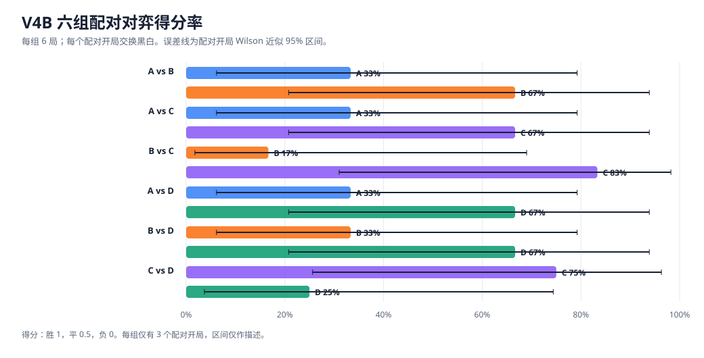
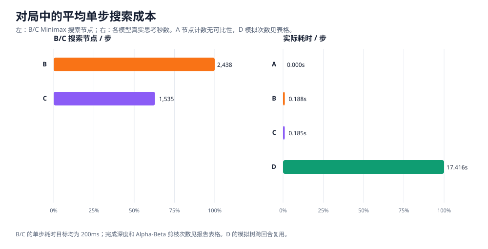

# V4B：ABCD 最终对弈总结

## 执行结论

本轮完成 **36 局**：新增 **30 局**，复用 V3 **6 局**。六组对阵均各 6 局，每个固定开局交换黑白一次。正式运行累计耗时 **4337.7 秒**（另有预检 20.4 秒）。

V4B 条件下 D20 对 B200ms 得分率为 **66.7%**，对 C200ms 为 **25.0%**。在这 6 局探索性样本里，D20 对 C200ms 的得分率低于一半；这组样本没有显示 MCTS 突破 Alpha-Beta。 D20 每步实际完成 **70350 次模拟**（共 17,517,121 次；新跑局平均 4186 次/秒），平均耗时 16.81 秒。MCTS 每步预算约为 B/C 的 100 倍；结果属于非等算力挑战。

本报告没有神经网络训练；A/B/C/D 都是规则或搜索算法。本环境无法读取 Codex 会话的模型档位，因此不能独立核验 Codex 6.0 Luna / Max 配置。

## 实验方法与公平性

- 9×9 棋盘；A 使用原规则策略，决策后立即落子，不人为等待。
- B 为纯 Minimax，C 为 Minimax + Alpha-Beta；每步均 200ms。两者使用 V4 相同的候选半径、排序、评价函数与迭代加深逻辑；每步深度上限为剩余空位数（初始开局后 77 层），仅 C 启用剪枝。超时返回已完成层的结果。
- D 显示为 V4B 的 D，实际调用 V3 D3 的 `MCTSAgent`，每局持久化一个代理，保留 UCT、战术根筛选、战术 rollout 与跨步树复用，每步 20 秒。没有调用 Minimax，也没有神经网络。
- 对阵：A–B、A–C、B–C、A–D、B–D、C–D。开局种子 731091、731092、731093；每个开局两局交换黑白。普通新局种子由配置种子 `20261020` 和唯一 ID 哈希派生。
- 超时仍采用搜索器返回的合法落子并记超时；非法落子按负方判负。每局在 JSONL 落盘并 fsync 后才更新进度。

## 环境、预检与恢复

| 项目 | 实测值 |
|---|---:|
| CPU | INTEL(R) XEON(R) PLATINUM 8573C；逻辑 CPU 3；容器 CPU 配额 2.0 核 |
| 内存 | cgroup 上限 8.0 GiB；宿主机可用内存 9.2 GiB |
| 工作区可用磁盘 | 29.7 GiB |
| 正式任务预估 | 40.2 分钟；含 25% MCTS 对局长度余量范围约 40.2–50.3 分钟 |
| 正式运行实耗 | 72.3 分钟；为点估算的 1.80 倍 |
| 12 局 D20 全部打满盘的松上界 | 2.60 小时 |
| 结果与恢复包预计存储 | 3.12 MiB |

预检在 V3 注册开局 731091 的同一 4 手局面上各测一次 A/B/C/D，不计入正式对局。D3 测得 3,749 次模拟、20.00 秒；B/C 的搜索深度、节点、剪枝与落点，以及 A 的用时和规则落点保存在 `preflight.json`。A 的 `nodes` 是剩余空位数，不作为搜索节点。实际正式运行耗时为预估的 1.80 倍；12 局新 D20 对 B/C 共消耗 4185.0 秒，明显高于 V3 标定及余量对应的估算，部分对局接近满盘。估算使用 V3 的 D20 对 B/C 各 6 局真实耗时和走子数，并对 200ms 对手增加 25% 余量。

Drive 最终快照已完成上传、下载、SHA-256 校验和空目录恢复，恢复棋局 ID 一致；新快照验证后已删除上一版，且已核实仅剩一份最新有效 V4B 快照。

恢复包只含恢复必需的配置、进度、棋谱、复用审计和代码版本；未操作 V1–V4 的 Drive 快照。

## V3 六局复用核验

A–D 的 6 局复用自 V3。复用源 `research/v3/results/9x9_d3-20s-vs-a_games.jsonl`，V3 源 commit `ff6aa837cf2d38268485fab51548c0e8327eb56d`。V3 整套 54 局重放验证通过；D3 引擎源码 SHA-256 为 `9e5b552a6172f47db63bafe6c765b38be7aa519b7dfd11cc9c4a7de1af7d4991`，与 V3 commit 中源码一致。复用记录保留原始棋谱、时间、模拟数、树深、种子和超时数据；规范化副本将 D3 映射为 D，并用 `source_game_id`、逐局 SHA-256 与 `v3_reused_games.jsonl` 保存来源证据。

## 六组完整胜负结果

得分率定义为胜 1、平 0.5、负 0。区间基于 3 个配对开局块，每块汇总交换黑白的两局后计算 Wilson-style 95% 描述区间；小样本下该区间覆盖率未经校准，只作为不确定性提示。

| 对阵 | 胜-平-负 | 纯胜率 | 得分率（配对 95% CI） | 黑棋/白棋得分率 | 来源 |
|---|---|---|---|---|---|
| A–B | A: 0-4-2; B: 2-4-0 | A 0.0%; B 33.3% | A 33.3% [6.1%, 79.2%]; B 66.7% [20.8%, 93.9%] | A 黑 50.0% / 白 16.7%; B 黑 83.3% / 白 50.0% | new 6 |
| A–C | A: 0-4-2; C: 2-4-0 | A 0.0%; C 33.3% | A 33.3% [6.1%, 79.2%]; C 66.7% [20.8%, 93.9%] | A 黑 50.0% / 白 16.7%; C 黑 83.3% / 白 50.0% | new 6 |
| B–C | B: 0-2-4; C: 4-2-0 | B 0.0%; C 66.7% | B 16.7% [1.8%, 69.0%]; C 83.3% [31.0%, 98.2%] | B 黑 16.7% / 白 16.7%; C 黑 83.3% / 白 83.3% | new 6 |
| A–D | A: 0-4-2; D: 2-4-0 | A 0.0%; D 33.3% | A 33.3% [6.1%, 79.2%]; D 66.7% [20.8%, 93.9%] | A 黑 33.3% / 白 33.3%; D 黑 66.7% / 白 66.7% | reused_v3 6 |
| B–D | B: 1-2-3; D: 3-2-1 | B 16.7%; D 50.0% | B 33.3% [6.1%, 79.2%]; D 66.7% [20.8%, 93.9%] | B 黑 33.3% / 白 33.3%; D 黑 66.7% / 白 66.7% | new 6 |
| C–D | C: 3-3-0; D: 0-3-3 | C 50.0%; D 0.0% | C 75.0% [25.6%, 96.3%]; D 25.0% [3.7%, 74.4%] | C 黑 83.3% / 白 66.7%; D 黑 33.3% / 白 16.7% | new 6 |

### 完整胜负矩阵（行方视角）

| 行方 \ 对手 | A | B | C | D |
|---|---|---|---|---|
| A | — | 0-4-2 | 0-4-2 | 0-4-2 |
| B | 2-4-0 | — | 0-2-4 | 1-2-3 |
| C | 2-4-0 | 4-2-0 | — | 3-3-0 |
| D | 2-4-0 | 3-2-1 | 0-3-3 | — |

## 四模型总排名与先后手

每个模型共 18 局，黑白各 9 局；排名仅按本轮样本得分率排序，不能视为稳定棋力定论。

| 排名 | 模型 | 总战绩 W-D-L | 纯胜率 | 得分率（配对 95% CI） |
|---:|---|---:|---:|---:|
| 1 | C | 9-9-0 | 50.0% | 75.0% [42.7%, 92.4%] |
| 2 | D | 5-9-4 | 27.8% | 52.8% [24.6%, 79.3%] |
| 3 | B | 3-8-7 | 16.7% | 38.9% [15.3%, 69.1%] |
| 4 | A | 0-12-6 | 0.0% | 33.3% [12.1%, 64.6%] |

| 模型 | 黑棋得分率（局数） | 白棋得分率（局数） |
|---|---:|---:|
| A | 44.4%（9） | 22.2%（9） |
| B | 44.4%（9） | 33.3%（9） |
| C | 83.3%（9） | 66.7%（9） |
| D | 55.6%（9） | 50.0%（9） |

本样本按黑白比较：A 黑棋高 22.2 个百分点；B 黑棋高 11.1 个百分点；C 黑棋高 16.7 个百分点；D 黑棋高 5.6 个百分点。每种颜色各 9 局且对手组合不完全相同，先手差异仅作描述。

## 搜索深度与计算成本

| 模型 | 决策数 | 平均耗时/步 | 平均节点计数/步（口径见注） | B/C 完整迭代层或 D 树深（均值/范围） | 剪枝数 | 模拟数/步 | 模拟/秒 | 树深最大 | 超时 |
|---|---:|---:|---:|---:|---:|---:|---:|---:|---:|
| A | 540 | 0.0005s | 不适用（原规则计数非搜索节点） | —（规则 AI） | 0 | 0.0 | 0.0 | 0 | 0 |
| B | 394 | 0.1879s | 2438.2 | 1.88（1–5） | 0 | 0.0 | 0.0 | 5 | 376 |
| C | 421 | 0.1854s | 1534.6 | 2.49（1–7） | 70324 | 0.0 | 0.0 | 7 | 394 |
| D | 441 | 17.4157s | 433823.4（树操作+rollout） | 3.07（最大树路径，0–7） | 0 | 69953.8 | 4016.7 | 7 | 375 |

节点口径：A 接口的 `nodes` 是剩余空格数，不是搜索节点，因此表中不比较；B/C 是 Minimax 搜索访问节点；D 计数含 MCTS 树操作与 rollout 落子数，不能直接与 B/C 节点数等同。D 的实际模拟次数另列，可作为其主要计算量。

V4 固定局面基准中，B 从 50ms 到 200ms 的平均深度由 1.08 增至 1.33，平均节点由 593 增至 2527；C 的平均深度由 1.92 增至 4.00，节点由 275 增至 1376。这是相同局面上的搜索预算变化，不代表胜率本身的因果变化。

| 模型 | 预算 | 平均耗时 | 平均深度 | 平均节点 | 节点/秒 | 平均剪枝 | 超时决策 |
|---|---:|---:|---:|---:|---:|---:|---:|
| B | 50ms | 0.0450s | 1.08 | 593.0 | 13169 | 0.0 | 12/12 |
| B | 200ms | 0.1951s | 1.33 | 2527.3 | 12957 | 0.0 | 12/12 |
| C | 50ms | 0.0454s | 1.92 | 275.3 | 6082 | 53.2 | 12/12 |
| C | 200ms | 0.1954s | 4.00 | 1375.8 | 7046 | 199.1 | 12/12 |

V4B 实际对局中，B/C 节点、深度和 C 剪枝数如上表。两者不在同一条独立固定局面序列上逐状态逐节点比较，所以对局汇总只能描述实际使用量；B/C 算法效率因果结论沿用 V4 的相同局面验证。D20s 新跑局实际完成 17,517,121 次模拟、平均 70350 次/步；树深最大 7，树复用节点累计 8,969。历史复用的六局另见 `model_usage.csv` 中 `D_v3_reused` 行。

## 与 V1–V4 历史结果的关系

| 轮次 | 条件 | D 类 MCTS 结果 | 计算条件 |
|---|---|---:|---|
| V1 | D vs A | 1 胜 / 11 平 / 188 负（得分率 3.2%） | A/B/C/D 原配置；D 50ms；每组 200 局 |
| V1 | D vs B | 2 胜 / 0 平 / 198 负（得分率 1.0%） | A/B/C/D 原配置；D 50ms；每组 200 局 |
| V1 | D vs C | 0 胜 / 0 平 / 200 负（得分率 0.0%） | A/B/C/D 原配置；D 50ms；每组 200 局 |
| V2 | D2 vs C | 0 胜 / 0 平 / 10 负（得分率 0.0%） | 阶段 `extreme-9x9-d2-1s-vs-c-50ms`；D2 1s，对手 0.05s；10 局 |
| V2 | D2 vs C | 0 胜 / 0 平 / 10 负（得分率 0.0%） | 阶段 `extreme-9x9-d2-200ms-vs-c-50ms`；D2 0.2s，对手 0.05s；10 局 |
| V2 | D2 vs C | 1 胜 / 0 平 / 9 负（得分率 10.0%） | 阶段 `extreme-9x9-d2-5s-vs-c-50ms`；D2 5s，对手 0.05s；10 局 |
| V3 | D3 vs A | 2 胜 / 4 平 / 0 负（得分率 66.7%） | D3 20s，对手 50ms；6 局 |
| V3 | D3 vs B | 3 胜 / 0 平 / 3 负（得分率 50.0%） | D3 20s，对手 50ms；6 局 |
| V3 | D3 vs C | 3 胜 / 1 平 / 2 负（得分率 58.3%） | D3 20s，对手 50ms；6 局 |
| V4 | B/C 固定局面性能 | 无正式对局结果 | 比较 50ms 与 200ms 搜索深度、节点和剪枝 |

V3 对 B/C 的对手计算预算为 50ms，V4B 为 200ms；V4B 的 B/C 又都显著低于 D 的 20 秒。应将结果解释为“搜索预算提升条件下的探索性挑战”，不能把对局差异单独归因于算法改进。V3 D3 和 V4B D 使用相同 MCTS 源代码与搜索设置。

## 典型棋谱与失利观察

- **D 获胜**：`v4b-9x9-B-D-o731092-s0`，B执黑、D执白，26 手，w_win（five_in_row）。前段完整棋谱见原始数据；末 12 手：B-B(5,1)；D-W(6,0)；B-B(3,2)；D-W(5,2)；B-B(1,2)；D-W(0,2)；B-B(4,3)；D-W(4,1)；B-B(2,3)；D-W(0,1)；B-B(5,3)；D-W(2,1)
- **D 失利**：`v4b-9x9-B-D-o731091-s0`，B执黑、D执白，11 手，b_win（five_in_row）。前段完整棋谱见原始数据；末 11 手：开局-B(4,4)；开局-W(6,3)；开局-B(7,5)；开局-W(6,1)；B-B(6,4)；D-W(5,2)；B-B(5,3)；D-W(3,4)；B-B(4,2)；D-W(4,3)；B-B(3,1)

原始 JSONL 保留全部 36 局的完整走子和每步指标；上面的例子只列尾段以便阅读。棋谱坐标使用从 0 开始的 `(行,列)`。胜局按真实五连判定，平局按棋盘填满判定；非法落子则单独按弃权判负。

## 结论与限制

1. 本轮新增 30 局、V3 复用 6 局；A–D 复用来源和核验结果见上文及 `reuse_audit.json`。
2. D 能否挑战 B/C，应分别看 B200ms 和 C200ms 两组的 6 局配对结果；C 是最强传统搜索对手。在这 6 局探索性样本里，D20 对 C200ms 的得分率低于一半；这组样本没有显示 MCTS 突破 Alpha-Beta。 C 与 D 的总模型区间有重叠，排名仍受小样本不确定性限制。
3. D 的每步计算时间约为 B/C 的 100 倍。即便 D20 获得更多模拟，也不能直接称其性价比更高；按每秒模拟数及每局思考总时长一起看。
4. 仅三个开局、每组六局；A–D 中 6 局复用自 V3，其余为本轮新跑。统计区间宽、配对块数少。没有对先后手、开局或偶然战术做种子筛选；结果不支持稳定等级宣称。
5. 本轮只做 9×9。没有 15×15 验证，也没有训练或 checkpoint。

## 复现与文件

- 固定配置：`configs/abcd_final_v4b.json`
- 对弈运行：`python scripts/run_abcd_final_v4b.py --config configs/abcd_final_v4b.json --output-dir research/v4b/results`
- 全局校验与报告：`python scripts/summarize_abcd_final_v4b.py --results research/v4b/results`
- 原始数据：`research/v4b/results/9x9_games.jsonl`；V3 源记录副本：`research/v4b/results/v3_reused_games.jsonl`
- 统计表：`pairwise_summary.csv`、`model_summary.csv`、`model_usage.csv`；机器可读汇总：`summary.json`、`history_comparison.json`
- 恢复包校验：`python scripts/restore_abcd_final_v4b_snapshot.py <snapshot.zip> <empty-destination>`
- 报告生成时源码 HEAD：`19ab04bf66a31f3363947585ccb4cf03dd05893b`；V4B 交付分支最终提交见仓库 HEAD。
