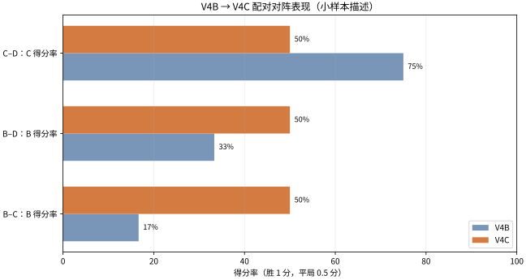
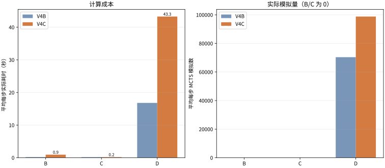

# V4C 高算力最终挑战赛研究报告

## 摘要

本轮在 9×9 棋盘完成 18 局全新对弈：B–C、B–D、C–D 各 6 局。V4/V4B 历史棋局仅作比较，未计入本轮。按胜 1 分、平 0.5 分排名：并列：B = C = D（50.0%）。排名受 18 局小样本影响，D 的单步预算是 B 的 50 倍、C 的 250 倍，不能解释为同等算力下的稳定强弱。

## 配置、实现与公平性

- B 为纯 Minimax，单步最多 1 秒；C 为 Alpha–Beta，单步最多 200ms。两者使用相同的 V4 评价函数、候选集及排序、迭代加深与截止时间实现，只有 C 启用剪枝。
- D 直接复用 V4B `MCTSAgent`（纯 UCT，不含神经网络），根节点战术识别、rollout、节点扩展及跨步树复用保持不变，仅把预算从 20 秒改为 50 秒。D 的 50 秒不等于 50 秒保证用满：即时胜/必防可提前返回。
- 每个对阵使用三个固定开局，每个开局交换黑白；种子由固定实验种子、对局 ID 和决策位置的 SHA-256 派生。所有本轮记录均为 `source_type=new`。
- 超时仍接受引擎返回的合法着法并记录超时；非法落子判负。完成后的每局先按规则回放，再追加 JSONL 并 fsync；恢复仅按唯一 game ID 续跑。
- 棋盘规则、AI 搜索源文件的哈希见配置和原始记录；当前环境为 INTEL(R) XEON(R) PLATINUM 8573C，CPU 配额 2.0 核，内存限制 8.0 GiB。
- 本项目没有神经网络或强化学习训练，不含训练指标或 checkpoint。Codex 模型档位及推理强度无法由运行环境独立验证。

## 比赛结果

### 六局配对赛果

| 对阵 | 胜–平–负 | 得分率 | 纯胜率 | 配对描述性 95% 区间 | 黑方得分率（前者/后者） | 白方得分率（前者/后者） |
|---|---:|---|---|---|---|---|
| B–C | 1–4–1 | B 50.0% / C 50.0% | B 16.7% / C 16.7% | B [12.5%, 87.5%]; C [12.5%, 87.5%] | 66.7% / 66.7% | 33.3% / 33.3% |
| B–D | 1–4–1 | B 50.0% / D 50.0% | B 16.7% / D 16.7% | B [12.5%, 87.5%]; D [12.5%, 87.5%] | 66.7% / 66.7% | 33.3% / 33.3% |
| C–D | 1–4–1 | C 50.0% / D 50.0% | C 16.7% / D 16.7% | C [12.5%, 87.5%]; D [12.5%, 87.5%] | 66.7% / 66.7% | 33.3% / 33.3% |

### 总排名及先后手

| 排名 | 模型 | 总战绩 | 总得分率 | 配对区间 | 黑方得分率 | 白方得分率 |
|---:|---|---:|---:|---|---:|---:|
| 1（并列） | B | 2–8–2 | 50.0% | [18.8%, 81.2%] | 66.7% | 33.3% |
| 1（并列） | C | 2–8–2 | 50.0% | [18.8%, 81.2%] | 66.7% | 33.3% |
| 1（并列） | D | 2–8–2 | 50.0% | [18.8%, 81.2%] | 66.7% | 33.3% |

每个模型参加 12 局，按 6 个‘对手×开局’的换色配对块计算总排名区间；每组对阵仅 n=3 个开局块。区间是 Wilson-style 描述区间，小样本覆盖率未校准，不能据此宣称显著差异。先手汇总得分率为黑方 66.7%、白方 33.3%；每个模型每色仅 6 局，先手效应仍是探索性观察。

## 搜索计算成本

| 模型 | 决策数 | 总思考秒数 | 平均秒/步 | 平均节点/步 | 平均完成深度 | 剪枝数 | 剪枝/节点 | 模拟总数 | 平均模拟/步 | 模拟/秒 | 超时步数 |
|---|---:|---:|---:|---:|---:|---:|---:|---:|---:|---:|---:|
| B | 360 | 339.32 | 0.943 | 11,477 | 2.32 | 0 | 0.0% | 0 | 0 | 0.0 | 339 |
| C | 370 | 68.49 | 0.185 | 1,404 | 2.47 | 59788 | 11.5% | 0 | 0 | 0.0 | 346 |
| D | 364 | 15,752.85 | 43.277 | 869,409 | 3.40 | 0 | 0.0% | 35963304 | 98,800 | 2,283.0 | 304 |

B/C 的节点数同为该 minimax 引擎的 visited search nodes。D 的 `nodes` 是树操作数加 rollout plies，与 B/C 不可直接比较；D 的工作量用真实模拟次数、思考秒数和模拟/秒表示。剪枝/节点比例是实现计数，不等同于被剪掉的整棵子树比例。

## V3、V4B 对照

### B 从 200ms 提高至 1 秒

V4B 中 B200ms 对 C200ms 为 B 0–2–4、得分率 16.7%；V4C B1s 对 C200ms 为 B 1–4–1、B 得分率 50.0%。B 的平均完成深度从 V4B 的 1.88 到本轮 2.32；本轮平均节点/步 11,477、平均耗时 0.943 秒。
本轮对照显示 B 增加算力后的赛果变化为 16.7% → 50.0%，但每格只有 6 局且 C 预算不变；若得分率没有上升，也不能证明 B 的搜索没有计算收益，需结合深度/节点和低样本不确定性判断。C200ms 本轮平均深度 2.47，V4B 为 2.49，可视为同预算实现的批次波动。

### B-D 赛果变化

V4B B200ms–D20s 为 B 1–2–3（B 得分率 33.3%，D 66.7%）；V4C B1s–D50s 为 B 1–4–1（双方得分率 50.0%）。本轮 B、D 预算都提高且开局种子批次不同，因此变化不能归因于单一预算。

### D 从 20 秒提高至 50 秒，挑战 C200ms

V4B D20s 对 C200ms：C 3–3–0，C 得分率 75.0%、D 25.0%；V4C D50s 对 C200ms：C 1–4–1，C 50.0%、D 50.0%。D 平均每步实际耗时 16.81 → 43.28 秒；实际模拟平均/步 70,350 → 98,800；模拟速度 4,185.7 → 2,283.0 次/秒。不同种子与局面下，速率只作描述。
V3 的 D20s 面对 B50ms、C50ms 时分别取得 B 对局 3胜3负、C 对局 3胜1平2负；V4B 把对手提高到 200ms 后，D20 对 B 为 3胜2平1负、对 C 为 0胜3平3负。V4C 的 C-D 组保持 C 为 200ms，只把 D 从 20s 提至 50s；B-D 组则同时提高了 B 与 D 的预算。各批开局/决策随机种子不同，不能把逐轮赛果差直接解释为因果效果。

## 计算收益与成本解释

D50 的累计思考时间、模拟数和实际模拟速度直接报告在表格；若更多预算带来模拟数增加而胜率不升，仅说明本样本中额外计算没有转化为稳定得分优势，无法据此断言已饱和。模拟速度受局面、战术捷径及复用树影响。B1s 与 C200ms 的思考时间不等，且它们与 D50 差异更大；本轮不是等算力排名。

## 典型棋谱与战术观察

- B取胜示例 `v4c-9x9-b-c-o731091-s0`，对阵 B–C，结果 b_win，终止于第 33 手。末段棋谱：C-W(2,1)；B-B(6,6)；C-W(8,4)；B-B(3,7)；C-W(0,4)；B-B(4,7)；C-W(4,6)；B-B(6,7)；C-W(2,7)；B-B(6,8)。完整合法棋谱在 `results/9x9_games.jsonl`。
- B失利示例 `v4c-9x9-b-c-o731091-s1`，对阵 B–C，结果 b_win，终止于第 33 手。末段棋谱：B-W(2,1)；C-B(6,6)；B-W(8,4)；C-B(3,7)；B-W(0,4)；C-B(4,7)；B-W(4,6)；C-B(6,7)；B-W(2,7)；C-B(6,8)。完整合法棋谱在 `results/9x9_games.jsonl`。
- D取胜示例 `v4c-9x9-b-d-o731093-s1`，对阵 B–D，结果 b_win，终止于第 21 手。末段棋谱：B-W(4,1)；D-B(7,4)；B-W(6,4)；D-B(6,5)；B-W(4,5)；D-B(5,6)；B-W(2,3)；D-B(4,7)；B-W(3,8)；D-B(8,3)。完整合法棋谱在 `results/9x9_games.jsonl`。
- D失利示例 `v4c-9x9-b-d-o731093-s0`，对阵 B–D，结果 b_win，终止于第 33 手。末段棋谱：D-W(8,4)；B-B(4,3)；D-W(5,2)；B-B(4,1)；D-W(6,1)；B-B(4,2)；D-W(4,0)；B-B(3,3)；D-W(1,5)；B-B(6,0)。完整合法棋谱在 `results/9x9_games.jsonl`。

对决定性棋局逐手回放：6 局均由黑方取胜，黑方在白方最后防守前有 6 局同时存在至少两个下一手成五点；白方在 6 局挡住了其中一点，但另一点仍可立即获胜。分叉宽度为 2 个胜点 4 局、3 个胜点 2 局。这解释了本轮所有非和棋结果与明显先手优势相符；小样本下不能把它归结为某个模型的整体棋力优势。逐局原始记录及每个决定性局面的胜点列表保存在 `results/tactical_review.json`、`results/9x9_games.jsonl`。

## 预检、资源与恢复

正式运行前，B/C/D 同一四手开局预检总耗时 51.2 秒；资源估算正式比赛约 220.9 分钟，估算高侧约 287.1 分钟。实际 wall-clock 4小时39分32秒（runner 记录活动耗时 4小时29分21秒）；期间记录到 1 次终端/环境恢复事件。12 局含 D 的理论 50 秒满额上界为 6.5 小时，实测估算依赖 V4B 的回合数。
Drive 演练：已通过上传/下载/SHA-256/空目录恢复，预演恢复 0 局；最终快照状态 verified，恢复 18 局；恢复包包含冻结配置、进度、完整棋谱和代码版本，上传后经下载哈希比对并恢复到空目录验证。

## 结论

本轮 18 局排名为 并列：B = C = D（50.0%）。
B 1 秒对 C 200ms：本轮 B 得分高于 V4B 的 200ms 批次；这一结果仍只有六局，不构成稳健棋力结论。
D 50 秒对 C 200ms：双方本轮得分相同。 D 得到 250 倍于 C 的单步时间预算，无法据此评判等计算资源下的算法优劣。
阶段性看，增加搜索预算应以实际完成深度、模拟数、决策时间和配对棋力同时衡量。MCTS 高预算表现必须由更多预注册对局和更广开局验证；传统搜索侧可继续研究 C 的威胁空间/候选扩展，同时保持 B/C 相同搜索逻辑的效率对照。

## 可复现文件

- 冻结参数：`configs/bcd_high_compute_v4c.json`。
- 全部对局与逐手 telemetry：`research/v4c/results/9x9_games.jsonl`。
- 汇总及统计：`research/v4c/results/summary.json`、`pairwise_summary.csv`、`model_summary.csv`、`model_usage.csv`。
- 终局战术逐手回放：`research/v4c/results/tactical_review.json`。
- 预检、资源与耗时：`research/v4c/results/preflight.json`、`execution.json`。
- 环境恢复事件：`research/v4c/results/environment_events.json`。
- 运行：`PYTHONPATH=. python scripts/run_bcd_high_compute_v4c.py`；校验/汇总：`PYTHONPATH=. python scripts/summarize_bcd_high_compute_v4c.py`。
- 测试：`PYTHONPATH=. python -m pytest -q`。
- 测试结果：167 passed, 0 failed

## 图表

## 限制

每组仅 6 局（3 个换色配对块），模型总排名每模型 n=6 个块；配对 Wilson-style 区间是描述统计，未对这种小样本和结果相关性进行校准。B/C/D 的预算不相等，D 的 50 秒/步显著高于 B 的 1 秒、C 的 0.2 秒。不同实验轮使用不同随机种子与已完成的相同开局模板，跨轮比较易受随机性与先后手影响。不能将本轮数据宣称为统计显著或稳定棋力排序。
