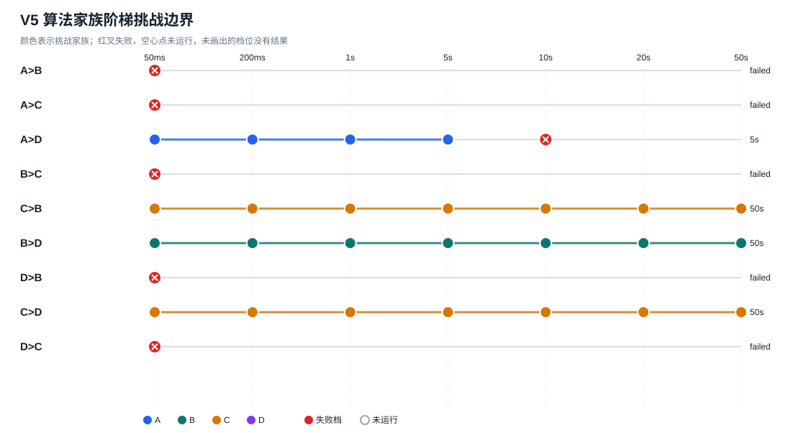

# V5「ABCD 四大算法家族·全量程阶梯挑战赛」研究报告

正式对局时间：2026-10-20T23:18:36Z 至 2026-10-21T00:20:33Z。预检耗时 4.31 分钟。预检按理论 60 组估算约 13.13 小时；配置预算的全盘极端上限约 16.86 小时。本轮为传统规则和搜索算法的开发与对弈评估；没有神经网络或强化学习训练。Drive 恢复快照用于保存配置、进度和棋谱，不是训练 checkpoint。

## 摘要

本轮在 9×9 棋盘完成 **28 组、56 局**（理论上限 60 组、120 局），完整挑战路线结束状态为：4 条路线至少通过一档、6 条失败、3 条到达 50 秒档。逐步思考时间合计 0.83 小时，运行器计算耗时 0.83 小时，含快照的正式实验墙钟耗时 1.03 小时。较理论全量程估时更短，主要因为阶梯失败规则让部分路线提前停止。每组同一固定开局交换黑白，按两局得分至少 1 分晋级。完整逐档结果见下表和 [梯度图](figures/ladder_gradient.svg)。

正式执行前的 10 局前测已作废且未计入正式成绩；因审阅发现的运行器状态标注问题，之后按同一唯一 ID 重跑。审计元数据与对局 ID 保存在 `preliminary_attempt_audit.json`。

本报告把“路线通过”解释为该两局配对达到规则阈值。每档只有两局、单一开局，因此路线边界是探索性现象，不能当成稳定棋力排名或显著差异。

## 1. 算法与预算

| 模型 | V5 设置 | 时间口径 |
|---|---|---|
| A | 沿用原启发式规则 AI | 自然决策耗时，无 sleep、无人工延迟、无预算超时 |
| B | 纯 Minimax，迭代加深 | 采用当前路线预算；使用 V4 已验证评价函数与候选顺序 |
| C | Minimax + Alpha-Beta | 与 B 搜索设置相同，只启用剪枝 |
| D | V4C 优化版纯 UCT MCTS | 采用当前路线预算；保留战术规则与跨步树复用，不调用 Minimax |

七档预算为 `50ms, 200ms, 1s, 5s, 10s, 20s, 50s`。A 对 B/C/D 时，A 保持自然速度，对手按阶档增加预算。B/C/D 内部对阵共享一次 50ms–50ms 基线；后续 X→Y 由 X 使用当前档挑战固定 50ms 的 Y，反向路线单独运行并独立晋级。每个实际预算配对最多比赛一次，故理论上限为 21 个 A 路线组 + 39 个 B/C/D 组 = 60 组。

## 2. 挑战晋级树

“✓”表示该档两局总分至少 1；“×”表示失败并停止该路线；“—”表示未执行。结果括号内为挑战者两局得分。

| 挑战路线 | 各档结果 | 最高通过 | 失败档 |
|---|---|---:|---:|
| `A>B` | 50ms × (0.0) → 200ms — → 1s — → 5s — → 10s — → 20s — → 50s — | 无 | 50ms |
| `A>C` | 50ms × (0.5) → 200ms — → 1s — → 5s — → 10s — → 20s — → 50s — | 无 | 50ms |
| `A>D` | 50ms ✓ (2.0) → 200ms ✓ (2.0) → 1s ✓ (2.0) → 5s ✓ (1.0) → 10s × (0.5) → 20s — → 50s — | 5s | 10s |
| `B>C` | 50ms × (0.0) → 200ms — → 1s — → 5s — → 10s — → 20s — → 50s — | 无 | 50ms |
| `C>B` | 50ms ✓ (2.0) → 200ms ✓ (2.0) → 1s ✓ (2.0) → 5s ✓ (2.0) → 10s ✓ (2.0) → 20s ✓ (2.0) → 50s ✓ (2.0) | 50s | 无（尚未失败） |
| `B>D` | 50ms ✓ (2.0) → 200ms ✓ (2.0) → 1s ✓ (2.0) → 5s ✓ (2.0) → 10s ✓ (2.0) → 20s ✓ (2.0) → 50s ✓ (2.0) | 50s | 无（尚未失败） |
| `D>B` | 50ms × (0.0) → 200ms — → 1s — → 5s — → 10s — → 20s — → 50s — | 无 | 50ms |
| `C>D` | 50ms ✓ (2.0) → 200ms ✓ (2.0) → 1s ✓ (2.0) → 5s ✓ (2.0) → 10s ✓ (2.0) → 20s ✓ (2.0) → 50s ✓ (2.0) | 50s | 无（尚未失败） |
| `D>C` | 50ms × (0.0) → 200ms — → 1s — → 5s — → 10s — → 20s — → 50s — | 无 | 50ms |

未运行的档位没有被估算成胜负，也不计入对战成绩。共享 50ms 基线结果同时从双方模型视角判定，平局各得 1 分时双方都能晋级。

## 3. 所有实际对局

### 六类家族对阵汇总

| 配对 | 已完成组/局 | 首模型胜–平–次模型胜 | 首模型得分率 [95% 描述区间] | 次模型得分率 [95% 描述区间] |
|---|---:|---:|---:|---:|
| A-B | 1 / 2 | 0–0–2 | 0.0% [0.0%, 79.3%] | 100.0% [20.7%, 100.0%] |
| A-C | 1 / 2 | 0–1–1 | 25.0% [1.5%, 88.2%] | 75.0% [11.8%, 98.5%] |
| A-D | 5 / 10 | 7–1–2 | 75.0% [33.6%, 94.7%] | 25.0% [5.3%, 66.4%] |
| B-C | 7 / 14 | 0–0–14 | 0.0% [0.0%, 35.4%] | 100.0% [64.6%, 100.0%] |
| B-D | 7 / 14 | 14–0–0 | 100.0% [64.6%, 100.0%] | 0.0% [0.0%, 35.4%] |
| C-D | 7 / 14 | 14–0–0 | 100.0% [64.6%, 100.0%] | 0.0% [0.0%, 35.4%] |

### 完整胜负矩阵

每格为行模型胜/平/负、实际得分率。未发生的预算组合不以历史数据补齐。

| 行 \ 列 | A | B | C | D |
|---|---:|---:|---:|---:|
| A | — | 0胜/0平/2负，0.0/2分（0.0%） | 0胜/1平/1负，0.2/2分（25.0%） | 7胜/1平/2负，3.8/10分（75.0%） |
| B | 2胜/0平/0负，2.0/2分（100.0%） | — | 0胜/0平/14负，0.0/14分（0.0%） | 14胜/0平/0负，7.0/14分（100.0%） |
| C | 1胜/1平/0负，1.5/2分（75.0%） | 14胜/0平/0负，14.0/14分（100.0%） | — | 14胜/0平/0负，7.0/14分（100.0%） |
| D | 2胜/1平/7负，2.5/10分（25.0%） | 0胜/0平/14负，0.0/14分（0.0%） | 0胜/0平/14负，0.0/14分（0.0%） | — |

### 每组实际结果

| 对阵 | 阶档 | 挑战路线 | 开局 ID | 黑胜 | 白胜 | 平 | 结果分数 |
|---|---:|---|---:|---:|---:|---:|---|
| A-B | 50ms | `A>B` | 731101 | 1 | 1 | 0 | A>B=0.0 |
| A-C | 50ms | `A>C` | 731104 | 1 | 0 | 1 | A>C=0.5 |
| A-D | 50ms | `A>D` | 731107 | 1 | 1 | 0 | A>D=2.0 |
| A-D | 200ms | `A>D` | 731108 | 1 | 1 | 0 | A>D=2.0 |
| A-D | 1s | `A>D` | 731109 | 1 | 1 | 0 | A>D=2.0 |
| A-D | 5s | `A>D` | 731110 | 2 | 0 | 0 | A>D=1.0 |
| A-D | 10s | `A>D` | 731111 | 0 | 1 | 1 | A>D=0.5 |
| B-C | 200ms | `C>B` | 731104 | 1 | 1 | 0 | C>B=2.0 |
| B-C | 1s | `C>B` | 731105 | 1 | 1 | 0 | C>B=2.0 |
| B-C | 5s | `C>B` | 731106 | 1 | 1 | 0 | C>B=2.0 |
| B-C | 10s | `C>B` | 731107 | 1 | 1 | 0 | C>B=2.0 |
| B-C | 20s | `C>B` | 731108 | 1 | 1 | 0 | C>B=2.0 |
| B-C | 50s | `C>B` | 731109 | 1 | 1 | 0 | C>B=2.0 |
| B-C | 50ms | `B>C;C>B` | 731110 | 1 | 1 | 0 | B>C=0.0; C>B=2.0 |
| B-D | 200ms | `B>D` | 731102 | 1 | 1 | 0 | B>D=2.0 |
| B-D | 1s | `B>D` | 731103 | 1 | 1 | 0 | B>D=2.0 |
| B-D | 5s | `B>D` | 731104 | 1 | 1 | 0 | B>D=2.0 |
| B-D | 10s | `B>D` | 731105 | 1 | 1 | 0 | B>D=2.0 |
| B-D | 20s | `B>D` | 731106 | 1 | 1 | 0 | B>D=2.0 |
| B-D | 50s | `B>D` | 731107 | 1 | 1 | 0 | B>D=2.0 |
| B-D | 50ms | `B>D;D>B` | 731101 | 1 | 1 | 0 | B>D=2.0; D>B=0.0 |
| C-D | 200ms | `C>D` | 731105 | 1 | 1 | 0 | C>D=2.0 |
| C-D | 1s | `C>D` | 731106 | 1 | 1 | 0 | C>D=2.0 |
| C-D | 5s | `C>D` | 731107 | 1 | 1 | 0 | C>D=2.0 |
| C-D | 10s | `C>D` | 731108 | 1 | 1 | 0 | C>D=2.0 |
| C-D | 20s | `C>D` | 731109 | 1 | 1 | 0 | C>D=2.0 |
| C-D | 50s | `C>D` | 731110 | 1 | 1 | 0 | C>D=2.0 |
| C-D | 50ms | `C>D;D>C` | 731104 | 1 | 1 | 0 | C>D=2.0; D>C=0.0 |

## 4. 观察到的模型排序与先后手

按本轮实际所有局的得分率排序如下。各模型面对的预算分布不同，且早停导致样本量不等，所以该表是阶梯赛的描述性汇总，不是同算力总排名。

| 排名（描述性） | 模型 | 胜–平–负 | 局数 | 得分率 | 95% 组级描述区间 |
|---:|---|---:|---:|---:|---:|
| 1 | C | 29–1–0 | 30 | 98.3% | [77.1%, 99.9%] |
| 2 | A | 7–2–5 | 14 | 57.1% | [25.0%, 84.2%] |
| 3 | B | 16–0–14 | 30 | 53.3% | [30.1%, 75.2%] |
| 4 | D | 2–1–35 | 38 | 6.6% | [1.4%, 26.4%] |

| 模型 | 黑方局/分 | 白方局/分 | 黑方得分率 | 白方得分率 |
|---|---:|---:|---:|---:|
| A | 7 / 4.5 | 7 / 3.5 | 64.3% | 50.0% |
| B | 15 / 8.0 | 15 / 8.0 | 53.3% | 53.3% |
| C | 15 / 15.0 | 15 / 14.5 | 100.0% | 96.7% |
| D | 19 / 1.5 | 19 / 1.0 | 7.9% | 5.3% |

各组都交换黑白，消除了固定的单边颜色分配；但只有两局且同一开局，仍无法精确估计先手效应。颜色数据仅作描述。

## 5. 搜索成本与有效计算量

下表由实际每步记录聚合。A 的节点数来自规则选择器返回的空格扫描口径；B/C 为 Minimax 访问节点；D 的节点字段按 MCTS 实现定义，跨模型节点不能直接比较。

| 模型 | 实际预算档 | 决策数 | 平均秒/步 | 平均深度 | 峰值深度 | 节点/步 | 剪枝/节点 | 模拟/步 | 模拟/秒 | 超时数 |
|---|---:|---:|---:|---:|---:|---:|---:|---:|---:|---:|
| A | natural | 198 | 0.0006 | 0.00 | 0 | 55.5 | 0.000 | 0.0 | 0.0 | 0 |
| B | 10s | 7 | 9.9906 | 2.00 | 2 | 143278.4 | 0.000 | 0.0 | 0.0 | 7 |
| B | 1s | 7 | 0.9952 | 2.00 | 2 | 12375.0 | 0.000 | 0.0 | 0.0 | 7 |
| B | 200ms | 9 | 0.1950 | 1.78 | 2 | 2905.8 | 0.000 | 0.0 | 0.0 | 9 |
| B | 20s | 7 | 19.9801 | 3.00 | 3 | 308627.7 | 0.000 | 0.0 | 0.0 | 7 |
| B | 50ms | 112 | 0.0452 | 1.00 | 1 | 632.8 | 0.000 | 0.0 | 0.0 | 112 |
| B | 50s | 9 | 49.9751 | 3.00 | 3 | 718689.8 | 0.000 | 0.0 | 0.0 | 9 |
| B | 5s | 7 | 4.9952 | 2.00 | 2 | 71404.7 | 0.000 | 0.0 | 0.0 | 7 |
| C | 10s | 24 | 9.3251 | 9.00 | 64 | 64192.2 | 0.143 | 0.0 | 0.0 | 22 |
| C | 1s | 16 | 0.9951 | 6.69 | 38 | 7717.0 | 0.139 | 0.0 | 0.0 | 16 |
| C | 200ms | 22 | 0.1952 | 2.59 | 8 | 1691.6 | 0.112 | 0.0 | 0.0 | 22 |
| C | 20s | 22 | 18.3747 | 10.27 | 68 | 166650.0 | 0.087 | 0.0 | 0.0 | 20 |
| C | 50ms | 71 | 0.0440 | 1.92 | 4 | 333.2 | 0.150 | 0.0 | 0.0 | 69 |
| C | 50s | 22 | 45.5857 | 10.82 | 67 | 349760.8 | 0.132 | 0.0 | 0.0 | 20 |
| C | 5s | 20 | 4.8224 | 7.25 | 68 | 35359.4 | 0.152 | 0.0 | 0.0 | 19 |
| D | 10s | 49 | 9.0947 | 2.88 | 7 | 222079.7 | 0.000 | 49802.2 | 5476.0 | 44 |
| D | 1s | 13 | 0.9223 | 2.00 | 3 | 9095.3 | 0.000 | 454.0 | 492.3 | 12 |
| D | 200ms | 22 | 0.1811 | 1.82 | 2 | 1803.5 | 0.000 | 77.0 | 424.9 | 20 |
| D | 50ms | 119 | 0.0476 | 1.93 | 2 | 435.1 | 0.000 | 28.9 | 607.5 | 115 |
| D | 5s | 16 | 4.3747 | 1.94 | 3 | 31138.1 | 0.000 | 1272.5 | 290.9 | 14 |

B/C 的深度代表完整完成的迭代加深层；C 剪枝量以 Alpha-Beta cutoff 计，`cutoff/节点` 只是实现计数比率，不等于所有未访问子树节点的比例。D 同时报告实际模拟次数与模拟/秒；搜索预算配置值没有替代实际模拟计数。A 的均值是自然耗时。

56 局合计记录 35,709,007 个实现口径的搜索节点和 2,471,702 次 MCTS 模拟；B/C/D 的节点定义不同，不作直接横向比较。

正式对局中记录了 551 次搜索到达本步预算截止；这些是迭代加深/限时搜索按设计返回最近完整结果的事件，不代表整局超时或弃权。名义步时长超过分配预算的记录有 16 步，其中超过 10ms 的有 0 步。完整局面均使用合法返回着继续，原始步时长保留在棋谱中。

## 6. 与 V1–V4C 历史结果对照

历史结果仅作背景对照，不并入 V5 胜负或路线统计。

| 阶段 | 历史观测 |
|---|---|
| V1（9×9、50ms 基线） | 完成 1200 局；B–C 为 B 1 胜、0 平、C 199 胜；报告综合排序为 C、B、A、D。 |
| V2 D2 vs C50ms（200ms） | 10 局；D2 0 胜、0 平、10 负，得分率 0.0%。 |
| V2 D2 vs C50ms（1s） | 10 局；D2 0 胜、0 平、10 负，得分率 0.0%。 |
| V2 D2 vs C50ms（5s） | 10 局；D2 1 胜、0 平、9 负，得分率 10.0%。 |
| V3 D310s vs C50ms | 6 局；D3 1 胜、0 平、5 负，得分率 16.7%。 |
| V3 D320s vs C50ms | 6 局；D3 3 胜、1 平、2 负，得分率 58.3%。 |
| V3 D350s vs C50ms | 6 局；D3 2 胜、2 平、2 负，得分率 50.0%。 |
| V4 ABC 搜索预算性能 | 完成 252 个搜索测试；C 在 10–50 秒档中有 28/36 次超过深度 4，显示加时可越过原层数限制，但后续迭代的收益取决于局面。 |
| V4B（ABCD 最终对弈） | 36 局探索赛，观测排序 C, D, B, A；C200ms、B200ms、D20s 的对阵只各 6 局，样本小且预算不等。 |
| V4C（B1s / C200ms / D50s） | 18 局；B-C、B-D、C-D 各为一胜、四平、一负（1–4–1），每组 6 局。 |

来源校验：`research/results/summary.json, research/v2/results/summary.json, research/v3/results/summary.json, research/v4/results/summary.json, research/v4b/results/summary.json, research/v4c/results/summary.json`。

历史实验的预算、开局池和样本设计不同；本轮得分和路线晋级不与历史局数合并。V5 用阶梯方式观察提高计算预算是否能让原本的路线继续通过，不能单独识别算法改进，因为本轮未修改决策逻辑。

### V5 结果解释

- 路线 `A>B` 在 50ms 失败（挑战者得分 0.0/2），后续档未运行。
- 路线 `A>C` 在 50ms 失败（挑战者得分 0.5/2），后续档未运行。
- 路线 `A>D` 在 10s 失败（挑战者得分 0.5/2），后续档未运行。
- 路线 `B>C` 在 50ms 失败（挑战者得分 0.0/2），后续档未运行。
- 路线 `C>B` 通过全部预算档，最高为 50s。
- 路线 `B>D` 通过全部预算档，最高为 50s。
- 路线 `D>B` 在 50ms 失败（挑战者得分 0.0/2），后续档未运行。
- 路线 `C>D` 通过全部预算档，最高为 50s。
- 路线 `D>C` 在 50ms 失败（挑战者得分 0.0/2），后续档未运行。
- D 在共享 50ms 基线对阵 B、C 未晋级；对应 D 的更高预算路线没有比赛，因此本轮不能推断高预算 D 与这些对手的直接结果。
- 本轮非等预算混合样本的描述性得分率排序为：C 98.3%、A 57.1%、B 53.3%、D 6.6%。
- 各家族的预算分布、对阵构成与有效局数不同；路线通过和汇总得分率均不是同算力的稳定强弱结论。

每组仅两局、使用一个固定开局；挑战通过只表示达到预设晋级阈值。两局样本和早停不支持稳定棋力或统计显著性结论。

## 7. 棋谱、错误与结论限制

完整走子与逐步耗时、深度、节点、cutoff、MCTS 模拟次数保存在 `9x9_games.jsonl`。每局都回放到胜负终止；非法落子判负，搜索超时使用算法返回的合法着并记录超时。典型局面可由 `game_summary.csv` 的 `game_id` 定位原始记录。

固定开局使用分布：731101: 4, 731102: 2, 731103: 2, 731104: 8, 731105: 6, 731106: 6, 731107: 8, 731108: 6, 731109: 6, 731110: 6, 731111: 2, 731112: 0。对局组在多个开局之间按固定轮转分配，但路线只有两局且基于同一开局；开局分配和早停会造成路线间非均匀样本。表中 95% 区间是对“每组两局平均分”做 Wilson 风格的描述区间，仅两个观察块时覆盖率不稳定，不作显著性检验。

本轮是传统算法基线，不能据此推断 AlphaZero 等学习算法的成绩。下一步若要验证稳定边界，应在每个晋级边界扩大配对开局数，并单独报告同预算赛与阶梯赛。

## 8. 资源、复现与恢复

- 预检、环境资源和总耗时估算：`preflight.json`。
- 预检环境为 INTEL(R) XEON(R) PLATINUM 8573C，3 个逻辑 CPU、cgroup 配额 2.0 核、内存上限 8.0 GiB；估算存储 4.02 MiB。
- 唯一对局、随机种子、开局、完整棋谱：`9x9_games.jsonl`。
- 路线与逐局进度：`progress.json`、`route_summary.csv`。
- 可复算统计：`summary.json`、`group_summary.csv`、`game_summary.csv`、`pairwise_summary.csv`、`model_usage.csv`。
- Drive 恢复验证：已实际验证 Drive 上传、下载、SHA-256 校验及空目录恢复；每次都先验证新快照再删除旧快照，最终专用文件夹仅保留一份有效 V5 快照；详情见 `drive_recovery.json`。
- 最终有效快照 `1VyZMpw3h75JTAXXoV5mXpmP0gefoKAUv`，SHA-256 `8eef93d129fd79fd2cac1d43cc32fbe854fea9d900e4a077de1f6dbb908a3aaf`，包含 56 局；专用文件夹当前文件数 1。
- 执行期间命令通道曾短暂断开；工作区棋谱仍在，恢复后校验了 50 局记录并推进 Drive 快照，没有丢失、回滚或重计对局。详见 `execution_events.json`。
- 正式数据核对：56 个唯一对局 ID；终局分布 `five_in_row=54`、`full_board=2`；完整回放校验由汇总脚本执行。
- 代码基于 V4C 分支并固定 `src/ai.py`、`src/gomoku.py`、`src/research/mcts_d2.py` 的 SHA-256；执行代码提交记录于 `progress.json`。
- 预检先于审阅修正提交 fd76fcbea97353bc847530f9005759c5d9b9dc46 执行；其固定的三个决策引擎 SHA 与正式运行版本一致。报告/统计代码提交单独在最终分支中。
- 配置及脚本：`configs/abcd_ladder_v5.json`、`python scripts/run_abcd_ladder_v5.py`、`python scripts/summarize_abcd_ladder_v5.py`。
