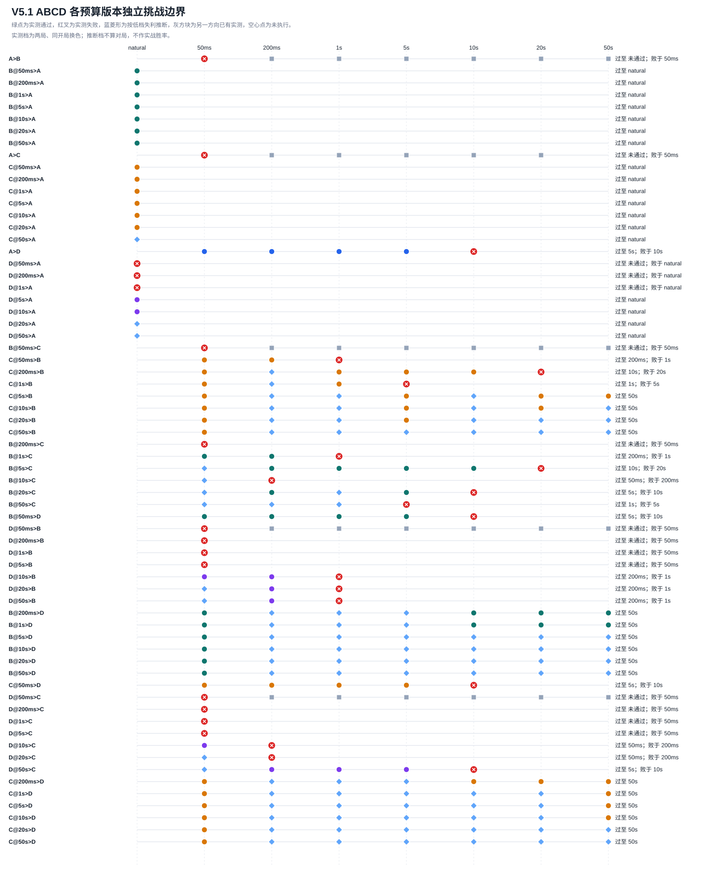

# V5.1「ABCD 全模型独立阶梯挑战赛」研究报告

**状态：完整完成。** 本轮只使用传统规则 AI、Minimax、Alpha-Beta 与 MCTS 推理；没有神经网络或强化学习训练。此处的恢复归档是实验数据快照，不是训练 checkpoint。

## 摘要

本轮完成 73 组、146 局配对对局；另有 1 局未配对观察记录（不计入战绩）。复用 V5 28 组、56 局；66 条独立路线中 34 条完成，32 条在失败档终止。AI 实际思考时间合计 6.58 小时；运行器墙钟 6.03 小时，累计有效运行 5.75 小时。

四家族跨预算混合样本的描述性得分率顺序为：C（78.4%）、B（56.7%）、A（36.1%）、D（16.7%）。这不是统一预算下的棋力排名，原因是不同版本可打到的对手预算、实际局数和开局不同。

## 1. 赛制、实现与公平性

A、B、C、D 分别使用原规则 AI、纯 Minimax、Minimax + Alpha-Beta、冻结的纯 UCT MCTS 与 V4C 战术规则。A 自然耗时；B/C 使用相同候选集、顺序、评价与迭代加深，C 只增加 Alpha-Beta。没有针对对手的规则，也没有训练。
B、C、D 的独立版本预算为 50ms、200ms、1s、5s、10s、20s、50s。A 为单一自然时间版本。路线固定挑战者版本，只逐档提高对手预算；A 路线逐档面对对手的七个版本。只安排跨家族比赛。
同一预算配对只运行一次并可供两条方向相反的路线共享；每条实测路线只在自己的两局合计得分至少 1 分时升级。对局使用预注册的 12 个合法开局池和固定种子，每组相同开局换色。V5 精确匹配的对局只在其配对组到达可执行时才物化。
依照追加的早停规则，若固定挑战者未通过某家族的较低预算版本，则该路线不再实测更高预算；反向路线中高于已败低档的版本标为“推断通过”，不计为实战胜场、得分率或对局。此推断采用“更高预算版本不弱于低预算版本”的单调性假设；已有完整棋局仍按真实结果保留，未配对观察保留原始记录但不计赛果。
赛程剪枝规则在实验运行中途追加。修正规则前已经完成的 A–B200ms 至 50s 六组、A–C200ms 至 20s 五组均保留为真实棋谱，可供尚未淘汰的反向路线共享，但不计入 A 已失败路线的晋级得分；A–C50s 已开始的一局作为未配对观察保留。规则更新后未再启动这些被低档失败支配的对局。
V1–V5 的决策引擎代码未修改；V5.1 只增加独立预算版本赛程、恢复、验证和统计代码。

### 运行资源与耗时预估

CPU 可见核心：3；预检记录内存可用量：9337 MiB；磁盘可用量：29.7 GiB。
预检逐版本局面耗时 258.7 秒。预计如所有独立路线都到达 50 秒，最多需新跑 140 组 / 280 局；按 V5 同家族对局实际长度和逐预算实测速率，单进程估计 10.60 小时；按完整 9×9 盘面预算的保守上限 78.11 小时。
所需棋谱空间估计 2.3 MiB。

恢复快照：Drive 快照已上传、回下载、SHA-256 校验一致并成功恢复；最新有效快照 `v5-1-latest-recovery.zip`，SHA-256 `27a0a41ae90f805958f744602bb3f969d36c0af41df924dfa57fce8cda1e6ae1`，含 147 局，专用文件夹当前有 1 个文件。完成上传、下载、哈希及恢复验证后已删除旧版；专用文件夹当前只保留一份最新有效快照。

运行器使用唯一 game ID、JSONL 每局 fsync、progress 原子替换；每局回放检查合法性、五连胜和计数，配对齐全后才推进路线。恢复时按棋谱重建路线，而不是信任缓存的晋级结果。

## 2. 66 条独立挑战路线

表中每条 B/C/D@预算路线都有独立状态。实测通过/失败来自两局配对；“按低档失利推断通过”是零对局的赛程剪枝结果；最高实测通过与最高（含推断）通过分开列示。

| 挑战者版本 → 对手家族 | 各对手预算档结果 | 最高实测通过 | 最高（含推断）通过 | 首个实测失败档 |
|---|---|---:|---:|---:|
| `A>B` | 50ms：× 失败 0.0/2 → 200ms：共享棋局已记，但本路线此前失败 → 1s：共享棋局已记，但本路线此前失败 → 5s：共享棋局已记，但本路线此前失败 → 10s：共享棋局已记，但本路线此前失败 → 20s：共享棋局已记，但本路线此前失败 → 50s：共享棋局已记，但本路线此前失败 | 无 | 无 | 50ms |
| `B@50ms>A` | natural：✓ 通过 2.0/2 | natural | natural | 无（路线完成或未失败） |
| `B@200ms>A` | natural：✓ 通过 1.0/2 | natural | natural | 无（路线完成或未失败） |
| `B@1s>A` | natural：✓ 通过 1.0/2 | natural | natural | 无（路线完成或未失败） |
| `B@5s>A` | natural：✓ 通过 1.0/2 | natural | natural | 无（路线完成或未失败） |
| `B@10s>A` | natural：✓ 通过 1.5/2 | natural | natural | 无（路线完成或未失败） |
| `B@20s>A` | natural：✓ 通过 1.5/2 | natural | natural | 无（路线完成或未失败） |
| `B@50s>A` | natural：✓ 通过 2.0/2 | natural | natural | 无（路线完成或未失败） |
| `A>C` | 50ms：× 失败 0.5/2 → 200ms：共享棋局已记，但本路线此前失败 → 1s：共享棋局已记，但本路线此前失败 → 5s：共享棋局已记，但本路线此前失败 → 10s：共享棋局已记，但本路线此前失败 → 20s：共享棋局已记，但本路线此前失败 → 50s：未配对观察，不计分 | 无 | 无 | 50ms |
| `C@50ms>A` | natural：✓ 通过 1.5/2 | natural | natural | 无（路线完成或未失败） |
| `C@200ms>A` | natural：✓ 通过 2.0/2 | natural | natural | 无（路线完成或未失败） |
| `C@1s>A` | natural：✓ 通过 2.0/2 | natural | natural | 无（路线完成或未失败） |
| `C@5s>A` | natural：✓ 通过 2.0/2 | natural | natural | 无（路线完成或未失败） |
| `C@10s>A` | natural：✓ 通过 1.5/2 | natural | natural | 无（路线完成或未失败） |
| `C@20s>A` | natural：✓ 通过 1.5/2 | natural | natural | 无（路线完成或未失败） |
| `C@50s>A` | natural：◇ 按低档失利推断通过（0局） | 无 | natural | 无（路线完成或未失败） |
| `A>D` | 50ms：✓ 通过 2.0/2 → 200ms：✓ 通过 2.0/2 → 1s：✓ 通过 2.0/2 → 5s：✓ 通过 1.0/2 → 10s：× 失败 0.5/2 → 20s：本路线失败后未跑 → 50s：本路线失败后未跑 | 5s | 5s | 10s |
| `D@50ms>A` | natural：× 失败 0.0/2 | 无 | 无 | natural |
| `D@200ms>A` | natural：× 失败 0.0/2 | 无 | 无 | natural |
| `D@1s>A` | natural：× 失败 0.0/2 | 无 | 无 | natural |
| `D@5s>A` | natural：✓ 通过 1.0/2 | natural | natural | 无（路线完成或未失败） |
| `D@10s>A` | natural：✓ 通过 1.5/2 | natural | natural | 无（路线完成或未失败） |
| `D@20s>A` | natural：◇ 按低档失利推断通过（0局） | 无 | natural | 无（路线完成或未失败） |
| `D@50s>A` | natural：◇ 按低档失利推断通过（0局） | 无 | natural | 无（路线完成或未失败） |
| `B@50ms>C` | 50ms：× 失败 0.0/2 → 200ms：共享棋局已记，但本路线此前失败 → 1s：共享棋局已记，但本路线此前失败 → 5s：共享棋局已记，但本路线此前失败 → 10s：共享棋局已记，但本路线此前失败 → 20s：共享棋局已记，但本路线此前失败 → 50s：共享棋局已记，但本路线此前失败 | 无 | 无 | 50ms |
| `C@50ms>B` | 50ms：✓ 通过 2.0/2 → 200ms：✓ 通过 2.0/2 → 1s：× 失败 0.0/2 → 5s：本路线失败后未跑 → 10s：本路线失败后未跑 → 20s：本路线失败后未跑 → 50s：本路线失败后未跑 | 200ms | 200ms | 1s |
| `C@200ms>B` | 50ms：✓ 通过 2.0/2 → 200ms：◇ 按低档失利推断通过（0局） → 1s：✓ 通过 1.0/2 → 5s：✓ 通过 1.0/2 → 10s：✓ 通过 1.5/2 → 20s：× 失败 0.0/2 → 50s：本路线失败后未跑 | 10s | 10s | 20s |
| `C@1s>B` | 50ms：✓ 通过 2.0/2 → 200ms：◇ 按低档失利推断通过（0局） → 1s：✓ 通过 2.0/2 → 5s：× 失败 0.0/2 → 10s：本路线失败后未跑 → 20s：本路线失败后未跑 → 50s：本路线失败后未跑 | 1s | 1s | 5s |
| `C@5s>B` | 50ms：✓ 通过 2.0/2 → 200ms：◇ 按低档失利推断通过（0局） → 1s：◇ 按低档失利推断通过（0局） → 5s：✓ 通过 1.0/2 → 10s：◇ 按低档失利推断通过（0局） → 20s：✓ 通过 1.0/2 → 50s：✓ 通过 1.5/2 | 50s | 50s | 无（路线完成或未失败） |
| `C@10s>B` | 50ms：✓ 通过 2.0/2 → 200ms：◇ 按低档失利推断通过（0局） → 1s：◇ 按低档失利推断通过（0局） → 5s：✓ 通过 1.0/2 → 10s：◇ 按低档失利推断通过（0局） → 20s：✓ 通过 2.0/2 → 50s：◇ 按低档失利推断通过（0局） | 20s | 50s | 无（路线完成或未失败） |
| `C@20s>B` | 50ms：✓ 通过 2.0/2 → 200ms：◇ 按低档失利推断通过（0局） → 1s：◇ 按低档失利推断通过（0局） → 5s：✓ 通过 1.5/2 → 10s：◇ 按低档失利推断通过（0局） → 20s：◇ 按低档失利推断通过（0局） → 50s：◇ 按低档失利推断通过（0局） | 5s | 50s | 无（路线完成或未失败） |
| `C@50s>B` | 50ms：✓ 通过 2.0/2 → 200ms：◇ 按低档失利推断通过（0局） → 1s：◇ 按低档失利推断通过（0局） → 5s：◇ 按低档失利推断通过（0局） → 10s：◇ 按低档失利推断通过（0局） → 20s：◇ 按低档失利推断通过（0局） → 50s：◇ 按低档失利推断通过（0局） | 50ms | 50s | 无（路线完成或未失败） |
| `B@200ms>C` | 50ms：× 失败 0.0/2 → 200ms：本路线失败后未跑 → 1s：本路线失败后未跑 → 5s：本路线失败后未跑 → 10s：本路线失败后未跑 → 20s：本路线失败后未跑 → 50s：本路线失败后未跑 | 无 | 无 | 50ms |
| `B@1s>C` | 50ms：✓ 通过 2.0/2 → 200ms：✓ 通过 1.0/2 → 1s：× 失败 0.0/2 → 5s：本路线失败后未跑 → 10s：本路线失败后未跑 → 20s：本路线失败后未跑 → 50s：本路线失败后未跑 | 200ms | 200ms | 1s |
| `B@5s>C` | 50ms：◇ 按低档失利推断通过（0局） → 200ms：✓ 通过 1.0/2 → 1s：✓ 通过 2.0/2 → 5s：✓ 通过 1.0/2 → 10s：✓ 通过 1.0/2 → 20s：× 失败 0.5/2 → 50s：本路线失败后未跑 | 10s | 10s | 20s |
| `B@10s>C` | 50ms：◇ 按低档失利推断通过（0局） → 200ms：× 失败 0.5/2 → 1s：本路线失败后未跑 → 5s：本路线失败后未跑 → 10s：本路线失败后未跑 → 20s：本路线失败后未跑 → 50s：本路线失败后未跑 | 无 | 50ms | 200ms |
| `B@20s>C` | 50ms：◇ 按低档失利推断通过（0局） → 200ms：✓ 通过 2.0/2 → 1s：◇ 按低档失利推断通过（0局） → 5s：✓ 通过 1.0/2 → 10s：× 失败 0.0/2 → 20s：本路线失败后未跑 → 50s：本路线失败后未跑 | 5s | 5s | 10s |
| `B@50s>C` | 50ms：◇ 按低档失利推断通过（0局） → 200ms：◇ 按低档失利推断通过（0局） → 1s：◇ 按低档失利推断通过（0局） → 5s：× 失败 0.5/2 → 10s：本路线失败后未跑 → 20s：本路线失败后未跑 → 50s：本路线失败后未跑 | 无 | 1s | 5s |
| `B@50ms>D` | 50ms：✓ 通过 2.0/2 → 200ms：✓ 通过 2.0/2 → 1s：✓ 通过 2.0/2 → 5s：✓ 通过 2.0/2 → 10s：× 失败 0.0/2 → 20s：本路线失败后未跑 → 50s：本路线失败后未跑 | 5s | 5s | 10s |
| `D@50ms>B` | 50ms：× 失败 0.0/2 → 200ms：共享棋局已记，但本路线此前失败 → 1s：共享棋局已记，但本路线此前失败 → 5s：共享棋局已记，但本路线此前失败 → 10s：共享棋局已记，但本路线此前失败 → 20s：共享棋局已记，但本路线此前失败 → 50s：共享棋局已记，但本路线此前失败 | 无 | 无 | 50ms |
| `D@200ms>B` | 50ms：× 失败 0.0/2 → 200ms：本路线失败后未跑 → 1s：本路线失败后未跑 → 5s：本路线失败后未跑 → 10s：本路线失败后未跑 → 20s：本路线失败后未跑 → 50s：本路线失败后未跑 | 无 | 无 | 50ms |
| `D@1s>B` | 50ms：× 失败 0.0/2 → 200ms：本路线失败后未跑 → 1s：本路线失败后未跑 → 5s：本路线失败后未跑 → 10s：本路线失败后未跑 → 20s：本路线失败后未跑 → 50s：本路线失败后未跑 | 无 | 无 | 50ms |
| `D@5s>B` | 50ms：× 失败 0.0/2 → 200ms：本路线失败后未跑 → 1s：本路线失败后未跑 → 5s：本路线失败后未跑 → 10s：本路线失败后未跑 → 20s：本路线失败后未跑 → 50s：本路线失败后未跑 | 无 | 无 | 50ms |
| `D@10s>B` | 50ms：✓ 通过 2.0/2 → 200ms：✓ 通过 1.0/2 → 1s：× 失败 0.0/2 → 5s：本路线失败后未跑 → 10s：本路线失败后未跑 → 20s：本路线失败后未跑 → 50s：本路线失败后未跑 | 200ms | 200ms | 1s |
| `D@20s>B` | 50ms：◇ 按低档失利推断通过（0局） → 200ms：✓ 通过 1.0/2 → 1s：× 失败 0.0/2 → 5s：本路线失败后未跑 → 10s：本路线失败后未跑 → 20s：本路线失败后未跑 → 50s：本路线失败后未跑 | 200ms | 200ms | 1s |
| `D@50s>B` | 50ms：◇ 按低档失利推断通过（0局） → 200ms：✓ 通过 1.0/2 → 1s：× 失败 0.5/2 → 5s：本路线失败后未跑 → 10s：本路线失败后未跑 → 20s：本路线失败后未跑 → 50s：本路线失败后未跑 | 200ms | 200ms | 1s |
| `B@200ms>D` | 50ms：✓ 通过 2.0/2 → 200ms：◇ 按低档失利推断通过（0局） → 1s：◇ 按低档失利推断通过（0局） → 5s：◇ 按低档失利推断通过（0局） → 10s：✓ 通过 1.0/2 → 20s：✓ 通过 1.0/2 → 50s：✓ 通过 1.0/2 | 50s | 50s | 无（路线完成或未失败） |
| `B@1s>D` | 50ms：✓ 通过 2.0/2 → 200ms：◇ 按低档失利推断通过（0局） → 1s：◇ 按低档失利推断通过（0局） → 5s：◇ 按低档失利推断通过（0局） → 10s：✓ 通过 2.0/2 → 20s：✓ 通过 2.0/2 → 50s：✓ 通过 1.5/2 | 50s | 50s | 无（路线完成或未失败） |
| `B@5s>D` | 50ms：✓ 通过 2.0/2 → 200ms：◇ 按低档失利推断通过（0局） → 1s：◇ 按低档失利推断通过（0局） → 5s：◇ 按低档失利推断通过（0局） → 10s：◇ 按低档失利推断通过（0局） → 20s：◇ 按低档失利推断通过（0局） → 50s：◇ 按低档失利推断通过（0局） | 50ms | 50s | 无（路线完成或未失败） |
| `B@10s>D` | 50ms：✓ 通过 2.0/2 → 200ms：◇ 按低档失利推断通过（0局） → 1s：◇ 按低档失利推断通过（0局） → 5s：◇ 按低档失利推断通过（0局） → 10s：◇ 按低档失利推断通过（0局） → 20s：◇ 按低档失利推断通过（0局） → 50s：◇ 按低档失利推断通过（0局） | 50ms | 50s | 无（路线完成或未失败） |
| `B@20s>D` | 50ms：✓ 通过 2.0/2 → 200ms：◇ 按低档失利推断通过（0局） → 1s：◇ 按低档失利推断通过（0局） → 5s：◇ 按低档失利推断通过（0局） → 10s：◇ 按低档失利推断通过（0局） → 20s：◇ 按低档失利推断通过（0局） → 50s：◇ 按低档失利推断通过（0局） | 50ms | 50s | 无（路线完成或未失败） |
| `B@50s>D` | 50ms：✓ 通过 2.0/2 → 200ms：◇ 按低档失利推断通过（0局） → 1s：◇ 按低档失利推断通过（0局） → 5s：◇ 按低档失利推断通过（0局） → 10s：◇ 按低档失利推断通过（0局） → 20s：◇ 按低档失利推断通过（0局） → 50s：◇ 按低档失利推断通过（0局） | 50ms | 50s | 无（路线完成或未失败） |
| `C@50ms>D` | 50ms：✓ 通过 2.0/2 → 200ms：✓ 通过 2.0/2 → 1s：✓ 通过 2.0/2 → 5s：✓ 通过 2.0/2 → 10s：× 失败 0.5/2 → 20s：本路线失败后未跑 → 50s：本路线失败后未跑 | 5s | 5s | 10s |
| `D@50ms>C` | 50ms：× 失败 0.0/2 → 200ms：共享棋局已记，但本路线此前失败 → 1s：共享棋局已记，但本路线此前失败 → 5s：共享棋局已记，但本路线此前失败 → 10s：共享棋局已记，但本路线此前失败 → 20s：共享棋局已记，但本路线此前失败 → 50s：共享棋局已记，但本路线此前失败 | 无 | 无 | 50ms |
| `D@200ms>C` | 50ms：× 失败 0.0/2 → 200ms：本路线失败后未跑 → 1s：本路线失败后未跑 → 5s：本路线失败后未跑 → 10s：本路线失败后未跑 → 20s：本路线失败后未跑 → 50s：本路线失败后未跑 | 无 | 无 | 50ms |
| `D@1s>C` | 50ms：× 失败 0.0/2 → 200ms：本路线失败后未跑 → 1s：本路线失败后未跑 → 5s：本路线失败后未跑 → 10s：本路线失败后未跑 → 20s：本路线失败后未跑 → 50s：本路线失败后未跑 | 无 | 无 | 50ms |
| `D@5s>C` | 50ms：× 失败 0.0/2 → 200ms：本路线失败后未跑 → 1s：本路线失败后未跑 → 5s：本路线失败后未跑 → 10s：本路线失败后未跑 → 20s：本路线失败后未跑 → 50s：本路线失败后未跑 | 无 | 无 | 50ms |
| `D@10s>C` | 50ms：✓ 通过 1.5/2 → 200ms：× 失败 0.0/2 → 1s：本路线失败后未跑 → 5s：本路线失败后未跑 → 10s：本路线失败后未跑 → 20s：本路线失败后未跑 → 50s：本路线失败后未跑 | 50ms | 50ms | 200ms |
| `D@20s>C` | 50ms：◇ 按低档失利推断通过（0局） → 200ms：× 失败 0.0/2 → 1s：本路线失败后未跑 → 5s：本路线失败后未跑 → 10s：本路线失败后未跑 → 20s：本路线失败后未跑 → 50s：本路线失败后未跑 | 无 | 50ms | 200ms |
| `D@50s>C` | 50ms：◇ 按低档失利推断通过（0局） → 200ms：✓ 通过 1.0/2 → 1s：✓ 通过 1.0/2 → 5s：✓ 通过 1.0/2 → 10s：× 失败 0.5/2 → 20s：本路线失败后未跑 → 50s：本路线失败后未跑 | 5s | 5s | 10s |
| `C@200ms>D` | 50ms：✓ 通过 2.0/2 → 200ms：◇ 按低档失利推断通过（0局） → 1s：◇ 按低档失利推断通过（0局） → 5s：◇ 按低档失利推断通过（0局） → 10s：✓ 通过 2.0/2 → 20s：✓ 通过 2.0/2 → 50s：✓ 通过 1.0/2 | 50s | 50s | 无（路线完成或未失败） |
| `C@1s>D` | 50ms：✓ 通过 2.0/2 → 200ms：◇ 按低档失利推断通过（0局） → 1s：◇ 按低档失利推断通过（0局） → 5s：◇ 按低档失利推断通过（0局） → 10s：◇ 按低档失利推断通过（0局） → 20s：◇ 按低档失利推断通过（0局） → 50s：✓ 通过 1.0/2 | 50s | 50s | 无（路线完成或未失败） |
| `C@5s>D` | 50ms：✓ 通过 2.0/2 → 200ms：◇ 按低档失利推断通过（0局） → 1s：◇ 按低档失利推断通过（0局） → 5s：◇ 按低档失利推断通过（0局） → 10s：◇ 按低档失利推断通过（0局） → 20s：◇ 按低档失利推断通过（0局） → 50s：✓ 通过 1.0/2 | 50s | 50s | 无（路线完成或未失败） |
| `C@10s>D` | 50ms：✓ 通过 2.0/2 → 200ms：◇ 按低档失利推断通过（0局） → 1s：◇ 按低档失利推断通过（0局） → 5s：◇ 按低档失利推断通过（0局） → 10s：◇ 按低档失利推断通过（0局） → 20s：◇ 按低档失利推断通过（0局） → 50s：✓ 通过 1.5/2 | 50s | 50s | 无（路线完成或未失败） |
| `C@20s>D` | 50ms：✓ 通过 2.0/2 → 200ms：◇ 按低档失利推断通过（0局） → 1s：◇ 按低档失利推断通过（0局） → 5s：◇ 按低档失利推断通过（0局） → 10s：◇ 按低档失利推断通过（0局） → 20s：◇ 按低档失利推断通过（0局） → 50s：◇ 按低档失利推断通过（0局） | 50ms | 50s | 无（路线完成或未失败） |
| `C@50s>D` | 50ms：✓ 通过 2.0/2 → 200ms：◇ 按低档失利推断通过（0局） → 1s：◇ 按低档失利推断通过（0局） → 5s：◇ 按低档失利推断通过（0局） → 10s：◇ 按低档失利推断通过（0局） → 20s：◇ 按低档失利推断通过（0局） → 50s：◇ 按低档失利推断通过（0局） | 50ms | 50s | 无（路线完成或未失败） |

## 3. 六类家族对阵胜负矩阵

以下胜负与得分率由全部实际对局计算；95% 区间以每个两局配对组的得分率为观察单位，采用 Wilson 近似，仅作描述。开局种类有限且路线按两局早停，区间不消除选择偏差。

| 对阵 | 实际组/局 | 首家族胜–平–次家族胜 | 首家族分/胜率 [95%组级描述区间] | 次家族分/胜率 [95%组级描述区间] |
|---|---:|---:|---:|---:|
| A-B | 7/14 | 0–8–6 | 4.0/28.6% [8.2%, 64.1%] | 10.0/71.4% [35.9%, 91.8%] |
| A-C | 6/12 | 0–3–9 | 1.5/12.5% [1.8%, 52.5%] | 10.5/87.5% [47.5%, 98.2%] |
| A-D | 5/10 | 7–1–2 | 7.5/75.0% [33.6%, 94.7%] | 2.5/25.0% [5.3%, 66.4%] |
| B-C | 21/42 | 10–5–27 | 12.5/29.8% [14.6%, 51.1%] | 29.5/70.2% [48.9%, 85.4%] |
| B-D | 17/34 | 28–1–5 | 28.5/83.8% [60.6%, 94.6%] | 5.5/16.2% [5.4%, 39.4%] |
| C-D | 17/34 | 28–2–4 | 29.0/85.3% [62.3%, 95.3%] | 5.0/14.7% [4.7%, 37.7%] |

## 4. 168 个潜在精确预算对局格

每一行对应唯一模型版本组合。未执行或推断的格子没有胜负、积分或得分率；完整棋谱进入赛果统计，未配对观察保存在原始 JSONL 和 CSV，只计资源消耗、不计胜负矩阵。

| 精确预算组合 | 配对 ID / 开局 | 路线引用 | 状态 | 实际局数 | 胜–平–负 | 首/次模型得分（得分率） |
|---|---|---|---|---:|---:|---:|
| A@natural–B@50ms | `v5-1-9x9-a-natural-b-50ms-o731101` / 731101 | A>B, B@50ms>A | played | 2 | 0–0–2 | 0.0/0.0%；2.0/100.0% |
| A@natural–B@200ms | `v5-1-9x9-a-natural-b-200ms-o731102` / 731102 | A>B, B@200ms>A | played | 2 | 0–2–0 | 1.0/50.0%；1.0/50.0% |
| A@natural–B@1s | `v5-1-9x9-a-natural-b-1s-o731103` / 731103 | A>B, B@1s>A | played | 2 | 0–2–0 | 1.0/50.0%；1.0/50.0% |
| A@natural–B@5s | `v5-1-9x9-a-natural-b-5s-o731104` / 731104 | A>B, B@5s>A | played | 2 | 0–2–0 | 1.0/50.0%；1.0/50.0% |
| A@natural–B@10s | `v5-1-9x9-a-natural-b-10s-o731105` / 731105 | A>B, B@10s>A | played | 2 | 0–1–1 | 0.5/25.0%；1.5/75.0% |
| A@natural–B@20s | `v5-1-9x9-a-natural-b-20s-o731106` / 731106 | A>B, B@20s>A | played | 2 | 0–1–1 | 0.5/25.0%；1.5/75.0% |
| A@natural–B@50s | `v5-1-9x9-a-natural-b-50s-o731107` / 731107 | A>B, B@50s>A | played | 2 | 0–0–2 | 0.0/0.0%；2.0/100.0% |
| A@natural–C@50ms | `v5-1-9x9-a-natural-c-50ms-o731104` / 731104 | A>C, C@50ms>A | played | 2 | 0–1–1 | 0.5/25.0%；1.5/75.0% |
| A@natural–C@200ms | `v5-1-9x9-a-natural-c-200ms-o731105` / 731105 | A>C, C@200ms>A | played | 2 | 0–0–2 | 0.0/0.0%；2.0/100.0% |
| A@natural–C@1s | `v5-1-9x9-a-natural-c-1s-o731106` / 731106 | A>C, C@1s>A | played | 2 | 0–0–2 | 0.0/0.0%；2.0/100.0% |
| A@natural–C@5s | `v5-1-9x9-a-natural-c-5s-o731107` / 731107 | A>C, C@5s>A | played | 2 | 0–0–2 | 0.0/0.0%；2.0/100.0% |
| A@natural–C@10s | `v5-1-9x9-a-natural-c-10s-o731108` / 731108 | A>C, C@10s>A | played | 2 | 0–1–1 | 0.5/25.0%；1.5/75.0% |
| A@natural–C@20s | `v5-1-9x9-a-natural-c-20s-o731109` / 731109 | A>C, C@20s>A | played | 2 | 0–1–1 | 0.5/25.0%；1.5/75.0% |
| A@natural–C@50s | `v5-1-9x9-a-natural-c-50s-o731110` / 731110 | A>C, C@50s>A | inferred_dominated_partial_observation | 0 | 未运行 | —；— |
| A@natural–D@50ms | `v5-1-9x9-a-natural-d-50ms-o731107` / 731107 | A>D, D@50ms>A | played | 2 | 2–0–0 | 2.0/100.0%；0.0/0.0% |
| A@natural–D@200ms | `v5-1-9x9-a-natural-d-200ms-o731108` / 731108 | A>D, D@200ms>A | played | 2 | 2–0–0 | 2.0/100.0%；0.0/0.0% |
| A@natural–D@1s | `v5-1-9x9-a-natural-d-1s-o731109` / 731109 | A>D, D@1s>A | played | 2 | 2–0–0 | 2.0/100.0%；0.0/0.0% |
| A@natural–D@5s | `v5-1-9x9-a-natural-d-5s-o731110` / 731110 | A>D, D@5s>A | played | 2 | 1–0–1 | 1.0/50.0%；1.0/50.0% |
| A@natural–D@10s | `v5-1-9x9-a-natural-d-10s-o731111` / 731111 | A>D, D@10s>A | played | 2 | 0–1–1 | 0.5/25.0%；1.5/75.0% |
| A@natural–D@20s | `v5-1-9x9-a-natural-d-20s-o731112` / 731112 | A>D, D@20s>A | inferred_dominated | 0 | 未运行 | —；— |
| A@natural–D@50s | `v5-1-9x9-a-natural-d-50s-o731101` / 731101 | A>D, D@50s>A | inferred_dominated | 0 | 未运行 | —；— |
| B@50ms–C@50ms | `v5-1-9x9-b-50ms-c-50ms-o731110` / 731110 | B@50ms>C, C@50ms>B | played | 2 | 0–0–2 | 0.0/0.0%；2.0/100.0% |
| B@50ms–C@200ms | `v5-1-9x9-b-50ms-c-200ms-o731104` / 731104 | B@50ms>C, C@200ms>B | played | 2 | 0–0–2 | 0.0/0.0%；2.0/100.0% |
| B@50ms–C@1s | `v5-1-9x9-b-50ms-c-1s-o731105` / 731105 | B@50ms>C, C@1s>B | played | 2 | 0–0–2 | 0.0/0.0%；2.0/100.0% |
| B@50ms–C@5s | `v5-1-9x9-b-50ms-c-5s-o731106` / 731106 | B@50ms>C, C@5s>B | played | 2 | 0–0–2 | 0.0/0.0%；2.0/100.0% |
| B@50ms–C@10s | `v5-1-9x9-b-50ms-c-10s-o731107` / 731107 | B@50ms>C, C@10s>B | played | 2 | 0–0–2 | 0.0/0.0%；2.0/100.0% |
| B@50ms–C@20s | `v5-1-9x9-b-50ms-c-20s-o731108` / 731108 | B@50ms>C, C@20s>B | played | 2 | 0–0–2 | 0.0/0.0%；2.0/100.0% |
| B@50ms–C@50s | `v5-1-9x9-b-50ms-c-50s-o731109` / 731109 | B@50ms>C, C@50s>B | played | 2 | 0–0–2 | 0.0/0.0%；2.0/100.0% |
| B@200ms–C@50ms | `v5-1-9x9-b-200ms-c-50ms-o731111` / 731111 | B@200ms>C, C@50ms>B | played | 2 | 0–0–2 | 0.0/0.0%；2.0/100.0% |
| B@200ms–C@200ms | `v5-1-9x9-b-200ms-c-200ms-o731112` / 731112 | B@200ms>C, C@200ms>B | inferred_dominated | 0 | 未运行 | —；— |
| B@200ms–C@1s | `v5-1-9x9-b-200ms-c-1s-o731111` / 731111 | B@200ms>C, C@1s>B | inferred_dominated | 0 | 未运行 | —；— |
| B@200ms–C@5s | `v5-1-9x9-b-200ms-c-5s-o731109` / 731109 | B@200ms>C, C@5s>B | inferred_dominated | 0 | 未运行 | —；— |
| B@200ms–C@10s | `v5-1-9x9-b-200ms-c-10s-o731102` / 731102 | B@200ms>C, C@10s>B | inferred_dominated | 0 | 未运行 | —；— |
| B@200ms–C@20s | `v5-1-9x9-b-200ms-c-20s-o731101` / 731101 | B@200ms>C, C@20s>B | inferred_dominated | 0 | 未运行 | —；— |
| B@200ms–C@50s | `v5-1-9x9-b-200ms-c-50s-o731106` / 731106 | B@200ms>C, C@50s>B | inferred_dominated | 0 | 未运行 | —；— |
| B@1s–C@50ms | `v5-1-9x9-b-1s-c-50ms-o731112` / 731112 | B@1s>C, C@50ms>B | played | 2 | 2–0–0 | 2.0/100.0%；0.0/0.0% |
| B@1s–C@200ms | `v5-1-9x9-b-1s-c-200ms-o731108` / 731108 | B@1s>C, C@200ms>B | played | 2 | 1–0–1 | 1.0/50.0%；1.0/50.0% |
| B@1s–C@1s | `v5-1-9x9-b-1s-c-1s-o731109` / 731109 | B@1s>C, C@1s>B | played | 2 | 0–0–2 | 0.0/0.0%；2.0/100.0% |
| B@1s–C@5s | `v5-1-9x9-b-1s-c-5s-o731112` / 731112 | B@1s>C, C@5s>B | inferred_dominated | 0 | 未运行 | —；— |
| B@1s–C@10s | `v5-1-9x9-b-1s-c-10s-o731102` / 731102 | B@1s>C, C@10s>B | inferred_dominated | 0 | 未运行 | —；— |
| B@1s–C@20s | `v5-1-9x9-b-1s-c-20s-o731111` / 731111 | B@1s>C, C@20s>B | inferred_dominated | 0 | 未运行 | —；— |
| B@1s–C@50s | `v5-1-9x9-b-1s-c-50s-o731109` / 731109 | B@1s>C, C@50s>B | inferred_dominated | 0 | 未运行 | —；— |
| B@5s–C@50ms | `v5-1-9x9-b-5s-c-50ms-o731101` / 731101 | B@5s>C, C@50ms>B | inferred_dominated | 0 | 未运行 | —；— |
| B@5s–C@200ms | `v5-1-9x9-b-5s-c-200ms-o731104` / 731104 | B@5s>C, C@200ms>B | played | 2 | 0–2–0 | 1.0/50.0%；1.0/50.0% |
| B@5s–C@1s | `v5-1-9x9-b-5s-c-1s-o731107` / 731107 | B@5s>C, C@1s>B | played | 2 | 2–0–0 | 2.0/100.0%；0.0/0.0% |
| B@5s–C@5s | `v5-1-9x9-b-5s-c-5s-o731106` / 731106 | B@5s>C, C@5s>B | played | 2 | 1–0–1 | 1.0/50.0%；1.0/50.0% |
| B@5s–C@10s | `v5-1-9x9-b-5s-c-10s-o731104` / 731104 | B@5s>C, C@10s>B | played | 2 | 1–0–1 | 1.0/50.0%；1.0/50.0% |
| B@5s–C@20s | `v5-1-9x9-b-5s-c-20s-o731108` / 731108 | B@5s>C, C@20s>B | played | 2 | 0–1–1 | 0.5/25.0%；1.5/75.0% |
| B@5s–C@50s | `v5-1-9x9-b-5s-c-50s-o731107` / 731107 | B@5s>C, C@50s>B | inferred_dominated | 0 | 未运行 | —；— |
| B@10s–C@50ms | `v5-1-9x9-b-10s-c-50ms-o731102` / 731102 | B@10s>C, C@50ms>B | inferred_dominated | 0 | 未运行 | —；— |
| B@10s–C@200ms | `v5-1-9x9-b-10s-c-200ms-o731101` / 731101 | B@10s>C, C@200ms>B | played | 2 | 0–1–1 | 0.5/25.0%；1.5/75.0% |
| B@10s–C@1s | `v5-1-9x9-b-10s-c-1s-o731106` / 731106 | B@10s>C, C@1s>B | skipped_no_active_route | 0 | 未运行 | —；— |
| B@10s–C@5s | `v5-1-9x9-b-10s-c-5s-o731108` / 731108 | B@10s>C, C@5s>B | inferred_dominated | 0 | 未运行 | —；— |
| B@10s–C@10s | `v5-1-9x9-b-10s-c-10s-o731111` / 731111 | B@10s>C, C@10s>B | inferred_dominated | 0 | 未运行 | —；— |
| B@10s–C@20s | `v5-1-9x9-b-10s-c-20s-o731106` / 731106 | B@10s>C, C@20s>B | inferred_dominated | 0 | 未运行 | —；— |
| B@10s–C@50s | `v5-1-9x9-b-10s-c-50s-o731102` / 731102 | B@10s>C, C@50s>B | inferred_dominated | 0 | 未运行 | —；— |
| B@20s–C@50ms | `v5-1-9x9-b-20s-c-50ms-o731103` / 731103 | B@20s>C, C@50ms>B | inferred_dominated | 0 | 未运行 | —；— |
| B@20s–C@200ms | `v5-1-9x9-b-20s-c-200ms-o731109` / 731109 | B@20s>C, C@200ms>B | played | 2 | 2–0–0 | 2.0/100.0%；0.0/0.0% |
| B@20s–C@1s | `v5-1-9x9-b-20s-c-1s-o731110` / 731110 | B@20s>C, C@1s>B | inferred_dominated | 0 | 未运行 | —；— |
| B@20s–C@5s | `v5-1-9x9-b-20s-c-5s-o731112` / 731112 | B@20s>C, C@5s>B | played | 2 | 1–0–1 | 1.0/50.0%；1.0/50.0% |
| B@20s–C@10s | `v5-1-9x9-b-20s-c-10s-o731109` / 731109 | B@20s>C, C@10s>B | played | 2 | 0–0–2 | 0.0/0.0%；2.0/100.0% |
| B@20s–C@20s | `v5-1-9x9-b-20s-c-20s-o731101` / 731101 | B@20s>C, C@20s>B | inferred_dominated | 0 | 未运行 | —；— |
| B@20s–C@50s | `v5-1-9x9-b-20s-c-50s-o731109` / 731109 | B@20s>C, C@50s>B | inferred_dominated | 0 | 未运行 | —；— |
| B@50s–C@50ms | `v5-1-9x9-b-50s-c-50ms-o731104` / 731104 | B@50s>C, C@50ms>B | inferred_dominated | 0 | 未运行 | —；— |
| B@50s–C@200ms | `v5-1-9x9-b-50s-c-200ms-o731103` / 731103 | B@50s>C, C@200ms>B | inferred_dominated | 0 | 未运行 | —；— |
| B@50s–C@1s | `v5-1-9x9-b-50s-c-1s-o731107` / 731107 | B@50s>C, C@1s>B | inferred_dominated | 0 | 未运行 | —；— |
| B@50s–C@5s | `v5-1-9x9-b-50s-c-5s-o731110` / 731110 | B@50s>C, C@5s>B | played | 2 | 0–1–1 | 0.5/25.0%；1.5/75.0% |
| B@50s–C@10s | `v5-1-9x9-b-50s-c-10s-o731102` / 731102 | B@50s>C, C@10s>B | inferred_dominated | 0 | 未运行 | —；— |
| B@50s–C@20s | `v5-1-9x9-b-50s-c-20s-o731109` / 731109 | B@50s>C, C@20s>B | inferred_dominated | 0 | 未运行 | —；— |
| B@50s–C@50s | `v5-1-9x9-b-50s-c-50s-o731104` / 731104 | B@50s>C, C@50s>B | inferred_dominated | 0 | 未运行 | —；— |
| B@50ms–D@50ms | `v5-1-9x9-b-50ms-d-50ms-o731101` / 731101 | B@50ms>D, D@50ms>B | played | 2 | 2–0–0 | 2.0/100.0%；0.0/0.0% |
| B@50ms–D@200ms | `v5-1-9x9-b-50ms-d-200ms-o731107` / 731107 | B@50ms>D, D@200ms>B | played | 2 | 2–0–0 | 2.0/100.0%；0.0/0.0% |
| B@50ms–D@1s | `v5-1-9x9-b-50ms-d-1s-o731108` / 731108 | B@50ms>D, D@1s>B | played | 2 | 2–0–0 | 2.0/100.0%；0.0/0.0% |
| B@50ms–D@5s | `v5-1-9x9-b-50ms-d-5s-o731109` / 731109 | B@50ms>D, D@5s>B | played | 2 | 2–0–0 | 2.0/100.0%；0.0/0.0% |
| B@50ms–D@10s | `v5-1-9x9-b-50ms-d-10s-o731110` / 731110 | B@50ms>D, D@10s>B | played | 2 | 0–0–2 | 0.0/0.0%；2.0/100.0% |
| B@50ms–D@20s | `v5-1-9x9-b-50ms-d-20s-o731111` / 731111 | B@50ms>D, D@20s>B | inferred_dominated | 0 | 未运行 | —；— |
| B@50ms–D@50s | `v5-1-9x9-b-50ms-d-50s-o731112` / 731112 | B@50ms>D, D@50s>B | inferred_dominated | 0 | 未运行 | —；— |
| B@200ms–D@50ms | `v5-1-9x9-b-200ms-d-50ms-o731102` / 731102 | B@200ms>D, D@50ms>B | played | 2 | 2–0–0 | 2.0/100.0%；0.0/0.0% |
| B@200ms–D@200ms | `v5-1-9x9-b-200ms-d-200ms-o731108` / 731108 | B@200ms>D, D@200ms>B | inferred_dominated | 0 | 未运行 | —；— |
| B@200ms–D@1s | `v5-1-9x9-b-200ms-d-1s-o731103` / 731103 | B@200ms>D, D@1s>B | inferred_dominated | 0 | 未运行 | —；— |
| B@200ms–D@5s | `v5-1-9x9-b-200ms-d-5s-o731106` / 731106 | B@200ms>D, D@5s>B | inferred_dominated | 0 | 未运行 | —；— |
| B@200ms–D@10s | `v5-1-9x9-b-200ms-d-10s-o731103` / 731103 | B@200ms>D, D@10s>B | played | 2 | 1–0–1 | 1.0/50.0%；1.0/50.0% |
| B@200ms–D@20s | `v5-1-9x9-b-200ms-d-20s-o731108` / 731108 | B@200ms>D, D@20s>B | played | 2 | 1–0–1 | 1.0/50.0%；1.0/50.0% |
| B@200ms–D@50s | `v5-1-9x9-b-200ms-d-50s-o731102` / 731102 | B@200ms>D, D@50s>B | played | 2 | 1–0–1 | 1.0/50.0%；1.0/50.0% |
| B@1s–D@50ms | `v5-1-9x9-b-1s-d-50ms-o731103` / 731103 | B@1s>D, D@50ms>B | played | 2 | 2–0–0 | 2.0/100.0%；0.0/0.0% |
| B@1s–D@200ms | `v5-1-9x9-b-1s-d-200ms-o731108` / 731108 | B@1s>D, D@200ms>B | inferred_dominated | 0 | 未运行 | —；— |
| B@1s–D@1s | `v5-1-9x9-b-1s-d-1s-o731102` / 731102 | B@1s>D, D@1s>B | inferred_dominated | 0 | 未运行 | —；— |
| B@1s–D@5s | `v5-1-9x9-b-1s-d-5s-o731111` / 731111 | B@1s>D, D@5s>B | inferred_dominated | 0 | 未运行 | —；— |
| B@1s–D@10s | `v5-1-9x9-b-1s-d-10s-o731111` / 731111 | B@1s>D, D@10s>B | played | 2 | 2–0–0 | 2.0/100.0%；0.0/0.0% |
| B@1s–D@20s | `v5-1-9x9-b-1s-d-20s-o731111` / 731111 | B@1s>D, D@20s>B | played | 2 | 2–0–0 | 2.0/100.0%；0.0/0.0% |
| B@1s–D@50s | `v5-1-9x9-b-1s-d-50s-o731102` / 731102 | B@1s>D, D@50s>B | played | 2 | 1–1–0 | 1.5/75.0%；0.5/25.0% |
| B@5s–D@50ms | `v5-1-9x9-b-5s-d-50ms-o731104` / 731104 | B@5s>D, D@50ms>B | played | 2 | 2–0–0 | 2.0/100.0%；0.0/0.0% |
| B@5s–D@200ms | `v5-1-9x9-b-5s-d-200ms-o731106` / 731106 | B@5s>D, D@200ms>B | inferred_dominated | 0 | 未运行 | —；— |
| B@5s–D@1s | `v5-1-9x9-b-5s-d-1s-o731106` / 731106 | B@5s>D, D@1s>B | inferred_dominated | 0 | 未运行 | —；— |
| B@5s–D@5s | `v5-1-9x9-b-5s-d-5s-o731103` / 731103 | B@5s>D, D@5s>B | inferred_dominated | 0 | 未运行 | —；— |
| B@5s–D@10s | `v5-1-9x9-b-5s-d-10s-o731101` / 731101 | B@5s>D, D@10s>B | inferred_dominated | 0 | 未运行 | —；— |
| B@5s–D@20s | `v5-1-9x9-b-5s-d-20s-o731109` / 731109 | B@5s>D, D@20s>B | inferred_dominated | 0 | 未运行 | —；— |
| B@5s–D@50s | `v5-1-9x9-b-5s-d-50s-o731111` / 731111 | B@5s>D, D@50s>B | inferred_dominated | 0 | 未运行 | —；— |
| B@10s–D@50ms | `v5-1-9x9-b-10s-d-50ms-o731105` / 731105 | B@10s>D, D@50ms>B | played | 2 | 2–0–0 | 2.0/100.0%；0.0/0.0% |
| B@10s–D@200ms | `v5-1-9x9-b-10s-d-200ms-o731104` / 731104 | B@10s>D, D@200ms>B | inferred_dominated | 0 | 未运行 | —；— |
| B@10s–D@1s | `v5-1-9x9-b-10s-d-1s-o731108` / 731108 | B@10s>D, D@1s>B | inferred_dominated | 0 | 未运行 | —；— |
| B@10s–D@5s | `v5-1-9x9-b-10s-d-5s-o731106` / 731106 | B@10s>D, D@5s>B | inferred_dominated | 0 | 未运行 | —；— |
| B@10s–D@10s | `v5-1-9x9-b-10s-d-10s-o731103` / 731103 | B@10s>D, D@10s>B | inferred_dominated | 0 | 未运行 | —；— |
| B@10s–D@20s | `v5-1-9x9-b-10s-d-20s-o731102` / 731102 | B@10s>D, D@20s>B | inferred_dominated | 0 | 未运行 | —；— |
| B@10s–D@50s | `v5-1-9x9-b-10s-d-50s-o731101` / 731101 | B@10s>D, D@50s>B | inferred_dominated | 0 | 未运行 | —；— |
| B@20s–D@50ms | `v5-1-9x9-b-20s-d-50ms-o731106` / 731106 | B@20s>D, D@50ms>B | played | 2 | 2–0–0 | 2.0/100.0%；0.0/0.0% |
| B@20s–D@200ms | `v5-1-9x9-b-20s-d-200ms-o731112` / 731112 | B@20s>D, D@200ms>B | inferred_dominated | 0 | 未运行 | —；— |
| B@20s–D@1s | `v5-1-9x9-b-20s-d-1s-o731109` / 731109 | B@20s>D, D@1s>B | inferred_dominated | 0 | 未运行 | —；— |
| B@20s–D@5s | `v5-1-9x9-b-20s-d-5s-o731107` / 731107 | B@20s>D, D@5s>B | inferred_dominated | 0 | 未运行 | —；— |
| B@20s–D@10s | `v5-1-9x9-b-20s-d-10s-o731109` / 731109 | B@20s>D, D@10s>B | inferred_dominated | 0 | 未运行 | —；— |
| B@20s–D@20s | `v5-1-9x9-b-20s-d-20s-o731111` / 731111 | B@20s>D, D@20s>B | inferred_dominated | 0 | 未运行 | —；— |
| B@20s–D@50s | `v5-1-9x9-b-20s-d-50s-o731106` / 731106 | B@20s>D, D@50s>B | inferred_dominated | 0 | 未运行 | —；— |
| B@50s–D@50ms | `v5-1-9x9-b-50s-d-50ms-o731107` / 731107 | B@50s>D, D@50ms>B | played | 2 | 2–0–0 | 2.0/100.0%；0.0/0.0% |
| B@50s–D@200ms | `v5-1-9x9-b-50s-d-200ms-o731111` / 731111 | B@50s>D, D@200ms>B | inferred_dominated | 0 | 未运行 | —；— |
| B@50s–D@1s | `v5-1-9x9-b-50s-d-1s-o731101` / 731101 | B@50s>D, D@1s>B | inferred_dominated | 0 | 未运行 | —；— |
| B@50s–D@5s | `v5-1-9x9-b-50s-d-5s-o731111` / 731111 | B@50s>D, D@5s>B | inferred_dominated | 0 | 未运行 | —；— |
| B@50s–D@10s | `v5-1-9x9-b-50s-d-10s-o731107` / 731107 | B@50s>D, D@10s>B | inferred_dominated | 0 | 未运行 | —；— |
| B@50s–D@20s | `v5-1-9x9-b-50s-d-20s-o731106` / 731106 | B@50s>D, D@20s>B | inferred_dominated | 0 | 未运行 | —；— |
| B@50s–D@50s | `v5-1-9x9-b-50s-d-50s-o731108` / 731108 | B@50s>D, D@50s>B | inferred_dominated | 0 | 未运行 | —；— |
| C@50ms–D@50ms | `v5-1-9x9-c-50ms-d-50ms-o731104` / 731104 | C@50ms>D, D@50ms>C | played | 2 | 2–0–0 | 2.0/100.0%；0.0/0.0% |
| C@50ms–D@200ms | `v5-1-9x9-c-50ms-d-200ms-o731110` / 731110 | C@50ms>D, D@200ms>C | played | 2 | 2–0–0 | 2.0/100.0%；0.0/0.0% |
| C@50ms–D@1s | `v5-1-9x9-c-50ms-d-1s-o731111` / 731111 | C@50ms>D, D@1s>C | played | 2 | 2–0–0 | 2.0/100.0%；0.0/0.0% |
| C@50ms–D@5s | `v5-1-9x9-c-50ms-d-5s-o731112` / 731112 | C@50ms>D, D@5s>C | played | 2 | 2–0–0 | 2.0/100.0%；0.0/0.0% |
| C@50ms–D@10s | `v5-1-9x9-c-50ms-d-10s-o731101` / 731101 | C@50ms>D, D@10s>C | played | 2 | 0–1–1 | 0.5/25.0%；1.5/75.0% |
| C@50ms–D@20s | `v5-1-9x9-c-50ms-d-20s-o731102` / 731102 | C@50ms>D, D@20s>C | inferred_dominated | 0 | 未运行 | —；— |
| C@50ms–D@50s | `v5-1-9x9-c-50ms-d-50s-o731103` / 731103 | C@50ms>D, D@50s>C | inferred_dominated | 0 | 未运行 | —；— |
| C@200ms–D@50ms | `v5-1-9x9-c-200ms-d-50ms-o731105` / 731105 | C@200ms>D, D@50ms>C | played | 2 | 2–0–0 | 2.0/100.0%；0.0/0.0% |
| C@200ms–D@200ms | `v5-1-9x9-c-200ms-d-200ms-o731108` / 731108 | C@200ms>D, D@200ms>C | inferred_dominated | 0 | 未运行 | —；— |
| C@200ms–D@1s | `v5-1-9x9-c-200ms-d-1s-o731106` / 731106 | C@200ms>D, D@1s>C | inferred_dominated | 0 | 未运行 | —；— |
| C@200ms–D@5s | `v5-1-9x9-c-200ms-d-5s-o731109` / 731109 | C@200ms>D, D@5s>C | inferred_dominated | 0 | 未运行 | —；— |
| C@200ms–D@10s | `v5-1-9x9-c-200ms-d-10s-o731103` / 731103 | C@200ms>D, D@10s>C | played | 2 | 2–0–0 | 2.0/100.0%；0.0/0.0% |
| C@200ms–D@20s | `v5-1-9x9-c-200ms-d-20s-o731107` / 731107 | C@200ms>D, D@20s>C | played | 2 | 2–0–0 | 2.0/100.0%；0.0/0.0% |
| C@200ms–D@50s | `v5-1-9x9-c-200ms-d-50s-o731105` / 731105 | C@200ms>D, D@50s>C | played | 2 | 1–0–1 | 1.0/50.0%；1.0/50.0% |
| C@1s–D@50ms | `v5-1-9x9-c-1s-d-50ms-o731106` / 731106 | C@1s>D, D@50ms>C | played | 2 | 2–0–0 | 2.0/100.0%；0.0/0.0% |
| C@1s–D@200ms | `v5-1-9x9-c-1s-d-200ms-o731110` / 731110 | C@1s>D, D@200ms>C | inferred_dominated | 0 | 未运行 | —；— |
| C@1s–D@1s | `v5-1-9x9-c-1s-d-1s-o731104` / 731104 | C@1s>D, D@1s>C | inferred_dominated | 0 | 未运行 | —；— |
| C@1s–D@5s | `v5-1-9x9-c-1s-d-5s-o731104` / 731104 | C@1s>D, D@5s>C | inferred_dominated | 0 | 未运行 | —；— |
| C@1s–D@10s | `v5-1-9x9-c-1s-d-10s-o731111` / 731111 | C@1s>D, D@10s>C | inferred_dominated | 0 | 未运行 | —；— |
| C@1s–D@20s | `v5-1-9x9-c-1s-d-20s-o731104` / 731104 | C@1s>D, D@20s>C | inferred_dominated | 0 | 未运行 | —；— |
| C@1s–D@50s | `v5-1-9x9-c-1s-d-50s-o731105` / 731105 | C@1s>D, D@50s>C | played | 2 | 1–0–1 | 1.0/50.0%；1.0/50.0% |
| C@5s–D@50ms | `v5-1-9x9-c-5s-d-50ms-o731107` / 731107 | C@5s>D, D@50ms>C | played | 2 | 2–0–0 | 2.0/100.0%；0.0/0.0% |
| C@5s–D@200ms | `v5-1-9x9-c-5s-d-200ms-o731111` / 731111 | C@5s>D, D@200ms>C | inferred_dominated | 0 | 未运行 | —；— |
| C@5s–D@1s | `v5-1-9x9-c-5s-d-1s-o731110` / 731110 | C@5s>D, D@1s>C | inferred_dominated | 0 | 未运行 | —；— |
| C@5s–D@5s | `v5-1-9x9-c-5s-d-5s-o731111` / 731111 | C@5s>D, D@5s>C | inferred_dominated | 0 | 未运行 | —；— |
| C@5s–D@10s | `v5-1-9x9-c-5s-d-10s-o731107` / 731107 | C@5s>D, D@10s>C | inferred_dominated | 0 | 未运行 | —；— |
| C@5s–D@20s | `v5-1-9x9-c-5s-d-20s-o731111` / 731111 | C@5s>D, D@20s>C | inferred_dominated | 0 | 未运行 | —；— |
| C@5s–D@50s | `v5-1-9x9-c-5s-d-50s-o731111` / 731111 | C@5s>D, D@50s>C | played | 2 | 1–0–1 | 1.0/50.0%；1.0/50.0% |
| C@10s–D@50ms | `v5-1-9x9-c-10s-d-50ms-o731108` / 731108 | C@10s>D, D@50ms>C | played | 2 | 2–0–0 | 2.0/100.0%；0.0/0.0% |
| C@10s–D@200ms | `v5-1-9x9-c-10s-d-200ms-o731105` / 731105 | C@10s>D, D@200ms>C | inferred_dominated | 0 | 未运行 | —；— |
| C@10s–D@1s | `v5-1-9x9-c-10s-d-1s-o731103` / 731103 | C@10s>D, D@1s>C | inferred_dominated | 0 | 未运行 | —；— |
| C@10s–D@5s | `v5-1-9x9-c-10s-d-5s-o731112` / 731112 | C@10s>D, D@5s>C | inferred_dominated | 0 | 未运行 | —；— |
| C@10s–D@10s | `v5-1-9x9-c-10s-d-10s-o731110` / 731110 | C@10s>D, D@10s>C | inferred_dominated | 0 | 未运行 | —；— |
| C@10s–D@20s | `v5-1-9x9-c-10s-d-20s-o731107` / 731107 | C@10s>D, D@20s>C | inferred_dominated | 0 | 未运行 | —；— |
| C@10s–D@50s | `v5-1-9x9-c-10s-d-50s-o731109` / 731109 | C@10s>D, D@50s>C | played | 2 | 1–1–0 | 1.5/75.0%；0.5/25.0% |
| C@20s–D@50ms | `v5-1-9x9-c-20s-d-50ms-o731109` / 731109 | C@20s>D, D@50ms>C | played | 2 | 2–0–0 | 2.0/100.0%；0.0/0.0% |
| C@20s–D@200ms | `v5-1-9x9-c-20s-d-200ms-o731111` / 731111 | C@20s>D, D@200ms>C | inferred_dominated | 0 | 未运行 | —；— |
| C@20s–D@1s | `v5-1-9x9-c-20s-d-1s-o731106` / 731106 | C@20s>D, D@1s>C | inferred_dominated | 0 | 未运行 | —；— |
| C@20s–D@5s | `v5-1-9x9-c-20s-d-5s-o731101` / 731101 | C@20s>D, D@5s>C | inferred_dominated | 0 | 未运行 | —；— |
| C@20s–D@10s | `v5-1-9x9-c-20s-d-10s-o731105` / 731105 | C@20s>D, D@10s>C | inferred_dominated | 0 | 未运行 | —；— |
| C@20s–D@20s | `v5-1-9x9-c-20s-d-20s-o731111` / 731111 | C@20s>D, D@20s>C | inferred_dominated | 0 | 未运行 | —；— |
| C@20s–D@50s | `v5-1-9x9-c-20s-d-50s-o731108` / 731108 | C@20s>D, D@50s>C | inferred_dominated | 0 | 未运行 | —；— |
| C@50s–D@50ms | `v5-1-9x9-c-50s-d-50ms-o731110` / 731110 | C@50s>D, D@50ms>C | played | 2 | 2–0–0 | 2.0/100.0%；0.0/0.0% |
| C@50s–D@200ms | `v5-1-9x9-c-50s-d-200ms-o731105` / 731105 | C@50s>D, D@200ms>C | inferred_dominated | 0 | 未运行 | —；— |
| C@50s–D@1s | `v5-1-9x9-c-50s-d-1s-o731108` / 731108 | C@50s>D, D@1s>C | inferred_dominated | 0 | 未运行 | —；— |
| C@50s–D@5s | `v5-1-9x9-c-50s-d-5s-o731103` / 731103 | C@50s>D, D@5s>C | inferred_dominated | 0 | 未运行 | —；— |
| C@50s–D@10s | `v5-1-9x9-c-50s-d-10s-o731104` / 731104 | C@50s>D, D@10s>C | inferred_dominated | 0 | 未运行 | —；— |
| C@50s–D@20s | `v5-1-9x9-c-50s-d-20s-o731111` / 731111 | C@50s>D, D@20s>C | inferred_dominated | 0 | 未运行 | —；— |
| C@50s–D@50s | `v5-1-9x9-c-50s-d-50s-o731104` / 731104 | C@50s>D, D@50s>C | inferred_dominated | 0 | 未运行 | —；— |

## 5. 家族和预算版本的描述性排名

### 家族总体汇总

| 描述排序 | 家族 | 胜–平–负 | 实际局数 | 得分率（得分） | 黑方得分率 | 白方得分率 |
|---:|---|---:|---:|---:|---:|---:|
| 1 | C | 64–10–14 | 88 | 78.4% (69.0) | 87.5% | 69.3% |
| 2 | B | 44–14–32 | 90 | 56.7% (51.0) | 61.1% | 52.2% |
| 3 | A | 7–12–17 | 36 | 36.1% (13.0) | 44.4% | 27.8% |
| 4 | D | 11–4–63 | 78 | 16.7% (13.0) | 20.5% | 12.8% |

### A 自然耗时与 B/C/D 各独立预算版本

| 独立模型版本 | 实际胜–平–负 | 局数 | 得分率 | 平均计算秒/步 | 搜索树指标 | 每计算秒得分 |
|---|---:|---:|---:|---:|---|---:|
| A@natural | 7–12–17 | 36 | 36.1% | 0.0006 | A 规则选择 | 31.1492 |
| B@50ms | 10–0–16 | 26 | 38.5% | 0.0451 | 均深 1.00；峰深 1；节点 95699；剪枝 0 | 1.4668 |
| B@200ms | 5–2–5 | 12 | 50.0% | 0.1899 | 均深 1.59；峰深 5；节点 327845；剪枝 0 | 0.2194 |
| B@1s | 10–3–3 | 16 | 71.9% | 0.9644 | 均深 2.20；峰深 5；节点 2503276；剪枝 0 | 0.0552 |
| B@5s | 6–5–3 | 14 | 60.7% | 4.7183 | 均深 2.53；峰深 6；节点 15076479；剪枝 0 | 0.0069 |
| B@10s | 3–2–1 | 6 | 66.7% | 9.3500 | 均深 2.91；峰深 7；节点 10793363；剪枝 0 | 0.0046 |
| B@20s | 6–1–3 | 10 | 65.0% | 19.4828 | 均深 3.13；峰深 6；节点 30224841；剪枝 0 | 0.0028 |
| B@50s | 4–1–1 | 6 | 75.0% | 47.5171 | 均深 3.24；峰深 7；节点 46492984；剪枝 0 | 0.0012 |
| C@50ms | 13–2–3 | 18 | 77.8% | 0.0443 | 均深 1.70；峰深 4；节点 51953；剪枝 8173 | 1.7939 |
| C@200ms | 13–3–4 | 20 | 72.5% | 0.1899 | 均深 2.37；峰深 8；节点 380918；剪枝 43089 | 0.3018 |
| C@1s | 9–0–3 | 12 | 75.0% | 0.9952 | 均深 4.05；峰深 38；节点 776684；剪枝 81460 | 0.0952 |
| C@5s | 10–1–3 | 14 | 75.0% | 4.8409 | 均深 4.46；峰深 68；节点 4419404；剪枝 733743 | 0.0153 |
| C@10s | 9–2–1 | 12 | 83.3% | 9.3280 | 均深 5.53；峰深 66；节点 10794595；剪枝 1473443 | 0.0067 |
| C@20s | 6–2–0 | 8 | 87.5% | 18.2241 | 均深 5.99；峰深 68；节点 17309269；剪枝 1942881 | 0.0033 |
| C@50s | 4–0–0 | 4 | 100.0% | 47.0489 | 均深 8.88；峰深 67；节点 11921148；剪枝 1567765 | 0.0026 |
| D@50ms | 0–0–30 | 30 | 0.0% | 0.0476 | 树深 1.93；模拟 3440；模拟/秒 607.5 | 0.0000 |
| D@200ms | 0–0–6 | 6 | 0.0% | 0.1788 | 树深 1.79；模拟 3474；模拟/秒 498.3 | 0.0000 |
| D@1s | 0–0–6 | 6 | 0.0% | 0.9592 | 树深 2.08；模拟 12928；模拟/秒 539.1 | 0.0000 |
| D@5s | 1–0–5 | 6 | 16.7% | 4.4995 | 树深 2.07；模拟 75075；模拟/秒 556.2 | 0.0074 |
| D@10s | 5–2–5 | 12 | 50.0% | 8.0861 | 树深 2.50；模拟 4444447；模拟/秒 3,456.9 | 0.0047 |
| D@20s | 1–0–5 | 6 | 16.7% | 16.9573 | 树深 2.54；模拟 375227；模拟/秒 481.0 | 0.0013 |
| D@50s | 4–2–6 | 12 | 41.7% | 42.9555 | 树深 3.07；模拟 10568690；模拟/秒 1,500.2 | 0.0007 |

各版本的实际算力投入不同，综合得分率受到路线存活和对手版本构成影响；这张表仅描述已发生对局，不代表每一预算档的固有棋力。

## 6. 搜索效率与计算成本

每项统计来自实际逐手记录；空白表示未发生该版本决策。B/C 深度是完整迭代加深层；C 剪枝列为 cutoff / visited node 比率，不等同于总省略子树节点比例。D 同时报真实模拟次数和每秒模拟数。不同家族的 `nodes` 口径不同，不作跨算法节点比较。A 平均时长是自然决策时间。

| 模型版本 | 局数 | 胜–平–负 | 得分率 | 决策数 | 平均秒/步 | 平均/峰值深度 | 节点/步 | 剪枝/节点 | 模拟/步 | 模拟/秒 | 实际耗时秒 | 超时数 |
|---|---:|---:|---:|---:|---:|---:|---:|---:|---:|---:|---:|---:|
| A@natural | 36 | 7–12–17 | 36.1% | 715 | 0.0006 | 0.00/0 | 48.5 | 0.000 | 0.0 | 0.0 | 0.42 | 0 |
| B@50ms | 26 | 10–0–16 | 38.5% | 151 | 0.0451 | 1.00/1 | 633.8 | 0.000 | 0.0 | 0.0 | 6.82 | 151 |
| B@200ms | 12 | 5–2–5 | 50.0% | 144 | 0.1899 | 1.59/5 | 2,276.7 | 0.000 | 0.0 | 0.0 | 27.35 | 139 |
| B@1s | 16 | 10–3–3 | 71.9% | 216 | 0.9644 | 2.20/5 | 11,589.2 | 0.000 | 0.0 | 0.0 | 208.30 | 209 |
| B@5s | 14 | 6–5–3 | 60.7% | 260 | 4.7183 | 2.53/6 | 57,986.5 | 0.000 | 0.0 | 0.0 | 1,226.75 | 245 |
| B@10s | 6 | 3–2–1 | 66.7% | 94 | 9.3500 | 2.91/7 | 114,823.0 | 0.000 | 0.0 | 0.0 | 878.90 | 87 |
| B@20s | 10 | 6–1–3 | 65.0% | 118 | 19.4828 | 3.13/6 | 256,142.7 | 0.000 | 0.0 | 0.0 | 2,298.97 | 115 |
| B@50s | 6 | 4–1–1 | 75.0% | 78 | 47.5171 | 3.24/7 | 596,063.9 | 0.000 | 0.0 | 0.0 | 3,706.33 | 74 |
| C@50ms | 18 | 13–2–3 | 77.8% | 176 | 0.0443 | 1.70/4 | 295.2 | 0.157 | 0.0 | 0.0 | 7.80 | 172 |
| C@200ms | 20 | 13–3–4 | 72.5% | 253 | 0.1899 | 2.37/8 | 1,505.6 | 0.113 | 0.0 | 0.0 | 48.04 | 244 |
| C@1s | 12 | 9–0–3 | 75.0% | 95 | 0.9952 | 4.05/38 | 8,175.6 | 0.105 | 0.0 | 0.0 | 94.54 | 95 |
| C@5s | 14 | 10–1–3 | 75.0% | 142 | 4.8409 | 4.46/68 | 31,122.6 | 0.166 | 0.0 | 0.0 | 687.40 | 137 |
| C@10s | 12 | 9–2–1 | 83.3% | 161 | 9.3280 | 5.53/66 | 67,047.2 | 0.136 | 0.0 | 0.0 | 1,501.81 | 149 |
| C@20s | 8 | 6–2–0 | 87.5% | 118 | 18.2241 | 5.99/68 | 146,688.7 | 0.112 | 0.0 | 0.0 | 2,150.44 | 106 |
| C@50s | 4 | 4–0–0 | 100.0% | 33 | 47.0489 | 8.88/67 | 361,246.9 | 0.132 | 0.0 | 0.0 | 1,552.61 | 31 |
| D@50ms | 30 | 0–0–30 | 0.0% | 119 | 0.0476 | 1.93/2 | 435.1 | 0.000 | 28.9 | 607.5 | 5.66 | 115 |
| D@200ms | 6 | 0–0–6 | 0.0% | 39 | 0.1788 | 1.79/2 | 1,747.4 | 0.000 | 89.1 | 498.3 | 6.97 | 35 |
| D@1s | 6 | 0–0–6 | 0.0% | 25 | 0.9592 | 2.08/3 | 9,317.4 | 0.000 | 517.1 | 539.1 | 23.98 | 24 |
| D@5s | 6 | 1–0–5 | 16.7% | 30 | 4.4995 | 2.07/3 | 37,189.1 | 0.000 | 2,502.5 | 556.2 | 134.99 | 27 |
| D@10s | 12 | 5–2–5 | 50.0% | 159 | 8.0861 | 2.50/7 | 153,997.4 | 0.000 | 27,952.5 | 3,456.9 | 1,285.69 | 128 |
| D@20s | 6 | 1–0–5 | 16.7% | 46 | 16.9573 | 2.54/3 | 154,047.1 | 0.000 | 8,157.1 | 481.0 | 780.04 | 39 |
| D@50s | 12 | 4–2–6 | 41.7% | 164 | 42.9555 | 3.07/7 | 664,065.9 | 0.000 | 64,443.2 | 1,500.2 | 7,044.71 | 138 |

实际资源收益可按版本对照得分率、平均每步秒数、搜索深度/节点、剪枝率、MCTS 模拟数及每计算秒得分。小样本和早停意味着单位资源得分不是稳定的边际收益估计。

## 7. 先后手影响与统计限制

| 家族 | 黑方局/分/胜 | 白方局/分/胜 | 黑方得分率 | 白方得分率 |
|---|---:|---:|---:|---:|
| A | 18/8.0/4 | 18/5.0/3 | 44.4% | 27.8% |
| B | 45/27.5/24 | 45/23.5/20 | 61.1% | 52.2% |
| C | 44/38.5/37 | 44/30.5/27 | 87.5% | 69.3% |
| D | 39/8.0/7 | 39/5.0/4 | 20.5% | 12.8% |

每组都交换黑白，能控制组内先后手分配，但每条挑战档只有两局同一开局。固定开局结构、随机模拟与算法的战术选择会影响该档是否过线；通过门槛不是显著性检验，也不表示稳定胜过该对手。

## 8. 对重点问题的直接回答

- `D@20s>B`：最高通过对手预算 **200ms**；失败档 **1s**；路线状态 `failed`。
- `D@20s>C`：最高通过对手预算 **50ms**；失败档 **200ms**；路线状态 `failed`。
- `D@50s>B`：最高通过对手预算 **200ms**；失败档 **1s**；路线状态 `failed`。
- `D@50s>C`：最高通过对手预算 **5s**；失败档 **10s**；路线状态 `failed`。
- B 与 C 的预算边界请按上方每一条 `B@预算>C` 与 `C@预算>B` 路线逐档读取；反向路线独立计分。

## 9. V1–V5 历史对照与 V5 积分修正

历史结果只作背景，不合并到 V5.1 晋级、排名或胜负矩阵。V1–V4C 的既有比较摘要如下：

| 阶段 | 已验证历史观测 |
|---|---|
| V1（9×9、50ms 基线） | 完成 1200 局；B–C 为 B 1 胜、0 平、C 199 胜；报告综合排序为 C、B、A、D。 |
| V2 D2 vs C50ms（200ms） | 10 局；D2 0 胜、0 平、10 负，得分率 0.0%。 |
| V2 D2 vs C50ms（1s） | 10 局；D2 0 胜、0 平、10 负，得分率 0.0%。 |
| V2 D2 vs C50ms（5s） | 10 局；D2 1 胜、0 平、9 负，得分率 10.0%。 |
| V3 D310s vs C50ms | 6 局；D3 1 胜、0 平、5 负，得分率 16.7%。 |
| V3 D320s vs C50ms | 6 局；D3 3 胜、1 平、2 负，得分率 58.3%。 |
| V3 D350s vs C50ms | 6 局；D3 2 胜、2 平、2 负，得分率 50.0%。 |
| V4 ABC 搜索预算性能 | 完成 252 个搜索测试；C 在 10–50 秒档中有 28/36 次超过深度 4，显示加时可越过原层数限制，但后续迭代的收益取决于局面。 |
| V4B（ABCD 最终对弈） | 36 局探索赛，观测排序 C, D, B, A；C200ms、B200ms、D20s 的对阵只各 6 局，样本小且预算不等。 |
| V4C（B1s / C200ms / D50s） | 18 局；B-C、B-D、C-D 各为一胜、四平、一负（1–4–1），每组 6 局。 |

V5 复核：重新从 V5 `9x9_games.jsonl` 回放，并逐局重算 `wins + draws/2`。V5 原报告的部分矩阵第一列累计分被少算一半；得分率列是对的。V5.1 不改写历史报告和分支，只在下表给出由原始棋谱重算的数值。

| 对阵 | 原报告首模型分 | 棋谱重算首模型分 | 实际局数 | 重算得分率 |
|---|---:|---:|---:|---:|
| A-B | 0.0 | 0.0 | 2 | 0.0% |
| A-C | 0.2 | 0.5 | 2 | 25.0% |
| A-D | 3.8 | 7.5 | 10 | 75.0% |
| B-C | 0.0 | 0.0 | 14 | 0.0% |
| B-D | 7.0 | 14.0 | 14 | 100.0% |
| C-D | 7.0 | 14.0 | 14 | 100.0% |

同一预算版本在不同对局中可能因对手预算、开局和颜色交换而出现不同胜负。V5.1 中固定预算模型对每个对手版本使用预注册开局分配，双局门槛只反映该开局的一次探索性配对，不是稳定等级。

## 10. 结论与下一步

V5.1 按追加规则把低档失利对更高预算对手版本的支配关系标为推断，从而省去无效高档赛局；只有完整实测配对进入战绩排名。已完成的旧逻辑对局照实保留。推断通过不等于实战验证，也不能证明预算收益严格单调。

应以具体版本路线和实际资源统计作为结果。家族汇总排名受到预算与早停造成的不同样本构成影响，不能直接当作等预算对抗结论。两局一档、固定开局与平局计半晋级带来较高偶然性；后续若要建立稳定能力排序，应增加独立开局数并在预算层内做完整成对赛。

## 11. 可复现材料

- `configs/abcd_ladder_v5_1.json`：预算、开局池、确定性随机种子和 V5 引擎哈希。
- `results/schedule.json` 与 `results/reuse_manifest.json`：完整 168 格赛程及每条历史复用来源。
- `results/9x9_games.jsonl`：所有已完成棋谱及逐步搜索指标；每局包含唯一 ID。
- `results/progress.json`：66 条路线、组状态和恢复进度。
- `analysis/summary.json`、CSV 和 `figures/ladder_gradient.svg`：可重算统计与趋势图。
- 运行脚本：`scripts/run_abcd_ladder_v5_1.py`；分析脚本：`scripts/summarize_abcd_ladder_v5_1.py`。

本轮是传统规则与搜索算法的开发和对弈研究；没有神经网络训练，也不生成训练 checkpoint。
