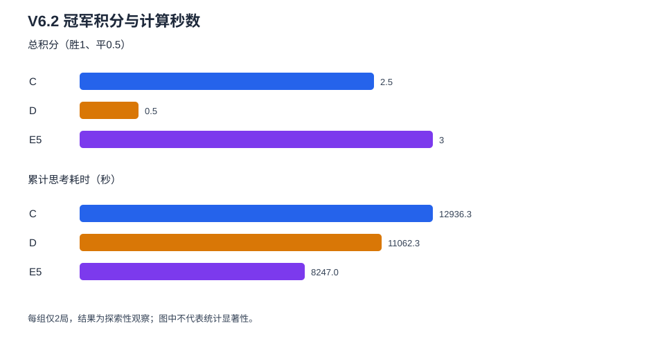

# WuziQ V6.2：200秒冠军争霸赛

## 实验结论

冠军：**E5**。本轮规则为胜1分、平0.5分、负0分，按总积分排列；同分并列冠军，不另设破同分规则。每组仅两局，本结论是固定开局下的探索性结果，不能解释为统计显著的棋力排序。

参赛算法为V6冻结版C（Minimax + Alpha-Beta）、D（优化纯MCTS）与E5（高级Alpha-Beta）。每步时间上限均为200秒，未训练、未调参、未更改决策算法。V6.2只统计以下六局新赛果。

## 赛果

| 对阵 | 胜平负（按双方分别计） | 积分 |
|---|---|---:|
| C–D | C 1胜 1平 0负 / D 0胜 1平 1负 | 1.5–0.5 |
| C–E5 | C 1胜 0平 1负 / E5 1胜 0平 1负 | 1–1 |
| D–E5 | D 0胜 0平 2负 / E5 2胜 0平 0负 | 0–2 |

| 排名 | 棋手 | 胜–平–负 | 总积分 | 总思考秒数 | 搜索步数 | 节点数 | MCTS模拟数 | 最大完成深度 | 最大树深 | 超时步数 | 超200秒步数 | 最大超限毫秒 |
|---:|---|---:|---:|---:|---:|---:|---:|---:|---:|---:|---:|---:|
| 1 | E5 | 3–0–1 | 3 | 8247.0 | 52 | 3661898 | 0 | 5 | 5 | 41 | 9 | 71.756 |
| 2 | C | 2–1–1 | 2.5 | 12936.3 | 70 | 97454320 | 0 | 12 | 12 | 64 | 1 | 17.707 |
| 3 | D | 0–1–3 | 0.5 | 11062.3 | 65 | 178366506 | 12175285 | 8 | 8 | 54 | 3 | 0.922 |

| 对局ID | 黑–白 | 胜者 | 落子数 | 总思考秒数 | 节点 | MCTS模拟数 | 超时步数 |
|---|---|---|---:|---:|---:|---:|---:|
| `v6.2-9x9-c-d-o731201-s0` | C（黑）–D（白） | C | 11 | 1387.4 | 14932811 | 1112979 | 6 |
| `v6.2-9x9-c-d-o731201-s1` | D（黑）–C（白） | 和棋 | 81 | 13411.8 | 175596634 | 8242346 | 66 |
| `v6.2-9x9-c-e5-o731201-s0` | C（黑）–E5（白） | C | 27 | 3999.6 | 17432647 | 0 | 20 |
| `v6.2-9x9-c-e5-o731201-s1` | E5（黑）–C（白） | E5 | 37 | 6219.2 | 25518747 | 0 | 31 |
| `v6.2-9x9-d-e5-o731201-s0` | D（黑）–E5（白） | E5 | 26 | 3401.3 | 25381649 | 1409820 | 17 |
| `v6.2-9x9-d-e5-o731201-s1` | E5（黑）–D（白） | E5 | 29 | 3826.2 | 20620236 | 1410140 | 19 |

积分按原始棋谱逐局重算，每位模型满足 `胜 + 平/2`。黑白统计见 `results/standings.csv`，逐局数据见 `results/games.csv`。

### 200秒实际计时核查

六局共有 **187** 个模型决策，其中 **13** 步实测超过200秒；累计超出 **186.250毫秒**，最大单步超出 **71.756毫秒**。所有这些步骤均带有超时标记。按棋手统计如下：

| 棋手 | 决策数 | 超200秒步数 | 累计超限毫秒 | 最大超限毫秒 |
|---|---:|---:|---:|---:|
| C | 70 | 1 | 17.707 | 17.707 |
| D | 65 | 3 | 1.545 | 0.922 |
| E5 | 52 | 9 | 166.998 | 71.756 |

因此本轮的**配置预算相同**，但实际计时并非严格的硬截止：C超限1步、D超限3步、E5超限9步，最大超出71.756毫秒。超出幅度很小，但对时间上限的要求不能表述为完全无偏差；报告保留全部实测时间，并把它列为公平性限制。



## 计算量与时间预算

### 正式开赛前的200秒决策预检

| 模型 | 实际耗时（秒） | 完成深度 | 节点 | 模拟数 | 超时标记 |
|---|---:|---:|---:|---:|---|
| C | 199.98 | 6 | 2225747 | 0 | 是 |
| D | 200.00 | 4 | 2343319 | 73873 | 是 |
| E5 | 5.89 | 4 | 10298 | 0 | 否 |

预检位置：`vct_cross_three`；预检不是正式比赛，不计入六局成绩。预估三个场景：乐观 **3.42小时**、中性 **9.59小时**、保守 **25.67小时**。估算公式及历史步数见 `preflight/preflight.json`；保守估计按六局各走满81格且每次搜索耗尽200秒。任务单进程串行，CPU核心时约等于wall-clock时长；记录体量预计低于10MiB。

实测总wall-clock：**9.04小时**；三模型累计思考时间：**8.96小时**。资源环境：逻辑CPU `3`，物理CPU `3`，内存 `10452471808` 字节，可用磁盘 `31648538624` 字节。

## 对比解读

- **D与C：**C本轮得1.5分，高于D的0.5分。与V6最多50秒预算相比，本轮D每步上限扩大到200秒；该差异只适用于本轮开局和种子，不表示稳定或显著提升。
- **E5与C：**E5与C本轮均得1分，结果持平。E5是否继续压制C只能按本轮两局积分描述，开局及随机种子的个别影响无法由两局排除。
- **D与E5：**E5本轮得2分，高于D的0分。D的实际模拟数及E5的搜索深度、节点和耗时分别按真实落子记录汇总。
- V6此前最高为50秒预算，本轮为200秒；预算提高只意味着更多可用推理时间，不等于必然更高的棋力。固定单一开局、每组两局和三组小样本不支持总体强弱或统计显著性判断。

## 开局、棋谱与数据完整性

三组共用新开局 `731201`：B(4,4)、W(3,5)、B(5,3)、W(2,6)。该四手序列通过9×9规则验证，并确认未出现在V6固定开局库及其1018份历史对局中。每组两局严格交换黑白，种子由基础种子 `20261028` 和唯一对局ID确定。回放验收：**6局、211手、6个唯一ID、3组完整配对**；终局合法性由V6棋盘规则重放核验。单步实际耗时、完成深度、节点、剪枝和模拟次数保存在 `results/9x9_games.jsonl`。

算法版本核验：六局逐局记录的执行提交如下。前两局之后的提交只修复了配对和棋计数校验与恢复记录；`src/research/v6/` 下的C、D、E5决策实现未更改，冻结算法与有效配置哈希保存在 `results/config.json`。本报告的预注册积分与200秒实际超限统计均从原始棋谱重算。

| 对局执行提交 | 对局数 |
|---|---:|
| `a4d1c80e61bc5359e538200221a752bc5deda21f` | 2 |
| `d0109e1ab4a1f401d3a1a45e5fdf2c936e67dbc8` | 4 |

## 复现与恢复

在该分支根目录执行：

```bash
python scripts/preflight_v6_2.py
python scripts/run_v6_2_championship.py
python scripts/validate_v6_2_results.py
python scripts/build_v6_2_report.py
```

中断时，完成局不会重复计数；若中断发生在一局中，该局从头重赛。快照恢复命令和哈希说明见 `scripts/restore_v6_2_snapshot.py --help` 与 `research/v6_2/drive_recovery.json`。

## 研究边界

本轮是规则/搜索算法实战评估，无神经网络训练，无训练指标或checkpoint。六局、单开局和每组两局的设计只适合观察长预算下的案例表现，不能支持统计显著、广义棋力优势或对其他开局的外推。Codex运行时的模型档位无法从项目环境独立核实。
