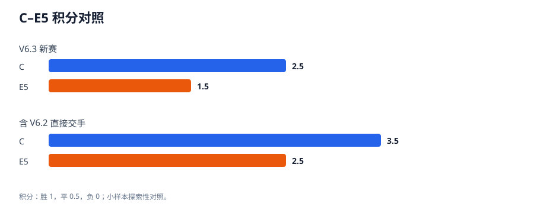
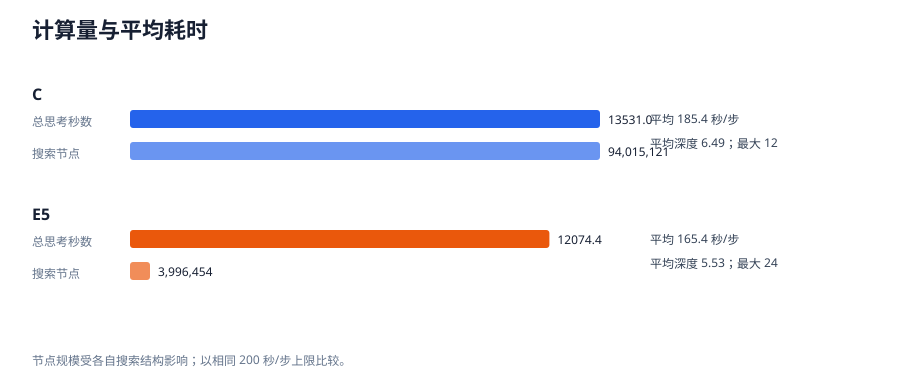

# WuziQ V6.3：C vs E5 冠军决胜加赛

## 结论

本轮新增 **4 局**，赛程状态为 `skipped_not_tied`；按预注册积分规则，C为本轮探索性冠军。
本轮积分：C **2.5**（2胜 1平 1负），E5 **1.5**（1胜 1平 2负）。
与 V6.2 两局 C–E5（C 1胜1负、积分 1:1）直接交手合并后：C **3.5/6局**（3胜 1平 2负），E5 **2.5/6局**（2胜 1平 3负）。
以上冠军仅指这组预先固定开局下的探索性赛果，不代表统计显著或对所有开局的稳定棋力排序。

## 赛制与算法冻结

9×9 原规则；冻结的 V6 C（Alpha-Beta）对 E5（高级 Alpha-Beta），双方每步上限均为 200 秒，使用同一运行环境。V6.3 配置固定在 V6.2 提交 `f2af15017573383115246242e8b820d1a56c1e1e`，算法文件哈希沿用 V6.2 的已验证值。未训练、未调参、未更改搜索实现。
先使用新开局 `731301`、`731302`，各交换黑白一局，共4局。仅当4局积分相同，才启用预注册的 `731303` 两局加赛；加赛后仍平分则并列。历史对局只用于合并比较，不计入 V6.3 新赛。

| 开局 ID | 预注册序列（行,列；从1开始） | 状态 |
|---|---|---|
| 731301 | B(5,5) → W(5,6) → B(6,4) → W(4,7) | 首轮固定开局 |
| 731302 | B(5,4) → W(3,5) → B(6,6) → W(7,3) | 首轮固定开局 |
| 731303 | B(4,5) → W(6,5) → B(3,3) → W(7,7) | 预注册条件开局，未执行 |

## 每局结果

| 对局 ID | 阶段 | 开局 | 黑棋 | 白棋 | 结果 | 落子数 | C 思考秒 | E5 思考秒 | C 节点 | E5 节点 | C/E5 最大深度 |
|---|---|---:|---|---|---|---:|---:|---:|---:|---:|---:|
| `v6.3-9x9-c-e5-o731301-s0` | initial | 731301 | C | E5 | C 胜 | 21 | 1,799.78 | 1,399.88 | 13,467,449 | 785,652 | 7/5 |
| `v6.3-9x9-c-e5-o731301-s1` | initial | 731301 | E5 | C | 和棋 | 81 | 6,531.89 | 6,539.44 | 47,241,375 | 1,439,655 | 12/24 |
| `v6.3-9x9-c-e5-o731302-s0` | initial | 731302 | C | E5 | C 胜 | 37 | 3,399.58 | 2,799.94 | 21,611,997 | 892,519 | 9/6 |
| `v6.3-9x9-c-e5-o731302-s1` | initial | 731302 | E5 | C | E5 胜 | 23 | 1,799.78 | 1,335.10 | 11,694,300 | 878,628 | 9/5 |

## 颜色与开局配对

| 开局 | 局数 | C 积分 | E5 积分 | C 胜 | 和棋 | E5 胜 | C执黑局/胜 | E5执黑局/胜 | 对局合计思考秒 |
|---:|---:|---:|---:|---:|---:|---:|---:|---:|---:|
| 731301 | 2 | 1.5 | 0.5 | 1 | 1 | 0 | 1/1 | 1/0 | 16,270.99 |
| 731302 | 2 | 1.0 | 1.0 | 1 | 0 | 1 | 1/1 | 1/1 | 9,334.41 |

## 搜索成本与计时

| 模型 | 决策数 | 总思考秒 | 平均秒/步 | 节点 | 节点/秒 | 剪枝数 | 平均完成深度 | 最大深度 | 超时标记 | 超200秒步数 |
|---|---:|---:|---:|---:|---:|---:|---:|---:|---:|---:|
| C | 73 | 13,531.03 | 185.36 | 94,015,121 | 6,948.11 | 16,353,276 | 6.49 | 12 | 67 | 0 |
| E5 | 73 | 12,074.37 | 165.40 | 3,996,454 | 330.99 | 1,554,448 | 5.53 | 24 | 59 | 16 |

从任务开始到四局全部完成的墙钟时间为 13.29 小时；有效对局逐局运行时间合计 7.11 小时，落子思考时间合计 7.11 小时；加上 5.98 秒预检后，实际有效执行时间约 7.11 小时。墙钟时间包括环境中断、恢复和一次未完成且未计分的重赛尝试。超时标记按引擎返回值或超出配置预算生成；实际超过200秒的步骤：C 0 步、E5 16 步，最大超限 151.316 毫秒。超过上限的实测值保留，不作截断。

## 计算环境、预检与时间估算

逻辑 CPU：3；内存：9.73 GiB；可用磁盘：29.39 GiB。赛前对 C 与 E5 各进行一次 3.00 秒预检，实测耗时分别为 C 3.00 秒（深度 4，节点 21,417，合法落点 [5, 4]）、E5 2.98 秒（深度 2，节点 4,083，合法落点 [5, 4]）. 预检不计入正式对局。
V6.2 已完成的 C–E5 两局实际思考时间为 3,999.65 秒、6,219.17 秒。据此，4局乐观/中性预估约 4.44/5.68 小时；若平分、跑满6局约 6.67/8.52 小时。按6局各剩余77步均耗尽200秒的保守上界约 25.67 小时。

## 配对不确定性与综合冠军判断

新增赛的 2 个换色开局块中，C领先 1 块、平 1 块、E5领先 0 块；对非平分开局块的 C 领先比例 Wilson 95% 描述区间为 `[0.20654931437723745, 1.0]`。这个区间只作小样本描述，不是显著性检验。
按本轮规则，当前结果为 **C为本轮探索性冠军**；按 V6.2 直接交手与本轮全部实测合并，积分为 C 3.5、E5 2.5。这提供了多开局的补充证据，但样本仍只有 6 局，而且部分 V6.2/V6.3 环境计时有轻微超限。不能将冠军标签解释为普遍棋力或统计显著差异。

## 重要棋局与复现边界

- `v6.3-9x9-c-e5-o731301-s0`：C 胜，终局方式 `five_in_row`；最后至多8手：E5(6,6)，C(7,6)，E5(7,3)，C(8,5)，E5(9,5)，C(5,8)，E5(4,9)，C(9,4)。棋谱只支持本局落子与终局事实，不证明较早局面不存在其他必胜选择。
- `v6.3-9x9-c-e5-o731301-s1`：和棋，终局方式 `full_board`；最后至多8手：C(2,8)，E5(1,3)，C(1,2)，E5(2,2)，C(2,1)，E5(8,1)，C(9,2)，E5(9,1)。棋谱只支持本局落子与终局事实，不证明较早局面不存在其他必胜选择。
- `v6.3-9x9-c-e5-o731302-s0`：C 胜，终局方式 `five_in_row`；最后至多8手：E5(8,3)，C(7,8)，E5(6,7)，C(8,8)，E5(7,7)，C(5,8)，E5(7,5)，C(4,8)。棋谱只支持本局落子与终局事实，不证明较早局面不存在其他必胜选择。
- `v6.3-9x9-c-e5-o731302-s1`：E5 胜，终局方式 `five_in_row`；最后至多8手：C(4,6)，E5(5,7)，C(5,8)，E5(8,4)，C(7,4)，E5(7,5)，C(4,8)，E5(9,3)。棋谱只支持本局落子与终局事实，不证明较早局面不存在其他必胜选择。

开局块按双方交换先后手成对，能直接呈现这两个具体开局上的颜色变化；两局同一开局仍不足以分离先手效应、引擎随机差异和局面因素。V6.2 的 731201 与本轮实际执行的 731301、731302 均按原始棋谱分别记录；预注册的 731303 因首轮未平分而未执行。

## 图表与数据





- `results/9x9_games.jsonl`：完整原始棋谱和逐步搜索指标。
- `results/games.csv`、`results/moves.csv`、`results/opening_summary.csv`：可分析表格。
- `results/summary.json`、`results/integrity_check.json`：汇总与验收。
- `configs/v6_3/championship.json`：冻结配置、随机种子、开局与 Drive 目录。
- `results/drive_recovery.json`：Drive 最新快照 ID、哈希及恢复验证记录。

## 复现

```bash
python scripts/preflight_v6_3.py
python scripts/run_v6_3_championship.py
python scripts/validate_v6_3_results.py
python scripts/build_v6_3_report.py
```

本项目仅进行传统规则/搜索算法对弈评估，没有神经网络训练、训练指标或 checkpoint。
